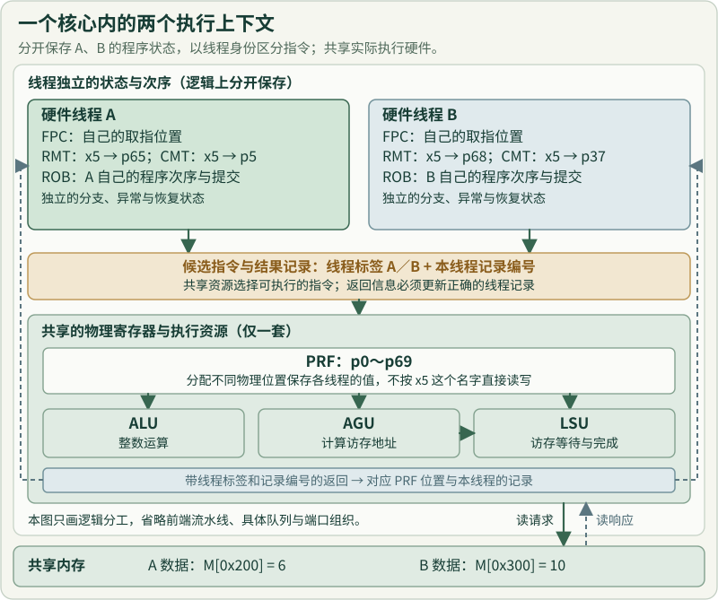
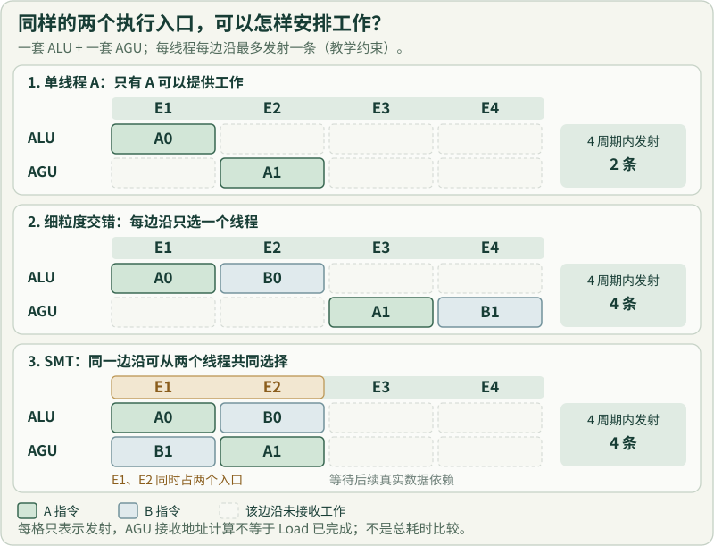
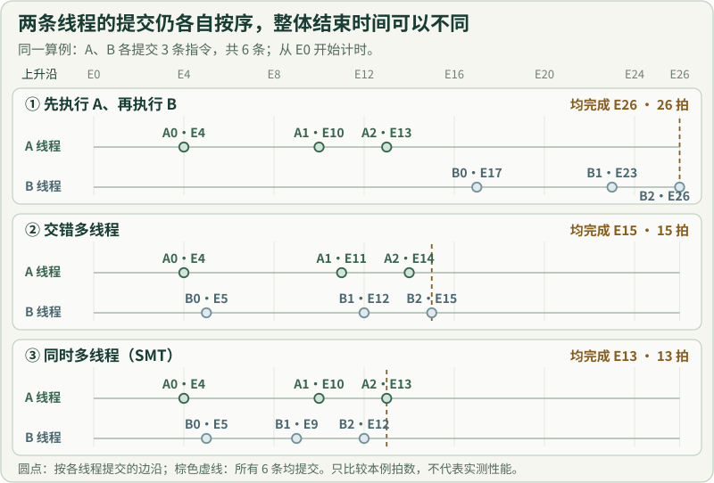

# 一个线程正在等待，另一个线程怎样利用空闲的计算资源？

在 [B07](b07-memory-execution-and-ordering.md) 中，我们已经让访存指令根据地址、数据和资源情况决定何时执行。在更早的几篇中，还让 CPU 动态选择可执行指令、进行寄存器重命名和推测执行。

但如果一个程序中暂时没有更多就绪的指令，这些机制也不能凭空产生可以执行的工作。即使 ALU 已经空闲，处理器仍然可能只能等待内存返回的数据。

**硬件多线程（Hardware Multithreading）**让一个处理器核心能够保存并推进多条独立的指令流，在某条指令流等待时，用其他指令流中的就绪工作利用同一套计算资源。

本篇将之前单线程的教学 CPU 扩展为两个执行上下文，逐步观察独立的指令、寄存器及提交状态怎样与共享的执行资源协作。最后对比交错多线程、同时多线程的执行方式及代价。

## 为什么乱序执行之后，ALU 仍然可能空闲？ {#idle-resources}

回看 [B05 的逐拍日程](b05-register-renaming.md#timeline)。处理器已经能够跳过等待中的 I2，先执行独立的 I3、I4。

| 边沿 | 指令 | 状态 |
| --- | --- | --- |
| E₄ | I1 | 发射 Load，随后等待数据 |
| E₆ | I3 | 获取两个已经就绪的源，发射 ADD |
| E₇ | I4 | 获取 I0 的结果，发射 ADD |
| E₉ | I1 | 内存返回的数据尚未写入 p33 |
| E₁₀ | I1 | 写入 p33 = 6 |
| E₁₁ | I2 | 读取 6，才能发射 ADD |

在这段日程中，E₉ 发射入口本来空闲。I3、I4 已经发射，I2 还不能取得 I1 的结果。后面的 I5 又需要 I2 的结果来确定分支。

增加指令窗口有时可以让处理器看到更远的独立工作，但仍可能遇到一组很长的数据依赖，或者暂时受限于未返回的内存请求及队列容量。

现在假设还有另一项独立工作，它并不需要 I1 的结果，而且其操作数已经准备好。如果能够在 E₉ 让它使用 ALU，就可以利用原本空闲的发射机会。

要实现这个想法，首先需要回答：当处理器正在执行第一段程序时，怎样同时保存另一段程序的执行状态？

## 两段程序都使用 x5，怎样保证它们不会互相改写？ {#hardware-context}

在 [B01 的架构状态](b01-instructions-and-architectural-state.md#architectural-state)中，我们将一条指令对程序的作用描述为对 PC、整数寄存器及相关内存状态的改变。迄今为止，教学 CPU 只维护了一条指令流。

假设现在增加第二条指令流。两条指令流都使用 B01 的程序前缀 I0～I2，为了便于区分，分别记为 A0～A2 和 B0～B2。

| 指令 | 线程 A | 线程 B |
| --- | --- | --- |
| 0 | `ADD x6, x1, x2` | `ADD x6, x1, x2` |
| 1 | `LW x5, 0(x4)` | `LW x5, 0(x4)` |
| 2 | `ADD x7, x5, x3` | `ADD x7, x5, x3` |

A 仍使用 B01 的初值，B 则使用不同的值。两者起始 PC 都为 `0x100`，可以执行同样的指令代码，但各自处理不同的数据。本例只观察前三条指令，之后的 PC 为 `0x10C`，不表示程序在此处停机。

| 初始状态 | A | B |
| --- | ---: | ---: |
| x1、x2、x3 | 2、3、1 | 20、3、4 |
| x4 | `0x200` | `0x300` |
| x5、x6、x7 | 0、0、0 | 0、0、0 |
| 对应地址处的数据 | M[`0x200`] = 6 | M[`0x300`] = 10 |

按照程序语义，A0 要将 5 写入 A 的 x6，B0 要将 23 写入 B 的 x6；A2 需要 A1 返回的 6，而 B2 需要 B1 返回的 10。这些同名寄存器不能是同一个架构状态。

因此，在同一个核心上支持两条独立指令流，至少需要在逻辑上分别维护两组 PC、架构寄存器以及其他 ISA 要求独立的状态。在本篇中，将这种能够保留一条指令流并推进其执行的硬件状态称为**硬件执行上下文（Hardware Context）**。

一个硬件线程有自己的执行上下文，但这并不意味着它拥有一套独立的 ALU。

在 RISC-V 中，软件所见的独立指令执行资源称为 **hart（Hardware Thread）**；一个物理核心可以支持多个 hart。规范也允许执行环境通过时分方式提供 hart，因此不能由 hart 数量直接推出物理执行资源数量。

[RISC-V 官方规范：执行环境与 hart](https://docs.riscv.org/reference/isa/v20250508/unpriv/intro.html)

这里还要区分软件线程。一个支持多软件线程的操作系统，可以把它们安排在不同硬件上下文运行，也可以让更多软件线程轮流使用同一个硬件上下文。软件切换所需的状态保存与恢复属于系统软件的知识范围。

本篇讨论的是两个已经分别驻留在硬件中的上下文。硬件可以在每个时钟周期之间直接选择其中的工作，不需要操作系统每拍执行一次线程切换。

## 哪些状态要分别保存，哪些电路可以共享？ {#context-and-shared-resources}

先从最简单的组织想起。如果只让线程 A 或 B 提供指令给同一个 ALU，就可以令每条指令携带自己的线程标识。选择对应线程的源操作数，执行结束后把结果送回对应位置。

在这样一个简单顺序核中，可以直接为每个线程设置一份架构 RF。RF 不一定要用彼此独立的物理阵列实现；重要的是相同的架构编号必须能选中本线程的数据。

我们已经在 B05 建立了物理寄存器和映射表，因此在本篇教学乱序核中，可以继续利用原有的组织，令不同上下文的映射指向不同的物理位置。

例如将 PRF 扩大为 p0～p69 共 70 个 32 位位置。在两条线程尚未登记任何指令时，A 的 x0～x31 分别映射到 p0～p31，B 的 x0～x31 分别映射到 p32～p63。本例使 p0、p32 固定为 0。

再预留六个位置保存六条新指令的结果。下面给出按各自程序顺序登记后得到的一种分配结果，不代表所有实现必须按这种物理编号分配。

| 指令 | 架构目标 | 源物理编号 | 新物理目标 |
| --- | --- | --- | --- |
| A0 | A 的 x6 | p1、p2 | p64 |
| A1 | A 的 x5 | p4（基地址） | p65 |
| A2 | A 的 x7 | p65、p3 | p66 |
| B0 | B 的 x6 | p33、p34 | p67 |
| B1 | B 的 x5 | p36（基地址） | p68 |
| B2 | B 的 x7 | p68、p35 | p69 |

A2 等待 p65 而 B2 等待 p68。即使 A1 已经写回，也不会使 B2 的源就绪。因为架构编号到物理编号的重命名发生在各自的线程内，B2 从一开始就记录了另一份真实数据的来源。

因此可以共享同一个 PRF，保持物理位置的独占分配，同时为每条线程保留自己的 RMT 和 CMT。共享的是保存数值的物理资源，不是程序所见的架构寄存器状态。

| 需要逻辑区分的状态 | 本例如何组织 |
| --- | --- |
| 指令地址及取指进度 | 各自的架构 PC 语义、FPC 和前端待处理记录 |
| 重命名和已提交状态 | 每线程一份 RMT、CMT |
| 在途指令的顺序和完成状态 | 每线程三项 ROB，分别按各自程序顺序登记与提交 |
| 访存及控制流恢复状态 | 根据线程及指令身份找到记录和恢复边界 |
| 异常、中断等架构控制状态 | 各自保存对应的恢复地址、原因等状态；本例只观察精确异常 |

指令等待记录中还要带上**线程标识（Thread ID）**或其他足以确定所属上下文的信息。本文用 A、B 表示线程标识，A1、B1 表示各线程内对应的指令记录。

发射时，执行单元使用选中的那条记录中的源编号读取 PRF。完成时则用目的物理编号写回，并用相应的指令身份去更新正确的 ROB 条目。访存请求返回时，也必须找到原来的 LQ 项，而不能只凭相同的本地序号认定是同一条指令。

<figure class="micro-diagram" style="max-width:820px; margin:1.2rem auto" tabindex="0" aria-label="两个独立硬件上下文共享同一物理寄存器及运算访存资源，窄屏可横向滚动" markdown="1">

<figcaption>本模型中的两个执行上下文共用核心内的物理数据和运算资源。图示已登记但尚未执行的前缀状态，只列出相关的映射项，省略具体的端口与仲裁电路。</figcaption>
</figure>

真正的硬件还可以共享指令 Cache、数据 Cache、访存队列等资源，但各设计不一定采用相同的复制、分区或动态分配方式。例如两个上下文的 ROB 条目可以位于同一物理表中，只要能够分别识别每条指令所属线程及其中的程序顺序。

这种设计并不需要把 B01～B07 的所有硬件机制实现之后才支持多线程。简单的顺序核也可支持多个独立上下文。本篇选择继续扩展之前的乱序核，来观察已有机制如何处理多个线程。

## 如果让两个线程轮流使用执行单元，会怎样？ {#interleaved-multithreading}

最直接的办法是先让 A 运行，在发生较长的等待时改选 B；等条件合适再让 A 继续。因为两条线程的状态已经驻留，切换主要是改变当前选择的上下文，而不是重新执行程序的前几条指令。

这种在较长延迟或其他指定条件发生时切换线程的组织称为**粗粒度多线程（Coarse-grained Multithreading）**。具体实现可能仍须清理或排空部分在途流水级，切换不一定完全没有代价。

若进一步把选择的时间尺度缩短，每拍可以从已经就绪的线程中选择一个。假如上一拍使用 A，这一拍可以选择 B，下一拍再尝试 A。没有可执行指令的线程可以被跳过。

这种细粒度的线程交错方式称为**细粒度多线程（Fine-grained Multithreading）**，也常称交错多线程。即使同一发射拍只选择一个线程，不同线程在此前已经发射的工作仍可以同时占据流水级、进行计算或等待访存结果。

例如 [OpenSPARC T1 微架构规范](https://www.oracle.com/a/tech/docs/systems/t1-01-opensparct1-micro-arch.pdf) 描述的核心具有多个硬件线程，在可执行的线程之间选择工作；它不是把每个线程都实现为一个独立核心，也并非无条件要求每拍轮换到下一线程。

下面用 A、B 的三个指令前缀进行逐拍比较。只关注后端，从 E₀ 已完成登记的状态开始，不重复计算取指、译码与重命名的装填周期。两个 Load 访问不同的普通内存位置，没有 Store 与其他写入者。

为便于检查时序，三种执行策略使用同一套运算资源与服务时间：

- 一个 ALU、一个 AGU，各自每拍能接纳一个相应操作。相比 B05，PRF 增加一个读端口，共三读一写；每拍最多一次结果交付及一次指令提交。
- 保留 B07 的三个 LQ 条目和非阻塞存储接口。接口每拍最多接纳一个新请求，支持至少两个在途读取。接纳后四个完整周期反馈数据。
- ADD 在发射沿采入两数，下一沿产生结果，再下一沿写 PRF 并完成。Load 在发射后一沿算地址，再一沿交付内存请求，返回后一沿写 PRF 并完成。
- 仍沿用沿前判断。为了突出线程选择，本例限制每个线程每拍至多发射一条；在满足发射资源条件的候选中，选择本线程程序顺序最早的一条。

最后一条是教学选择规则，而不是所有多线程处理器必须采用的宽度限制。它使后面可以检查同一拍是否允许两个上下文中的就绪指令分别使用现有 ALU 和 AGU。

### 先观察一次只运行一个线程

假设先运行 A，等这个前缀的三条指令都提交后再运行 B。为单纯比较后端，不计入两段之间重新准备指令及上下文的额外时间；B 在 A 完成的边界已经登记好自身前缀。

| 指令 | 发射 | 写回并完成 | 提交 |
| --- | --- | --- | --- |
| A0 | E₁ | E₃ | E₄ |
| A1 | E₂ | E₉ | E₁₀ |
| A2 | E₁₀ | E₁₂ | E₁₃ |
| B0 | E₁₄ | E₁₆ | E₁₇ |
| B1 | E₁₅ | E₂₂ | E₂₃ |
| B2 | E₂₃ | E₂₅ | E₂₆ |

A1 在 E₂ 发射，E₃ 算出地址 `0x200`，E₄ 发送读请求，E₈ 收到 6，E₉ 写入 p65。A2 因而到 E₁₀ 才能发射。这之间有很多拍没有可发射的指令。

运行 B 时又发生类似的等待，六条指令的全部提交需要 26 拍。注意，这里统计的是已经登记的两个前缀的后端执行时间，不是整个 B01 程序时间，也不包含软件线程切换成本。

### 再让两个线程交错发射

现在从 E₀ 就保留 A、B 两个线程的指令记录。每拍只允许选择一个线程，由该线程发射一条就绪指令；若两个线程都有候选，则采用 A08 的轮转思路。

| 边沿 | 获选线程及发射指令 | 状态变化 |
| --- | --- | --- |
| E₁ | A：A0 → ALU | 采入 2、3 |
| E₂ | B：B0 → ALU | 采入 20、3 |
| E₃ | A：A1 → AGU | 采入基地址 `0x200`；A0 写回 |
| E₄ | B：B1 → AGU | 采入基地址 `0x300`；B0 写回，A0 提交 |

A 尚未完成，B 的指令已经开始工作。A1 与 B1 分别在 E₅、E₆ 发送读请求，E₉、E₁₀ 返回，E₁₀、E₁₁ 将各自的数值写入 PRF。

此后 A2 在 E₁₁ 发射，B2 在 E₁₂ 发射。两条前缀分别在 E₁₄、E₁₅ 全部提交。两条线程的访存等待发生重叠，但还没有让任意一条指令跳过它的真实数据依赖。

## 如果两个线程的指令能使用不同的执行单元，为什么还要轮流发射？ {#simultaneous-multithreading}

回顾 E₁。A0 需要 ALU，但不需要 AGU；在同一拍中，B1 所需的基地址已经就绪，而它不需要 B0 的加法结果。

按照前面的线程交错规则，即使这两条指令完全可以使用不同执行资源，也不能在同一个发射沿交付，因为只有一个线程获得本拍的选择机会。

如果将规则改为：在每拍选择可以发射的若干指令时，允许它们属于不同的线程，就可以让 A0 使用 ALU，同时让 B1 使用 AGU。

这就是**同时多线程（Simultaneous Multithreading，SMT）**的核心区别。它利用多个指令流中同时存在的独立工作，让一个具有多发射能力的核心更容易填满可用的发射机会。

本例仍使用前面相同的运算资源。设 E₁ 优先检查 A 的候选，再从 B 的候选中选择能够使用剩余资源的一条；下一拍则交换优先检查次序。不能因为较早的 B0 需要已占用的 ALU，就让 B1 也错过空闲的 AGU。

| 边沿 | ALU 接收 | AGU 接收 |
| --- | --- | --- |
| E₁ | A0，采入 2、3 | B1，采入 `0x300` |
| E₂ | B0，采入 20、3 | A1，采入 `0x200` |
| E₃～E₈ | 无新发射 | 无新发射 |
| E₉ | B2，采入 10、4 | — |
| E₁₀ | A2，采入 6、1 | — |

B0 在 E₁ 的 ALU 资源冲突中没有获得发射资格，但 B1 的访存请求与 B0 无数据依赖，因此可以先发射。B0 仍会在 E₂ 执行，并在 B1 之前提交。这正是 B03 的动态选择机制在多线程条件下的应用。

E₁ 时两条指令需要合计三个操作数，本例已经明确共享 PRF 能提供这三个读端口。E₃、E₄ 两次 ADD 的结果分别写回，所以单写端口也能满足这段日程。如果没有相应端口或者入口接纳能力，就不能依靠线程数量使两个动作同沿完成。

<figure class="micro-diagram" style="max-width:820px; margin:1.2rem auto" tabindex="0" aria-label="相同ALU和AGU资源下三种线程选择规则的发射对照，窄屏可横向滚动" markdown="1">

<figcaption>只比较前四个发射沿的新工作接纳情况。每拍最多有一个 ALU 机会和一个 AGU 机会，已经发射的运算、访存及写回并未画出。三种策略没有改变单元数量。</figcaption>
</figure>

E₁、E₂ 中各有两条不同线程的指令得到资源，填补了原来空闲的发射机会。到 E₈，B1 已经写入 p68，因此 B2 可以在 E₉ 发射；A1 在 E₉ 写入 p65，A2 则在 E₁₀ 发射。

本例没有改变一个执行单元本身的吞吐能力。若两条指令都需要唯一的 ALU，仍只能由其中一条先发射。若每个线程内部已经有多条独立指令，较宽的交错设计也可能填满同一拍的多个执行机会。

因此 SMT 并不等于每拍一定发射两个线程的指令，也不要求取指、译码及提交等每一个阶段都必须同时处理两个线程。例如 [Tullsen 等人 1996 年的 SMT 组织](https://courses.grainger.illinois.edu/ece511/fa2003/papers/Tullsen.1996.ISCA.pdf) 将发射队列和执行资源共享，而取指每拍仍可只选择一个线程。

[Tullsen、Eggers 与 Levy，1995：Simultaneous Multithreading: Maximizing On-Chip Parallelism](https://cseweb.ucsd.edu/~tullsen/isca95.pdf) 从单线程宽发射、传统多线程和 SMT 的资源利用角度讨论这些组织方式。本篇不直接使用论文中的模拟性能作为实际处理器性能。

## 发射顺序不同，怎样保持每个线程自己的提交结果？ {#commit-and-recovery}

在 SMT 的例子中，B1 比 A1 更早完成，甚至 B1 比 B0 更早发射。但是 A、B 各自的 ROB 内部已经定义其指令的程序顺序。

当决定是否提交时，不应要求 B 的指令因为 A 的 ROB 队首在等待而全部停止提交。提交器可以分别检查两个线程的队首，若都已完成且可以提交，再通过本例共享的单提交机会进行仲裁。

各个线程内部依然有先后次序。例如 B1 不能抢在 B0 之前更新 B 的架构 x5，但 B1 与 A0 之间没有本线程 ROB 所要求的提交关系。这并不解除 [B07 的内存次序](b07-memory-execution-and-ordering.md#memory-ordering)所规定的跨线程可见性约束。

由此可以看到，在同一个核心中，判断指令年龄不只是简单比较 A1 和 B1 中的数字。先区分线程，再判断它在该线程内的程序顺序；共享资源的分配则需要另外的仲裁依据。

### 如果 A 的 Load 发生异常，B 需要一起撤销吗？

回忆 B04、B05 的精确异常恢复。若 A1 的访存失败，当它来到本线程 ROB 队首时，应该保留 A 已提交的指令效果，取消 A1 和更年轻的 A 指令，恢复相应的 A 映射与取指地址。

在本篇的教学模型中，B 的指令并不受这一异常影响。B 的 CMT、RMT、ROB 及在途访问仍属于另一条指令流，先前已经取得的结果不需要被撤销。

同理，如果 A 的某次分支预测错误，本模型根据 A 的分支边界取消属于 A 的年轻指令并回收其物理位置，不能释放仍被 B 的映射或待完成工作使用的物理位置。

真实处理器有可能为了实现简单而暂时影响其他线程的执行进度；但架构效果必须满足每个线程各自的异常及程序语义。取消后的迟到响应仍需正确识别，避免修改已经复用的记录或物理寄存器。

### 多线程的访存记录可以共用吗？

本例 A1 访问 `0x200`，B1 访问 `0x300`，两条读请求可在同一个 LSU 及存储接口中在途，用线程与请求身份区分返回路径。

若在访问相同位置的多线程程序中出现 Store，不能仅凭硬件线程标识认定内存彼此独立。对同一个线程的 Store-to-Load 转发，需要检查该线程程序顺序上的较早写入；其他线程对共享位置的读取应服从 B07 的内存一致性规则。

这说明硬件多线程增加的是指令流及执行上下文，不是给每条线程创建一份独立的物理内存。地址空间与 Cache 一致性如何组织，仍由相应的体系结构和系统设计决定。

## 两份工作提前了多少？又是谁在等待？ {#throughput-and-latency}

整理三种策略的提交日程。前面已经说明 A、B 的执行内容相同，三种策略最终都应该提交六条指令，并产生以下值。

| 架构寄存器 | A | B |
| --- | ---: | ---: |
| x6 | 5 | 23 |
| x5 | 6 | 10 |
| x7 | 7 | 14 |

对于后一种 SMT 策略，具体提交边沿如下。各条指令仍严格在对应线程内按序提交，同一个边沿没有发生写回或提交端口冲突。

| 指令 | 发射 | 写回并完成 | 提交 |
| --- | --- | --- | --- |
| A0 | E₁ | E₃ | E₄ |
| A1 | E₂ | E₉ | E₁₀ |
| A2 | E₁₀ | E₁₂ | E₁₃ |
| B0 | E₂ | E₄ | E₅ |
| B1 | E₁ | E₈ | E₉ |
| B2 | E₉ | E₁₁ | E₁₂ |

<figure class="micro-diagram" style="max-width:820px; margin:1.2rem auto" tabindex="0" aria-label="三种线程调度策略的提交时序对照，窄屏可横向滚动" markdown="1">

<figcaption>两条已准备好的程序前缀在本教学规则下的提交边沿。只比较本观察区间，串行策略忽略两段之间的额外重载时间。</figcaption>
</figure>

| 观察指标 | 单上下文串行 | 两上下文交错 | 两上下文 SMT |
| --- | ---: | ---: | ---: |
| A 最后提交 | E₁₃ | E₁₄ | E₁₃ |
| B 最后提交 | E₂₆ | E₁₅ | E₁₂ |
| 两份前缀全部提交所需周期数 | 26 | 15 | 13 |
| 观察区间平均提交数（指令/拍） | 6/26 ≈ 0.231 | 6/15 = 0.400 | 6/13 ≈ 0.462 |

多线程主要是在其他线程等待时利用空闲资源，所以这里整体完成时间缩短了。但看 A 的完成边沿，采用交错方式时反而从 E₁₃ 变成 E₁₄。因为 B 获得了部分原来可以给 A 的发射机会。

总吞吐（一定时间内完成的总工作量）与一条线程的延迟（这条工作花费的时间）是不同的指标。这里统计的是固定后端片段的提交率，只有在时钟周期相同的前提下才可对应单位时间的吞吐差异，不能把它当作真实 CPU 的 IPC 或加速比预测。

若两条线程都能充分使用同一个 ALU 或已经占满内存带宽，就不会有同样多的空闲机会可以填补。新增上下文自身带来的状态维护、端口、调度成本也可能改变处理器的时钟或资源分配。

## 如果一个线程长期占用资源，另一个线程怎样继续推进？ {#sharing-and-fairness}

除了同拍竞争执行单元，还需考虑一个更长时间尺度的问题。假设本核心仍使用总共六个 ROB 条目，但 A 发出一个长延迟 Load 以后，不能提交的较年轻记录逐步填满了整个 ROB。

若采用完全动态共享的分配方式，B 即使拥有已经就绪的操作数，也可能没有空闲条目登记下一条指令。空闲 ALU 仍然会因为没有可以发射的 B 指令而等待。

这说明共享资源不能只关注哪一拍谁能够使用 ALU，还需要考虑每条线程占用了多少尚未释放的在途位置。

一种办法是固定划分资源。例如本篇为每条线程分配三个 ROB 条目，A 的等待不会仅因 ROB 容量而占掉 B 的全部登记机会。代价是当 B 不活动时，它自己的空位可能不能被 A 利用。

另一种办法是动态分配，同时为每条活动线程保证一定可用容量，或者限制一条持续停顿的线程继续登记新指令。不同的 PRF、发射队列、ROB、LSQ 及 Cache 容量可以采用不同策略。

真实 SMT 处理器中的资源分配也是重要设计问题。例如 [Tullsen 与 Brown 2001 年论文](https://cseweb.ucsd.edu/~jbrown/papers/smtload-fixed.pdf) 研究了长访存等待的线程占用共享资源如何影响总吞吐与其他线程的进度，以及限制相关占用的办法。

### 当两个线程总有一条 ADD 就绪时，谁先获准发射？

回到 [A08 的仲裁策略](../01-foundations/a08-dependencies-and-scheduling.md#arbitration-policy)。假设在一个四拍的独立观察区间中，A、B 每拍都各有一条 ADD 就绪，只有一个 ALU 发射机会，且没有其他依赖或端口限制。

| 仲裁策略 | 第 1 拍 | 第 2 拍 | 第 3 拍 | 第 4 拍 | A / B 获得的次数 |
| --- | --- | --- | --- | --- | ---: |
| 固定优先 A | A | A | A | A | 4 / 0 |
| 两线程轮转 | A | B | A | B | 2 / 2 |

两种策略都使用完四个发射机会，因此从这个端口来看汇总吞吐相同。但固定优先 A 时，如果竞争一直持续，B 可能长期得不到服务。轮转使持续合格的请求都能获得使用机会。

公平并不要求每条线程的 IPC 都相同：不同工作本来就有各自的数据依赖、访存等待和资源需求。设计者需要根据目标选择仲裁及资源分配方式，例如提高总完成率、保证进度、减少某条线程的等待等。

长期吞吐还受取指、写回、提交与访存资源限制。因此只对 ALU 采用轮转，不代表整个处理器就建立了适用于所有资源的进展保证。

## 两个硬件线程，是否等于两个 CPU 核心？ {#cores-and-parallelism}

现在可以区分两种组织方式：一个核心保存两个执行上下文并共享其执行资源，以及两个物理核心各自拥有一套核心内运算资源。

| 组织 | 程序执行状态 | 典型资源区别 |
| --- | --- | --- |
| 一个核心支持两个硬件线程 | 两份独立架构状态 | 可以共享 ALU、LSU、部分队列、寄存器文件和 Cache 等资源 |
| 两个核心各支持一个线程 | 两份独立架构状态 | 各有核心内的执行资源，可能仍共享更高层 Cache、互连和内存带宽 |

例如 [Intel Hyper-Threading 的早期微架构论文](https://courses.grainger.illinois.edu/ece511/fa2005/papers/Marr.2002.itj.pdf) 描述了在同一核心中维持逻辑处理器的独立架构状态，并对各种物理资源进行复制、共享和划分。这个具体实现不代表所有 Intel 或其他 SMT 处理器都采用完全相同的组织。

硬件线程数量并不会直接决定执行单元数量、发射宽度或处理器性能。多个物理核心的协作留到 [多执行实体与资源协作](../06-resource-cooperation/README.md) 继续讨论。

## 回看从一条指令到多条指令流的演进 {#summary}

从 B01 开始，我们逐步改变教学 CPU 的硬件组织，但始终保持指令集规定的程序语义。现在可以分别理解这些机制消除了什么限制，以及仍然需要满足什么约束。

| 文章 | 从原来的等待或约束出发 | 新的能力 |
| --- | --- | --- |
| [B01](b01-instructions-and-architectural-state.md) | 需要外部提供运算控制 | 取得、译码并执行指令 |
| [B02](b02-in-order-pipeline-and-hazards.md) | 后一条指令等待前一条完全结束 | 重叠指令阶段并处理冒险 |
| [B03](b03-dynamic-issue-and-out-of-order-execution.md) | 未就绪指令阻挡独立工作 | 动态发射就绪指令 |
| [B04](b04-in-order-commit-and-precise-exceptions.md) | 乱序完成可能破坏正确架构状态 | 按序提交与精确恢复 |
| [B05](b05-register-renaming.md) | 同名寄存器造成不必要的等待 | 用物理位置区分不同值 |
| [B06](b06-branch-prediction-and-speculation.md) | 下一指令地址尚不可知 | 预测、推测及错误路径恢复 |
| [B07](b07-memory-execution-and-ordering.md) | 访存依赖取决于运行时地址 | 独立地址计算、转发、重放与内存次序约束 |
| B08 | 单线程缺少足够的就绪工作 | 利用多条指令流共享执行资源 |

这些机制共同说明 CPU 微架构怎样在保留程序所需语义的前提下，寻找能够并行推进的工作。它们不是实现所有 CPU 的必备模块，也不会在任何程序上得到相同收益。

接下来可以沿 [并行执行与 GPU](../03-parallel-execution/README.md) 路线，观察另一类更依赖多数据通道、执行分组和驻留上下文的硬件组织。CPU 的 SMT 与 GPU 的线程组织并不是同一个执行模型，但它们都需要回答数据何时就绪、谁能使用硬件以及有限资源如何共享这些共同问题。

[返回指令执行与 CPU 导读](README.md) · [返回计算微架构系列](../README.md)。
