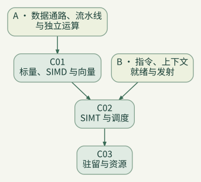

# 并行执行与 GPU

并行执行将多项运算安排到多个硬件执行资源。SIMD、向量和 SIMT 等机制让硬件可以组织具有独立性的工作，而交错安排不同的执行上下文还可以减少资源空闲的时间。

十个加法互不依赖，如果芯片有四条执行通道，至少需要几个执行批次才能完成？当一组线程需要等待数据，而另一组仍有工作可做时，硬件又怎样安排它们使用运算单元？

本路线先解释一条指令或一组线程怎样使用多条物理执行通道，再观察调度器怎样处理等待和分支，最后比较线程驻留数量、存储资源与实际吞吐，理解为什么增加 GPU 线程并不必然加速计算。

## 知识关系

<figure class="micro-v2-map" markdown="1">

<figcaption>知识衔接示意。点击可查看大图。</figcaption>
</figure>

## 计划阅读顺序

下表为本路线的文章规划。正文尚未发布的条目不提供文章链接。

| 编号 | 文章 | 阅读重点 | 状态 |
| --- | --- | --- | --- |
| C01 | 十个独立的加法，怎样交给四条执行通道？ | 标量、SIMD、向量、物理 lane、分批、掩码与尾部 | 未发布 |
| C02 | 一组线程还在等待数据，另一组线程能否先执行？ | SIMT、warp/wavefront、线程上下文、分支发散、谓词执行、硬件发射、延迟隐藏 | 未发布 |
| C03 | 为什么 GPU 中的线程越多，计算不一定越快？ | 线程块驻留、寄存器容量、occupancy、执行端口、访存合并、bank conflict | 未发布 |

## 与其他路线的关系

- [共同计算基础](../01-foundations/README.md)：理解运算单元、寄存器、流水线、依赖与发射。
- [指令执行与 CPU](../02-cpu/README.md)：想理解指令发射和硬件执行上下文时，可查阅相关机制，无需先掌握完整 CPU 乱序执行。
- [计算阵列与数据流](../04-compute-arrays/README.md)：换一种并行组织，追踪多个乘加单元之间的数据传递。
- [专用计算与稀疏计算](../07-specialized-compute/README.md)：继续了解逐元素运算、归约以及不规则数据的处理。

[返回计算微架构系列](../README.md)
