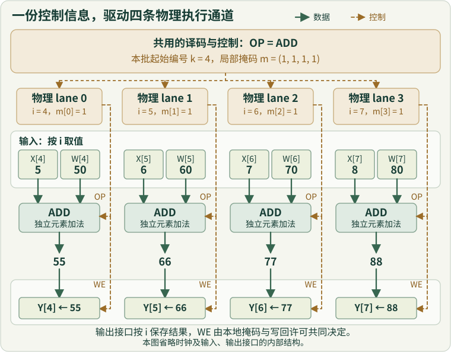
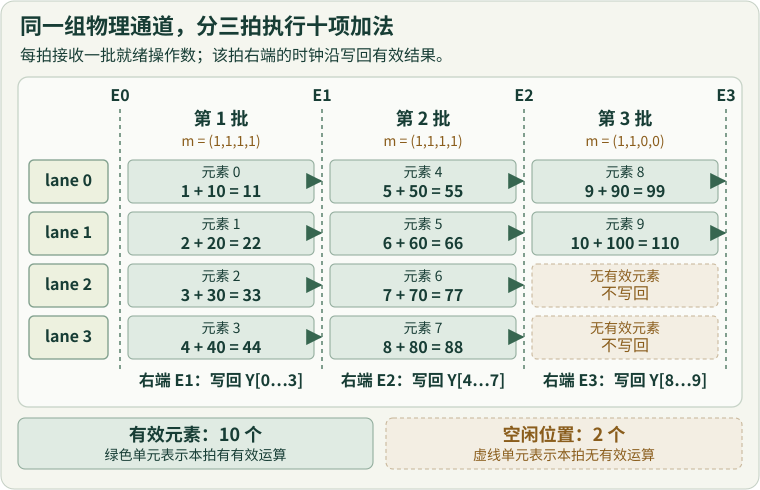

# 十个独立的加法，怎样交给四条执行通道？

在 [A05](../01-foundations/a05-datapath-and-control.md) 中，一个 ALU 可以从寄存器读取不同的数，完成运算，再把结果写回指定位置。[A06](../01-foundations/a06-pipeline-and-throughput.md) 进一步解释了怎样让多项运算重叠执行，提高同一条数据通路的吞吐。

现在要计算两个数组的对应元素之和。如果其中十对数据之间没有依赖，为什么还要让一个加法器依次完成十次加法？我们可以增加运算电路，让多个数据同时通过它们。

**SIMD（Single Instruction, Multiple Data，单指令多数据）**和向量执行提供了组织这些并行运算的方法。它们让一条指令描述多项数据操作，而不必为每个元素分别指定一次同样的运算。

但一条指令要求处理十个元素，并不说明芯片有十个加法器。本篇只改变表达运算的方式和物理执行通道的数量，观察十个结果怎样逐步产生。

## 如果只有一个加法器，十个加法需要多久？ {#scalar}

给出两组 32 位整数 X 和 W，希望得到 Y。每个 Y[i] 只依赖对应的 X[i] 和 W[i]，不依赖其他 Y 的结果。

**Y[i] = X[i] + W[i]，i 从 0 到 9。**

| 元素编号 i | X[i] | W[i] | Y[i] |
| ---: | ---: | ---: | ---: |
| 0 | 1 | 10 | 11 |
| 1 | 2 | 20 | 22 |
| 2 | 3 | 30 | 33 |
| 3 | 4 | 40 | 44 |
| 4 | 5 | 50 | 55 |
| 5 | 6 | 60 | 66 |
| 6 | 7 | 70 | 77 |
| 7 | 8 | 80 | 88 |
| 8 | 9 | 90 | 99 |
| 9 | 10 | 100 | 110 |

和 [A03 中的累加](../01-foundations/a03-multiplication-and-accumulation.md#mac) 不同，这十项运算之间没有传递中间和的路径。只要操作数已经就绪，先计算第 9 项还是第 0 项，都不改变最终的十个结果。这是程序本身可以提供的**数据级并行性（Data-Level Parallelism，DLP）**。

为了只观察运算通路，先作以下教学假设。后面的实验保持同一个时钟和同一种加法。

- X、W 的十对操作数都已在执行通路可以读取的位置，Y 有足够的独立结果位置。暂时不计算从内存搬运数据的时间。
- 每个 32 位加法通道能在一拍内完成计算并将结果交给约定位置，下一拍又能接收一对新数。即本文观察边界内，延迟和接纳间隔（II）都为一拍。
- 每一批的输入在起始边沿已经准备好，结果在结束边沿写入。控制、读写通路和结果接收均不引入额外停顿。

这里不是在模拟完整的 CPU 流水线。本例的 E₀ 表示第一批操作数进入执行通路的边沿，不表示程序从内存取出第一条指令。

沿用 [B01 中的 ADD 指令](../02-cpu/b01-instructions-and-architectural-state.md#instruction)，可以为每一对数安排一次标量运算。**标量（Scalar）** ADD 的两个操作数各表示一个数，产生一个结果。十个加法需要十条这样的算术指令；取数、循环控制和保存结果所需的其他指令暂不计入。

只有一个加法通道时，E₀ 到 E₁ 计算第 0 项，E₁ 到 E₂ 计算第 1 项，依次推进。到 E₁₀ 才写完第 9 项。执行区间共十拍，吞吐为 1 个结果/拍。

即使程序中的十项运算都已准备好，它们也不能在这条物理通路中同时进行。现在的限制不是数据依赖，而是硬件每拍能够接纳多少项运算。

## 增加三个加法器，需要怎样组织数据和控制？ {#physical-lanes}

把原本的一个加法通道扩展为四个。每条通道都有自己的操作数输入、加法路径和结果出口。本例称这样的并行数据通路为**物理执行通道（Physical Lane）**，编号为 0～3。

如果只增加加法器，不增加操作数输入和结果出口的服务能力，四个加法器依然不能同时取得四对不同的数。回想 [A05 中的 RF 端口](../01-foundations/a05-datapath-and-control.md#ports-and-sharing)：多个运算单元共享一个窄接口时，数据本身可能无法同时到达。

四条通道在同一拍完成四项加法，需要提供八个 32 位源元素，并能够接收四个 32 位目标元素。这些数据可以来自一个宽接口、多个独立接口或分布在不同通道附近的存储，不要求采用某种固定 RF 物理结构。

### 每条通道都接收自己的 ADD 指令吗？

一种办法是像 [B03 的多发射](../02-cpu/b03-dynamic-issue-and-out-of-order-execution.md#superscalar) 一样，硬件同时选择四条彼此独立的标量 ADD 指令，各自选择操作数、指定运算并保存结果。

不同的指令可以选择不同运算，也可以访问不同的寄存器。但为了四项加法同拍进入通路，这种设计还需要相应的指令发射能力及独立控制信息。增加四个加法器本身，不会自动建立这些能力。

观察本例的十条 ADD：它们选择相同的操作类型，只是处理的元素不同。是否可以用一份相同的运算控制信号驱动四条通道，再让各条通道处理各自的一对数？

让四条通道接收相同的 ADD 控制。控制器提供一个组起始编号 k：通道 j 处理第 k+j 个元素。四份数据仍然彼此独立，但不必再分别从四条算术指令取得相同的运算控制。

<figure class="micro-diagram" style="max-width:820px; margin:1.2rem auto" tabindex="0" aria-label="共享控制与四条加法数据通路，窄屏可横向滚动" markdown="1">

<figcaption>四条数据通路分别计算自己的元素。图中 k 是教学控制状态，不代表所有 SIMD 指令都带有这种地址字段；图中不规定操作数存储的物理组织。</figcaption>
</figure>

为了正确计算，元素之间必须保持数值边界。一个 32 位整数的进位不能传入相邻的另一个 32 位整数。本例使用四条独立的 32 位 ADD 路径，因此四项运算不会因为加法器之间的进位而互相影响。

真正的设计也可能使用支持多种元素位宽的运算电路。例如，同一个宽数据通路可以在不同控制下划分为不同大小的元素。此时仍要让各元素服从指令规定的算术语义。

## 一条 SIMD 指令怎样描述四项运算？ {#simd}

在 B01 中，一条 ADD 指令指定两个源寄存器和一个目标寄存器。若把每个操作数改为四个按顺序排列的数，就可以让一条指令描述四项对应元素的加法。

例如，将 X 的前四个元素放在一个 128 位寄存器中，W 的前四个元素放在另一个 128 位寄存器中。每个寄存器有四个 32 位元素，再用一个同样大小的寄存器保存四个结果。

| 寄存器内容（按元素编号排列） | 元素 0 | 元素 1 | 元素 2 | 元素 3 |
| --- | ---: | ---: | ---: | ---: |
| Vx | 1 | 2 | 3 | 4 |
| Vw | 10 | 20 | 30 | 40 |
| Vy（运算之后） | 11 | 22 | 33 | 44 |

一条这样的加法指令规定 Vy 的每个元素由 Vx、Vw 中对应的一对元素相加得到。这就把原先四条标量加法指令表达的工作，合成了一条指令。

这是一种常见的**定长 SIMD** 指令组织。例如 Arm Neon 的整数加法可以采用四个 32 位元素的 `ADD Vd.4S, Vn.4S, Vm.4S` 形式。这种指令的两个源操作数及目标操作数都是 128 位向量。

参见 [Arm：SVE and Neon coding compared](https://developer.arm.com/-/media/Arm%20Developer%20Community/PDF/Learn%20the%20Architecture/102131_0100_01_SVE_and_Neon_coding_compared.pdf?revision=feaaf72e-a941-461c-bd92-0d960d0f8615) 的寄存器与元素组织。

在本文的四通道硬件中，可以让一条这种四元素指令对应一批物理运算。因此，前八个元素只需要两条四元素加法指令，各用一拍处理四对数。

请注意，**指令中的四个元素是架构上规定的操作范围，不是对底层四条物理加法通道的要求。** 如果该指令实际由两条物理通道分两批完成，程序得到的四个结果仍然相同。

在一个宽发射处理器里，也可能同时执行多条 SIMD 指令，使每拍计算的元素数超过一条指令的元素数。指令宽度、发射宽度和物理通路宽度需要分别讨论。

## 最后只剩两个元素，另外两条通道应该做什么？ {#tail-mask}

已经算完第 0～7 项，再用一条四元素指令时，本例只剩第 8、9 两项确实属于任务。第 10、11 项并不存在于 X、W、Y 的有效范围中。

不能因为硬件有四条通道，就要求无条件从第 10、11 项读取数据并写入结果。如果这些编号对应别的对象，可能破坏其他数据，或者访问不允许的内存地址。

最简单的办法，是剩余两项改用标量指令。另一种办法是使用支持部分元素有效的指令和数据通路，让最后一批只有两条通道参与本次有效计算。前面举例的 Neon ADD 指令本身没有逐元素谓词控制；下面单独构造支持掩码的教学模型。

给每个物理通道增加一个局部有效控制。依照通道编号 0、1、2、3 的顺序，最后一批的控制是 `(1, 1, 0, 0)`。其中 1 表示处理对应元素，0 表示该位置不属于这次有效操作。这组位称为**掩码（Mask）**。

在这个教学实现中，局部有效控制与写回许可共同决定对应结果的写使能：只有有效且成功交付的元素才更新 Y。最后两条通道没有有效输入，也不会写入不存在的 Y[10]、Y[11]。

<figure class="micro-diagram" style="max-width:820px; margin:1.2rem auto" tabindex="0" aria-label="十个加法分三拍在四条物理通道执行，窄屏可横向滚动" markdown="1">

<figcaption>每列对应一个完整的执行周期，结果在该列结束边沿写入。掩码按通道编号从左到右列出。只计算本例理想执行区间，不包含取指、译码、加载和存储。</figcaption>
</figure>

| 执行区间 | 起始编号 k | 各通道处理的元素 | 写入 Y 的结果 |
| --- | ---: | --- | --- |
| E₀ → E₁ | 0 | 0、1、2、3 | 11、22、33、44 |
| E₁ → E₂ | 4 | 4、5、6、7 | 55、66、77、88 |
| E₂ → E₃ | 8 | 8、9、—、— | 99、110 |

这种对最后不足一批的元素进行处理的方法，称为**尾部处理（Tail Handling）**。

掩码也能表示不连续的有效位置。例如前四项仍然存在，但这一次只希望更新其中第 1、3 项，那么掩码可以设为 `(0, 1, 0, 1)`。本例会将 22、44 写入对应的 Y 位置，Y[0] 和 Y[2] 保留此前的值。

这样的按条件控制元素操作的方法称为**谓词执行（Predicated Execution）**。计算指令的有效元素不一定要连在一起。后面理解一组线程只有部分需要执行某条指令时，会再次使用这个认识。

这里的写使能是教学实现。实际指令集需要规定非活动元素在目标向量寄存器中的行为：有的保留旧值，有的写入零，有的允许不关心其具体值。禁止结果更新也不等于物理电路的输入不再翻转，更不等于该次操作没有任何执行成本。

此外，向量运算的掩码和访存指令的访问许可不是同一个问题。如果要避免超出有效数组，必须使用语义允许抑制对应访问的 Load/Store，或将尾部交给合法的单元素访问，而不是先做一次可能越界的普通宽加载，再靠加法的掩码补救。[Arm SVE 文档](https://developer.arm.com/-/media/Arm%20Developer%20Community/PDF/SVE%20programmers%20guide/102476_0001_00_en_introduction-to-sve.pdf?revision=dd9b245b-d819-43c3-8040-e69250d7b003) 中的谓词寄存器就是一个具体的接口实例。

## 如果一条指令直接要求计算十个元素呢？ {#vector}

前面定长 SIMD 的方法，需要程序按四个元素一组来表达工作。若采用有合适掩码的四元素指令，就需要三条加法指令。

可是硬件已经能按 k=0、4、8 依次选择三批元素。为什么不把选择下一批的工作交给硬件，让程序直接说明：对两个向量的前十个元素执行加法？

这就是本例接下来要建立的**向量执行（Vector Execution）**。向量指令描述一组元素的运算，硬件根据支持的向量长度、执行通道和资源情况完成它。逻辑上的一个向量操作可以在物理通路上分批执行。

### 怎样用相同的四条通道完成一个较长的向量操作？

仍采用 X、W、Y。假设架构支持至少十个 32 位元素的向量操作，并且全部输入已经准备好。向量 ADD 描述整个十元素操作，程序只提交一条这样的算术指令。

本文采用一个简单实现。控制器保存这条指令的运算类型、源和目标位置、有效长度 10，以及当前处理的起始编号 k。k 初始为 0。每条物理通道 j 对应元素 k+j。

只有当 k+j 小于 10，该元素才属于本次操作的有效范围。如果还有额外的元素掩码，也需要同时满足对应的掩码条件。

- k=0：交付第 0～3 项；下一批的 k 更新为 4。
- k=4：交付第 4～7 项；下一批的 k 更新为 8。
- k=8：交付第 8、9 项，屏蔽超出长度的两个位置。所有有效结果成功交付后，向量指令在本例的后端完成。

这三批与上一节的执行图完全相同，只是控制每一批的来源发生了变化。上一个例子由程序发出三个四元素的运算；现在由一条向量运算及其保留的控制状态产生三批工作。

这个控制器必须在停顿期间保持尚未交付的工作，并依据实际交接推进 k。这和 [A07 的握手](../01-foundations/a07-handshake-and-backpressure.md#valid-ready) 一样。如果流水线允许多个批次同时在途，还需要保留相应的编号、有效位和完成状态，直到最后一批结果写回。

这个模型只采用一种顺序分批的实现方法，不要求所有真实向量处理器都具有一个这样的中央计数器，也不讨论指令的异常与架构提交。

### 向量寄存器有多宽，是否决定了执行速度？

向量长度常会用来表达不同的概念，需要先确认是在数元素、数比特，还是数物理通道。

例如在 RISC-V V 扩展 1.0 中，单个架构向量寄存器的位数称为 VLEN；SEW 是所选择的元素位宽。先只考虑一个向量寄存器而不组合多个寄存器（LMUL=1）。其架构元素容量为 VLEN/SEW。

假设某个实现的 VLEN 为 512 位，选择 32 位元素，那么一个向量寄存器可以容纳 16 个元素。通过合法的向量配置指令请求 10 个元素，得到 `vl=10`。普通逐元素向量加法 `vadd.vv v3, v1, v2` 可以对编号 0～9 的十对元素进行运算（假设从编号 0 开始且不使用额外掩码）。

因此，在这一例子中可以区分三个数量：

| 数量 | 本例 | 回答的问题 |
| --- | ---: | --- |
| 每个向量寄存器的容量 | 512 位，即 16 个 32 位元素 | 架构上能表示多少数据？ |
| 本次向量长度（vl） | 10 个元素 | 这条指令处理到哪个元素范围？ |
| 本教学硬件的物理通道 | 4 条 | 当前运算每拍可处理多少对元素？ |

在前面的 RISC-V 例子中，编号 10～15 是本次向量操作的尾部，不是另外六项需要计算的任务。对于长度范围内但被掩码关闭的元素，则属于另一种非活动位置。RVV 对这两类位置分别定义了保留旧值和可不考虑最终值的策略。

这里的四条物理通道只是假设的一种实现，不由 VLEN 或 `vl` 推导得出。在另一个实现中，可以用更多或更少的物理执行资源完成相同的向量指令。若架构支持的当前元素容量不足十个，则程序需要分段执行，不可能仅靠设置 `vl` 就越过该容量。

[RISC-V 非特权 ISA：V 扩展 1.0](https://docs.riscv.org/reference/isa/_attachments/riscv-unprivileged.pdf) 定义了 VLEN、`vtype`、`vl`、掩码和尾部的架构语义。一个具体的物理实现参考是 [Ara2 向量处理器论文](https://arxiv.org/html/2311.07493v2)，其中的向量寄存器容量与执行 lane 数是可以分别讨论的硬件设计参数。

### SIMD 和向量执行是否是两种互斥的计算架构？

并不是。SIMD 描述的是一条指令对多份数据执行操作的组织方式。向量执行则强调指令如何表示一组元素，以及这组元素如何在硬件资源上推进。前面的四元素 SIMD ADD 就是一种向量运算。

通常会用定长 SIMD 与支持可变有效长度或长度无关程序的向量扩展作对照。例如 Arm Neon 的指令使用规定宽度的向量，而 Arm SVE 可以让程序适配不同实现的架构向量长度，并通过谓词指定活动元素。

不能据此认为定长 SIMD 一定在一拍完成，而向量指令一定分几拍执行。它们都可以采用不同数量的物理通道和流水线。本篇为了观察控制来源的区别，分别选取四元素指令和十元素指令作为例子。

## 怎样估算四条通道完成十项运算的时间？ {#throughput}

回到最初的十个加法。假设每条物理通道每拍只能完成一个结果、全部数据已经就绪，而且不存在写回冲突，四条通道每拍最多完成四项运算。

前两拍各完成四项，最后一拍完成两项。本批任务的理想执行周期数为 ⌈10/4⌉=3。它不是 10/4=2.5 拍，因为本文的通路只能在整个时钟周期的结束边沿交付结果。

下面区分算术指令数量和物理执行能力。仍只统计十项加法，假设相关指令及控制均已准备好，允许后一批在下一拍进入执行通路。四元素 SIMD 假设支持本例的尾部有效控制；十元素向量假设合法设置了该长度。

| 组织方式 | 算术指令数 | 每拍最多接纳的标量等价运算数 | 观察区间周期数 |
| --- | ---: | ---: | ---: |
| 一条标量通路 | 10 | 1 | 10 |
| 四通道，四条独立标量指令可同拍进入 | 10 | 4 | 3 |
| 四通道，四元素定长 SIMD | 3 | 4 | 3 |
| 四通道，十元素向量指令内部分批 | 1 | 4 | 3 |

后面三种安排在同一观察区间内完成相同的十项运算，物理加法通道没有变化。区别在于每个指令表达的运算数、所需的独立发射能力，以及硬件与程序各自承担多少分批控制。

例如，若只有每拍一条标量指令的发射能力，并且没有能将多条工作合并或提前交付的机制，即使硬件中有四条可用加法通道，也无法靠这条发射路径持续占满四条通道。

同样，一条只发射一次的十元素向量指令依然要在后端经历三个批次。**指令发射宽度（指令/拍）与算术执行宽度（元素/拍）不是同一个量。**

### 最后一拍的空闲位置是否算作有效吞吐？

理想模型里，四条通道在三拍中提供 12 个元素运算机会。我们只需要其中 10 个，所以这个固定工作量内的有效通道槽位比例为：

**有效槽位比例 = 10 / (4 × 3) ≈ 83.3%。**

有效吞吐为 10/3 ≈ 3.33 个结果/拍。若时钟频率相同，执行时间由十拍缩短到三拍，速度提高到约 3.33 倍，而不是四倍。

这个比例只统计四条教学加法通道上的有效工作。它不是 GPU 线程驻留比例（Occupancy），也不是芯片全部部件的利用率。其他任务是否能够使用最后一拍的空闲通道，取决于硬件能否同时接受其他工作并将其正确映射到这些位置。

若把通道增加到八条，在同样的分批规则下只需两拍，但有效槽位比例变为 10/16=62.5%。此时执行时间更短，槽位比例反而降低。提高容量、提高利用率与缩短延迟，并不总是同一目标。

### 为什么增加通道以后，实际硬件不一定更快？

前面的结果假设每拍能同时提供四对操作数。如果读通路每拍只能给出两对，且没有预存的操作数可以补充供给，那么长期最多只能支撑每拍两项加法。写回、运算类型及流水线 II 也可能限制吞吐。

增加物理通道还会增加算术电路、数据路径、存储端口及控制的成本。共用运算控制可以减少重复的控制工作，但不能消除为不同元素提供数据与保存结果的需求。

真实硬件的总时间还包含指令与数据的准备、流水线填充和排空、资源竞争等。本节的三拍和 83.3% 只是该教学算例的结果，不能用于预测某个 CPU 或 GPU 的性能。[A06 的延迟与吞吐](../01-foundations/a06-pipeline-and-throughput.md#latency-and-ii) 已说明这两个观察量为什么必须分开。

## 如果每个元素需要执行不同的下一条指令呢？ {#next}

现在的 X、W、Y 都是数组里的数据元素。一个程序指定同一项向量运算，硬件可以依照统一的控制和有效条件处理多个元素。

但如果得到 Y 之后，有的元素应该继续加法，有的元素应该进行减法，还有的元素需要等待尚未返回的数据，那么不能只靠原先的 ADD 控制和 k 决定每个元素接下来该做什么。

向量指令可以通过掩码来表达许多这样的工作。另一种表达方式是让每一项工作成为具有自身程序状态的线程，并在许多线程执行到相同指令时利用共同的控制和多条数据通路。SIMT（Single Instruction, Multiple Threads，单指令多线程）就是这样一种执行组织。

它与 SIMD 可以共享相似的物理通路，区别在于表达和组织工作的方式。参见 [NVIDIA 的 SIMT 执行模型](https://docs.nvidia.com/cuda/cuda-programming-guide/03-advanced/advanced-kernel-programming.html#simt-execution-model)。

[B08](../02-cpu/b08-hardware-multithreading-and-resource-sharing.md) 已经建立了独立执行上下文与共享硬件资源的基础。下一篇 [C02：一组线程还在等待数据，另一组线程能否先执行？](c02-simt-and-warp-scheduling.md) 将继续观察 SIMT、线程分组与调度：怎样在保留各线程程序行为的同时共享一次指令发射，以及为什么一组线程等待时另一组可以继续工作。

[返回并行执行与 GPU 导读](README.md)。
