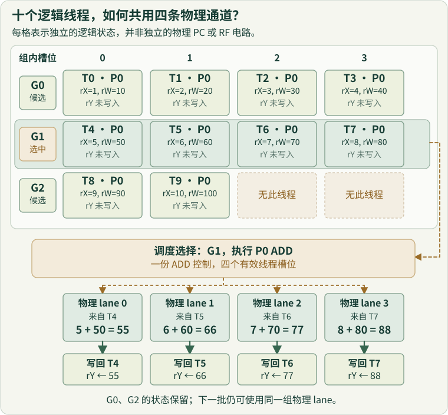
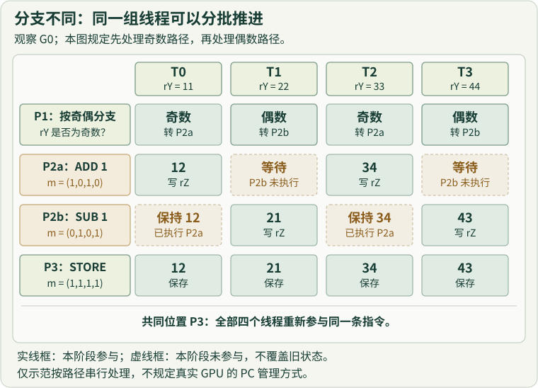
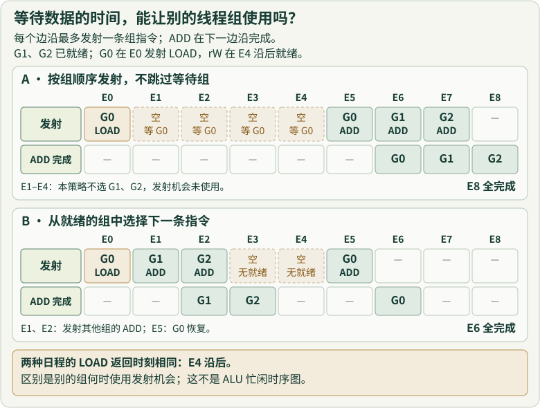

# 一组线程还在等待数据，另一组线程能否先执行？

在 [C01](c01-scalar-simd-and-vector-execution.md) 中，十个加法可以由四条执行通道分三批完成。如果每个结果还需要根据自己的值决定下一步做什么，原来的硬件该怎样组织这些不同的工作？

一种方法是为每项工作建立一个线程，使它具有自己的程序执行状态。当多个线程需要执行同一条指令时，硬件仍然可以共用指令控制，并让不同执行通道处理各自的数据。

这种执行组织称为 **SIMT（Single Instruction, Multiple Threads，单指令多线程）**。它不仅利用同类运算的并行性，还能在一组线程等待时选择另一组可以执行的线程。

本篇继续使用 C01 的十个加法，先观察数据元素怎样对应到线程，再让线程产生不同的分支与等待状态。最后看看硬件如何在这些状态的约束下使用同一套执行资源。

## 如果十个加法分别由十个线程完成，会有什么变化？ {#thread-context}

回忆 C01 的两组输入 X、W。X[i] = i+1，W[i] = 10(i+1)，元素编号 i 从 0 到 9。我们希望得到相同的十个结果 Y[i] = X[i] + W[i]。

在向量指令的表达方式中，一条向量 ADD 指定两组源元素和一组目标元素，硬件根据向量长度推进不同元素的运算。

现在将第 i 项工作分配给线程 Ti。十个线程执行同一段程序，但每个线程使用自己的 i、操作数和结果。先只保留计算 Y 的一条算术指令，假设操作数已经准备好。

```text
ADD rY, rX, rW
```

这是本文的教学指令表示，不是某种 GPU ISA 的正式语法。其中 rX、rW 和 rY 都是这个线程内部的寄存器名称。

| 线程 | rX | rW | ADD 后的 rY |
| --- | ---: | ---: | ---: |
| T0 | 1 | 10 | 11 |
| T1 | 2 | 20 | 22 |
| T2 | 3 | 30 | 33 |
| T3 | 4 | 40 | 44 |
| … | … | … | … |
| T9 | 10 | 100 | 110 |

T0 和 T1 都执行 `ADD rY, rX, rW`，但读取和更新的不是同一份寄存器状态。T0 写入自己的 rY = 11，不应该将 T1 的 rY 改为 11。

与 [B08 的硬件线程](../02-cpu/b08-hardware-multithreading-and-resource-sharing.md#hardware-context) 一样，每个线程需要有自己对应的寄存器值和程序执行位置。把这些与一条指令流相关的状态视为该线程的**执行上下文（Execution Context）**。

线程具有独立的程序语义，不意味着每个线程都需要独立物理 ALU、取指器或一套单独的寄存器文件。硬件可以共享这些资源，只要能正确区分不同线程的状态，并保留各线程所需的执行行为。

## 十个线程能否继续共用四条执行通道？ {#thread-groups}

如果十个线程当前都到达同一个 ADD 指令位置 P0，分别为它们取得相同的运算控制显然存在重复工作。我们可以像 C01 一样，让一份运算控制驱动四条物理通道。

构造一个教学执行单元，仍然提供四条 32 位加减通道。将十个线程按编号分成三个固定的执行组，每组有四个逻辑位置。称它们为 G0、G1 和 G2。

| 执行组 | 位置 0 | 位置 1 | 位置 2 | 位置 3 | 有效位置 |
| --- | --- | --- | --- | --- | --- |
| G0 | T0 | T1 | T2 | T3 | (1, 1, 1, 1) |
| G1 | T4 | T5 | T6 | T7 | (1, 1, 1, 1) |
| G2 | T8 | T9 | — | — | (1, 1, 0, 0) |

这里假设十个线程属于同一个线程块（Thread Block，即一批可以在块内协作的线程），因此形成最后一个不足四线程的组。不为 G2 的另外两个位置创建线程上下文。线程块的入驻和资源分配留给 C03。

硬件选择一个执行组，取得它当前需要执行的指令及活动掩码，再将该组中处于活动位置的线程映射到物理通道。本例逻辑位置 j 对应物理通道 j，每条通道从对应线程的上下文取得操作数，并将结果送回该线程。

<figure class="micro-diagram" style="max-width:820px; margin:1.2rem auto" tabindex="0" aria-label="十个线程的逻辑上下文与四条共享物理通道，窄屏可横向滚动" markdown="1">

[](assets/c02-thread-groups.svg)

<figcaption>每个线程拥有独立的逻辑状态。图中没有给每个线程分配专用执行电路，也没有规定 PC 或寄存器必须采用怎样的物理存储结构。</figcaption>
</figure>

在本例中，G0、G1、G2 分别发射一次 ADD，使用相同的四条通道。它们仍然在三个执行周期内得到十个结果。只不过现在硬件需要保留组和线程的身份，从相应的上下文中读取与写回数据。

这种共同发射的线程组，在 NVIDIA GPU 中称为 **Warp**，在 AMD GPU 中通常称为 **Wavefront**。NVIDIA 的一个 warp 有 32 个逻辑线程位置；AMD 不同架构可采用不同的 wavefront 大小。例如 RDNA 2 支持 32 或 64 个位置。

本例一次只选择一个组，不会自动用其他组的线程填补 G2 的空闲通道。本文的四线程组只是为了方便逐拍观察，不是某款 GPU 的参数。它恰好等于本例的四条物理通道，但这两个数量没有必然相等的关系。

例如，如果一个执行组有八个线程位置而只有四条适用通道，硬件可以把同一组指令分成两批执行。[AMD RDNA 2 ISA](https://www.amd.com/content/dam/amd/en/documents/radeon-tech-docs/instruction-set-architectures/rdna2-shader-instruction-set-architecture.pdf) 第 2.1 节展示了实际的分批方式：wave64 的向量算术与访存指令可以拆为两个 32 位置的部分执行。

这与 C01 的逻辑向量长度和物理通道宽度的区别相似。不能只数线程组中的逻辑位置，就得到每拍可执行的实际运算数。

### 这与 SIMD 和 SMT 有什么区别？

在向量 ADD 中，指令指定的是向量操作数，元素之间的并行关系由指令语义表达。在本例的 SIMT ADD 中，单个线程仍执行标量指令，硬件将同组活动线程的该指令合在一起执行。

如果十个线程都执行 P0，本例有三次组级 ADD 发射，产生十项线程级加法。这与一条向量指令的内部分批不是同一个指令计数口径，虽然最终都可能使用相同的算术通路。

[B08 中的同时多线程（SMT）](../02-cpu/b08-hardware-multithreading-and-resource-sharing.md#simultaneous-multithreading)关注多个独立线程的指令能否在同一拍使用不同发射机会。SIMT 关注一份共同指令怎样推动多个线程执行。两者回答的问题不同。

SIMT 可以利用 SIMD 式的数据通路；一颗 GPU 也可能有多个发射机会，可以同时处理不同执行组的指令。因此不能将 SIMD、向量执行、SIMT、SMT 当成四种严格互斥的硬件类型。

[NVIDIA 的 SIMT 执行模型](https://docs.nvidia.com/cuda/cuda-programming-guide/03-advanced/advanced-kernel-programming.html#simt-execution-model) 对比了向量指令与单线程语义。这里先保留组内共同发射的简化组织，下面改变各线程的程序路径。

## 如果同一组中的线程接下来要执行不同指令呢？ {#divergence}

在同一组加法完成后，为每个线程增加一个操作：如果 rY 为奇数，将它加 1；如果为偶数，将它减 1。最后保存新结果 Z[i]。

```text
P0: rY = rX + rW
P1: if rY is odd, go to P2a; otherwise go to P2b
P2a: rZ = rY + 1; go to P3
P2b: rZ = rY - 1; go to P3
P3: Z[i] = rZ
```

这段伪程序只描述线程的控制流，不规定具体 ISA 编码、跳转开销和执行阶段。在本文的教学模型中，P2a 和 P2b 各包含一项算术运算，结束后进入共同的 P3。

只观察 G0。四个线程完成 P0 后，rY 分别为 11、22、33、44。到 P1 判断时，T0 和 T2 需要去 P2a，T1 和 T3 则需要去 P2b。

如果四条物理通道仍然共用一份 ADD 或 SUB 控制，它们不能同时接收两个不同的指令控制。硬件必须区分哪些线程应该参加当前的这条指令，哪些线程还需要执行另一条路径。

一种实现方法是保留两条尚待执行的路径及其线程集合，先选择其中一条，完成后再转向另一条。这里假设先执行 P2a，并将同组的其他线程暂停在自己的路径上。

- P2a：活动掩码为 (1, 0, 1, 0)，T0 和 T2 执行加法，分别得到 12、34，其他线程不更新 rZ。
- P2b：活动掩码为 (0, 1, 0, 1)，T1 和 T3 执行减法，分别得到 21、43，其他线程不更新 rZ。
- P3：两条路径完成后，四个线程都到达共同的后续位置。本文让它们重新一起执行保存结果的指令。

<figure class="micro-diagram" style="max-width:820px; margin:1.2rem auto" tabindex="0" aria-label="执行组内分支发散、路径掩码与重新汇合，窄屏可横向滚动" markdown="1">

[](assets/c02-divergence.svg)

<figcaption>图中跟踪的是线程属于哪一条路径、当前指令的参与者和它们的结果，不是某款 GPU 的真实分支时序。掩码按执行组逻辑位置从 0 到 3 排列。</figcaption>
</figure>

同一组的线程因控制流条件不同而走向不同路径，这称为**分支发散（Branch Divergence）**。在本例中，只有属于当前路径的线程可以改变自己的程序状态，另一部分线程并没有消失，它们仍有自己的工作需要完成。

这里的活动掩码与 [C01 的尾部掩码](c01-scalar-simd-and-vector-execution.md#tail-mask) 有相似用途，都可以限制哪些元素或线程参加本次运算。但是含义不同：G2 的两个空位没有对应线程，而 G0 暂停在另一条路径上的线程仍然存在。

### 不活跃的线程，能不能在下一条公共指令中继续执行？

P2a 执行完时，T0 和 T2 已经到达 P3，但 T1 和 T3 还未计算 rZ。若直接让四个线程一起执行 P3，后两者就可能保存错误的值。

本文采用如下简单的路径管理方式：第一条路径到达共同位置时先保存其到达状态，等另一条路径也到达，再让两个集合一起执行 P3。这种重新组织共同执行的过程称为**重聚（Reconvergence）**。

| 当前阶段 | 正在执行的线程 | 还要执行另一条路径的线程 | 已到达 P3 的线程 |
| --- | --- | --- | --- |
| P2a 执行前 | T0、T2 | T1、T3 | — |
| P2b 执行前 | T1、T3 | — | T0、T2 |
| P3 执行前 | T0、T1、T2、T3 | — | T0、T1、T2、T3 |

为了实现这种行为，硬件或执行控制需要保留尚未完成的路径、各路径的活动掩码以及预定的重聚位置。一种经典方式是用栈保存这些信息，例如 [Fung 等人 2007 年的 GPU 控制流论文](https://people.ece.ubc.ca/aamodt/papers/wwlfung.micro2007.pdf) 中的重聚栈示例。

这只是一种处理发散的组织，不是所有 GPU 都必须使用的硬件。NVIDIA 在计算能力低于 7.0 的实现中使用 warp 级 PC 及活动掩码；从 Volta（计算能力 7.0）开始引入独立线程调度（Independent Thread Scheduling）。

后者保留线程级的程序位置与调用栈等执行状态，可以在同一 warp 内对更小的活动线程集合进行调度和重聚。不能因此推断每个线程都有一个独立的物理发射器。[NVIDIA：独立线程调度](https://docs.nvidia.com/cuda/cuda-programming-guide/03-advanced/advanced-kernel-programming.html#independent-thread-scheduling)

本文刻意选择路径统一到 P3 后才继续的简单模型。实际硬件能在什么位置重聚、是否需要等待其他线程，还取决于程序的控制流、数据依赖、同步要求与具体实现。

### 两条路径各只有两个线程，为什么还要使用两次发射？

因为本教学单元一次只能为一组线程发射一条共同的指令。P2a 需要 ADD，P2b 需要 SUB；即使两个操作都能由现有 ALU 执行，硬件也不能将它们当成同一条指令发射。

在 C01 每条物理通道每拍完成一个元素运算的假设下，这两项路径算术占用两个执行周期，共提供八个通道槽位，但只产生四个有效算术结果。因此该片段的有效槽位比例为 4/8 = 50%。

这个比例只统计本例两条路径上的算术，不计条件判断、跳转和后续保存，也不代表真实 GPU 整段程序的利用率。若四个线程选择同一路径，只需要发射该路径的算术指令。

由此可以看出，即使软件中的工作十分充足，由于所需指令不同，硬件也可能无法在同一时刻利用全部物理通道。不同执行组走不同路径并不构成组内分支发散，它们本来就可以被分别发射。

### 能不能不跳转，仅让部分线程执行 ADD 或 SUB？

回忆 C01 的谓词执行：指令带有一个条件，只有条件成立的元素才产生该指令规定的有效结果。

对于刚才的短分支，另一种表达方式是让线程先得到条件 p，再依次使用两条带谓词的指令。以下同样是伪指令。

```text
p = is_odd(rY)
if p:     ADD rZ, rY, 1
if not p: SUB rZ, rY, 1
```

这里的 `if` 表示对指令的执行许可，不表示跳转到另一个指令地址。T0、T2 的 p 为真，T1、T3 的 p 为假。两条指令都可以沿共同的指令序列发射，但分别更新应该参与的线程。

这种谓词化（Predication）避免了该例中由于跳转而需要管理的两条控制流路径，但不自动将两条不同的算术指令合并为一次。硬件仍然需要对应的发射机会。

[CUDA Best Practices Guide 的 Branch Predication](https://docs.nvidia.com/cuda/cuda-c-best-practices-guide/index.html#branch-predication) 描述了 NVIDIA 实现中这种条件执行方式。具体什么时候采用分支或谓词化属于指令选择与编译策略，本篇不继续展开。

## 若一个执行组的下一条指令缺少数据，其他组能否先走？ {#warp-scheduling}

前面已经能让多个线程共用指令控制，并处理一组线程内部的不同路径。现在回到最初只计算 Y 的任务，改变一个条件：G0 的四个 W 元素还没有从存储系统取回。

G0 的下一条指令是读取自己的 W[i]，将结果放入对应线程的 rW。其后的 ADD 需要 rW 才能执行。G1、G2 的 X、W 都已经在对应的寄存器中准备好，它们的下一条指令是 ADD。

虽然四条加法通道可能没有计算工作，G0 仍不能在缺少 rW 时发射 ADD。但 G1 或 G2 并没有这项数据依赖，等待 G0 的数据并不是它们正确执行的条件。

[B08 的交错多线程](../02-cpu/b08-hardware-multithreading-and-resource-sharing.md#interleaved-multithreading) 已经展示了如何轮流使用不同执行上下文。现在把选择的对象换成执行组，构造一个 **Warp 调度器（Warp Scheduler）**：它从可以发射指令的组中选择工作，将该组当前可执行的指令交给适用通路。

### 硬件怎样知道哪些组可以发射？

对于 G0 的 Load，硬件需要维护与在途读取相关的线程、目标寄存器、活动位置等信息，以便把返回的数据交给正确的寄存器状态。这与 [B07 的访存执行](../02-cpu/b07-memory-execution-and-ordering.md#lsq) 中保存请求及目标信息的需求相似。

在 Load 发射后，将需要等待结果的 rW 标记为尚未就绪。直到相应数据写入或通过规定的转发路径可用，才能解除 ADD 的数据依赖。

可以采用类似 [B03 的记分牌（Scoreboard）](../02-cpu/b03-dynamic-issue-and-out-of-order-execution.md#scoreboard) 的状态跟踪机制。这里不规定状态位必须按线程、寄存器还是执行组物理存储，只要求判断被执行的操作数能否正确取得。

本例为简化调度，在组内所有参加当前 ADD 的线程的源数据就绪后，才允许这一组发射。实际硬件可能支持更细粒度的线程就绪及调度。

除数据条件之外，指令本身也要已准备好，且对应的执行入口、端口和缓冲能够接纳工作。和 [A08](../01-foundations/a08-dependencies-and-scheduling.md#issue) 一样，具备所需数据与真正获得资源的许可是两件事。

因此可以区分三类状态：

| 状态 | 含义 | 本例 |
| --- | --- | --- |
| 驻留（Resident） | 硬件保留该组执行所需的上下文 | G0、G1、G2 都已驻留 |
| 可发射（Eligible） | 存在可以发射的下一条指令，满足所需条件 | G0 等待数据时，G1、G2 可以发射 ADD |
| 已选中并发射（Issued） | 获得本次发射许可并交付指令 | 某一拍从 G1 发射 ADD |

未选中的可发射组是暂时没有获得发射机会，不一定存在数据依赖。正在等待数据的组仍然驻留，不会因为没有发射指令就失去自己的执行状态。

注意，文档中的“active warp”有时指当前驻留的 warp；而“active thread”在 SIMT 指令的语境中指当前指令的参与线程。两者不能混淆。[NVIDIA Nsight Compute Profiling Guide](https://docs.nvidia.com/nsight-compute/ProfilingGuide/) 使用驻留、可发射和实际发射的 warp 来描述调度器状态。

## 逐拍比较等待一个组与选择其他就绪组 {#latency-hiding}

继续使用三个组及四条 ADD 通道。为观察调度，不引入前面用于解释分支的 P1～P3。

两种调度策略拥有完全相同的硬件、输入状态和工作量。采用以下教学假设：

- 三个组的上下文都已保存在硬件内部，E₀ 时 G0 的 Load 以及 G1、G2 的 ADD 可以发射。规定先发射 G0 的 Load。
- 每个时钟边沿最多接纳来自一个组的一条指令。Load 使用单独的访存通路，四条 ADD 通道可以在后续周期接收工作。
- G0 在 E₀ 发射 Load，四个 W 值在 E₄ 成功写入 rW，E₄ 沿后更新就绪状态。本模型不使用提前通知或转发，因此 G0 的 ADD 最早在 E₅ 发射。
- ADD 像 C01 的教学通路一样，在发射边沿取得操作数，在下一边沿写回全部活动线程的 rY。结果被成功保存后认为该组的工作完成。

这个观察区间只计算组指令从发射到结果就绪的过程，不包含十个线程的启动、完整取指和最后从寄存器向外存写入的开销。四拍 Load 延迟是教学假设，不是实测访存延迟。

第一种策略：严格按照 G0、G1、G2 的顺序发射，只允许最早仍有指令尚未发射的组参加选择。所以 E₁～E₄ 虽然存在其他可发射工作，发射入口却没有接收新指令。

E₅ 发射 G0 的最后一条 ADD 后，下一拍即可选择 G1。G0 的 ADD 在 E₆ 写回，恰好与 G1 的发射发生在同一边沿。这里不要求根据 E₆ 沿后刚产生的完成状态作出 E₆ 的发射决定。

第二种策略：G0 无法继续发射时，从其余已就绪的组中选择工作。E₁ 发射 G1 的 ADD，E₂ 发射 G2 的 ADD。到 E₃、E₄，没有剩余的可发射工作，入口仍然空闲。

<figure class="micro-diagram" style="max-width:820px; margin:1.2rem auto" tabindex="0" aria-label="串行等待与交错发射执行组的逐拍对比，窄屏可横向滚动" markdown="1">

[](assets/c02-latency-hiding.svg)

<figcaption>图中的槽位表示组指令的发射机会，而不是访存和算术单元在所有流水级上的活动状态。ADD 的结果在发射的下一边沿写回；两种方式的 Load 都在 E₄ 写回。</figcaption>
</figure>

| 观察指标 | 严格按组顺序发射 | 从可发射的组中选择 |
| --- | ---: | ---: |
| G0 的 Load 写回边沿 | E₄ | E₄ |
| G0 的 ADD 写回边沿 | E₆ | E₆ |
| G1 的 ADD 写回边沿 | E₇ | E₂ |
| G2 的 ADD 写回边沿 | E₈ | E₃ |
| 从 E₀ 到全部结果写回的周期数 | 8 | 6 |

两种策略都执行同一条组级 Load 和三条组级 ADD，产生相同的十个 Y。不改变 Load 自身的四拍延迟，也不增加算术通道，只通过选择其他就绪工作使整个任务提前两拍结束。

这种利用独立工作填补等待期间空闲执行机会的方式，称为**延迟隐藏（Latency Hiding）**。被等待的数据并没有更早返回，变化的是它等待期间硬件能完成的其他工作。

本例的第二种方式仍在 E₃ 和 E₄ 空发射。若只有 G0 存在，或者 G1、G2 也缺少所需数据，就没有这样的机会可以利用。延迟隐藏的前提是存在足够的独立、可发射工作，且对应的执行资源能够接纳它们。

### 在不同执行组之间切换，要把寄存器搬走再加载吗？

在本例中，G0 等待 rW 时，其线程状态仍留在硬件内部。选择 G1 时，只需识别 G1 及它的下一条指令，再取得 G1 的数据。G0 的返回数据也可以根据保存的身份写入它自己的上下文。

因为若干执行组同时驻留在同一执行单元内，硬件不需要像操作系统切换未驻留的软件线程上下文那样，每次选择另一组指令时都保存旧上下文并从外部重新装载新上下文。

[NVIDIA 的硬件多线程说明](https://docs.nvidia.com/cuda/cuda-programming-guide/03-advanced/advanced-kernel-programming.html#hardware-multithreading) 描述了 warp 上下文驻留在片上并由调度器选择的方式。这并不意味着指令准备、资源争用或上下文入驻和退出都没有成本。

切换执行组不是无条件地轮流执行。组内的下一条指令未就绪时应跳过等待，多个组都能发射时需要仲裁；如果所有组都无法发射，调度器仍然只能等待。

## CPU 的乱序执行和 GPU 的延迟隐藏有何不同？ {#ooo-and-simt}

回忆 [B03](../02-cpu/b03-dynamic-issue-and-out-of-order-execution.md)。当 CPU 指令窗口内的较早 Load 未能返回数据，硬件可以寻找窗口中更年轻且独立的指令，让它先执行。

上一个算例没有要求 G0 自己后面的指令越过等待中的 ADD。调度器改从 G1 或 G2 取得已就绪的指令，两种做法都利用了独立工作，只是寻找工作的对象不同。

| 常见机制 | 当较早工作等待时 | 需要保留的额外状态 |
| --- | --- | --- |
| CPU 单指令流乱序执行 | 从同一线程的指令窗口中选择其他可执行指令 | 在途指令、寄存器依赖及提交相关状态 |
| 多执行组交错发射 | 从其他驻留组中选择可以执行的下一条指令 | 多组线程的执行上下文及其就绪状态 |

这不是 CPU 与 GPU 的绝对区别。CPU 可以采用 B08 的硬件多线程，从不同线程中选择工作；GPU 也可以利用同一组内部的独立指令，例如让已发射的算术与访存重叠，不必采用 CPU 式的乱序发射。多种并行执行机制可以组合。

对于大量线程执行相似计算的工作，组内使用共同的指令控制，组间交错安排不同的就绪工作，是 GPU 获得高吞吐的一种重要机制。它需要保留多个上下文以及足够的可用执行资源。

## 如果一个线程需要使用另一个线程的结果呢？ {#exchange-and-sync}

回看 P2a 和 P2b 两条路径。G0 的 T0 得到 12，T1 得到 21。现在希望 T0 进一步使用 T1 的结果，计算 12 + 21。

虽然这两个线程属于同一执行组，它们也有自己的寄存器状态。T0 不能仅通过读取自己的 rZ 得到 T1 的 21，也不能假设 T1 已经完成了减法。

### 怎样让一个线程取得另一线程的值？

一种方法是提供组内的数据交换通路。例如让每个参与线程将自己的值提供给交换网络，同时指定希望接收哪个逻辑线程位置提供的值，再把接收到的值保存到自己的寄存器中。

假设在前面的 P2a、P2b 都完成之后，G0 的四个线程参加一次这种交换操作。T0 指定组内位置 1 为数据来源，于是取得 21；本例没有让线程直接访问另一线程的任意私有寄存器。

这里需要保证指定的源线程参与本次交换且对应数据可用。如果将 G2 不存在的第三个线程位置当作数据来源，就没有有效的数据可以取得。

这种机制的一种具体形式是 NVIDIA 的 warp shuffle。其接口描述参与线程、各自提供的值和逻辑源位置，不需要通过共享内存中转。参见 [CUDA Warp Shuffle Functions](https://docs.nvidia.com/cuda/cuda-programming-guide/05-appendices/cpp-language-extensions.html#warp-shuffle-functions)。

### 若通过共享存储交换，为什么还要同步？

另一种方法是让 T1 把 21 写入一个约定的共享存储位置，再让 T0 从中读取。此时正确性需要的不仅是地址一致，还要保证 T0 的读取得 T1 已经完成并按相关语义可见的那次写入。

例如可以在这两个动作之间设置一个约定的同步点。参与者到达后等待，直到要求的参与线程满足到达条件，且同步操作所规定的内存次序条件得到满足，才能继续。

这样的到达与等待机制称为**屏障（Barrier）**。它只针对指定的参与者和同步范围；究竟约束哪些存储访问，由具体同步指令和内存模型规定。例如 NVIDIA 的 warp 同步与线程块同步具有不同的参与范围。

控制流重聚只说明线程能够再次被组织起来执行共同指令，不等于建立了任意共享数据的可见性关系。warp shuffle 也不是通用的内存屏障。参见 [CUDA 同步函数及内存次序说明](https://docs.nvidia.com/cuda/cuda-programming-guide/05-appendices/cpp-language-extensions.html#warp-synchronization-function)。

如果一个组因为等待参与者而无法继续发射，调度器仍可以选择其他有就绪工作的组。但调度不能消除程序真正的数据依赖，也不能替代必要的同步。

共享存储的实现见[存储系统](../../storage/README.md)，多个执行引擎之间的完成事件与数据可用性留给[多执行实体与资源协作](../06-resource-cooperation/README.md)。本篇不展开编程接口及跨设备通信。

## 为什么不能一直增加等待中的线程组？ {#next}

回到那个只剩 G0 等待的数据依赖例子。如果硬件还有其他同时驻留且能够发射的组，就可能继续填补 E₃、E₄ 这些空发射机会。

但每个驻留线程都需要寄存器等执行状态，每个执行组需要管理自己的程序位置、活动集合和在途操作。当相应状态空间、发射机会或数据供给能力耗尽时，再增加软件创建的线程就不一定能增加有效运算数。

因此，要分析 GPU 的执行效率，需要分别观察有多少线程组能够驻留、有多少组确实可以发射、发射后有多少物理通道参与有效运算，以及这些工作需要多少存储访问。

下一篇 [C03：为什么 GPU 中的线程越多，计算不一定越快？](c03-gpu-resources-and-execution-efficiency.md) 将在本篇的组内并行与组间调度基础上，观察这些有限资源怎样共同约束实际执行吞吐。

[返回并行执行与 GPU 导读](README.md)。
