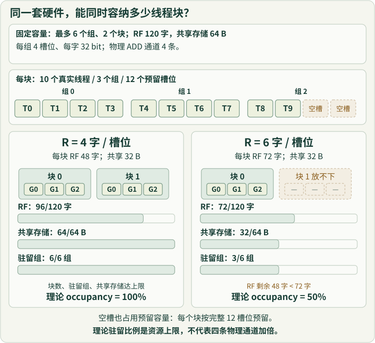
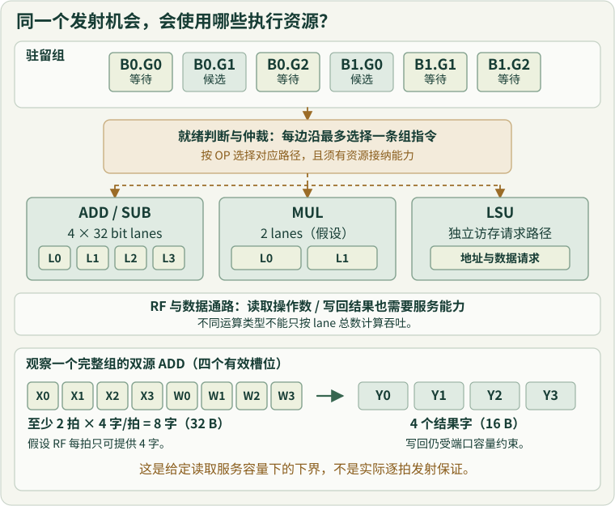
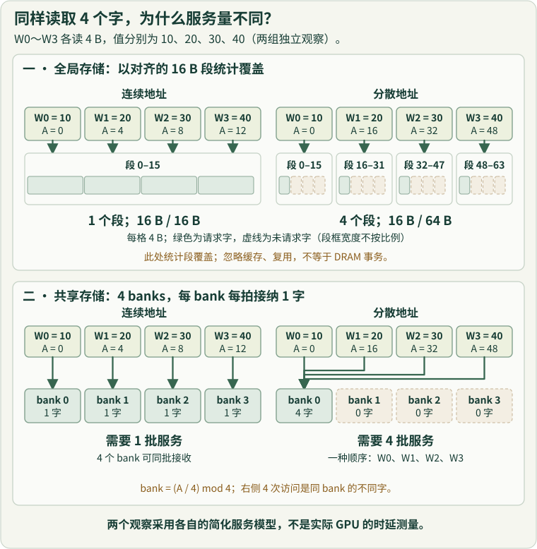

# 为什么 GPU 中的线程越多，计算不一定越快？

在 [C02](c02-simt-and-warp-scheduling.md) 中，当一个执行组正在等待 W 元素时，调度器可以让其他就绪的组先使用四条加法通道。如果让更多的线程组同时保留在硬件内部，等待期间可供选择的工作就可能更多。

但是，硬件需要为这些线程保存寄存器、程序位置和在途操作等状态。就绪的线程还需要经过发射、操作数供给和执行通路，才能真正得到结果。

GPU 的线程数量、可以同时驻留的线程数量和实际运算能力，并不是同一个量。本篇从 C02 的三个执行组出发，观察一个局部执行单元怎样分配资源，以及这些资源怎样限制计算吞吐。

## 十个线程的状态应该放在哪里？ {#execution-unit}

C02 中的十个线程属于同一个线程块。它们分为 G0、G1 和 G2，每组四个逻辑位置，最后一组只有两个真实线程。三个执行组共用四条物理执行通道。

如果芯片还有另一组十个元素需要相同的计算，可以让另一个线程块执行它。下面将这样的两个线程块分别称为 B0 和 B1，每块处理自己独立的一组 X、W 和 Y 元素。

一颗 GPU 通常包含多个局部计算实体。这些实体具有自己的执行资源、管理线程状态的存储和调度控制。例如 NVIDIA 将其中一种组织称为流式多处理器（Streaming Multiprocessor，SM），AMD GPU 则有 Compute Unit（CU）等组织。

线程块可以被分配给这些局部执行实体。本篇只观察其中一个，不从某个产品的完整结构图开始，也不假设 SM 和 CU 的内部结构相同。

在 CUDA 的常规线程块执行模型中，一个线程块被安排到一个 SM 内执行，其 warp 的上下文和该块使用的共享存储都需要在对应硬件中取得资源。调度器随后在已经驻留的执行组中选择指令。

[CUDA 编程指南：硬件多线程](https://docs.nvidia.com/cuda/cuda-programming-guide/03-advanced/advanced-kernel-programming.html#hardware-multithreading) 描述了这种资源分配与调度的关系。这里先构造一个很小的教学单元，再分别核算它的资源。

## 为什么不能立即接纳所有线程块？ {#residency}

保持 C01 和 C02 的四条 32 位加法通道。现在假设本地执行单元还有以下硬件容量。

| 资源 | 教学单元容量 |
| --- | ---: |
| 物理 ADD 通道 | 4 条 |
| 同时驻留的执行组 | 最多 6 个 |
| 同时驻留的线程块 | 最多 2 个 |
| 寄存器文件（RF） | 120 个 32 位存储位置 |
| 块内共享存储 | 64 B |

这是一组用于推导的自定义参数，不是某款 GPU 的规格。只考虑上述入驻限制，不引入调度器分区、额外分配粒度或其他资源约束。

块内共享存储是为同一块内线程保留的可共享空间。C02 已经解释了为什么不同线程有时需要通过它交换数据。本例为线程块预留一定共享容量，即使当前执行的 ADD 尚未使用这些位置。

### 先计算一个块占用多少资源

一个块有十个真实线程，形成三个四位置的执行组。本例规定：每个组按四个逻辑位置预留寄存器存储，下图中没有真实线程的两个尾部位置也占用这一分配粒度，但不创建可执行的线程。

若每个位置预留 R 个 32 位寄存器存储位置，则一个块需要：

**每块 RF 分配量 = 3 × 4 × R = 12R 个位置。**

这里的 R 是假设已经确定的分配需求，不是根据源代码中变量的数量推导出来的。实际线程在不同程序阶段可能复用寄存器位置，具体资源需求取决于程序及其实现。

取 R = 4，并假设每个块还需要 32 B 共享存储。这样，一个块占用 48 个 RF 位置、32 B 共享存储、三个驻留组位置和一个驻留块位置。

分别从四类容量求得可以同时容纳的完整块数：

| 限制因素 | 容纳块数的计算 | 上限 |
| --- | --- | ---: |
| 驻留组数量 | ⌊6/3⌋ | 2 |
| 驻留块数量 | 硬件上限 | 2 |
| RF 容量 | ⌊120/48⌋ | 2 |
| 共享存储容量 | ⌊64/32⌋ | 2 |

因为每个新块同时需要这几类资源，最终只能取这些上限中的最小值。本例可以让 B0、B1 同时进入该单元，六个执行组的上下文都保留在硬件内。

若还有第三个块，不会因为四条 ADD 通道中有空闲位置就自动接纳它。它还需要取得完整的块与组管理资源，并获得足够的寄存器与共享存储。

### 若每个线程需要更多寄存器呢？

改变一个条件：将每个逻辑位置预留的寄存器数量从 4 增加到 6，其他容量不变。一个块现在需要 12 × 6 = 72 个 RF 位置。

B0 入驻后，RF 只剩 48 个空闲位置。虽然另一个块所需的三个组位置和 32 B 共享存储都仍然空闲，但剩余 RF 容量不足以容纳 B1。

<figure class="micro-diagram" style="max-width:820px; margin:1.2rem auto" tabindex="0" aria-label="两个线程块在固定寄存器容量下的驻留对照，窄屏可横向滚动" markdown="1">

<figcaption>两种分配需求下的容量上界。每块十个真实线程，但按十二个逻辑位置预留 RF 容量。图中的组位置是保存执行状态的资源，不是新增的物理 ADD 通道。</figcaption>
</figure>

这次即使有许多软件线程等待执行，也只能接纳一个块。B1 需要等待该单元释放足够资源，或者在真实多执行单元系统中取得其他单元的资源。

同样，如果 R 保持为 4，而共享存储需求从每块 32 B 增加到 40 B，64 B 总容量也只能容纳一个块。在不同条件下，限制入驻数量的资源可能不同。

实际处理器还可能限制每块的线程数量、每线程寄存器数量、各调度分区中的状态空间等。RF 和共享存储也可能按某个分配单位向上取整。

因此不能把本例的简单除法当作所有 GPU 的通用计算规则。[NVIDIA Occupancy Calculator 接口](https://docs.nvidia.com/nsight-compute/OccupancyCalculatorPythonInterface/) 列出了不同硬件的寄存器、warp 和共享存储分配粒度等参数。

## Occupancy 高，为什么不代表运算单元都在工作？ {#occupancy}

在讨论 GPU 时，经常使用一个指标描述执行组的驻留程度，称为 **Occupancy（驻留占用率）**。

按照 NVIDIA 的定义，它是一个 SM 上驻留 warp 的数量与该 SM 最多能够驻留的 warp 数量之比。这里把它应用到我们的教学执行单元：

**Occupancy = 当前驻留组数 / 硬件最大驻留组数。**

如果有足够多的相同线程块等待入驻，根据前面的资源容量可计算理论上限。

| 每个位置的寄存器分配 | 最大驻留块数 | 理论驻留组数 | 理论 Occupancy |
| --- | ---: | ---: | ---: |
| R = 4 | 2 | 6 | 6/6 = 100% |
| R = 6 | 1 | 3 | 3/6 = 50% |

理论 Occupancy 描述资源允许达到的上限，不是实际执行期间一定维持的状态。如果总共只有一个块需要运行，第一种情况下也只能取得三个驻留组，初始驻留比例为 50%。

实际执行中会有新块入驻、旧块完成、线程退出等变化。实际 Occupancy 通常根据执行期间的平均驻留组数计算，具体统计范围以分析工具为准，不必等于理论上限。[NVIDIA Nsight Compute Profiling Guide](https://docs.nvidia.com/nsight-compute/ProfilingGuide/) 区分了理论与实际 Occupancy。

### 驻留、就绪、发射和有效运算是四件不同的事

回忆 [C02 的 Warp 调度](c02-simt-and-warp-scheduling.md#warp-scheduling)。一个已驻留组只表示其执行状态已经保存在硬件内，并不是它的下一条指令已经具备全部执行条件。

如果六个组正在等待尚未返回的数据，即使驻留比例为 100%，也可能没有任何可发射的指令。如果两个组都可以发射，但是只有一个发射机会，其中一个仍然需要等待选择。

即使某一组成功发射，它也可能只需要两条物理通道。例如 G2 只有两个线程；C02 中 G0 走不同分支时，执行一条路径也只有两个线程参加本次算术。

| 观察层次 | 要问的问题 | 本例的量 |
| --- | --- | --- |
| 驻留 | 保存了多少个执行组的状态？ | 最多 6 个组 |
| 可发射 | 其中有多少组的下一条指令具备发射条件？ | 0～6 个组（视状态而定） |
| 发射 | 本次有多少指令成功进入适用通路？ | 假设最多 1 条组指令/拍 |
| 有效运算 | 实际有多少物理通道处理所需的元素？ | 对 ADD 而言最多 4 个元素/拍 |

这些层次逐步缩小工作范围，但单位不同，不能把最后一行直接用第一行的百分比表示。

例如六个组驻留时，两个尾组各有两个不存在的线程位置，实际工作共有二十个线程，而不是二十四个。Occupancy 可以达到 100%，但这不会消除尾部未使用的通道位置。

### 50% 的 Occupancy 能和 100% 一样快吗？

比较相同的二十项加法：两个独立的十线程块，四条 ADD 通道，所有操作数都已准备好。每组发射一次 ADD，在一拍后写回活动线程的结果，仍采用 C01 的固定映射。

为单独观察入驻容量，假设两种寄存器分配需求不会改变算术指令和供数条件。只统计各块的算术执行区间，不计块的接纳、状态准备与释放所需的周期。这不是对实际寄存器优化的性能预测。

| 理论 Occupancy | 一个可行的组发射顺序 | 算术执行拍数 |
| ---: | --- | --- |
| 50%（一次一个块） | B0.G0、B0.G1、B0.G2、B1.G0、B1.G1、B1.G2 | 6 |
| 100%（两块可同时驻留） | B0.G0、B1.G0、B0.G1、B1.G1、B0.G2、B1.G2 | 6 |

第一种情况每块使用三个执行周期，两块依次执行。第二个块需要等第一个块释放资源后才能入驻。表中将两块各自的算术执行区间拼接，不假设同一边沿刚释放的资源已经可以读出新块的数据。

两种情况均需要六个组级发射机会。有效 ADD 槽位比例都是 20 / (6 × 4) ≈ 83.3%，在统计的算术执行区间内，有效吞吐都是 20/6 ≈ 3.33 个结果/拍。如果换块没有额外的空闲周期，两种方案的总时间也可以相同；否则还需计入相应开销。

如果某些组开始等待数据，多驻留的组可能提供额外的就绪工作，从而像 C02 那样填补空发射机会。但当发射及执行能力已经得到充分使用时，继续增加驻留并不会增加这些资源的能力。

更多寄存器或共享存储有时还可以让中间数据保留在片上，减少反复读写。人为压低寄存器需求则可能增加中间值的暂存和访问开销。因此提高理论 Occupancy 并不总能提高实际吞吐。

[CUDA Best Practices Guide：Occupancy](https://docs.nvidia.com/cuda/cuda-c-best-practices-guide/#occupancy) 讨论了这一关系。这里不进一步讨论软件应如何调整寄存器分配或线程块大小。

## 即使有可执行工作，为什么也不能每拍完成四个结果？ {#execution-resources}

在前面的算例中，四条执行通道只用于同一种 32 位整数 ADD，并假设它们能在每拍取得全部输入、交付全部输出。

实际局部计算实体通常不仅执行加法，还需要乘法、浮点运算、地址计算和数据搬运等功能。不同指令可能需要不同的执行路径及端口。

假设在四条 ADD/SUB 通道之外，增加一种有两条物理通道的乘法路径，以及独立的 Load/Store 路径。调度器仍然每拍最多发射一条组指令，根据运算类型将它交给适用入口。

当需要乘法的组试图发射时，即使四条 ADD/SUB 通道全部空闲，也不能因此把乘法交给这些不支持该功能的通道。若一组包含四个乘法，则两条乘法通道至少要处理两个批次。

这不意味着该组指令恰好需要两拍才能执行或必须跨两次发射。实际管线的延迟、接纳间隔及内部排队可能不同。这里只想说明一条指令能使用哪些物理资源。

<figure class="micro-diagram" style="max-width:820px; margin:1.2rem auto" tabindex="0" aria-label="从驻留组到发射及不同执行通路的数据供给，窄屏可横向滚动" markdown="1">

<figcaption>执行通路按功能组织，RF 容量与其实际供数能力是两个约束。图中通路宽度仅为教学假设，不代表某款 GPU 的组织。</figcaption>
</figure>

不同指令可以共享部分运算电路，也可以具有专用管线。实际 GPU 中，各调度器可能同时向不同的管线发射工作。但具体发射数量、资源间的共享关系和每种运算的吞吐必须按对应实现判断。

例如 [NVIDIA Volta 架构白皮书](https://images.nvidia.com/content/volta-architecture/pdf/volta-architecture-whitepaper.pdf) 的 SM 组织图提供了调度器、不同算术路径和存储资源分工的实际参考。产品级参数及结构详见[芯片架构实例](../../chip-architectures/README.md)。

### 有足够的 RF 容量，就有足够的操作数吗？

重新观察 G0 的四个加法。每个线程需要 rX 和 rW 两个 32 位值，以及一个 32 位的结果位置。

如果这八个源值都通过 RF 取得、四个结果最终都写回 RF，那么该批有效运算对应的逻辑数据量为：

| 操作 | 满组 ADD 的数据量 |
| --- | ---: |
| 两个源操作数 × 四个线程 | 8 个值，即 32 B |
| 一个结果 × 四个线程 | 4 个值，即 16 B |

假设 RF 的读取路径每拍总共只能提供四个 32 位源值，不考虑数据复用、旁路或提前保存的值补充供给。本来需要的八个源值至少要分成两个读取批次。

如果这样的独立加法一直连续到达，长期每拍提供四个源值至多能支撑两项加法。即使保存了足够多的线程上下文，以保证调度器一直有候选，也不会让这条读取通路每拍提供八个源值。

这里计算的是 RF 数据服务能力的上界，不代表一条组指令的执行时序。硬件可能先接纳指令、再分拍收集操作数；可能使用局部缓冲累积数据，也可能因为读端口不足而推迟发射。

如 [A05 的 RF 端口与共享路径](../01-foundations/a05-datapath-and-control.md#ports-and-sharing) 所述，增加运算资源不一定能增加供数和写回资源。RF 的具体端口、bank、旁路及存储实现见[寄存器堆与操作数供给](../../storage/02-sram/applications/register-file-as-sram.md)。

## 一组线程各自读取一个数，为什么地址分布会影响吞吐？ {#coalescing}

C02 假设 G0 的 Load 在四拍后写回 rW。不过真实硬件还需要处理组内各个线程的地址、发出请求并取得返回值。现在只改变 W 元素的存放位置，观察它们形成的访问工作量。

G0 的 T0～T3 仍然需要四个 32 位整数 W[0] 到 W[3]，值分别为 10、20、30、40。每个元素大小为 4 B。

### 如果存储接口每次取得一整段数据呢？

构造一个简化的内存访问接口：地址 0 按 16 B 对齐，每个访问段为 16 B，段边界在地址 0、16、32、48 等位置。一条组级 Load 对四个有效线程的地址进行合并，每个被覆盖的不同段只请求一次。

这里不计算 cache 内已有的数据、请求间的复用或其他流量，假设需要取得每个被触及的段一次。目的是在同一观察接口比较所需服务的段数量，并不预测实际 DRAM 请求数。

让四个 W 元素首先连续存放，其 byte 地址为 0、4、8、12。四笔线程级读取全部指向同一个 16 B 段，只需要取得该段，就可以将其中的四个值交给对应线程。

再改变布局，四个 W 元素的地址分别变为 0、16、32、48，数值不变。这次每个元素在不同的 16 B 段中，需要分别取得四个段才能得到同样四个源值。

这就是**访存合并（Memory Coalescing）**需要处理的问题：利用一条组级访存指令中各活动线程的地址关系，组织对存储接口的请求，减少重复覆盖的数据范围和不必要的访问工作。

<figure class="micro-diagram" style="max-width:820px; margin:1.2rem auto" tabindex="0" aria-label="同一组地址的访问段数与共享存储bank服务批次对照，窄屏可横向滚动" markdown="1">

<figcaption>上半图观察组级 Load 在教学访问接口上触及的段；下半图是另一个共享存储实验。它们采用相同地址，但不表示这次访问依次经过图中的两种存储。</figcaption>
</figure>

| 四线程访问的 byte 地址 | 有效数据 | 覆盖的段数 | 覆盖的字节量 | 本例数据比例 |
| --- | ---: | ---: | ---: | ---: |
| 0、4、8、12 | 16 B | 1 | 16 B | 100% |
| 0、16、32、48 | 16 B | 4 | 64 B | 25% |

两次执行完全相同的四次元素读取。改变的只是地址分布，使组级 Load 所需要的访问段数不同。如果该接口的服务带宽有限，更多覆盖的段可能占用更多服务机会，导致有用数据到达得更慢。

连续线程访问连续元素常常有利于合并，但不是唯一的情况。只要有效地址涉及相同的段，就不一定需要按线程编号顺序排列。例如将地址顺序打乱为 8、0、12、4，仍只涉及一个段。

实际 GPU 的访问粒度与合并规则由对应硬件定义。[NVIDIA CUDA 文档的全局内存访问](https://docs.nvidia.com/cuda/cuda-programming-guide/02-basics/writing-cuda-kernels.html#coalesced-global-memory-access) 给出了现代硬件按 32 B 段组织访问的实例，本例的 16 B 不是 NVIDIA 规格。

还需要区分同一级接口请求的段数和实际向下一级发出的流量。若某个段已经在 Cache 内，可能由该层直接服务；一个段也可能是更大传输的一部分。不能把上表的四段直接视作四条 DRAM 命令或四倍端到端时间。

存储系统中的[访问粒度与局部性](../../storage/01-memory-hierarchy/01-system-basics/locality-working-set-data-movement.md)进一步讨论了访问层级和实际流量的关系。本篇只观察组级请求的地址分布如何改变供数资源的需求。

## 如果数据已经在片上，为什么线程之间还会因访问冲突而等待？ {#bank-conflict}

继续使用上面两组地址，但将观察对象改成一块供线程协作的共享存储。这个独立实验假设该块预留了足够的存储范围（至少 52 B），不沿用前面每块 32 B 的容量假设。

共享存储可以分为若干个能够并行服务访问的 bank。在[存储系统的 SRAM bank 文章](../../storage/02-sram/foundations/sram-bank-address-mapping-conflicts.md)中，已经用四个独立 bank 推导了地址映射与冲突。这里直接借用该教学组织：

- 四个 bank，每个 bank 每拍最多接纳一次 4 B 读请求。
- 所有地址均是 4 B 对齐的 byte 地址，按 word 交错映射到 bank。
- 四个线程同时请求自己的一个 word；假设入口及返回通路足够，不存在其他访问。没有广播时，每个不同 word 都需要自己的读请求。

**bank 编号 = (byte 地址 / 4) mod 4。**

连续地址 0、4、8、12 分别映射到 bank 0、1、2、3。四个 bank 各接纳一个请求，四笔读在一拍内都可以被接纳。

而地址 0、16、32、48 对应的 word 编号为 0、4、8、12，全部映射到 bank 0，并且是该 bank 内四个不同的 word。虽然另外三个 bank 仍然空闲，它们却不保存这四个地址中的任何一个。

在这个固定映射下，只能由 bank 0 逐次接纳这些请求。当没有其他竞争且 bank 每拍都可以继续接纳时，四笔请求最早分四拍进入。这种多个访问竞争同一个 bank 服务能力的现象称为 **Bank Conflict（bank 冲突）**。

上图下半部分显示了两种分布。这里的四拍是请求接纳的批次，不是所有读取结果的端到端延迟。若采用不同的端口数量、映射或接纳间隔，结果也会不同。

如果多个线程读取的是同一个 word，情况又不一样。当硬件支持读广播时，可以由一次读取取得该值，再发给多个线程。例如地址 0、0、4、8 可以用三个 bank 的三笔读取服务四个线程。

真实 GPU 可能使用更多 bank 和不同的数据宽度。例如 NVIDIA 计算能力 5.x 及之后的典型 shared memory 使用 32 个 bank，对连续 32 位 word 采用交错映射，并支持同地址读广播。

参见 [CUDA Best Practices Guide：Shared Memory and Memory Banks](https://docs.nvidia.com/cuda/cuda-c-best-practices-guide/#shared-memory-and-memory-banks)。

### 访存合并与 bank 冲突是同一种问题吗？

它们都受到地址分布影响，但观察的是不同的硬件服务资源。

| 机制 | 在判断什么 | 本例地址 0、16、32、48 的影响 |
| --- | --- | --- |
| 访存合并 | 一条组指令涉及多少个对齐访问段 | 需要四个段，而不是一个 |
| bank 冲突 | 同一批请求落到哪些 bank、需要多少服务机会 | 四个不同 word 竞争 bank 0 |

不能因为某次全局访存能够合并，就推断另一块共享存储中不存在 bank 冲突。也不能仅依据 bank 数量推断传输段的大小。二者需要分别按照对应接口的规则计算。

如果数据已经驻留在片上，仍然可能因为这些局部存储路径的竞争而无法及时进入运算单元。这也是为什么只提高驻留线程数量或算术通道数量不一定能够提高有效吞吐。

## 怎样理解一颗 GPU 的执行效率？ {#summary}

回到 C01 的十个独立加法。从一个加法通道到四个，硬件可以提高并行计算能力；从向量指令到 SIMT，多个线程还可以保存各自的执行状态，并共享指令控制。

C02 已经说明为什么执行组之间的交错调度可以隐藏等待。C03 进一步发现，能否利用这些机制，需要沿着真实工作推进的过程逐层检查。

| 当观察到这些现象时 | 应进一步了解什么 |
| --- | --- |
| 许多线程尚未开始执行 | 是否有足够的块、组、RF 和共享存储资源让它们驻留 |
| 驻留组很多，发射机会却常常空着 | 是否有数据、控制或同步依赖，适用通路是否可以接纳 |
| 指令持续发射，有效运算数仍然较少 | 活动掩码、物理通道宽度、运算类型和操作数供给 |
| 算术资源空闲，但存储路径十分忙碌 | 各层请求量、访问段覆盖、bank 竞争及供数带宽 |

在这个认识框架中，Occupancy 仅描述其中一个环节的资源使用程度。它和每拍发射多少指令、每拍完成多少有效元素、整个任务花费多少时间都需要分别观察。

这些指标的关系不是由一个固定公式决定的。例如实际访存延迟还会随着请求数量和资源竞争改变，不能简单用本例的固定等待周期估算任何 GPU 的吞吐。[Volkov 的 GPU 延迟隐藏研究](https://www2.eecs.berkeley.edu/Pubs/TechRpts/2016/EECS-2016-143.html)进一步讨论了这些关系。

到这里，C 专题建立了从普通执行通道到并行线程与有限资源约束的认识。接下来可以沿着不同问题继续读：

- [计算阵列与数据流](../04-compute-arrays/README.md)：追踪多个乘加单元之间怎样传递、复用和归约数据。
- [数据搬运与处理引擎](../05-data-movement/README.md)：深入观察独立搬运路径怎样产生及服务请求。
- [多执行实体与资源协作](../06-resource-cooperation/README.md)：研究多个局部计算单元和引擎怎样协作。
- [性能分析与设计权衡](../08-performance/README.md)：综合执行、供数与依赖关系，比较架构性能与实现成本。

[返回并行执行与 GPU 导读](README.md)。
