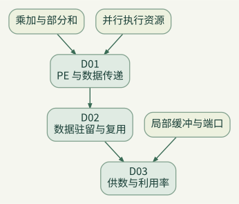

# 计算阵列与数据流

计算阵列将多个运算单元组织起来，让它们协作完成计算。数据流描述操作数与中间结果在这些资源之间如何移动、驻留和复用。

一个矩阵乘法包含大量乘加。如果把一个乘加单元扩展为四个，怎样把操作数送到每个单元，又怎样收集合适的部分和？如果继续增大阵列，所有单元是否都能一直工作？

本路线沿用同一个小型矩阵乘法，先改变乘加单元间的连接方式，再改变输入、权重和部分和留存的位置，最后改变阵列规模及供数条件。通过这些变化理解阵列执行、数据复用和等待，以及阵列规模与有效吞吐的关系。

## 知识关系

<figure class="micro-v2-map" markdown="1">

<figcaption>知识衔接示意。点击可查看大图。</figcaption>
</figure>

数据传递方式与数据驻留方式是两个问题：脉动阵列描述单元之间按时序传递数据的机制，stationary 数据流则描述数据在何处保留和复用。

## 计划阅读顺序

本专题沿用 2×4 的 X 与 4×2 的 W 相乘：先比较 MAC 分工与数据传递，再研究操作数及部分和驻留，最后比较阵列规模与供数条件。正文尚未发布的条目不提供文章链接。

| 编号 | 文章 | 阅读重点 | 状态 |
| --- | --- | --- | --- |
| D01 | [多个 MAC 怎样协作完成一次矩阵乘法？](d01-macs-and-array-data-paths.md) | PE、并行 MAC、广播、邻居传递、部分和归约、脉动阵列与执行时序 | 已发布 |
| D02 | 同一块矩阵，哪些数据应该留在计算单元里？ | 数据驻留/复用，weight/input/output/row-stationary 的数据路径及代价 | 未发布 |
| D03 | 为什么扩大计算阵列，不一定能同比例提高吞吐？ | 填排、局部缓冲、供数/输出带宽、矩阵形状、阵列尺寸与利用率 | 未发布 |

## 与其他路线的关系

- [共同计算基础](../01-foundations/README.md)：先理解乘加、累加状态、寄存器端口和流水线。
- [并行执行与 GPU](../03-parallel-execution/README.md)：建立独立运算与物理通道的认知，或比较其他并行执行方式。
- [数据搬运与处理引擎](../05-data-movement/README.md)和[多执行实体与资源协作](../06-resource-cooperation/README.md)：从阵列内部扩展到外部供数、计算与搬运的协作。
- [性能分析与设计权衡](../08-performance/README.md)：比较扩大阵列与提高供数能力的收益。

- [算法与模型](../../workload/README.md)：了解矩阵乘法的数学语义与张量形状。
- [存储系统](../../storage/README.md)：了解存储器、访问机制及端口；本路线关注它们对阵列执行的约束。
- [芯片与系统互连](../../interconnect/README.md)：了解广播、多播、归约网络及请求传输。
- [芯片架构实例](../../chip-architectures/README.md)：研究具体芯片的 PE 组织、阵列结构与实现参数。

本路线只介绍给定计算块的数据如何进入硬件、资源怎样工作；分块方案和数据流的自动选择属于编译器的优化问题。

[返回计算微架构系列](../README.md)
