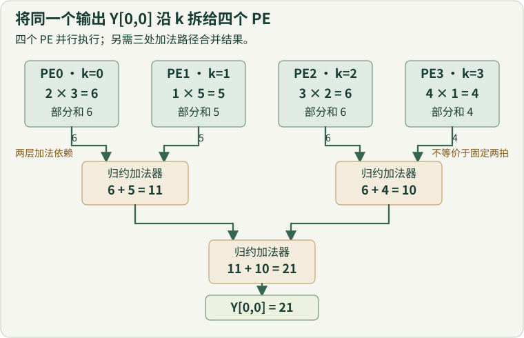
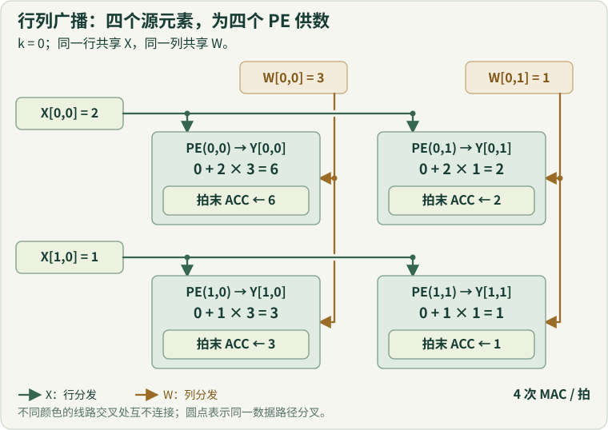
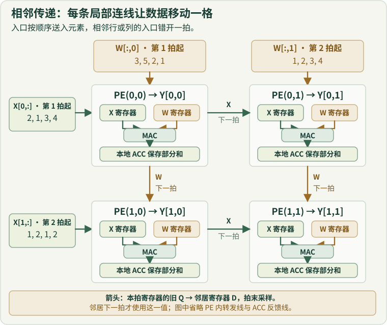
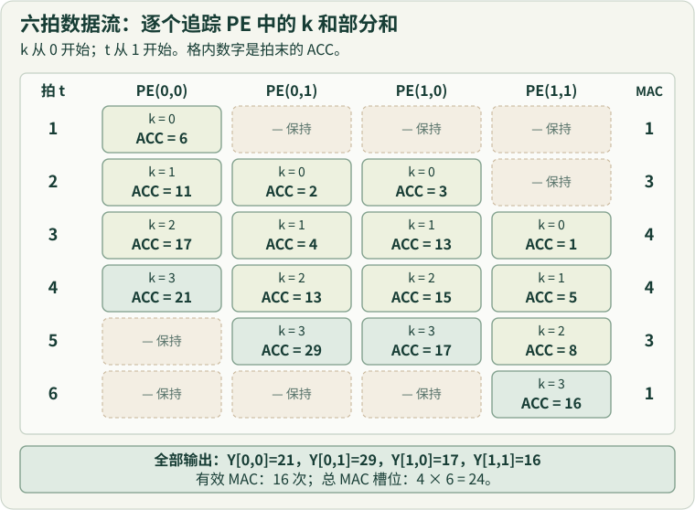

# 多个 MAC 怎样协作完成一次矩阵乘法？

在 [A03](../01-foundations/a03-multiplication-and-accumulation.md#mac) 中，一个乘加单元将四个乘积逐次加入累加器，最终得到一个点积。在 [C01](../03-parallel-execution/c01-scalar-simd-and-vector-execution.md) 中，我们又用四条执行通道同时完成多个独立的加法。

矩阵乘法同时包含这两类工作：每个输出元素需要对多个乘积求和（只有一个 MAC 时逐项累加），而不同输出元素之间又没有这种依赖。如果芯片有四个 MAC，应该让它们分别计算不同的输出，还是共同计算同一个输出？

**计算阵列**将多个运算单元及其数据通路组织起来，使它们能够协作完成一项计算。单元之间怎样分工，怎样取得操作数，怎样传递数据和合并部分和，都会影响最终的执行过程。

本篇从一个 MAC 出发，保持要执行的矩阵乘法不变，观察增加运算资源及改变数据传递路径分别带来什么变化。

## 一个 MAC 怎样完成整个矩阵乘法？ {#single-mac}

沿用 A03 中的四组数据：X 的值为 2、1、3、4，W 的值为 3、5、2、1，两组数的点积为 21。

现在让 X 再多一行，W 再多一列：

| X | k=0 | k=1 | k=2 | k=3 |
| --- | ---: | ---: | ---: | ---: |
| i=0 | 2 | 1 | 3 | 4 |
| i=1 | 1 | 2 | 1 | 2 |

| W | j=0 | j=1 |
| --- | ---: | ---: |
| k=0 | 3 | 1 |
| k=1 | 5 | 2 |
| k=2 | 2 | 3 |
| k=3 | 1 | 4 |

X 有两行、四列，W 有四行、两列。矩阵乘法 Y = XW 的每个输出 Y[i,j] 都是 X 的第 i 行与 W 的第 j 列的点积：

**Y[i,j] = ∑k=03 X[i,k] × W[k,j]**

这里 i 和 j 决定需要产生哪个输出，k 决定这个输出正在累加哪一项。计算全部四个输出，需要十六次乘加（从零开始累计）。

| 输出 | 计算过程 | 结果 |
| --- | --- | ---: |
| Y[0,0] | 2×3 + 1×5 + 3×2 + 4×1 | 21 |
| Y[0,1] | 2×1 + 1×2 + 3×3 + 4×4 | 29 |
| Y[1,0] | 1×3 + 2×5 + 1×2 + 2×1 | 17 |
| Y[1,1] | 1×1 + 2×2 + 1×3 + 2×4 | 16 |

Y[0,0] 恰好就是 A03 已经完成的点积。现在一共需要四个点积。矩阵乘法的形状、数学含义以及运算量计算可参考[算法与模型中的张量形状与计算量](../../workload/00-overview/tensor-shapes-and-cost.md)。

### 先明确本篇的硬件和计时假设

- 与 A03 一样，X、W 为四位无符号整数，完整乘积为八位，累加器 ACC 为十位，可精确保存四个最大乘积之和（4×225 = 900）。
- 每个 MAC 在一个周期内，用本拍有效的两个操作数和 ACC 的旧值产生新和，并在拍末的时钟沿更新 ACC。下一拍可以继续使用该新值。
- 数据从已准备好的输入缓冲进入运算路径；下面先假设相应接口能及时供数。拍 t 表示时钟沿 Et−1 到 Et 的区间，表格中的部分和均为 Et 更新后的状态。
- 每个新点积从零开始。假设输出交付、ACC 初始化及输入缓冲准备不会在所观察的计算区间内额外占用周期。实际需要的读写路径与时间不能因此省略，它们将在 D02、D03 中进一步讨论。

一个 MAC 可以按 Y[0,0]、Y[0,1]、Y[1,0]、Y[1,1] 的顺序工作。每完成一个点积，交付结果后让下一次点积从零开始。先假设输入路径不额外保留或复用操作数，每次 MAC 都由缓冲提供两个元素。

| 计算拍 | ACC 对应的输出 | 四次 MAC 后的部分和（依次） |
| --- | --- | --- |
| 1～4 | Y[0,0] | 6 → 11 → 17 → 21 |
| 5～8 | Y[0,1] | 2 → 4 → 13 → 29 |
| 9～12 | Y[1,0] | 3 → 13 → 15 → 17 |
| 13～16 | Y[1,1] | 1 → 5 → 8 → 16 |

在上述理想条件下，整个矩阵乘法的算术执行区间为 16 拍。如果反馈路径需要多拍，连续更新同一个累加器就可能需要等待。相关限制已经在 [A06 的反馈依赖](../01-foundations/a06-pipeline-and-throughput.md#feedback-dependence)中解释过。

## 如果有四个 MAC，它们可以怎样分工？ {#parallel-macs}

四个输出元素彼此独立。计算 Y[0,1] 不需要 Y[0,0] 的结果，所以没有必要等待一个点积结束之后再开始另一个。

### 让每个 MAC 负责一个完整的输出

给每个 MAC 配置自己的 ACC。将四个单元分别对应四个输出，按照输出的行列编号排列：

| 物理位置 | 第 0 列 | 第 1 列 |
| --- | --- | --- |
| 第 0 行 | PE00：Y[0,0] | PE01：Y[0,1] |
| 第 1 行 | PE10：Y[1,0] | PE11：Y[1,1] |

本篇把这种能够保存局部状态、接收操作数并执行乘加的计算单元称为 **PE（Processing Element，处理单元）**。在这个模型中，一个 PE 内有一个 MAC 及其 ACC；实际硬件的 PE 可以包含不同数量的运算资源、寄存器和控制逻辑。

假设输入缓冲有四组独立的供数通路，每个 PE 每拍可以取得自己需要的两个操作数。四个 PE 就能同时更新各自的 ACC：

| 拍 | k | PE00 | PE01 | PE10 | PE11 |
| ---: | ---: | ---: | ---: | ---: | ---: |
| 1 | 0 | 0+6=6 | 0+2=2 | 0+3=3 | 0+1=1 |
| 2 | 1 | 6+5=11 | 2+2=4 | 3+10=13 | 1+4=5 |
| 3 | 2 | 11+6=17 | 4+9=13 | 13+2=15 | 5+3=8 |
| 4 | 3 | 17+4=21 | 13+16=29 | 15+2=17 | 8+8=16 |

四拍之后，四个输出都已经保存在各自的 ACC 中。与 C01 的四通道加法相似，这里利用了不同输出的独立性。区别在于，每条通路还要保存并反复更新自己的部分和。

X、W 的逻辑形状分别是 2×4、4×2，物理阵列却可以只有 2×2 个 PE。这次任务恰好将四个输出映射到四个 PE，但并不意味着每个 PE 必须永远负责这个位置的输出，也不意味着每个矩阵元素都需要一个物理 PE。

### 能否让四个 MAC 共同计算一个输出？

也可以。仍然观察 Y[0,0]，它的四项乘积为 6、5、6、4。产生这些乘积时，四项不需要相互等待。

如果将四组操作数同时交给四个 PE，每个 PE 从零开始执行一次 MAC，就能在同一拍末得到四份局部结果。接下来需要将它们归约为一个完整的输出，而不是把四份 ACC 当作四个不同的 Y。

<figure class="micro-diagram" style="max-width:700px; margin:1.2rem auto" tabindex="0" aria-label="四个PE共同计算一个输出并通过归约树合并，窄屏可横向滚动" markdown="1">

<figcaption>沿 k 分工。四个 PE 内各有一个 ACC，而额外的归约通路负责合并属于同一输出的局部结果。</figcaption>
</figure>

这里可以使用 [A03 中的树形归约](../01-foundations/a03-multiplication-and-accumulation.md#reduction)：两个加法器同时得到 11 和 10，再由第三个加法器得到 21。

为便于比较，假设另有三个加法器构成两层组合归约路径，且整个路径满足一个周期的时序要求。每个输出用一拍同时计算四项，再用一拍归约，暂不让归约与下一个输出的 MAC 重叠。这是一个具体的教学安排，不是归约的固定延迟。

| 拍 | 四个 PE 的局部结果 | 归约结果 |
| ---: | --- | --- |
| 1 | 6、5、6、4 | — |
| 2 | 保持 | Y[0,0] = 21 |
| 3 | 2、2、9、16 | — |
| 4 | 保持 | Y[0,1] = 29 |
| 5 | 3、10、2、2 | — |
| 6 | 保持 | Y[1,0] = 17 |
| 7 | 1、4、3、8 | — |
| 8 | 保持 | Y[1,1] = 16 |

这个安排仍然执行十六次有效 MAC，但额外执行十二次用于合并局部结果的加法。归约的数据路径、状态和时序也是硬件的一部分。如果让归约与下一组计算重叠，或者采用分段流水的归约树，周期数可能不同。

这里的重要区别不是哪种分工一定更快，而是：

- 沿输出的 i、j 分工，每个 PE 有一个输出的完整累加状态。
- 沿归约维度 k 分工，多个 PE 保存同一个输出的不同部分，必须把它们合并。

实际也可以组合这两种分工，例如两个 PE 协作一个输出，同时计算两个输出。部分和只能与属于同一输出的其他部分和相加，不能因为它们恰好在相邻的 PE 就直接相加。

本例整数不溢出，改变累加顺序不改变数学结果。对于 [A04](../01-foundations/a04-floating-point-and-low-precision.md) 中的浮点运算或中途截断、饱和的整数运算，改变归约顺序还需核对精度和数值语义。

下面恢复为每个 PE 负责一个完整的输出。先固定这件事，再改变数据怎样进入 PE。

## 每拍给四个 PE 送数，一定要从缓冲取出八个值吗？ {#broadcast}

观察四个 PE 在第 1 拍使用的操作数：

| PE | X | W |
| --- | --- | --- |
| PE00 | X[0,0] = 2 | W[0,0] = 3 |
| PE01 | X[0,0] = 2 | W[0,1] = 1 |
| PE10 | X[1,0] = 1 | W[0,0] = 3 |
| PE11 | X[1,0] = 1 | W[0,1] = 1 |

四个 PE 一共需要八份操作数，但这些操作数只有四个不同的元素地址。

同一行的两个 PE 都需要 X 的同一个元素，同一列的两个 PE 都需要 W 的同一个元素。即使某两个不同元素恰好数值相同，也不能因此认为它们是同一次元素读取；这里的共享来自矩阵乘法的索引关系。

### 从一次读取产生两份操作数

既然 PE00 与 PE01 都需要 X[0,0]，就可以让缓冲只提供一次 X[0,0]，再通过数据通路将这个值送到两个 PE 的 X 输入端。

对另一行和两列采用相同方式：X 按行广播，W 按列广播。这里的**广播（Broadcast）**指向选定的行或列中的所有 PE 发送同一份数据，不要求把数据发送到整个芯片。

<figure class="micro-diagram" style="max-width:740px; margin:1.2rem auto" tabindex="0" aria-label="两行X和两列W分别广播给四个PE，窄屏可横向滚动" markdown="1">

<figcaption>第 1 拍的行列广播。不同颜色表示 X 与 W 的路径，PE 内的 ACC 在拍末分别变为 6、2、3、1。</figcaption>
</figure>

每拍广播两份 X 和两份 W，就能使四个 PE 得到八份操作数。下一拍换成 k=1 对应的两份 X 与两份 W，仍然按照相同的行列路径发送。

如果广播路径能够在同一拍给全部目标 PE 提供所需数据，前一节的四拍执行表完全不变。改变的是输入路径，不是 MAC 的分工。

| 四个 PE 连续计算四拍 | 独立供数（不在输入路径复用） | 行列广播 |
| --- | ---: | ---: |
| 缓冲向供数网络提供的 X、W 元素数 | 32 | 16 |
| PE 端实际消费的 X、W 元素数 | 32 | 32 |
| 有效 MAC 次数 | 16 | 16 |
| 计算拍数 | 4 | 4 |

这些是教学模型中两个不同观察边界上的元素计数。一次广播会在路径上产生多个接收者，不能把源端减少的十六次元素传输等同于减少十六次物理连线活动。

实际的广播网络需要足够的分发能力，才能让所有目标在规定时刻取得数据。目的地越多、距离越长，扇出、布线和时序约束也可能改变。这与[芯片与系统互连中的广播和多播](../../interconnect/NOC/06-ai-noc-specifics/broadcast-multicast-tree.md)关注的复制位置、传输路径是相通的。本篇只研究阵列内部的操作数分发。

## 如果不让输入通路直接到达所有 PE 呢？ {#neighbor-transfer}

对于只有两行两列的阵列，为每一行和每一列设置广播路径并不难理解。但如果每一行有许多 PE，而且目标分布在更长的物理距离上，让一份数据在规定时间内到达全部目标可能更困难。

能不能让处于边缘的 PE 先使用这份数据，再将其交给旁边的 PE？

仍然让 PE00 使用 X[0,0]。如果它除了执行 MAC，还能将这个 X 通过局部寄存器向右交给 PE01，那么 PE01 就不再需要从行广播通路直接取得该元素。

同样让 W 从上向下移动：PE00 使用 W[0,0] 的同时，还可以把它交给 PE10。每个 PE 的部分和继续保存在自己的 ACC 中，不随 X 和 W 一起移动。

<figure class="micro-diagram" style="max-width:740px; margin:1.2rem auto" tabindex="0" aria-label="X向右和W向下逐拍传递的局部数据通路，窄屏可横向滚动" markdown="1">

<figcaption>一种局部传递组织。图中每条相邻传递路径需要一拍；在拍末保存转发的数据，邻居只能在下一拍使用该值。</figcaption>
</figure>

这个组织中，每个 PE 都有相应的操作数接收和向邻居发送的路径。假设每条 X、W 邻接链路各能每拍传送一个元素，X 与 W 的转发状态独立，转发与 MAC 可以在同一拍进行。

沿用前面的计时约定：边缘入口在第 t 拍提供的元素已在 Et−1 采入入口寄存器；拍末 Et 又可将其传给邻居的输入寄存器。因此邻居在第 t+1 拍才使用这个元素。

### 两个操作数怎样在同一拍相遇？

若所有边缘入口仍然同时注入 k=0 的数据，PE00 在第 1 拍就能计算 X[0,0]×W[0,0]。但 PE01 的 X 需要经过 PE00，到第 2 拍才有效。如果 PE01 的 W 入口此时已经换成 W[1,1]，它就会把不同 k 的两个元素相乘。

所以，新路径不只是改变数据从哪里经过，还改变了数据到达的时间。

要让 PE01 在第 2 拍正确计算，应该让上方的 W[0,1] 晚一拍注入。要让 PE10 在第 2 拍正确计算，也应该让左侧的 X[1,0] 晚一拍注入。

这样 PE11 的两个操作数都需要经过一个邻居，它们将在第 3 拍同时到达：

- X[1,0] 在第 2 拍进入 PE10，第 3 拍到达 PE11。
- W[0,1] 在第 2 拍进入 PE01，第 3 拍到达 PE11。

对于后续的 k=1、2、3，也保持相同的入口间隔。这里不要求 PE 通过比较 k 的数值寻找对应操作数。教学结构采用固定的输入时序和有效标记，控制器只在本拍两个有效操作数应当配对时允许更新 ACC；失去对齐时不能随意推进某一条流。

具体入口序列如下。下标为矩阵元素索引，破折号表示无有效输入而不是数值 0。

| 拍 | 左侧第 0 行 | 左侧第 1 行 | 上方第 0 列 | 上方第 1 列 |
| ---: | --- | --- | --- | --- |
| 1 | X[0,0] | — | W[0,0] | — |
| 2 | X[0,1] | X[1,0] | W[1,0] | W[0,1] |
| 3 | X[0,2] | X[1,1] | W[2,0] | W[1,1] |
| 4 | X[0,3] | X[1,2] | W[3,0] | W[2,1] |
| 5 | — | X[1,3] | — | W[3,1] |
| 6 | — | — | — | — |

### 逐拍观察四个 PE 的计算过程

X 每向右经过一个 PE 晚一拍，W 每向下经过一个 PE 也晚一拍。因此在 PE 的行号 i、列号 j 都从 0 开始的情况下，两者的第 k 项在 **第 1+i+j+k 拍**相遇。

<figure class="micro-diagram" style="max-width:760px; margin:1.2rem auto" tabindex="0" aria-label="四个PE在六个周期中各自处理的k索引，窄屏可横向滚动" markdown="1">

<figcaption>有效乘加的位置随时间变化。一条对角线上的 PE 在同一拍处理相同的 k，后方的 PE 晚一拍开始；最后一个 PE 也晚结束。</figcaption>
</figure>

将 X、W 的实际值代入，可以追踪每个 ACC。格内的数字为该拍末已保存的部分和；“—”表示不执行有效 MAC，ACC 保持原值。

| 拍 | PE00 | PE01 | PE10 | PE11 | 有效 MAC 数 |
| ---: | ---: | ---: | ---: | ---: | ---: |
| 1 | 6 | — | — | — | 1 |
| 2 | 11 | 2 | 3 | — | 3 |
| 3 | 17 | 4 | 13 | 1 | 4 |
| 4 | **21** | 13 | 15 | 5 | 4 |
| 5 | — | **29** | **17** | 8 | 3 |
| 6 | — | — | — | **16** | 1 |

例如第 3 拍，PE00 在累加 k=2，使用 X[0,2]=3 与 W[2,0]=2，得到 11+6=17。此时 PE11 才在计算 k=0，使用 X[1,0]=1 与 W[0,1]=1，得到 1。

同一拍中，不同 PE 可以正在处理不同的 k。这与上一节行列广播时所有 PE 同拍处理同一 k 的情形不同。不过，每个 PE 都依次处理了自己需要的四项，结果仍为 21、29、17、16。

这种让数据以规律的时序在相互连接的处理单元之间推进、使多个单元边传递边计算的组织，称为**脉动阵列（Systolic Array）**。经典设计利用局部、规则的连接，使数据从阵列边缘进入后可以被多个单元沿途使用。

参见 [H. T. Kung 1982 年原始论文《Why Systolic Architectures?》](https://www.eecs.harvard.edu/~htk/publication/1982-kung-why-systolic-architecture.pdf)。本例只展示一种二维矩阵乘法脉动组织，不代表所有脉动阵列都有相同的连接、数据方向或寄存器级数。

### 为什么有人愿意接受晚两拍得到结果？

在本例中，两种四 PE 方案都只需从缓冲向供数网络提供十六个元素。广播将每个元素直接分发给两个 PE，相邻传递则在第一次使用后再传给下一个 PE。

相邻传递方案在边界接收十六个有效元素，阵列内部又发生十六次有效的相邻元素传递：八个 X 各向右传一次，八个 W 各向下传一次。这里不统计无效标记、控制比特或阵列以外的流量。

这样就不需要让每个边缘入口直接连接到一整行或一整列中的所有计算单元。扩大阵列时，也可以用规则的局部连接及寄存器分隔较长的数据路径。但它会引入传播时间、额外寄存器，以及保证操作数正确相遇的控制要求。

从第一份数据有效到最后一次累加完成，需要六拍，而非理想广播的四拍。前后几拍有些 PE 尚未开始或已经结束，这正是数据必须逐跳推进所产生的等待。对单次小任务而言，这些周期占比较大；对更大的或连续任务，能否降低其相对开销，需要另行分析。

这并不能证明相邻传递的实际能耗一定更低，也不能证明广播一定能达到相同的时钟频率。真实实现应比较数据路径的供数能力、距离、扇出、寄存器与时序。

## 同一次矩阵乘法，改变了哪些硬件条件？ {#comparison}

汇总前面的实验。每种方案都处理相同的十六项乘积。有效 MAC 槽位比例定义为：

**有效 MAC 槽位比例 = 有效 MAC 次数 /（物理 MAC 数 × 计算拍数）**

它衡量指定区间内 MAC 槽位中有多少用来执行本任务的有效乘加，而不是整个芯片的资源利用率。

| 教学方案 | 物理 MAC 数 | 缓冲提供输入元素数 | 计算拍数 | 有效 MAC 槽位比例 | 平均有效 MAC/拍 |
| --- | ---: | ---: | ---: | ---: | ---: |
| 单 MAC 逐输出执行 | 1 | 32 | 16 | 100% | 1 |
| 4 PE 沿 k 分工，另设归约路径 | 4 | 32 | 8 | 50% | 2 |
| 2×2 PE，独立供数 | 4 | 32 | 4 | 100% | 4 |
| 2×2 PE，行列广播 | 4 | 16 | 4 | 100% | 4 |
| 2×2 PE，相邻传递 | 4 | 16 | 6 | 66.7% | 2.67 |

所有方案的 PE 都实际消费了三十二份四位操作数，最后交付四个十位输出。表中的输入量不计 ACC 反馈、内部归约或相邻转发。沿 k 分工的方案另有十二次归约加法；相邻传递方案另有十六次 PE 间元素交接。

如果把每个输入按四个有效比特计数，独立供数的模型在输入边界提供 128 bit，广播和相邻传递提供 64 bit。它们不是某种 SRAM 物理访问位宽或字节对齐后的实测流量。

各方案的计算拍数也是由前面的假设得出的，尚未计入输入准备、结果搬运、端口竞争等开销，更没有假设不同硬件设计能实现相同的最高时钟频率。100% 的槽位比例也不意味着任务更快：一个 MAC 和四个 MAC 都可能完全忙碌，但每拍能完成的工作数量不同。

## 计算阵列、脉动阵列和数据流是同一个概念吗？ {#next}

从本篇的变化过程可以把几个问题分开：

| 问题 | 本例中的一种选择 |
| --- | --- |
| 有哪些物理资源，它们怎样连接？ | 2×2 个 PE，每个有 MAC 和 ACC |
| 一份操作数怎样到达多个 PE？ | 行列广播，或带寄存器的相邻逐拍传递 |
| 工作怎样分配给这些 PE？ | PEij 负责 Y[i,j] 的四项累加 |
| 哪些数据持续保存在原位置？ | 一个输出的部分和留在对应 ACC 中，X、W 按拍更换 |

广播阵列和脉动阵列都可以是计算阵列。广播与相邻传递也并不互斥，同一阵列可以组合两种机制。脉动组织主要描述数据怎样沿单元间的连接、有节奏地传递和使用，并不规定一定要保留哪一种操作数。

例如本篇的广播方案和邻接方案都让一个输出的部分和驻留在同一个 PE 中。真实设计也可能支持多种驻留方式。[Berkeley Gemmini 的官方文档](https://chipyard.readthedocs.io/en/1.2.0/Generators/Gemmini.html)给出了可支持 Output Stationary 和 Weight Stationary 的脉动阵列实例，其中还采用了由多个 tile 组成的分层结构。本篇的逐 PE 寄存器模型不直接代表它的时序实现。

现在我们已经知道怎样在 PE 之间传递操作数，以及怎样利用独立输出或部分和进行分工。但如果 W 会被许多行 X 重复使用，为什么一定要让 W 每拍经过这些路径？能不能先将某些权重保存在 PE 内，再不断送入 X？

下一篇 [D02 · 同一块矩阵，哪些数据应该留在计算单元里？](d02-stationary-dataflows-and-reuse.md) 将保留同一个矩阵乘法，改变输入、权重和部分和驻留的位置，进一步研究数据复用。[D03](d03-array-size-bandwidth-and-utilization.md) 则会扩大阵列、改变矩阵形状和供数能力，看看这些机制最终能够带来多大的有效吞吐。

[返回计算阵列与数据流导读](README.md)。
