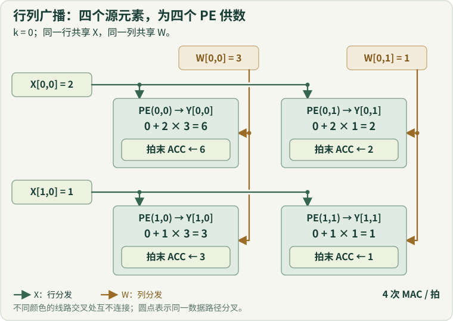
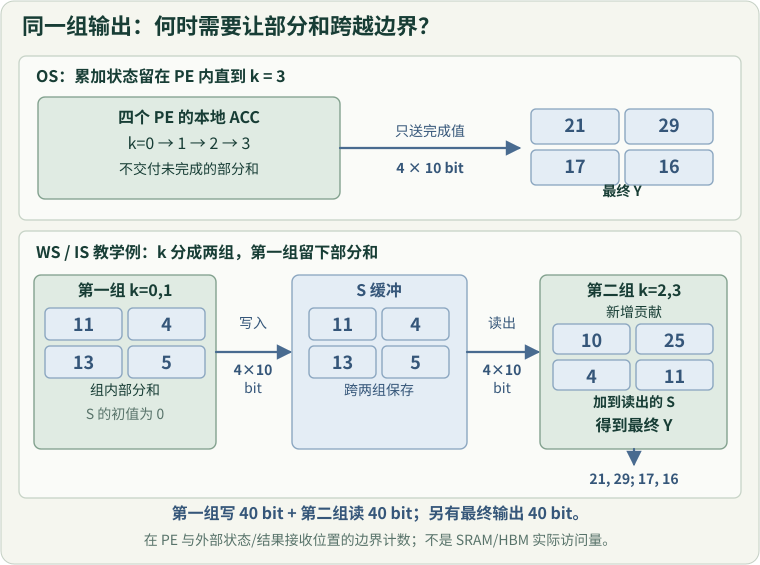
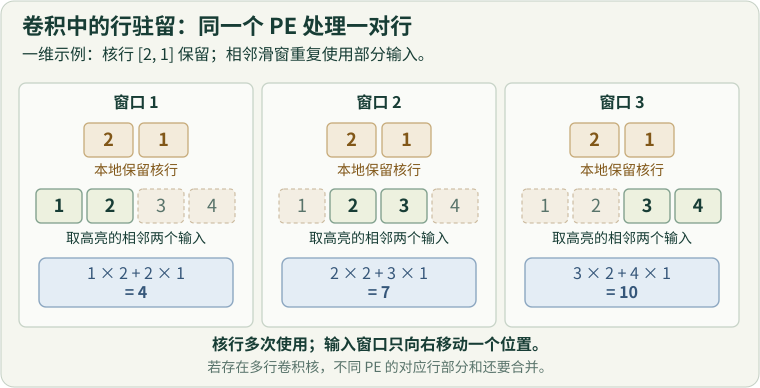

# 同一块矩阵，哪些数据应该留在计算单元里？

在 [D01](d01-macs-and-array-data-paths.md) 中，四个 PE 可以分别保存四个输出的部分和。我们每拍换一组输入和权重，部分和留在原来的累加器中，直到点积完成。

但矩阵乘法还存在另一种复用。例如同一个权重 W[0,0] 不仅参与第一行输出的计算，也参与第二行输出的计算。能不能一直把这个权重放在一个 PE 中，让这个 PE 先后处理两行输入？

这会产生一个新的问题：如果一个 PE 不再固定负责某个输出，那么它计算出的部分和应该怎样保存、传递和合并？

**数据驻留**描述数据在计算期间保留在哪个位置，以及能够在那里被重复使用多久。**数据流（Dataflow）**则进一步描述计算如何分配到这些资源，以及操作数与部分和怎样移动、驻留和复用。

本篇保持 D01 的运算任务不变，改变 X、W 和部分和的驻留位置，观察由此产生的硬件结构和数据搬运变化。

## 同一个值，为什么会被使用多次？ {#reuse}

沿用 D01 的矩阵 Y = XW。X 为 2×4，W 为 4×2：

| X | k=0 | k=1 | k=2 | k=3 |
| --- | ---: | ---: | ---: | ---: |
| i=0 | 2 | 1 | 3 | 4 |
| i=1 | 1 | 2 | 1 | 2 |

| W | j=0 | j=1 |
| --- | ---: | ---: |
| k=0 | 3 | 1 |
| k=1 | 5 | 2 |
| k=2 | 2 | 3 |
| k=3 | 1 | 4 |

每个输出 Y[i,j] 是一行 X 与一列 W 的点积：

**Y[i,j] = ∑k=03 X[i,k] × W[k,j]**

计算仍需要十六次 MAC，结果为：

| Y | j=0 | j=1 |
| --- | ---: | ---: |
| i=0 | 21 | 29 |
| i=1 | 17 | 16 |

先观察三个值，不急着讨论硬件怎样组织。

- X[0,0] = 2：参与 Y[0,0] 的 2×3 和 Y[0,1] 的 2×1。X 的同一个元素被两个不同的输出列使用。
- W[0,0] = 3：参与 Y[0,0] 的 2×3 和 Y[1,0] 的 1×3。W 的同一个元素被两个不同的输出行使用。
- Y[0,0] 的部分和：先得到 6，再更新为 11、17、21。每次更新都使用上次产生的累加状态。

如果 X 的形状为 M×K，W 的形状为 K×N，那么在完整的稠密矩阵乘法中，每个 X 元素参与 N 次乘加，每个 W 元素参与 M 次乘加，每个输出需要 K 项乘积。这些关系来自矩阵乘法本身，而不是某一种阵列的结构。

但同一个 X 元素参与两次乘加，并不意味着必须从缓冲读取两次。D01 已经通过广播做到一次取数、两处使用。我们也可以让两个乘加在同一个 PE 中先后执行，并让该操作数在两拍之间保留。

前者在多个计算位置之间共享一个值，常称为**空间复用**；后者在不同计算时刻使用同一份局部状态，常称为**时间复用**。两种复用也可以组合。

## 先回到四个部分和留在 PE 的方案 {#output-stationary}

仍取 D01 的 2×2 物理阵列。每个 PE 内有一个 MAC，X、W 是四位无符号整数，乘积为八位，部分和为十位。两个输入及旧的部分和有效时，一个 MAC 能在一拍内产生新和。沿用 D01 的时钟约定：本拍所需的值在拍开始时有效，新和在拍末时钟沿更新。

先让每个 PE 对应一个 Y[i,j]。X 按物理行广播，W 按物理列广播，ACC 的输出反馈给自己的 MAC：

<figure class="micro-diagram" style="max-width:740px; margin:1.2rem auto" tabindex="0" aria-label="D01 中行列广播及 PE 本地累加的结构，窄屏可横向滚动" markdown="1">

<figcaption>沿用 D01 的行列广播模型。图示为 k=0 的第 1 拍；下一拍更换 X、W，但不更换 ACC 对应的输出。</figcaption>
</figure>

| 拍 | PE00 的 ACC | PE01 的 ACC | PE10 的 ACC | PE11 的 ACC |
| ---: | ---: | ---: | ---: | ---: |
| 1 | 6 | 2 | 3 | 1 |
| 2 | 11 | 4 | 13 | 5 |
| 3 | 17 | 13 | 15 | 8 |
| 4 | 21 | 29 | 17 | 16 |

从第一项乘积到第四项乘积，PE00 始终在计算 Y[0,0]。例如它在第 2 拍直接使用本地已保存的 6，无须先把 6 送回阵列外的缓冲，再从缓冲读出。

这种让同一个输出的部分和在一个局部位置连续更新、直到规定的归约区间结束的组织，称为 **Output Stationary（OS，输出驻留）**。

这里的“输出驻留”主要指尚未完成的累加状态驻留，而不是最终结果永远留在 PE 中。计算结束后，Y 仍需要被交付。

本例四拍内，输入源一共提供八个 X 和八个 W。经过广播，四个 PE 合计接收十六份 X、十六份 W。四个部分和中途不需要离开 PE，最后只交付四个输出。

D01 的相邻传递模型同样是 OS：虽然 X、W 变成按拍在邻居之间移动，输出部分和依旧由固定的 PE 保存。因此 OS 并不等于行列广播，也不等于脉动阵列。

## 如果让权重留在 PE 中呢？ {#weight-stationary}

以 W[0,0] = 3 为例。在上面的 OS 方案中，PE00 与 PE10 同一拍分别使用这个 3。如果只给一个 PE 装入该权重，并让它连续两拍处理 X[0,0] 与 X[1,0]，一个权重就可以在同一个 PE 中服务两行输出。

不过，原来的 PE00 对应 Y[0,0]，其第二拍本来应该处理 k=1。如果只让它的权重保持不变而不改变工作安排，就会得到错误的点积。

因此改变驻留对象时，还需要重新确定各 PE 负责哪一些乘积。

### 先给四个 PE 装入四个权重

W 一共有八个元素，而我们假设每个 PE 只有一个用于保留权重的四位寄存器。四个 PE 只能同时保存四个权重。

将归约维度 k 分成两组：第一组 k=0、1，第二组 k=2、3。每组放入四个权重，组内完成所有对应的乘积后再更换。

第一组的物理位置如下：

| 物理位置 | 第 0 列 | 第 1 列 |
| --- | --- | --- |
| 第 0 行 | PE00：W[0,0]=3 | PE01：W[0,1]=1 |
| 第 1 行 | PE10：W[1,0]=5 | PE11：W[1,1]=2 |

原来的物理行对应输出行 i，现在对应本组的归约下标 k。列仍对应输出列 j。每个 PE 负责与自己的权重相关的乘积，输入行 i 不再固定在物理位置上，而是随时间更换。

权重写入后保持不变，直到两行输入对应的计算都已完成。这种将权重驻留在局部存储中，反复用它与不同输入进行计算的组织，称为 **Weight Stationary（WS，权重驻留）**。

### 改变 PE 分工后，部分和怎样到达下一个 MAC？

先计算 Y[0,0] 的前两项：

**2×3 + 1×5 = 11**

两个权重分别在 PE00 和 PE10，因此这个部分和不能仅由 PE00 的本地反馈完成。我们可以让 PE00 先得到 6，再把 6 送给下方的 PE10，由后者计算 6+1×5=11。

这样的组合需要让 MAC 的加数输入除了本地状态之外，还能取得上方送来的部分和。顶行的初始加数由零或前一组所保存的部分和提供，底行则使用经过一拍传递的顶行结果。

具体教学模型采用：

- 一个 PE 保留一个本组权重，权重预装不与本组 MAC 重叠。
- 一份 X 按物理行广播给两个 PE。顶行使用本组第一个 k 的 X，底行使用本组第二个 k 的 X。
- 部分和为十位，从顶行 MAC 在拍末产生，经过寄存器交接，底行在下一拍使用。底行结果从阵列送到外围接收位置。

<figure class="micro-diagram" style="max-width:760px; margin:1.2rem auto" tabindex="0" aria-label="权重驻留的四个PE及逐拍传递的部分和，窄屏可横向滚动" markdown="1">

[![第一组权重驻留3、1、5、2。第2计算拍顶行使用X[1,0]，产生3和1；底行用前一拍顶行送来的6和2及X[0,1]，产生11和4并交给外围部分和缓冲。](assets/d02-weight-stationary.svg)](assets/d02-weight-stationary.svg)

<figcaption>第一组 k=0、1 的第 2 计算拍。物理行对应 k，列对应 j；顶行和底行此时处理不同的输入行 i。图中的部分和传递经过时钟边沿，不是同拍组合穿过两个 MAC。</figcaption>
</figure>

在第 1 计算拍，顶行取得 X[0,0]=2，得到 6 和 2。底行还没有收到对应的部分和。

第 2 拍，底行可以用 X[0,1]=1 继续累加第一行输出。同时，顶行的两个权重仍然是 3 和 1，只需换成 X[1,0]=1 便可开始计算第二行输出。

第 3 拍，底行完成第二行输出在本组中的两项乘积和。顶行此时没有新的输入行需要处理。

| 计算拍 | 顶行 PE00、PE01 | 底行 PE10、PE11 |
| ---: | --- | --- |
| 1 | i=0，0+2×3=6；0+2×1=2 | — |
| 2 | i=1，0+1×3=3；0+1×1=1 | i=0，6+1×5=11；2+1×2=4 |
| 3 | — | i=1，3+2×5=13；1+2×2=5 |

这些都不是最终输出，因为每个点积还缺少 k=2、3 两项。用 S[i,j] 保存第一组的部分和，四个值为：

| S | j=0 | j=1 |
| --- | ---: | ---: |
| i=0 | 11 | 4 |
| i=1 | 13 | 5 |

注意，两个物理行内的 PE 依次参与同一输出的归约，但同一物理位置跨拍又处理了不同的输出。如果将上一拍的本地 ACC 无条件反馈到下一拍，就可能错误地把两个不同输出的部分和相加。

### 更换权重时，已经得到的 S 怎样保存？

现在要把 k=2、3 的四个权重装入原来的寄存器。第一组的状态必须有一个明确的保留位置。这里选用阵列外、仍可位于片上的部分和缓冲，保存四个十位值 S[0,0]、S[0,1]、S[1,0]、S[1,1]。

第二组开始时，顶行的 MAC 不再以 0 作为加数，而是取得对应的 S。这样，之前的部分和就与新的两项乘积继续累加。

| 计算拍 | 顶行 PE00、PE01（W=2、3） | 底行 PE10、PE11（W=1、4） |
| ---: | --- | --- |
| 1 | i=0，11+3×2=17；4+3×3=13 | — |
| 2 | i=1，13+1×2=15；5+1×3=8 | i=0，17+4×1=21；13+4×4=29 |
| 3 | — | i=1，15+2×1=17；8+2×4=16 |

这次底行送出的就是完整的 Y。两组执行完成后，每个权重仍然恰好参与两次乘加，每个输出仍然恰好累加四项乘积。

上述结构是 WS 的一种实现。也可以使用独立归约树、在阵列附近的累加存储中合并各组结果，或采用不同的部分和传递方向。权重驻留的定义不要求所有实现都把部分和送到同一个位置。

## 为什么也可以让 X 留在 PE 中？ {#input-stationary}

W[k,j] 可以被不同输入行 i 复用，X[i,k] 也可以被不同输出列 j 复用。

现在希望 X[0,0]=2 在同一个 PE 内，先后与 W[0,0]=3、W[0,1]=1 相乘。这样，在该 PE 处理不同输出列的过程中，X 可以保持原值。

这就是 **Input Stationary（IS，输入驻留）**。它与刚才的 WS 类似，只是将保留的操作数从 W 换成 X。

### 换一种物理位置的含义

仍然使用四个 PE 和两个 k 分组。先装入第一组四个 X：

| 物理位置 | 第 0 列 | 第 1 列 |
| --- | --- | --- |
| 第 0 行 | PE00：X[0,0]=2 | PE01：X[0,1]=1 |
| 第 1 行 | PE10：X[1,0]=1 | PE11：X[1,1]=2 |

这次物理行对应 i，物理列对应本组的 k。W 按列广播给两行，输出列 j 随时间变化。部分和由左向右传递，右侧 PE 在下一拍使用左侧产生的十位值。

<figure class="micro-diagram" style="max-width:760px; margin:1.2rem auto" tabindex="0" aria-label="输入驻留的PE映射与横向部分和传递，窄屏可横向滚动" markdown="1">

[![第一组X驻留2、1、1、2。第2计算拍左列使用W[0,1]=1产生2与1；右列取得前一拍的6与3及W[1,0]=5，产生11与13并送外围。](assets/d02-input-stationary.svg)](assets/d02-input-stationary.svg)

<figcaption>第一组 k=0、1 的第 2 计算拍。与 WS 图相比，归约方向改成由左向右；左列和右列同时处理不同的输出列 j。</figcaption>
</figure>

沿用每一级 MAC 的结果在本拍末完成交接、相邻 PE 在下一拍使用的假设，追踪第一组：

| 计算拍 | 左列 PE00、PE10 | 右列 PE01、PE11 |
| ---: | --- | --- |
| 1 | j=0，0+2×3=6；0+1×3=3 | — |
| 2 | j=1，0+2×1=2；0+1×1=1 | j=0，6+1×5=11；3+2×5=13 |
| 3 | — | j=1，2+1×2=4；1+2×2=5 |

第一组还是得到 S[0,0]=11、S[0,1]=4、S[1,0]=13、S[1,1]=5。只是底部送出一行输出的方式，改变为右侧送出一列输出。

再将第二组 X 装入四个 PE，并以 S 为初始部分和：

| 计算拍 | 左列 PE00、PE10（X=3、1） | 右列 PE01、PE11（X=4、2） |
| ---: | --- | --- |
| 1 | j=0，11+3×2=17；13+1×2=15 | — |
| 2 | j=1，4+3×3=13；5+1×3=8 | j=0，17+4×1=21；15+2×1=17 |
| 3 | — | j=1，13+4×4=29；8+2×4=16 |

计算任务没有改变，最后仍得到相同的 Y。

从物理组织上看，WS 与 IS 都需要能够保留一个乘法操作数，也都需要向其他单元传递部分和。在本例中，它们对不同矩阵轴的映射互相对应。不过，真实硬件是否支持两种方式切换，取决于寄存器、操作数选择、连接方向、端口和控制逻辑是否具备相应能力。

参见 [SCALE-Sim 论文第 II 节](https://bpb-us-e1.wpmucdn.com/sites/gatech.edu/dist/c/332/files/2020/03/scalesim_ispass2020.pdf) 中的三种脉动数据流实例。它们是特定的实现模型，不能直接替代本篇的逐拍假设。

## 哪一种方式真正减少了数据搬运？ {#traffic}

现在有三套能够正确执行同一矩阵乘法的教学方案。只比较 MAC 数量无法回答它们的数据流量是否相同。

首先固定观察边界：X、W 来自已经准备好的输入缓冲，任务开始时 PE 内没有可复用的旧 X、W。将计算阵列的供数网络、四个 MAC 及各自的局部寄存器都算在阵列一侧；WS、IS 的部分和缓冲位于另一侧，仍可在同一芯片上。

分别统计缓冲向供数网络提供的元素、各 PE 取得的操作数，以及跨越 PE 阵列边界的部分和。广播的一份源值在接收端成为两份；驻留的值只装一次，后续仍要向本地 MAC 提供它。

### X 和 W 的传输次数

在 OS 中，每个 k 需要两个 X、两个 W 源元素，四个 k 一共八个 X、八个 W。每个源值被两处 PE 消费。

对 WS 来说，每组预装四个 W，两组同样是八个。每组处理两行 i，每行需要两个 X 元素；两组一共八个 X 源元素，通过行广播变成十六份到 PE 的投递。

IS 正好相反，每组预装四个 X，两组装入八个；W 通过列广播服务两行。

| 一次完整矩阵乘法 | OS | WS | IS |
| --- | ---: | ---: | ---: |
| X 源端提供元素数（含预装） | 8 | 8 | 8 |
| W 源端提供元素数（含预装） | 8 | 8 | 8 |
| X 由供数网络投递到各 PE 的份数 | 16 | 16 | 8 |
| W 由供数网络投递到各 PE 的份数 | 16 | 8 | 16 |
| X 参与 MAC 的次数 | 16 | 16 | 16 |
| W 参与 MAC 的次数 | 16 | 16 | 16 |

三种方案的输入源端都只提供十六个四位元素，即 64 bit 的有效数据。在这个例子里，理想的 OS 行列广播已经让所有 X、W 只需从源端取得一次，WS 或 IS 不可能仅凭改变驻留方式，把这个一次读取模型再减少。

但 WS 的八个权重进了 PE 之后不需要再次通过供数网络，IS 的八个 X 也一样。复用的位置发生了变化：原来主要通过多个计算位置共享数据，现在可以在一个 PE 内跨拍使用局部寄存器的值。

表中的投递份数不是寄存器访问次数或导线翻转次数，也不是 SRAM 物理事务数。这些活动需要根据实际硬件另外统计。

### 部分和是比操作数更宽的数据

回到 WS、IS 的两次归约分组。第一组结束时，四个部分和 S 需保存在外围缓冲中。第二组开始时，将四个 S 分别送回对应的起始 PE；最后再交付四个完整输出。

<figure class="micro-diagram" style="max-width:760px; margin:1.2rem auto" tabindex="0" aria-label="部分和在两组归约之间的缓冲读写及OS对照，窄屏可横向滚动" markdown="1">

<figcaption>观察 PE 阵列与外围缓冲之间的边界。WS、IS 的第二组以 S 为初值，图中的增量表示剩余两项乘积的数学和，不表示额外执行一个独立加法。</figcaption>
</figure>

| 部分和及输出的传输 | OS | WS | IS |
| --- | ---: | ---: | ---: |
| PE 间逐跳传递的有效部分和（十位/份） | 0 | 8 | 8 |
| 阵列 → 外围缓冲：中间部分和 | 0 | 4 | 4 |
| 外围缓冲 → 阵列：读回中间部分和 | 0 | 4 | 4 |
| 阵列 → 接收位置：最终输出 | 4 | 4 | 4 |

本例每一个 k 分组内有四个有效的 PE 间交接，所以两组共有八次。第一组结束后的四次外围写入及第二组的四次读回又是另外的传输，不能与 PE 间的交接合并称为某一个接口的流量。

计算两种操作数时使用四位，而经过这些路径的部分和采用十位。因此中途跨阵列边界的八次部分和传输对应 80 bit，比本例所需输入的 64 bit 还多。

| 同一观察边界上的有效数据量 | OS | WS | IS |
| --- | ---: | ---: | ---: |
| 输入缓冲供应 X、W | 64 bit | 64 bit | 64 bit |
| 中间部分和写出和读回 | 0 | 80 bit | 80 bit |
| 最终结果交付 | 40 bit | 40 bit | 40 bit |

在这里规定的接口上，若合计有效数据量，OS 是 104 bit，WS、IS 各为 184 bit；PE 内的反馈、寄存器访问、广播扇出及 PE 间交接不包含在这三行中。比特数没有按实际字节或 SRAM 字对齐，也不表示外存流量。

这里选择十位部分和，是因为整个四项点积需要这样的最坏情况表示范围。实现也可以根据数值语义和所需范围选择不同的中间格式。

**权重或输入驻留的收益不能脱离部分和路径来衡量。** 如果增大了操作数复用，却让更多较宽的部分和经过较远的路径，新增的搬运可能抵消收益。反过来，若部分和有适用的局部存储或直接归约路径，统计结果也会不同。

这一点与存储系统的[按边界比较搬运量](../../storage/01-memory-hierarchy/04-npu-case/npu-memory-hierarchy.md#traffic)相通：片上缓冲留有一份 W，不等于 PE 也留有 W；减少一条边界的流量，不等于减少所有边界的流量。

### 数据量与计算时间还需要分别观察

理想的 OS 行列广播在四拍内完成十六次 MAC。WS、IS 的每组需三计算拍，因为部分和要经过两个 PE，后继计算比前一级晚一拍。本例共两组，合计六计算拍。

| 方案 | 有效 MAC | 计算拍数 | MAC 槽位比例（仅计算区间） |
| --- | ---: | ---: | ---: |
| OS 行列广播 | 16 | 4 | 100% |
| WS（两组） | 16 | 6 | 66.7% |
| IS（两组） | 16 | 6 | 66.7% |

WS、IS 还需要两个权重或输入预装阶段。这里假设每组预装完成才开始计算，未规定预装端口能力和拍数。也假设部分和缓冲的读写可以在上述时序规定的交接点完成，不额外引入等待。

因此表中的六拍不是完整任务耗时。若实际局部缓冲、装载通路或结果接口不足以服务这些交接，还需要计入相应时间。D03 将进一步分析这些条件。

## 什么情况下，驻留可以减少更多读取？ {#reuse-window}

上面的例子只计算一块 X。考虑同一个 W 还要服务另一块同形状的 X'，例如一个线性层又收到了两行新的输入。两块矩阵的运算彼此独立，但使用相同的权重。为了比较两种安排，假设两块输入均已具备处理条件。

仍然限制为四个 PE，每个权重寄存器只能保存一个 W 元素。要让第一组权重在更多运算中得到复用，有两种可观察的安排。

- 先完整算 X，再完整算 X'。每块都先装 k=0、1 的 W，再装 k=2、3 的 W。第二块开始时，第一组权重已被第二组覆盖，需要重新装载。
- 先装 k=0、1 的 W，依次服务 X 与 X' 的所有输入行，然后装 k=2、3 的 W，完成两块的剩余计算。

第一种安排共装入十六个权重元素，第二种只装入八个。两种安排处理的 X 数量相同，权重驻留使第二种在更长的时间内复用同一组四个权重。

但第二种安排有一个新的空间需求：当第一组执行结束、第二组尚未开始时，两块 X 对应的八个部分和都必须保留，而不再只有四个。

| 两块 X 与相同 W 的 WS 安排 | 每块各自装两组 W | 同一组 W 连续服务两块 |
| --- | ---: | ---: |
| 权重装载元素数 | 16 | 8 |
| 两组之间的部分和峰值（十位值） | 4 | 8 |
| 驻留权重数量 | 4 | 4 |

这个对照没有扩大单个权重寄存器，改变的是何时让某一组权重失效、哪些部分和同时处于未完成状态。第二种安排需要足够的部分和空间（本例至少 80 个有效数据比特，另需地址和控制等实现资源）。如果这些状态放不下，就不能照原安排执行。

类似地，如果一块 X 需要与新的 W 列继续相乘，让 X 在同一个 PE 内保留更久，有机会减少 X 的重新装载。

因此，stationary 不表示一个完整张量从任务开始到结束都在某处不动。要问清三个条件：**驻留的是哪些元素，驻留在哪一级存储，从哪一次装入到哪一次最后使用。**

同一份数据可能同时在外层缓冲和 PE 内有副本；不同层级也可以采用不同的复用方式。

存储系统中的[驻留容量与累计流量](../../storage/01-memory-hierarchy/04-npu-case/npu-memory-hierarchy.md#residency)已经区分了这两个量，而[缓冲区何时可以复用](../06-resource-cooperation/f01-overlap-and-buffer-reuse.md#buffer-lifetime)讨论何时能够安全覆盖旧数据。本篇只关注这些条件怎样改变阵列自身的工作方式。

## 如果把输入、权重和部分和都留在 PE 内呢？ {#combined-reuse}

可以，但需要更多的局部存储。

例如仍让四个 PE 分别负责四个 Y。与最开始的 OS 方案不同，先给每一个 PE 装入它计算这个输出所需的完整 X 行和 W 列。每个 PE 要保存四个 X、四个 W，另外保留一个十位 ACC。

这次四个 PE 共有三十二个四位操作数位置，比 X、W 实际包含的十六个元素多一倍。因为同一 X 行在两个物理列都有副本，同一 W 列在两个物理行也有副本。

如果先用广播路径装好这些数据，源端仍然可以只提供十六个元素。但计算时需要从各 PE 的局部存储中逐次选择对应的 k，而不必每拍从阵列外取得 X 和 W。

这是一种合理的组织思路，代价是增加局部存储容量、装载路径及读取选择能力。它不会消除初次装载或局部读写，也不意味着更大的矩阵都能完整驻留。

实际数据流并不只能三选一。比如 [Berkeley Gemmini](https://chipyard.readthedocs.io/en/1.2.0/Generators/Gemmini.html) 的脉动阵列可以支持 OS、WS 或两者，并可利用额外的累加存储实现部分和处理。具体实现不必与本文的十位部分和路径相同。

### 为什么卷积里还有 Row Stationary？

上面讨论的三种组织主要利用矩阵乘法中 X、W 和部分和的复用关系。但卷积的相邻计算窗口可能使用许多相同的输入元素。

这一小节换一个研究对象，只为理解卷积中的一类额外复用；不用它替换前面的矩阵乘法算例。

假设一行输入为 1、2、3、4，一行卷积核的权重为 2、1。采用步长 1、不填充且不翻转权重的滑动点积，三个相邻窗口分别产生：

| 窗口 | 两项乘积 | 行级部分和 |
| --- | --- | ---: |
| 1、2 | 1×2 + 2×1 | 4 |
| 2、3 | 2×2 + 3×1 | 7 |
| 3、4 | 3×2 + 4×1 | 10 |

从第一个窗口移动到第二个窗口时，输入值 2 仍然需要，只有新的 3 要加入窗口。两个权重都还要使用。

如果让一个 PE 保存卷积核的这两个权重和当前输入窗口，它就可以依次处理相邻的滑动点积，同时保留本次点积的局部累加状态。完成一个窗口后，仍需交付对应行级部分和，再开始下一个窗口。

<figure class="micro-diagram" style="max-width:760px; margin:1.2rem auto" tabindex="0" aria-label="一维卷积滑动窗口保留权重及重叠输入，窄屏可横向滚动" markdown="1">

<figcaption>用于解释卷积行级复用的教学示意。每个窗口包含两项乘积，不代表一次窗口处理只需要一拍，也未展示完整的多通道二维卷积。</figcaption>
</figure>

当卷积核及输入都不止一行时，还需要将不同卷积核行与对应输入行的点积贡献相加，才能得到完整的二维卷积结果。

[Eyeriss 2016 年原始论文第 V 节](https://eems.mit.edu/wp-content/uploads/2016/04/eyeriss_isca_2016.pdf) 提出的 **Row Stationary（RS，行驻留）** 就利用了这一结构：把一对卷积核行和输入行对应的一维滑动点积分派到一个逻辑 PE，在本地复用两类操作数及部分和，再利用多个 PE 间的共享和归约。

不同的逻辑 PE 还可以分时复用物理 PE，以适应有限的阵列和本地存储。RS 的思路也可适应其他层形状，但它不是把普通矩阵乘法的某一整行输入留住就自动得到的第四种分类。

## 应怎样判断值得驻留的数据？ {#next}

本篇比较了保持四个 MAC 及计算任务不变时，改变局部状态与数据路径产生的效果。

| 驻留对象 | 局部状态的用途 | 需要继续观察的路径 |
| --- | --- | --- |
| 输出部分和 | 同一输出沿 k 多次更新 | 每次乘加所需的 X、W 怎样到达 |
| 权重 W | 同一个 W 参与不同行的计算 | X 的分发、部分和的归约及保存 |
| 输入 X | 同一个 X 参与不同列的计算 | W 的分发、部分和的归约及保存 |
| 多类数据 | 在可用容量内组合复用 | 装载、复制、局部存储读写及不同计算间的状态关系 |

分析一种真实的计算阵列，不能只知道它叫什么 stationary。还要知道数据驻留在哪一级、能复用多少次，未驻留的值从哪里来，部分和在哪一级合并，以及哪些状态必须同时存在。

[存储系统的能耗分析](../../storage/01-memory-hierarchy/04-npu-case/npu-memory-hierarchy.md#energy)进一步说明，搬运量也只是能耗分析的一部分。减少某条路径的流量不直接等于降低整颗芯片的能耗；还需考虑存储读写、连线、计算和其他资源活动。

到这里，我们已经有了多种能够正确执行同一个矩阵乘法的硬件组织。不过前面的模型都假设操作数和部分和能及时到达。一旦阵列扩大，更多 PE 需要同时取得数据，局部缓冲和供数路径未必仍能满足这些要求。

下一篇 D03 将从阵列的实际尺寸、计算形状和每拍可交付的数据量出发，研究填充、排空、等待与实际吞吐，解释为什么更多 MAC 并不一定带来同比例的加速。

[返回计算阵列与数据流导读](README.md)。
