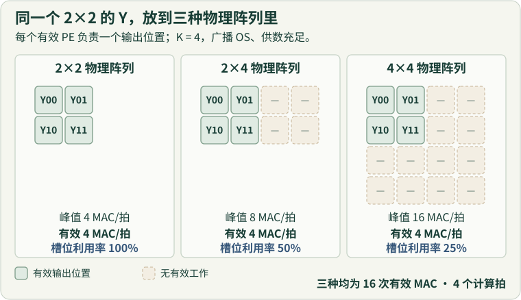
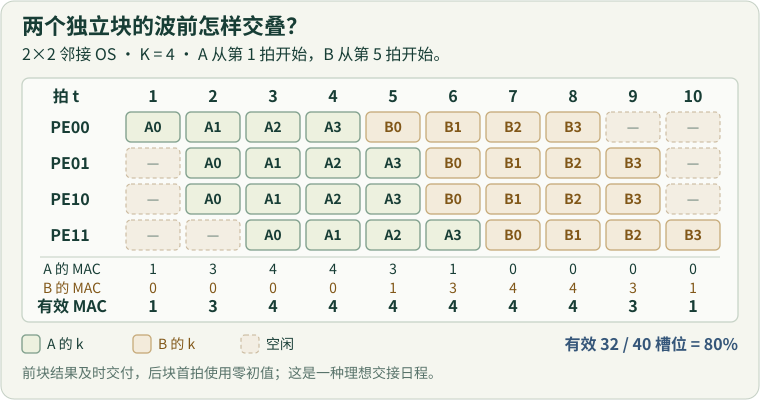
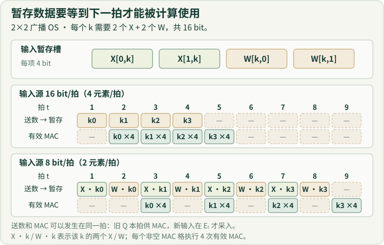
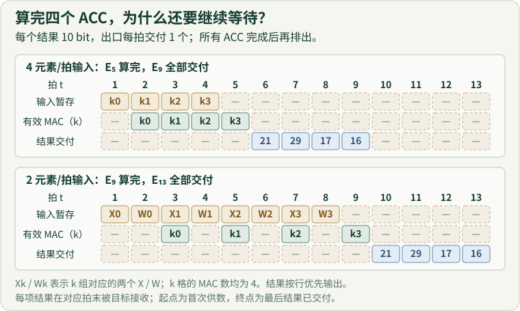

# 为什么扩大计算阵列，不一定能同比例提高吞吐？

在 [D01](d01-macs-and-array-data-paths.md) 中，四个 MAC 可以同时计算四个输出的乘积。单个 MAC 需要十六拍完成的工作，理想的行列广播阵列只需要四拍。

[D02](d02-stationary-dataflows-and-reuse.md) 又发现，即使有相同数量的 MAC，改变数据驻留位置，也会改变操作数供给和部分和的传递过程。

现在将四个 MAC 增加到十六个。如果仍然执行原来的矩阵乘法，能不能在一拍内完成？

**峰值算力**描述运算资源在规定数值格式、时钟频率和理想工作条件下所能提供的最大运算速率。但实际任务能够取得多少吞吐，还取决于有多少计算可以并行、操作数能否按时到达，以及完成的结果能否被及时接收。

本篇分别改变矩阵形状、阵列结构和数据供给条件。我们沿着同一批数据观察哪些 PE 真正在计算、哪些 PE 在等待，最后将算术执行与完整任务的时间区分开。

## 增加 MAC 后，原来的矩阵乘法还能分给谁？ {#shape}

回到 D01 和 D02 的算例。X 有两行四列，W 有四行两列：

| X | k=0 | k=1 | k=2 | k=3 |
| --- | ---: | ---: | ---: | ---: |
| i=0 | 2 | 1 | 3 | 4 |
| i=1 | 1 | 2 | 1 | 2 |

| W | j=0 | j=1 |
| --- | ---: | ---: |
| k=0 | 3 | 1 |
| k=1 | 5 | 2 |
| k=2 | 2 | 3 |
| k=3 | 1 | 4 |

Y = XW 有四个输出：Y[0,0]=21、Y[0,1]=29、Y[1,0]=17、Y[1,1]=16。每个输出需要沿 k 累加四次，总共有十六次有效 MAC。

沿用前两篇的四位无符号输入、八位完整乘积和十位累加器。在本篇的教学模型中，每个 PE 有一个 MAC，在操作数和初始部分和已经具备时，每拍最多完成一次有效乘加。

我们先固定 D02 的行列广播 OS（Output Stationary，输出驻留）方案：每个 PE 负责一个输出，部分和留在本地，依次处理四个 k。假设每拍数据都及时有效，暂时只观察算术执行区间，不计输入准备、ACC 初始化和结果交付。

### 将 2×2 阵列扩大到 4×4

原来四个 PE 分别负责四个输出。扩大阵列以后，仍然采用一个 PE 对应一个输出的方式。只有左上角的四个 PE 有对应的输出需要计算，其他 PE 没有更多输出可处理。

<figure class="micro-diagram" style="max-width:760px; margin:1.2rem auto" tabindex="0" aria-label="相同2乘2输出映射到三种物理阵列尺寸的对比，窄屏可横向滚动" markdown="1">

<figcaption>只改变物理阵列尺寸，保留一个 PE 负责一个输出的映射，以及 k=4 的逐项累加。空白位置没有本任务需要的有效乘加，不表示这些电路必然停止翻转。</figcaption>
</figure>

因此在这个映射下，即使十六个 MAC 都已经存在，仍然需要四拍才能算完。也可以尝试 D01 中沿 k 分工，让更多 PE 共同计算一个输出。但这需要新的操作数供给和部分和归约路径，不能由 MAC 数量自动推出。

### 怎样量化这些没有参加计算的 PE？

假设物理阵列有 P 个 MAC，每个 MAC 每拍最多执行一次乘加，那么连续 n 拍最多提供 P×n 个 MAC 槽位。

定义指定观察区间内的**有效 MAC 槽位比例**：

**U = 有效 MAC 次数 /（P × n）**

本篇用这个比例描述阵列的有效计算利用率。无效填零、没有对应输出的位置、等待操作数或等待结果交付的拍，都不计为有效 MAC；它不是芯片功耗或硬件开关活动的占比。

| 物理阵列 | 物理 MAC 数 | 本任务每拍有效 MAC | 算术执行拍数 | 有效 MAC 槽位比例 |
| --- | ---: | ---: | ---: | ---: |
| 2×2 | 4 | 4 | 4 | 100% |
| 2×4 | 8 | 4 | 4 | 50% |
| 4×4 | 16 | 4 | 4 | 25% |

在同样的时钟频率下，4×4 阵列比 2×2 阵列具有四倍的理论峰值 MAC/s，但执行这个任务时的有效吞吐没有提高。

### MAC 数量相同，阵列形状会影响结果吗？

再取一个 1×4 的阵列。它与 2×2 阵列都有四个 MAC，但在仍采用物理行对应 i、物理列对应 j 的映射下，1×4 一次只能处理 Y 的一行。

第一块计算 Y[0,0]、Y[0,1]；第二块计算 Y[1,0]、Y[1,1]。每块四拍，两个 PE 参与计算，另外两个没有对应的输出。

| 相同的四个 MAC | 2×2 | 1×4 |
| --- | ---: | ---: |
| 一次能够处理的本任务输出数 | 4 | 2 |
| 输出块数 | 1 | 2 |
| 算术执行拍数 | 4 | 8 |
| 有效 MAC 槽位比例 | 100% | 50% |

这里的差别来自逻辑输出形状与物理阵列形状的对应关系。不是所有 1×4 阵列都必须这样工作；如果有适用的重映射或按 k 分工的能力，结果可能不同。

假设一般矩阵乘法为 X(M×K) × W(K×N)，物理阵列为 R×C。如果每次映射一个不超过 R 行、C 列的输出块，每个 PE 都完整计算沿 K 的点积，各块依次执行且没有额外的切换开销，则：

- 输出块数 = ⌈M/R⌉ × ⌈N/C⌉。
- 算术执行拍数 = K × 输出块数。
- 有效 MAC 槽位比例 = M×N×K /（R×C×算术执行拍数）。

若只为 W 增加一列，让 Y 成为 2×3，2×2 阵列需要先算两列、再算剩余一列。后一个块仅有两个有效输出，一共 24 次 MAC 占用了 4×8 = 32 个槽位，利用率为 75%。

这种不能完全占满物理资源的最后一个块通常称为**尾块**。真实硬件可能通过掩码、填零或其他方式处理边界。无论是否实际执行了填充位置的运算，只计算原任务需要的 MAC 时，这些位置不贡献有效工作。

[Google Cloud TPU 性能指南](https://docs.cloud.google.com/tpu/docs/performance-guide#padding) 也指出矩阵维度与 MXU 的映射不匹配，可能引入填充并降低利用率；具体阵列尺寸和填充要求应按对应产品判断。

## 所有 PE 都有工作，为什么仍不能从第一拍开始同时运算？ {#fill-and-drain}

前面的行列广播假设同一拍所有 PE 都能取得自己的操作数。改回 D01 的相邻传递 OS：X 每拍向右传一个 PE，W 每拍向下传一个 PE，入口按行列错开。

我们不改变矩阵和四个 PE 的分工。D01 已经逐拍推导了第 k 项在 PE(i,j) 的相遇时刻：

**t = 1 + i + j + k**

这里 i、j、k 从 0 开始，第 t 拍的操作数在 Et−1 之后有效，新部分和在 Et 写入。仍然假设没有输入等待，结果能及时保存。

| 拍 | PE00 | PE01 | PE10 | PE11 | 有效 MAC |
| ---: | --- | --- | --- | --- | ---: |
| 1 | k=0 | — | — | — | 1 |
| 2 | k=1 | k=0 | k=0 | — | 3 |
| 3 | k=2 | k=1 | k=1 | k=0 | 4 |
| 4 | k=3 | k=2 | k=2 | k=1 | 4 |
| 5 | — | k=3 | k=3 | k=2 | 3 |
| 6 | — | — | — | k=3 | 1 |

在前几拍，操作数还未到达远端 PE；在后几拍，近端 PE 已经处理完最后一项，远端还在工作。

这就是阵列数据传播中的**填充（Fill）与排空（Drain）**。它与 [A06 的流水线填排](../01-foundations/a06-pipeline-and-throughput.md#latency-and-ii) 类似，只不过这里通过相邻 PE 的空间位置形成时序。

十六次有效 MAC 分布在 4×6 = 24 个槽位中，比例为 66.7%。与刚才任务形状造成的空闲不同，这次四个 PE 都有明确的计算任务，只是它们不能在相同的拍开始和结束。

### 如果实际参与的阵列更大呢？

假设采用 D01 的逐跳时序，实际参与计算的矩形区域有 r 行、c 列，从注入边缘开始使用，每个 PE 连续处理 K 项。

最后一个有效 MAC 位于 i=r−1、j=c−1、k=K−1。代入相遇公式：

**从首拍到最后一个有效 MAC 完成的拍数 = K + r + c − 2**

它只描述这个无停顿的相邻传递模型中的算术完成时间，不是所有脉动阵列的延迟公式，也不包含最终结果向目的地的搬运。

例如为 X 增加两行、为 W 增加两列，保持 K=4，就得到 4×4 的输出。若使用 4×4 物理阵列，所有位置都有对应的计算，依然需要十拍才全部完成 64 次 MAC。

| 无停顿的相邻传递 OS | 原任务，2×2 阵列 | 扩展任务，4×4 阵列 |
| --- | ---: | ---: |
| 参与的 PE 数 | 4 | 16 |
| 每个输出的归约项数 K | 4 | 4 |
| 有效 MAC 次数 | 16 | 64 |
| 最后一个有效 MAC 完成拍数 | 6 | 10 |
| 有效 MAC 槽位比例 | 66.7% | 40% |

若执行原来 2×2 的任务，只使用 4×4 里的左上四个 PE，在相同的边缘供数模型下，最后一个有效 MAC 仍在第六拍完成，不应将没有工作的后两行和后两列也代入 r、c。

扩大实际参与区域会增加数据到达远端的时间。若 K 足够长，满阵列工作的区间可能更长，填排占总时间的比例会下降。但 K 增大还要核查累加位宽，不能无条件沿用本例的十位 ACC。

### 每个计算块都必须等阵列完全排空，才能开始下一块吗？

不一定。让 2×2 的相邻传递阵列连续执行两块独立的 D01 形状的任务 A 和 B，每块 K=4。

A 的 PE00 在第 4 拍已算完自己的输出；PE11 还要等到第 6 拍。若 B 在第 5 拍从边缘按同样规律进入，B 的第一项会在第 5 拍到达 PE00、第 6 拍到达 PE01 和 PE10、第 7 拍到达 PE11。

每个 PE 都需要在上一块最后一次使用自己的 ACC 后，将完成的结果安全交付，并从零开始处理下一块。假设存在可按时接收这些结果的独立暂存或输出路径，首项可以选择初始加数 0，ACC 切换也不会额外占用周期。

例如 PE00 在 E₄ 得到 A 的结果，第 5 拍可以将其旧 ACC 值送向接收位置，同时用初始加数 0 计算 B 的第一项。在 E₅，接收位置采入 A 的旧结果，ACC 则采入 B 的新部分和。这需要相互独立的读取、写入及选择路径。

<figure class="micro-diagram" style="max-width:800px; margin:1.2rem auto" tabindex="0" aria-label="两块独立矩阵的邻接传递波前重叠，窄屏可横向滚动" markdown="1">

<figcaption>在不同 PE 之间，前一块的排空与后一块的填充重叠。假设操作数按时进入、每个 PE 在 ACC 被重用前已交付上一块结果，不代表所有实现都支持这个接纳间隔。</figcaption>
</figure>

两块如果完全串行，共需 6+6=12 拍。如果能够按图重叠，最后一次有效 MAC 在第 10 拍完成，共 32 次 MAC，利用率为 32/(4×10)=80%。

单块算术延迟仍然是六拍，但这里允许下一块在四拍后开始，即启动间隔为四拍。对于连续的 L 块，在相同假设下算术完成时间为 6+(L−1)×4 拍。实际吞吐还要核查供数及输出能否维持这个节拍。

这也是为什么单次任务的延迟不能直接代替持续吞吐，更不能只用一个填排公式证明整个芯片的任务处理速率。

## 如果供数路径每拍只能提供两个操作数呢？ {#input-bandwidth}

到现在为止，我们一直假设需要的数据会按时出现在 MAC 的输入端。现在保持原来 2×2 行列广播 OS，重新观察一份输入从缓冲出发，怎样进入四个 PE。

对于 k=0：

- 两行需要 X[0,0]=2 与 X[1,0]=1。
- 两列需要 W[0,0]=3 与 W[0,1]=1。

源端必须提供四个不同的矩阵元素，每个四位，即 16 bit。广播网络将这些值送给四个 PE，形成八份操作数；不能用八份接收端数据来代替源端的四份。

假设在阵列入口有四个四位暂存位置，分别保存 X 的两个值、W 的两个值，以及必要的有效状态。它们保存的是同一 k 对应的一组操作数。

为了跟踪取数时间，这次从入口为空、上游输入缓冲已经准备好的 E₀ 开始计时。一个服务拍内读出的数据在拍末写入暂存位置，下一拍可用；暂存寄存器读出旧 Q 和时钟沿写入新值可以同时按规定进行。

### 先假设一拍可以取齐四个元素

第 1 拍，缓冲提供 k=0 的四个元素，E₁ 时入口保存完整的一组数据。

第 2 拍，PE 使用这组旧 Q 执行四次 MAC。同时，缓冲可提供 k=1 的四个元素，在 E₂ 更新入口寄存器。此时此前的 MAC 已安全使用旧数据，不会和新的 k 混合。

接下来每拍都可以同时计算当前组、准备下一组。四组 MAC 在第 2～5 拍执行，E₅ 完成最后一次累加。

### 把源端服务能力从四个元素/拍减到两个

现在每拍最多取得两个四位元素，即 8 bit。第 1 拍只装入两个 X，第 2 拍才能装入对应的两个 W。

虽然四个 PE 仍然存在，第 2 拍开始时却没有完整的操作数组。若提前开始，就可能使用尚未准备好的 W 或错误地将不同 k 的操作数相乘。

第 3 拍才具备执行条件。此时利用入口暂存的旧值完成四个 MAC，同时让缓冲提供下一组的两个 X，在拍末采入；第 4 拍再取得对应的 W。

<figure class="micro-diagram" style="max-width:800px; margin:1.2rem auto" tabindex="0" aria-label="四元素和两元素每拍的输入供给与MAC执行日程对照，窄屏可横向滚动" markdown="1">

<figcaption>两种方案均使用四个操作数暂存位置。箭头对应拍末写入、下一拍使用；每个 MAC 活动拍执行四次有效 MAC。图中未计结果交付。</figcaption>
</figure>

把较慢路径的九拍都列出来：

| 拍 | 本拍从输入缓冲取得（拍末保存） | 本拍 MAC（使用拍初暂存值） | 拍末 ACC：PE00、PE01、PE10、PE11 |
| ---: | --- | --- | --- |
| 1 | X[0,0]、X[1,0] | — | 0、0、0、0 |
| 2 | W[0,0]、W[0,1] | — | 0、0、0、0 |
| 3 | X[0,1]、X[1,1] | k=0 | 6、2、3、1 |
| 4 | W[1,0]、W[1,1] | — | 6、2、3、1 |
| 5 | X[0,2]、X[1,2] | k=1 | 11、4、13、5 |
| 6 | W[2,0]、W[2,1] | — | 11、4、13、5 |
| 7 | X[0,3]、X[1,3] | k=2 | 17、13、15、8 |
| 8 | W[3,0]、W[3,1] | — | 17、13、15、8 |
| 9 | — | k=3 | 21、29、17、16 |

控制逻辑必须记录哪组操作数已经完整。如果第 3 拍结束后两个 X 已换成 k=1，而 W 仍是 k=0，就需要让本次操作数状态无效，直到 k=1 的 W 到达。ACC 只在有效 MAC 拍更新。

这里假设暂存寄存器的读出与拍末更新可以按上述方式配合。若实际端口不能支持这项安排，就还需要额外等待。

两种方案都从输入缓冲取得十六个四位元素，共 64 bit；慢路径不会因为等得更久而减少计算任务。快路径 E₅ 完成累加，慢路径 E₉ 才完成。

现在除了开始时的准备，还出现了算术执行中的空档。四个 MAC 在活动拍中全部工作，却不能做到每拍都活动。

## 装得下更多数据，就能一直保持满速吗？ {#buffer-capacity}

刚才的暂存区有四个四位位置，可保存一个 k 的完整操作数组，占十六个有效数据比特。不计有效位等控制信息。

如果只提供两个位置，且 MAC 必须从这些位置获得同一 k 的完整输入、没有直接旁路，那么原来的四 PE 同拍执行方式无法直接成立。需要增加暂存空间、改变供数路径或使用其他工作分配方式。

即使将容量从四个位置增至十六个位置，把本次 X、W 的所有元素预先装入，也没有改变慢路径每拍只能提供两个元素的能力。

看一种简单的预装安排：先用八拍把十六个元素全部装好，之后每拍从局部存储取得一组。若内部读取路径足够，四拍可以连续完成全部 MAC。

| 输入服务上限仍为 2 元素/拍 | 流式暂存（4 位置） | 全部预装（16 位置） |
| --- | ---: | ---: |
| 保存的有效操作数容量 | 16 bit | 64 bit |
| 从上游缓冲取得的元素数 | 16 | 16 |
| 所需输入服务拍数 | 8 | 8 |
| MAC 实际活动拍数 | 4 | 4 |
| 该安排的最后 MAC 完成拍数（从空入口开始） | 9 | 12 |

右侧方案假设完全预装再计算，不重叠装入和 MAC。它可以在四个算术拍内显示 100% 的 MAC 槽位比例，但从本任务开始到算完的时间并没有缩短。

更大的局部容量可以让硬件提前保存更多已到达的元素，也有可能帮助重叠、平滑短时波动或保留跨块复用的数据。它不自动增加读端口和写端口，也不能凭空产生新的操作数。

若后续任务仍以平均每拍四个元素的速率消耗新数据，而上游每拍只能补两个，预先保存的数据迟早会用完。**缓冲可以调整什么时候取得和使用数据，但有限容量不能长期补足持续供数速率的差额。**

D02 的权重驻留则更进一步：如果下一块确实能够继续复用本地 W，需要跨越所观察输入边界的新数据量会减少。这与仅仅增加暂存空间但仍然取相同的 64 bit，是两个不同的变化。

存储系统中的[驻留容量与累计流量](../../storage/01-memory-hierarchy/04-npu-case/npu-memory-hierarchy.md#residency)和[片上供数能力](../../storage/01-memory-hierarchy/04-npu-case/npu-memory-hierarchy.md#supply)进一步解释了容量、读取端口和 bank 等条件，本文不再展开存储器内部实现。

## 扩大阵列以后，每拍到底多需要多少数据？ {#scale-supply}

现在回到前面为 X 添加两行、为 W 添加两列的扩展任务。X、W 均为 4×4，Y 也为 4×4，K 仍为 4，总计 64 次有效 MAC。我们只分析形状和工作量，不需要知道新增元素的具体值。

保持行列广播的 OS。对于一个满的 r×c 输出块，每拍：

- r 行需要 r 个不同索引的 X，c 列需要 c 个不同索引的 W。
- 每个 PE 都取得一对操作数，共能执行 r×c 次 MAC。
- 在输入缓冲向供数网络的边界，共需 r+c 个四位元素；网络内部仍须完成对各 PE 的分发。

| 物理阵列 | 满阵列 MAC/拍 | 每个 k 所需源端元素/拍 | 每个 k 所需有效输入 bit/拍 |
| --- | ---: | ---: | ---: |
| 2×2 | 4 | 4 | 16 |
| 2×4 | 8 | 6 | 24 |
| 4×4 | 16 | 8 | 32 |

随着阵列扩大，一份操作数可以通过广播提供给更多 PE。对于同样的行列广播组织，不应简单认为 MAC 增加四倍，源端输入也必须增加四倍。

但这并不表示仍可以沿用原来每拍四个元素的供数接口。4×4 阵列要让十六个 MAC 同拍工作，需要满足八个元素的服务需求。若每拍只能供应四个，补充每个 k 的完整操作数组至少需要两个服务拍，因而无法持续维持每拍十六次有效 MAC。

在当前块的工作安排中，每组输入产生十六次 MAC。因此每两拍才可持续补充一组数据时，平均输入服务能力只能支持至多 **16/2 = 8 MAC/拍**。提前将数据存放在入口可以短时达到十六次，持续运行仍受补数速率限制。

### 同一个扩展任务，分成几个块时流量又会怎样？

假设每个物理阵列按照前文的输出块方式依次工作；块与块之间不额外驻留或共享输入副本，每个块所需的 X、W 都从同一个输入缓冲重新提供。统计区间覆盖本表所有取数和算术执行，不将预取移到统计区间之外。

2×2 阵列要处理四个输出块，每个块四个 k、每个 k 取四个元素。2×4 处理两个块，每个 k 取六个元素；4×4 一次就能覆盖全部输出。

| 完成同一个 4×4 输出 | 2×2 | 2×4 | 4×4 |
| --- | ---: | ---: | ---: |
| 有效 MAC | 64 | 64 | 64 |
| 输出块数 | 4 | 2 | 1 |
| 满供数时的算术执行拍数（不计切换） | 16 | 8 | 4 |
| 整个任务的源端元素数（含重读） | 64 | 48 | 32 |
| 若源端每拍最多 4 元素，输入服务拍数下界 | 16 | 12 | 8 |
| 由算术及输入服务能力限定的平均有效 MAC/拍上界 | 4 | 5.33 | 8 |

最后一行取算术执行拍数与输入服务拍数下界中的较大者，用 64 次 MAC 除以它。这个上界没有进一步计入数据依赖、装入初值和结果交付，也不意味着一定存在能达到该上界的交接日程。

阵列扩大让更多计算同时执行，也改变了哪些操作数可以在同一个块内复用。两个因素都影响需要多少输入服务；而是否值得采用某种分工还取决于实际的缓冲、端口和互连组织。

若改为 D02 的 WS 或 IS，本表的访问次数和速率就要重新推导，不能直接沿用 OS 的 r+c 关系。数据流不同，同一条路径的带宽需求也会不同。

[SCALE-Sim 原始研究](https://doi.org/10.1109/ISPASS48437.2020.00016) 分析了阵列规模、形状和存储带宽等参数对不同工作负载执行效率的影响，可作为本篇教学推导向更完整架构模型的延伸。

## 最后一项乘加已经完成，什么时候才能说任务完成？ {#output}

恢复 D01 的原始 2×2 输出。前面的有限供数实验中，快路径在 E₅、慢路径在 E₉ 得到四个完整的 ACC 值。

但它们还保存在 PE 本地。如果下一层需要从结果缓冲读取 Y，PE 必须把结果送到相应位置才算完成当前定义的任务。

假设四个 PE 共用一条输出路径，每拍只允许提交一个十位结果，结果由目的位置在拍末接收。最后一个 MAC 写入 ACC 的同一沿，接收方不能直接读取 ACC 刚更新的 Q；本例不增加绕过 ACC 的新结果旁路。

还假设本块计算结束后才逐个交付，按 Y[0,0]、Y[0,1]、Y[1,0]、Y[1,1] 的顺序读取四个 ACC；输入与输出路径各自独立。

<figure class="micro-diagram" style="max-width:800px; margin:1.2rem auto" tabindex="0" aria-label="从输入读取到结果全部交付的两种任务时序，窄屏可横向滚动" markdown="1">

<figcaption>观测区间从 E₀ 开始，包含输入装入、MAC 及最终结果交付。这里串行交付四个已完成的结果；输入、MAC 和输出的时间是否重叠，取决于明确的硬件约定。</figcaption>
</figure>

慢路径第 9 拍结束时只有计算完成。第 10～13 拍分别交付 21、29、17、16，直到 E₁₃ 时整个 Y 才保存在目的地。

快路径同样需要四个结果服务拍，从第 6 拍到第 9 拍。两种方案输出有效数据都是 4×10=40 bit。

### 那么实际吞吐应该怎样计算？

假设时钟周期为 Tclk，频率 f=1/Tclk。对于具有 P 个单拍 MAC 的教学阵列，理论峰值是 P×f MAC/s。

在包含 n 个周期的指定观察区间中，若原任务需要完成的有效 MAC 数为 Q，则：

**区间平均有效吞吐 = Q / n MAC/拍 = Q /（n×Tclk）MAC/s**

再次强调这个单位是 MAC，不是 FLOP。如果采用一次乘、一次加共计两次算术操作的约定，可以相应换算为整数运算的 OPS/s，不能把本例四位整数的能力当作浮点算力。

| 原任务在同一个 2×2 阵列上 | 快输入路径 | 慢输入路径 |
| --- | ---: | ---: |
| 理论峰值 | 4 MAC/拍 | 4 MAC/拍 |
| 实际执行有效 MAC 的活动拍 | 4 | 4 |
| 从 E₀ 到 ACC 全部完成 | 5 拍 | 9 拍 |
| 结果交付所需拍数 | 4 拍 | 4 拍 |
| 从 E₀ 到 Y 全部交付 | 9 拍 | 13 拍 |
| 此完整任务区间的平均有效吞吐 | 16/9 ≈ 1.78 MAC/拍 | 16/13 ≈ 1.23 MAC/拍 |
| 此区间的有效 MAC 槽位比例 | 44.4% | 30.8% |

这里的完整任务仅指从已准备好的输入缓冲到结果目的地，不包含片外内存装入、任务下发、其他引擎执行等步骤。若结果需要交给另一个引擎，完成与可读的通知机制见 [F02](../06-resource-cooperation/f02-task-control-and-synchronization.md#event-and-visibility)。

注意，D01 行列广播的四拍和本节的九拍并不矛盾。D01 观察的是数据已经及时到达时的算术执行区间；现在我们还把输入准备和结果交付纳入统计。

### 如果再来一个独立的计算块呢？

在本节模型中，若没有其他可保存完成结果的位置，并且下一个块仍需同时占用这四个 ACC，计算就必须等上一块的结果已经安全交付后才能使用这些 ACC。

增加输出暂存空间、有独立的传输路径，可能允许下一块的计算与本块结果交付重叠。但仍然要判断哪些状态可以被覆盖，以及输出端口在长期内能接受多少个结果。这个问题将在 [F01 的多引擎与缓冲复用](../06-resource-cooperation/f01-overlap-and-buffer-reuse.md#more-buffers)中进一步讨论。

例如扩展后的 4×4 阵列在满供数时四拍完成 16 个结果。若长期保持这种执行速率，平均每拍需要交付四个十位值。每拍只能交付一个值的接口即使有足够的输出暂存，也无法持续跟上；64 次 MAC 对应十六次输出服务，长期平均有效吞吐至多 4 MAC/拍。

这还不是对完整任务时间的预测，因为每块的输出集中到达，输入依赖、暂存容量和交接日程还会影响实际等待。

## 怎样在设计时确定扩大阵列是否值得？ {#summary}

本专题三篇分别改变了计算单元组织、数据驻留和硬件资源约束。现在可以按照实际的数据路径，检查一项矩阵乘法的执行情况：

| 观察到的现象 | 应检查的条件 |
| --- | --- |
| 大量 PE 在整个块内都没有有效工作 | 矩阵形状、物理阵列形状、映射及尾部 |
| 有明确任务的 PE 先后开始或结束 | 数据传递延迟、填充和排空、接纳下一块的条件 |
| 多个 PE 同时等待操作数 | 当前所需的 X、W 和部分和，是否已到达合适的位置 |
| 数据装得下却不能及时取得 | 局部端口、片上存储和供数通路的服务能力 |
| MAC 已完成却无法接纳下一块 | 结果是否已安全交付、输出带宽和暂存状态 |

这些约束可能同时存在。首先由计算形状和硬件映射得到需要执行的 MAC 数，再按照实际数据流追踪每条路径上的流量，才能判断哪个资源不能维持预期节拍。

如果某个资源在观察区间内需要搬运 q bit，有效服务上限为 b bit/拍，那么至少需要 ⌈q/b⌉ 个服务拍。若多个方向共享同一物理通路，应将该通路承载的需求合计；若各自独立，则按各自的资源另算。

例如 D02 的三种方案虽然都有 64 bit 输入，但 WS、IS 在教学结构中还需中间部分和写出和读回。如果这些传输与输入共用资源，带宽预算就不能只计算 X、W。

服务拍数下界不等于任务时间，也不能把各路径的下界不加区分地相加。还需知道实际的依赖、重叠和等待。[存储系统的片上带宽预算](../../storage/01-memory-hierarchy/04-npu-case/on-chip-bandwidth-budget.md)对共享与独立通路给出了更完整的记账方式。

最后，即使两种阵列的每拍有效 MAC 数相同，它们的真实时钟频率也可能因布线、扇出和关键路径不同而改变。要得到 MAC/s 必须采用各自的真实工作频率；面积、功耗与时序等取舍则属于后续的[性能分析与设计权衡](../08-performance/README.md)。

D 专题到这里告一段落。接下来可以继续阅读：

- [数据搬运与处理引擎](../05-data-movement/README.md)：研究怎样将一块数据送到计算阵列，以及请求和返回怎样组织。
- [多执行实体与资源协作](../06-resource-cooperation/README.md)：研究计算、搬运和结果交付之间的时序与资源关系。
- [专用计算与稀疏计算](../07-specialized-compute/README.md)：研究其他算术路径及如何处理不规则工作。
- [性能分析与设计权衡](../08-performance/README.md)：综合不同机制，分析延迟、吞吐与硬件成本。

[返回计算阵列与数据流导读](README.md)。
