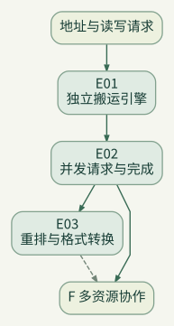

# 数据搬运与处理引擎

数据搬运引擎负责在存储器或硬件模块之间传送数据。直接内存访问（DMA）引擎是其中的一类，它可以独立执行一项搬运，不必让处理器逐项执行数据读写。

计算单元完成一次乘加后，下一组操作数却还在内存里。如果搬运这些数也要占用计算单元的执行资源，计算就可能需要等待。独立的搬运引擎可以减少这种干扰，并在资源允许时与计算并行。

以同一块 3×4 的 8 bit 矩阵贯穿本路线：从连续复制出发，改变源和目标的行步长，再允许多笔读写事务同时推进，最后让同一组数据在搬运途中改变布局和格式。每一步都追踪数据所在的位置、引擎内部的状态和请求完成的条件。

## 知识关系

<figure class="micro-v2-map" markdown="1">

<figcaption>知识衔接示意。虚线表示关联或辅助阅读。点击可查看大图。</figcaption>
</figure>

## 计划阅读顺序

本路线规划三篇文章。下表按照任务展开、并发推进、数据处理的认知顺序列出正文；尚未完成的条目为后续阅读规划。

| ID | 文章 | 内容范围 | 状态 |
| --- | --- | --- | --- |
| E01 | [一块数据从内存搬到计算单元，DMA 要做哪些工作？](e01-dma-task-and-address-generation.md) | 独立引擎、描述符、地址生成、多维 stride、burst、对齐与边界切分 | 已发布 |
| E02 | [第一笔请求还没有返回，为什么 DMA 能发出第二笔请求？](e02-outstanding-requests-and-completion.md) | outstanding、ID、内部缓冲、响应匹配/乱序、反压、命令队列、完成通知与可读条件 | 已发布 |
| E03 | 搬运数据时，能否顺便改变数据的布局和格式？ | gather/scatter、转置、重排、类型转换、打包、压缩/解压、粒度及吞吐 | 未发布 |

## 阅读衔接

- [共同计算基础](../01-foundations/README.md)：重点了解 [A01 的状态与控制](../01-foundations/a01-state-and-control.md)、[A05 的数据通路](../01-foundations/a05-datapath-and-control.md)、[A07 的握手](../01-foundations/a07-handshake-and-backpressure.md)和 [A08 的任务生命周期](../01-foundations/a08-dependencies-and-scheduling.md)。不必先读完整的 CPU 或计算阵列路线。
- 地址、存储端口和访问粒度可参阅[存储系统](../../storage/README.md)；[NPU 数据路径与存储组织](../../storage/01-memory-hierarchy/04-npu-case/README.md)解释数据如何跨存储层级。总线事务、请求和响应的通信机制可参阅[芯片与系统互连](../../interconnect/README.md)，尤其是[AXI 与 DMA 的系统接口](../../interconnect/BUS/04-microarchitecture-integration/axi-dma-system-interface.md)。
- 本路线关注搬运和数据处理的硬件机制；驱动编程、软件编排及具体互连协议不在这里展开。
- 接下来阅读[多执行实体与资源协作](../06-resource-cooperation/README.md)，看看数据准备和计算如何同时进行。

## 进阶资料

[旧版 DMA 专题](../../microarchitecture/05-dma/README.md)中还有多通道与虚拟化、不同系统的接口及实现、性能建模和商业 IP 调研。新版正文先建立一般的硬件机制；这些原有资料仍可按目的查阅，不需要作为三篇正文的前置知识。

[返回计算微架构系列总览](../README.md)
