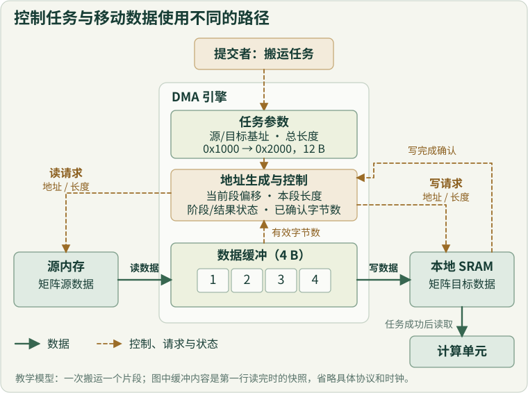
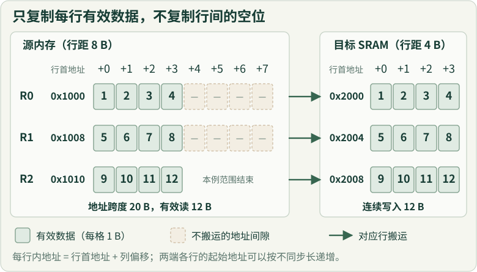
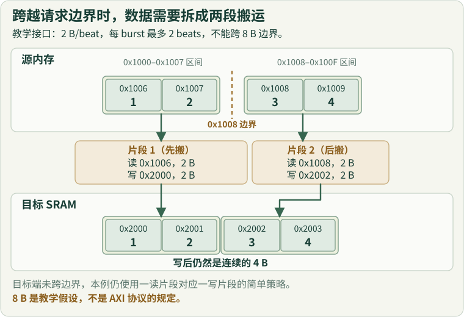

# 一块数据从内存搬到计算单元，DMA 要做哪些工作？

计算一组乘加之前，运算单元需要先取得操作数。假如下一组操作数还在片外内存中，而计算单元只能从身边的片上存储器取数，就需要先把这组数据复制到片上。

这件事不改变任何操作数的值，但需要访问源地址、等待数据返回，再把数据写入新的位置。如果这些操作都由负责计算的处理器逐次发起，就会占用它的指令执行和读写资源。

**直接内存访问（Direct Memory Access，DMA）**的一种实现方式，是增加一个能够独立执行搬运任务的硬件引擎。给它地址、长度等任务参数，它就能自行产生读写请求，并在数据真正搬完后报告状态。

下面先搬一块连续存放的小矩阵，再将它的三行放到不连续的地址上。沿着同一块数据，看看 DMA 为什么需要保存状态，以及一条搬运命令怎样展开成多笔实际访问。

## 如果没有独立的搬运引擎，数据怎样到达计算单元？ {#why-dma}

取一个 3×4 的矩阵 M，其中每个元素都是一个 8 bit 无符号整数，占 1 B。行号和列号都从 0 开始。

| 行 | 第 0 列 | 第 1 列 | 第 2 列 | 第 3 列 |
| --- | ---: | ---: | ---: | ---: |
| 0 | 1 | 2 | 3 | 4 |
| 1 | 5 | 6 | 7 | 8 |
| 2 | 9 | 10 | 11 | 12 |

假设源矩阵按行连续保存在内存地址 `0x1000`～`0x100B` 中。计算单元的本地 SRAM 中有一块 12 B 的空闲区域，从 `0x2000` 开始。我们要让 `0x2000`～`0x200B` 保存相同的十二个数。

本例假设两个区域不重叠，地址已映射且允许相应读写，搬运期间源数据不变，也没有其他实体修改目标区。所有地址均以字节为单位。

回忆 [A05 的数据通路](../01-foundations/a05-datapath-and-control.md)：运算单元可以从局部寄存器取操作数，而要读到新的操作数，必须先将数据送到可供它读取的位置。

如果有一个能访问这两块存储区的通用处理器，它可以利用 [B01 的 Load 和 Store](../02-cpu/b01-instructions-and-architectural-state.md#load-store) 完成复制。

假设处理器支持每次读写 4 B 的指令，先从 `0x1000` 读四个字节到临时寄存器，再将它们写入 `0x2000`。接下来两次分别复制第 1 行和第 2 行。

| 第几次 | Load 的地址 | 临时数据（按地址递增） | Store 的地址 |
| --- | --- | --- | --- |
| 1 | `0x1000` | 1、2、3、4 | `0x2000` |
| 2 | `0x1004` | 5、6、7、8 | `0x2004` |
| 3 | `0x1008` | 9、10、11、12 | `0x2008` |

即使数据完全没有经过 ALU 运算，这种实现也至少需要三条 Load 和三条 Store。处理器还可能需要更新地址、判断循环是否结束。对于没有通用指令接口的计算单元，也可以由控制逻辑产生类似的读写序列。

如果希望让原来的处理器继续执行其他工作，能不能将产生这些读写请求、保存返回数据、判断搬完没有的工作，交给另一套电路？

这里独立的是任务的执行职责。DMA 仍然需要发出内存访问，并占用存储器和互连服务资源。它不是消除数据搬运，而是让发起任务的处理器不必逐笔参与。对于很小的复制，提交 DMA 的开销也可能比直接复制更大。

## 只交给 DMA 一项任务，怎样让它记住还要搬什么？ {#task-state}

从刚才三次复制的规律，可以提取出一组参数：源起点 `0x1000`，目标起点 `0x2000`，总长度 12 B。两侧的地址都随着已经复制的字节数递增。

发起者只需告诉 DMA 这些参数。我们把“将这 12 B 复制到另一区域”称为一项**搬运任务**。传给硬件的启动操作称为搬运命令；描述任务参数的记录通常称为**描述符（Descriptor）**。

最简单的引擎可以直接接收控制寄存器或命令接口中的参数，不一定支持从内存中取描述符。也可以将任务参数放在内存里，让 DMA 先读取并解析描述符，再执行相应搬运。

例如 [AMD AXI CDMA v4.1 的简单模式](https://docs.amd.com/r/en-US/pg034-axi-cdma/Programming-Sequence)通过源地址、目标地址和长度寄存器配置复制。

其可选的[链式描述符模式](https://docs.amd.com/r/en-US/pg034-axi-cdma/Scatter-Gather-Transfer-Descriptor-Definition)则提供内存中的任务记录及下一条描述符指针。两种入口可以描述类似的复制要求，而不必逐次提交每笔载荷读写。

但参数本身还不足以让电路完成任务。假如第一笔读已经发出，而数据尚未返回，硬件还需要知道哪些工作已经发出、当前在等待什么。

沿用 [A01 的寄存器、计数器与有限状态机](../01-foundations/a01-state-and-control.md)构造一个简单引擎。它只接纳一项任务，并且每次只搬运一个小段。内部有以下保存位置：

| 保存的信息 | 作用 | 接纳连续复制任务后的初值 |
| --- | --- | --- |
| 源、目标基址，任务长度 | 保存任务要求 | `0x1000`、`0x2000`、12 B |
| 已成功确认写入的字节数 k | 确定下一段的偏移与是否完成 | 0 B |
| 当前段的源地址、目标地址和长度 | 在等待期间保持本段的对应关系 | 生成请求时填写 |
| 数据缓冲及有效字节数 | 保留从源端收到、需要向目标端写出的数据 | 空 |
| 控制状态及结果状态 | 区分准备请求、等待返回、写入及完成或失败 | 准备读 |

其中前三类记录可以由不同方式实现。例如本例中当前段地址可以从基址和 k 组合算出，不必一定另造完整的地址寄存器。关键是等待期间不能弄丢地址与数据的对应关系。

为便于观察，设定这台教学机器的两个访问接口都按字节寻址，数据宽度均为 16 bit，即一个数据拍最多传 2 B。本例的对齐访问均使用完整的 2 B 数据拍。一笔请求最多传两个连续数据拍（4 B）。

DMA 有一块 4 B 的内部数据缓冲，且等待当前段成功写入后才开始下一段。暂时不考虑边界和非对齐问题；稍后会增加这些限制。

## 一条命令收到后，硬件逐拍做什么？ {#execution}

先看 k = 0 的第一段。地址生成逻辑用两个基址分别加上 k，得到源地址 `0x1000` 和目标地址 `0x2000`。本段长度取剩余 12 B 与最大段长 4 B 的较小者，等于 4 B。

源地址和长度通过读请求接口发出。读端收到这笔请求后，若访问成功，会把相应数据送回来。本例的 DMA 先保存整段数据，再把它们交给目标端写接口。错误响应不应被当作有效数据写入。

目标侧同样需要地址，只送出数值 1、2、3、4 并不能让 SRAM 知道它们应该写在哪里。现在可以把读写控制和数据路径连接起来。

<figure class="micro-diagram" style="max-width:820px; margin:1.2rem auto" tabindex="0" aria-label="独立DMA的读写请求、数据缓冲及目标片上SRAM，窄屏可横向滚动" markdown="1">

<figcaption>以普通内存到本地 SRAM 的复制为例。控制器产生请求、观察接纳和应答，数值经过数据路径传输。实际引擎可以使用不同接口、缓冲结构或直接流式转发。</figcaption>
</figure>

为了逐拍检查这一过程，再规定如下时序。这些都是本例的接口假设，不是 DMA 或 DRAM 的普遍延迟：

- 引擎和两端接口使用同一个时钟。每个请求或者数据拍在 valid/ready 同时有效的边沿完成交接，各接口没有额外等待。
- 读地址被接纳后隔两拍返回第一个 2 B，下一拍返回第二个 2 B。读数据按本笔请求内的地址从低到高返回。
- DMA 收齐一段数据后，下一拍提交写地址，之后每拍写 2 B。本地 SRAM 直接更新相应字节，最后一个数据拍被接纳后的下一拍返回成功应答。
- 本例在写应答之后才释放这一段的缓冲，更新 k。每轮只允许一笔读或写事务在途，不允许提前发下一段的读。

将时钟边沿编号为 E0、E1……。观察第一段的地址和数据在各边沿后的状态：

| 边沿 | 实际发生的事件 | 内部缓冲中的有效数据 | 已成功确认的写入量 k |
| --- | --- | --- | ---: |
| E0 | 接纳任务 | 空 | 0 B |
| E1 | 读请求被源端接纳：`0x1000`，4 B | 空 | 0 B |
| E2 | 等待返回 | 空 | 0 B |
| E3 | 第一个读数据拍返回 | 1、2 | 0 B |
| E4 | 第二个读数据拍返回 | 1、2、3、4 | 0 B |
| E5 | 写请求被目标端接纳：`0x2000`，4 B | 1、2、3、4 | 0 B |
| E6 | 写入 `0x2000`～`0x2001` | 1、2、3、4（保留） | 0 B |
| E7 | 写入 `0x2002`～`0x2003` | 1、2、3、4（保留） | 0 B |
| E8 | 收到成功写应答，释放缓冲 | 空 | 4 B |

E1 以后，源端已经接收了地址，并不表示 DMA 已取得任何字节。E3 以后，缓冲只有半段有效数据。E4 才取得整段，仍不能认为它已经写到目标位置。

E7 以后，本例的前四个目标字节已经更新。但直到 E8 收到本段的成功应答，控制器才确认 k 可以增加到 4 B。若写应答表示失败，不应沿着成功路径增加 k 或报告整项任务成功。失败前的目标写入也未必能撤销。

这是 [A07 的握手与反压](../01-foundations/a07-handshake-and-backpressure.md)在搬运通路中的应用。如果某个边沿下游没有 READY，本例要保持待交付的地址或数据，等待真正握手之后才推进相应状态。

E8 以后，k = 4，控制逻辑便可生成下一段地址 `0x1004` 和 `0x2004`。它用同一个缓冲依次搬第二、第三段，分别在 E16、E24 收到成功写应答。

到 E24 时 k = 12 B，达到任务长度。目标 SRAM 已经保存了完整矩阵。控制器可以记录成功完成，按本例约定让计算端在 E24 之后取得新数据（最早在 E25 的边沿发起读取）。

为什么 DMA 接走命令后，处理器可以先干别的事？因为完成任务所需的参数、进度、数据和等待状态都已由另一套电路保存。发起方不必占用自己的执行通路等待每笔事务，这种任务层面的异步执行并不要求两个模块属于不同的时钟域。

## 如果矩阵的行并不连续，怎样生成地址？ {#stride}

现在只改变源矩阵在内存中的放置方式。假设这三行来自一个行宽为 8 B 的大矩阵，我们只需要每行的前四个元素。第 0 行仍从 `0x1000` 开始，但第 1 行从 `0x1008` 开始，第 2 行从 `0x1010` 开始。

其余四个字节可能是大矩阵中本次不需要的元素，也可能是布局中的填充。本次任务不能把这些字节当作有效操作数。目标仍希望按原来的三行紧密存放。

<figure class="micro-diagram" style="max-width:820px; margin:1.2rem auto" tabindex="0" aria-label="三行四列矩阵从源行距8字节复制到目标行距4字节的地址映射，窄屏可横向滚动" markdown="1">

<figcaption>两个地址空间按相同的逻辑行对应。行内有效长度为 4 B，源行距为 8 B，目标行距为 4 B。只复制十二个有效字节，不复制行间的八个无关字节。</figcaption>
</figure>

如果原样使用连续地址的复制命令，DMA 在搬完 `0x1000`～`0x1003` 后，将从 `0x1004` 继续读，却读不到第 1 行的数据。要得到正确结果，至少还需要告诉 DMA 每行有几个字节，下一行开始于什么位置，以及要搬多少行。

这里引入**步长（Stride）**：沿某一维移动一个逻辑位置时，地址增加或减少的量。本例用字节作为步长单位。相邻两行的首地址之差称为行步长或行距，而不是上一行末尾与下一行之间的空隙。

对于行内连续的矩阵，一种二维搬运描述可以保存以下参数：

| 参数 | 数值 |
| --- | --- |
| 源、目标基址 | `0x1000`、`0x2000` |
| 每行有效字节数 W | 4 B |
| 行数 H | 3 |
| 源行步长 S | 8 B |
| 目标行步长 D | 4 B |

分别令 r 为当前行号，b 为当前行内的字节偏移。只要地址生成器能产生以下两个地址，就不会因为目标紧凑存放而读错源位置：

**源地址 = 源基址 + r × S + b**

**目标地址 = 目标基址 + r × D + b**

本例中 r 的取值是 0、1、2，b 从 0 到 3。因为每个元素正好占 1 B，b 也等于列号。更大的元素需要让列号乘以元素字节数。

不需要每次重新做乘法。可以让两个行首地址寄存器从基址开始，每次完成整行就分别增加 S 和 D，同时让行号计数器加 1、行内偏移复位为 0。

如果实现保存的是已经向前移动到行末之后的地址指针，则跳到下一行时应增加 S − W 或 D − W，而不能再加一整个行步长。

沿用前面的 4 B 最大段长，这台机器的请求序列变为：

| 行 r | 读请求 R | 写请求 W | 成功确认后的累计字节数 |
| --- | --- | --- | ---: |
| 0 | R0：`0x1000`，4 B | W0：`0x2000`，4 B | 4 B |
| 1 | R1：`0x1008`，4 B | W1：`0x2004`，4 B | 8 B |
| 2 | R2：`0x1010`，4 B | W2：`0x2008`，4 B | 12 B |

R0、R1、R2 和 W0、W1、W2 是为了跟踪这六笔访问而给出的编号。此时每次只有一笔事务在途，并不需要依靠可区分多个在途事务的 ID 来匹配返回。

矩阵的实际数据量还是 12 B。源端从 `0x1000` 到 `0x1013` 的地址跨度是 20 B，目标端的跨度是 12 B。地址跨度不等于此次有效搬运量。

若还需要搬多张这样的矩阵，且相邻矩阵的首地址具有固定差值，就可以再增加一个外层计数器和两端的矩阵步长。每完成一张就更新矩阵起点，重新开始逐行搬运。这是由内层连续区间和外层步长逐级产生地址的**多维步长搬运**。不要求所有 DMA 都支持相同的维数。

[TI EDMA3 控制器用户手册 SPRUEQ5B，第 2.3、2.11 节](https://www.ti.com/lit/ug/sprueq5b/sprueq5b.pdf)展示了具体硬件如何用连续数组长度、数组计数及独立的源/目的索引描述多维传输。本文的参数名是为教学选择的，并不是该控制器的寄存器编程规范。

## 为什么一行四个字节要传两拍，而不是发四次读地址？ {#burst}

前面每笔请求覆盖 4 B，而接口每个数据拍只能交付 2 B。为什么没有必要为每个字节都发出一次地址？

在本例这样的连续访问中，接收端已从请求得到起始地址和数据长度。它可以确定后续数据拍对应的地址，不需要发送端再为每个数据拍重复提交完整的地址。这种以一个请求组织多个数据拍的传输称为**突发传输（Burst）**。

例如 R0 从 `0x1000` 开始，声明请求两个 2 B 数据拍。源端按请求内地址递增的顺序，先返回 `0x1000`～`0x1001`，再返回 `0x1002`～`0x1003`。目的端 W0 也可以采用两个数据拍的突发写入。

这使我们能够区分一整项任务、一笔接口事务和实际的数据交接：

| 对象 | 二维算例中的数量 |
| --- | ---: |
| 逻辑搬运任务 | 1 项，12 B |
| 源端读事务 | 3 笔，每笔 4 B |
| 源端读数据拍（Beat） | 6 个，每个 2 B |
| 目标端写事务 | 3 笔，每笔 4 B |
| 目标端写数据拍 | 6 个，每个 2 B |
| 整项任务的成功完成事件 | 1 次 |

描述符需要描述哪些字节属于这一项任务，而事务及数据拍是引擎按接口规则选择的实现方式。数据拍也不是时钟周期的另一种叫法：只有成功交接才计一个数据拍，一拍时钟可能没有数据传输。

在这个模型里，长一些的 burst 能减少地址请求数量。实际接口还可能对单个 burst 的最大拍数、地址对齐及允许覆盖的范围有所限制。

## 如果一行数据跨过接口边界，为什么还要拆成两笔请求？ {#split}

保持每拍 2 B、最多两拍的限制。为了把边界问题缩小到容易观察的范围，额外设定本例接口要求一次 burst **不能跨越任意 8 B 对齐的地址边界**。这不是实际 AXI 的边界数值，只是教学参数。

将源矩阵的基址从 `0x1000` 改成 `0x1006`，继续使用 8 B 源行距。第 0 行现在占 `0x1006`～`0x1009`。如果仍然发 4 B 的读请求，两个数据拍会分别落在边界 `0x1008` 的两侧。

接口不允许这样的请求。因此地址生成逻辑在提交请求之前必须判断本次访问能覆盖的范围，而不只是检查剩余字节数。

<figure class="micro-diagram" style="max-width:820px; margin:1.2rem auto" tabindex="0" aria-label="一行4字节跨教学8字节边界，拆成两笔各2字节的请求，窄屏可横向滚动" markdown="1">

<figcaption>把第 0 行单独放大。源侧到下一边界的距离只有 2 B，简单引擎按相同的行内偏移在两端同步切段。目标地址没有跨界，不是目标接口本身要求拆成两笔。</figcaption>
</figure>

初始 b = 0，源地址到下一处边界的距离是 `0x1008 − 0x1006 = 2 B`；目标地址到下一处边界的距离是 `0x2008 − 0x2000 = 8 B`。

对本例这样两侧均按 2 B 对齐、剩余长度也是 2 B 整数倍的传输，可以采用一种简单的保守策略。每一段的长度取以下四者的最小值：

**段长 = min(本行剩余字节数，最大段长，源侧边界距离，目标侧边界距离)**

因此第一段长度是 min(4, 4, 2, 8) = 2 B。读 `0x1006`～`0x1007`，写 `0x2000`～`0x2001`。成功写入后，b 从 0 增加到 2。

第二次计算时本行仍剩 2 B，源地址已经变成 `0x1008`，目标地址变成 `0x2002`。下一处源侧边界为 `0x1010`。第二段也长 2 B。直到 b = 4，才更新两个行首地址并开始下一行。

这个过程中既没有丢掉任何有效字节，也没有把跨界传输当成一笔合法请求。如果目标端也有边界限制，同样需要遵守。改进的引擎还可以先把两笔读的数据聚合在缓冲里，再合成一笔合法的目标写；读事务与写事务并非必须一一对应。

现实接口的边界规则不同。例如 [Arm AMBA AXI/ACE 协议规范 IHI 0022H，A3.4.1 节](https://developer.arm.com/-/media/Arm%20Developer%20Community/PDF/IHI0022H_amba_axi_protocol_spec.pdf?hash=6325311012DDADF238C35A6C0FD734E520754F82&la=en&revision=71bd7c57-2ed7-487b-bc3e-68c4ab56fa5f)规定 AXI burst 不得跨 4 KiB 边界。这是事务覆盖范围的约束，不能把它当成所有 DMA 的共同限制，也不等于 DRAM 的行边界。

[互连系列：AXI 的 burst、对齐与边界](../../interconnect/BUS/03-on-chip-protocol-families/axi-burst-alignment-boundary.md)

如果把本例起点改为 `0x1001`，或者一行仅剩 1 B，则 2 B 的对齐数据拍也可能无法恰好覆盖需要的地址范围。硬件必须根据两端支持的传输大小、非对齐和字节使能能力来生成合法访问，必要时在内部重新对齐数据。不能保证合法时，应拒绝不支持的任务，而不是任意多读或覆盖其他字节。

例如 [AMD AXI CDMA 的 DataMover](https://docs.amd.com/r/en-US/pg034-axi-cdma/DataMover)能够根据地址边界拆分总线事务，并可选配字节级数据重新对齐能力。能否做非对齐复制取决于具体实现。

## 最后一笔数据已经发出去，为什么还要观察完成状态？ {#completion}

回到原来不跨界的二维例子。E24 是最后一行的成功写应答到达 DMA 的边沿。此时控制器知道三个目的区域均已完成本例所约定的写入。

参考 [A08 的任务生命周期](../01-foundations/a08-dependencies-and-scheduling.md#result-availability)，还需要明确每种事件到底确认了什么。

| 事件 | 本例中的时刻 | 能确认什么？ |
| --- | --- | --- |
| 搬运命令接纳 | E0 | DMA 已保存参数，有责任推进任务 |
| 第一笔读请求接纳 | E1 | 源端接受了地址与长度 |
| 第一段数据收齐 | E4 | DMA 已取得第 0 行的四个字节 |
| 最后一个写数据拍交接 | E23 | 本例 SRAM 接收并写入最后两个字节 |
| 最后的成功写应答被接收 | E24 | 本例全部目标字节的写入已得到成功确认 |
| 完成状态发布、消费者可使用 | E24 沿后 | 本例允许计算端读取完整矩阵 |

本例将整项任务的成功边界定义为所有段的成功写应答均已收到。目标是本地 SRAM，写应答只在该段已经写入后返回；消费者另有明确的整块读取许可。最后两类事件因此可以安排在同一边沿之后，但它们描述的是不同的条件。

换成其他引擎，写数据被接口接纳可能只代表进入中间缓冲；完成通知也有不同含义。

例如 TI EDMA3 的控制器允许配置完成通知发生在请求交给搬运控制器时，或在得到对应的传输完成反馈时。[TI EDMA3 用户手册，第 2.5 节](https://www.ti.com/lit/ug/sprueq5b/sprueq5b.pdf)

若目标数据还要供可能保留旧副本的 CPU 读取，必须另外遵守系统的地址映射、内存次序与 Cache 一致性契约。这里使用 DMA 可直接访问的合法地址，并假设目标 SRAM 不存在此类旧副本，不展开相关协议。

[互连系列：DMA 的地址翻译](../../interconnect/BUS/04-microarchitecture-integration/iommu-smmu-dma-addressing.md) · [存储系统：Cache 与 scratchpad 的区别](../../storage/01-memory-hierarchy/02-access-paths/cache-vs-scratchpad.md)

因此，理解一个 DMA 接口的 DONE 或中断时，不能只根据名字判断数据能不能使用，而要先找到它所确认的事件及消费者的读取条件。多引擎如何用这种条件同步，将由 [F 专题](../06-resource-cooperation/README.md)继续解释。

## 下一行真的必须等上一行写完吗？ {#next}

在当前没有跨界的教学模型中，E0 到 E24 共经过 24 个时钟周期，DMA 成功复制了 12 B 的有效数据。按命令接纳到最后成功写应答的时间来计算，这一次搬运的平均有效吞吐为 **12 B / 24 拍 = 0.5 B/拍**。

每侧数据接口在成功交接时都能传 2 B/拍，单方向峰值带宽为 2 B/拍。这次搬运中，源端和目标端各自只有六个有效数据拍。两个接口各传 12 B，将两侧相加得到的是两处接口的有效载荷流量，而不是任务的有效复制量。其余时间，这台 DMA 正在提交请求、等待数据或等待写入应答。

为什么接口会有空闲？并非每次请求都必须相互依赖。本例第 1 行和第 0 行访问的源及目的区域没有重叠。第一行已经发出但还未返回时，第二行的地址也完全可以算出来。

真正限制它提前发出的是我们设计的控制和保存能力：只有一组当前段状态和 4 B 数据缓冲，并规定一笔事务完成后才继续下一笔。如果解除这个限制，就必须能够区分属于不同请求的状态，并保证随后返回的数据有地方保存。

[下一篇 E02：第一笔请求还没有返回，为什么 DMA 能发出第二笔请求？](e02-outstanding-requests-and-completion.md) 将沿用源行距 8 B、目标行距 4 B 的原始二维矩阵，改变的只是引擎同时保存和推进多笔请求的能力。我们将观察后一笔数据先返回时怎样找到正确的目标位置，以及累积的请求和缓冲资源何时会使引擎停止继续发出请求。

[返回数据搬运与处理引擎导读](README.md)
