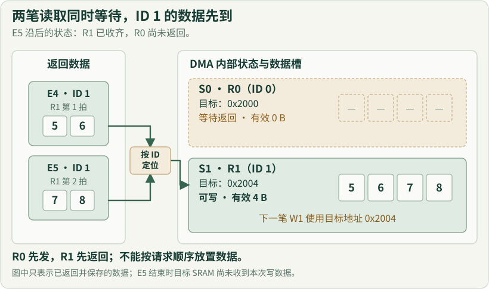
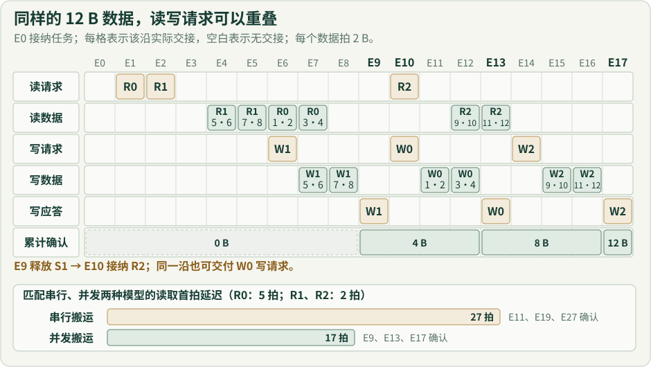
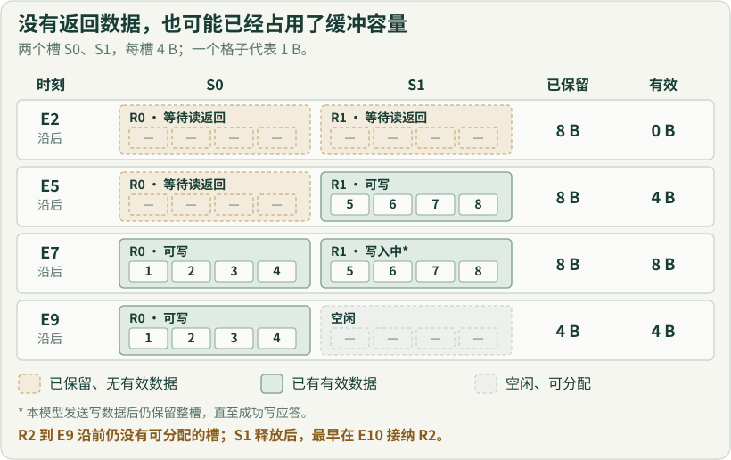

# 第一笔请求还没有返回，为什么 DMA 能发出第二笔请求？

在 [E01](e01-dma-task-and-address-generation.md) 的教学引擎中，第一段数据需要先从源端读回来，再写入本地 SRAM。只有等到写应答，DMA 才开始搬下一段。

然而，下一段的地址早就可以算出来，而且它与前一段的源、目标范围都不重叠。第一笔请求还在等待数据返回时，如果接口能接受第二个读地址，为什么不先发出去？

**允许多笔请求同时在途（Outstanding）**，可以让 DMA 在等待某笔访问时继续推进其他访问。这需要保留每笔请求独立的状态，为返回数据准备存放空间，并确认哪份数据最终写到了哪个位置。

下面沿用 E01 的矩阵，解除每次只能推进一段的限制。先看数据怎样正确返回，再走完完整的读写日程，并观察写端停顿如何反过来限制读请求的发出。

## 第一笔请求在等什么，第二笔又需要什么？ {#independent-requests}

仍然搬运三行四列的 8 bit 矩阵。每行 4 B，源行距为 8 B，目标行距为 4 B。每一行分别生成一笔 4 B 的读事务和写事务，每侧的数据接口均为 2 B/beat。

| 行号 | 源地址（读请求） | 数据 | 目标地址（写请求） |
| --- | --- | --- | --- |
| 0 | R0：`0x1000` | 1、2、3、4 | W0：`0x2000` |
| 1 | R1：`0x1008` | 5、6、7、8 | W1：`0x2004` |
| 2 | R2：`0x1010` | 9、10、11、12 | W2：`0x2008` |

沿用 E01 的地址及访问权限假设，不发生跨界拆分，搬运期间源数据保持不变。目标三个地址范围互不重叠，消费者仍等到整块搬完才读取。

E01 用已成功确认写入的字节数 k 产生下一段地址。当 k 为 0 时，控制器只跟踪 R0 以及与它对应的 W0。如果在第一笔写应答前重复按 k 计算地址，第二次仍会得到第 0 行。

为了提前发 R1，可以将两类进度分开保存：

- **已发出的读请求进度**：下一行应产生哪个读地址，使用哪个目标地址。本例每次成功交付一笔读请求，行号才递增。
- **已成功确认的写入进度**：哪些行已经成功写入目的地，以及累计确认了多少字节。

第 0、1 行不需要彼此的计算结果，也不需要等待对方修改源地址。它们在逻辑上可以独立执行。地址生成器只要能记录下一行，就不必等待第一行写完才准备它。

假设 E0 接纳矩阵搬运命令，E1 交付 R0，E2 就交付 R1。在 E2 之后，两个地址都已经被源端接纳，但尚未收到完整的读数据。

在此后的讨论中，**在途读事务数**只统计源接口已经接纳请求、尚未完成最后一个读数据拍交接的事务。写事务另行统计，从写请求被接纳到收到相应写应答。一项搬运任务则可能包含多笔这样的事务。

地址可以更早交付，不表示数据能同时通过同一条线。多个事务可以一起等待服务，而单条数据通路仍每拍最多交付一个数据拍。这与 [A06 的延迟和吞吐](../01-foundations/a06-pipeline-and-throughput.md#latency-and-ii)中的观察方法相同。

## 如果第二笔数据先回来，该写到哪里？ {#response-matching}

过去，DMA 只有一组当前段状态。只要有数据返回，就知道它属于这一段。

现在假设 R0 需要等比较长的时间，R1 反而先返回。DMA 最先收到的两个字节是 5、6。这两个数本来属于第 1 行，不应该被写入第 0 行的 `0x2000`～`0x2001`。

解决问题的关键不是判断数据的值，而是让返回数据带有能够确定其所属请求的信息。一种方法是为每笔还需独立追踪的读请求分配标识符（ID 或 Tag），源端返回数据时携带对应的标识。

在 E01 的一块 4 B 数据缓冲基础上，再增加一个同样大小的缓冲槽。把两个槽分别记为 S0、S1，每个槽都关联一份尚未完成的段状态。

| 槽 | 读请求标签 ID | 请求身份 | 目的地址 | 预期字节数 |
| --- | ---: | --- | --- | ---: |
| S0 | 0 | R0 | `0x2000` | 4 B |
| S1 | 1 | R1 | `0x2004` | 4 B |

为了简化硬件，本例直接用槽号作为读标签。在槽仍分配给旧请求时，不再将这个标签分配给另一段。R0、R1 是本文用来追踪矩阵行的名称，不是协议 ID 的数值。

此外，每个槽保存接收进度和阶段。假设 R1 的第一个数据拍携带 ID 1、数据 5 和 6。DMA 用 ID 1 选中 S1，再根据该槽已经接收的字节数（此时为 0）将数据写入槽的前两个字节，并更新接收计数。

第二个数据拍也携带 ID 1，数值是 7、8。它写入 S1 的后两个字节。这一拍结束后，S1 的四个字节都已有效，读事务 R1 可以结束，而 S0 仍然在等待 R0 的数据。

<figure class="micro-diagram" style="max-width:820px; margin:1.2rem auto" tabindex="0" aria-label="后发请求R1通过ID匹配缓冲槽和目的地址，窄屏可横向滚动" markdown="1">

<figcaption>R1 的两个数据拍先交付。ID 标识的是一个请求上下文，而上下文保存它的目标地址和接收进度；ID 本身不是字节偏移。</figcaption>
</figure>

这里的查找不一定需要遍历整张状态表。像本例这样将 ID 直接对应槽编号，可以用选择逻辑取得相应记录。其他设计也可以通过映射表把接口标签转换为内部请求编号。

读请求的在途状态在该笔最后一个数据拍完成握手时结束。实际接口还需检查传输长度、最后一拍和错误状态。若允许同一笔请求内部的片段乱序，还需要记录片段的独立位置。本例同一笔的两个数据拍按地址顺序返回。

在实际的 AXI4 读接口中，请求的 ARID 与返回的 RID 对应。不同 ID 的响应可能换序；同一个读 ID 对应的响应则须保持请求顺序。因此，有些引擎允许同 ID 同时在途多笔，使用该 ID 下的顺序记录继续配对，而不是为每笔都分配唯一 ID。

这里采用每槽一个标签的简单实现，且只在槽释放后复用该标签。ID 位宽、允许的在途事务数量和内部实际资源数量不能直接画等号。

[Arm AMBA AXI/ACE 规范 IHI 0022H，A5.2.1 和 A6.1 节](https://developer.arm.com/-/media/Arm%20Developer%20Community/PDF/IHI0022H_amba_axi_protocol_spec.pdf?hash=6325311012DDADF238C35A6C0FD734E520754F82&la=en&revision=71bd7c57-2ed7-487b-bc3e-68c4ab56fa5f) · [互连系列：AXI 通道、ID 与在途事务](../../interconnect/BUS/03-on-chip-protocol-families/axi-channel-id-outstanding.md)

## 读返回顺序和写入顺序必须相同吗？ {#write-selection}

当 S1 已经保存完整的第 1 行而 S0 还在等待时，DMA 可以从 S1 取得目标地址 `0x2004` 和四个数据字节，提交 W1。

如果所需的是一个按地址索引的 SRAM，三个目标范围彼此独立，那么先完成第 1 行的写入，不会妨碍第 0 行稍后写入正确的位置。

本例让写通路在空闲时从已经收齐数据的槽中选择一项，保留该槽的身份直到收到写应答。选择编号较小的就绪段作为平局规则；若只有 S1 就绪，就不会等待 S0。写通路一次处理一笔写事务，并按该笔地址的递增顺序送出两个数据拍。

另一方面，如果目的端不是按地址写入的存储器，而是一个约定按第 0、1、2 行顺序交付的流接口，就不能将先返回的第 1 行直接交给消费者。需要保留它，等第 0 行之后再按序输出。

这种用于将乱序到达的数据恢复为所需交付顺序的存储和控制，可称为**重排缓冲（Reorder Buffer）**。是否需要按序交付，由目标端契约决定。不是所有能够识别乱序响应的 DMA 都需要完整的重排缓冲。

本例只需要将任意先就绪的完整行写到正确的目标地址。下面保留这种写入策略，观察硬件的状态变化。

## 多笔请求一起推进，整块数据能提前多少拍完成？ {#timeline}

继续使用 E01 的单一时钟和 valid/ready 握手模型。只在读、写接口发生成功握手时推进相应状态。为避免把接口的物理宽度与事务数量混淆，再明确本篇的资源和时序假设。

| 资源或参数 | 教学引擎 |
| --- | --- |
| 读请求入口 | 每拍最多接纳一个读地址，最多两笔读事务在途 |
| 读数据接口 | 每拍最多返回一个 2 B 数据拍 |
| 写通路 | 单笔写事务在途；写地址后每拍最多交付 2 B |
| 内部数据缓冲 | 两个可独立使用的 4 B 槽，分别关联段状态 |
| 并行能力 | 读、写接口与槽的必要访问路径可以同时服务，不争用同一个端口 |

E01 规定读地址接纳后隔两拍交付第一个数据拍。这里为了观察乱序返回，令 R0 第一个数据拍在接纳后隔五拍返回，R1、R2 仍隔两拍返回。每笔的第二个数据拍在第一拍之后一拍接收。

写入规则不变：收齐整段数据后可在下一拍提交写地址，之后每拍写 2 B，最后一拍写数据交付后一拍收到成功应答。本例的 SRAM 在数据交接边沿真正更新相应位置。所有应答均为成功。

与 E01 一样，当前段的数据及状态保留到成功写应答。这里规定每个槽只有在已经释放后的下一个边沿才能重新接纳读请求，不使用同沿释放、分配的旁路逻辑。

将 E0、E1……作为边沿编号。下表列出关键边沿的事件。本例提出的读地址都能立即被接纳，所以将槽预留与请求接纳合记在同一边沿。空闲边沿没有发生对应接口交接。R1 和 R0 的返回可以交换先后，是源端允许的服务次序，而不是强迫源端加速某笔请求。

| 边沿 | 源端读操作 | 目标端写操作 | 已确认的写入字节数 |
| --- | --- | --- | ---: |
| E0 | DMA 接纳矩阵搬运命令（控制入口） | — | 0 B |
| E1 | R0 接纳，分配 S0 | — | 0 B |
| E2 | R1 接纳，分配 S1 | — | 0 B |
| E4 | R1 返回 5、6 | — | 0 B |
| E5 | R1 返回 7、8（收齐） | — | 0 B |
| E6 | R0 返回 1、2 | W1 写地址接纳 | 0 B |
| E7 | R0 返回 3、4（收齐） | W1 写入 5、6 | 0 B |
| E8 | — | W1 写入 7、8 | 0 B |
| E9 | — | W1 成功应答，释放 S1 | 4 B |
| E10 | R2 接纳，复用 S1 | W0 写地址接纳 | 4 B |
| E11 | — | W0 写入 1、2 | 4 B |
| E12 | R2 返回 9、10 | W0 写入 3、4 | 4 B |
| E13 | R2 返回 11、12（收齐） | W0 成功应答，释放 S0 | 8 B |
| E14 | — | W2 写地址接纳 | 8 B |
| E15 | — | W2 写入 9、10 | 8 B |
| E16 | — | W2 写入 11、12 | 8 B |
| E17 | — | W2 成功应答，释放 S1 | 12 B |

例如 E7，R0 的第二个读数据拍和 W1 的第一个写数据拍同时交接，分别使用不同的数据路径和缓冲槽。E10 则同时交付 R2 的读地址和 W0 的写地址。发出新读与写出旧数据可以重叠，但同一个接口本身的接纳能力没有增加。

<figure class="micro-diagram" style="max-width:960px; margin:1.2rem auto" tabindex="0" aria-label="两槽DMA逐拍并行推进三行数据，窄屏可横向滚动" markdown="1">

<figcaption>读地址、读数据、写地址、写数据及写应答是不同事件。图中使用相同的时钟边沿，空位表示该接口没有交接，并不一定没有待处理工作。</figcaption>
</figure>

现在只恢复 E01 严格串行的控制方式，保持刚才 R0、R1、R2 各自的首拍返回延迟不变。第一行从 E1 接纳读地址到 E11 收到写应答；后面两行依次在 E19 和 E27 收到应答。

| 比较项 | 单槽串行 | 双槽并发 |
| --- | ---: | ---: |
| 三行读、写事务数量 | 各 3 笔 | 各 3 笔 |
| 每侧有效数据量 | 12 B | 12 B |
| 从 E0 到最后写应答 | 27 拍 | 17 拍 |
| 此次搬运的平均有效吞吐 | 12/27 ≈ 0.44 B/拍 | 12/17 ≈ 0.71 B/拍 |

两种方案中的每个读请求仍需要相同的自身服务时间。本次减少的是不同段的等待和传输之间的空档。并发引擎用更多保存状态和数据的空间，换取原本闲置的接口服务机会。

E01 原来的串行结果是 24 拍。本篇为了演示乱序，将 R0 的首拍延迟增加了三拍，因此比较时使用重新计算的 27 拍基线，而不是将 17 拍与原来的 24 拍直接相减。

这些时间为教学假设下的推导结果。实际内存的服务延迟也可能随并发数、地址分布和仲裁策略变化，不能把本次提升幅度当作 DMA 性能的普遍规律。

## R1 的读数据已经全部回来，为什么 R2 还不能发出？ {#buffer-reservation}

回到 E5 之后。R1 的最后一个数据拍已经交接，所以源端在途读事务只剩 R0 一笔。从读在途名额看，还可以再发一笔。但是 S1 中已经保存了 5、6、7、8，尚未交给目标端；S0 中虽然暂时没有有效数据，却已分配给 R0。

如果再接纳 R2，等它返回时应该放到哪个槽？无论选择 S0 还是 S1，都可能占用另一笔请求所需要的位置。

本例在读请求离开 DMA 之前就先检查并预留一个完整槽。若接口尚未接纳该有效请求，则保留对应参数及其预留槽，直到交接成功或按接口契约收束，不随意改变正在发送的请求。

数据到来时，槽中接收计数不断递增，但这个槽从一开始就已经不能分配给其他段。把槽是否已被分配与内部实际保存的有效数据分开计数，得到下表。

| 边沿后 | S0 | S1 | 在途读事务数 | 已分配容量 / 有效数据量 |
| --- | --- | --- | ---: | --- |
| E2 | 等 R0，0 B 有效 | 等 R1，0 B 有效 | 2 | 8 B / 0 B |
| E5 | 等 R0，0 B 有效 | R1 收齐，4 B 有效 | 1 | 8 B / 4 B |
| E7 | R0 收齐，4 B 有效 | W1 写入中，保留 4 B | 0 | 8 B / 8 B |
| E9 | R0 待写，4 B 有效 | 已释放 | 0 | 4 B / 4 B |
| E10 | W0 写入中，保留 4 B | 等 R2，0 B 有效 | 1 | 8 B / 4 B |

<figure class="micro-diagram" style="max-width:820px; margin:1.2rem auto" tabindex="0" aria-label="预留容量与缓冲内有效数据随时间变化，窄屏可横向滚动" markdown="1">

<figcaption>槽已预留不表示它已经存有有效数据；读事务结束也不表示存放其数据的槽已经释放。图中写出过的数据保留至写应答。</figcaption>
</figure>

这里将一个可分配的空槽看作一份**信用（Credit）**。初始有两份信用，每分配一个槽消耗一份，每释放一个槽归还一份。本例中，只有存在空槽且读在途名额未用尽时，DMA 才能提出新读请求；源端接纳后才能推进发出进度。

这是为未来返回的数据保留位置的一种保守策略。它不是所有接口规定的信用形式，也不意味着 DMA 都必须为每笔读预留整笔大小的专用物理缓冲。有的引擎按数据拍预留容量，或者使用共享缓冲并提供足够的接收、暂存和排空能力。

实际硬件也可能在最后一拍写数据成功交给可靠的发送缓冲时早于写应答释放原数据槽，再在单独的应答表中保存写事务的状态。不能简单丢失这笔写的身份和结果处理责任。

例如 [AMD AXI DataMover PG022 的 Store and Forward](https://docs.amd.com/r/en-US/pg022_axi_datamover/Store-and-Forward) 描述了带存储转发缓冲的一种实际组织及其在途事务能力；不同配置的缓冲深度与事务限制并不相同。

### 如果目标写接口暂时停止接收呢？

假如 E8 时 W1 的第二个数据拍已经准备好，但目标端没有给出 READY。按照 [A07 的握手规则](../01-foundations/a07-handshake-and-backpressure.md#valid-ready)，DMA 必须保持该拍数据及其对应状态，直到目标端真正接收，不能因为它已经出现在接口上就认为写完。

这使 S1 的释放时刻晚于原来的 E9。此时 R0 已在 E7 收齐并仍占用 S0，两槽均不能重新分配。因此 R2 必须继续等待空槽。即使写端更早停顿，预留的位置也能承接已发出的读响应。

下游写接口的停顿通过数据缓冲的占用状态，影响上游读地址的发出，这就是搬运通路内部的**反压（Backpressure）**。如果停顿持续很久，有限的缓冲只能吸收有限数量的数据，不能永久维持读端吞吐。

此处的信用是 DMA 自身的资源管理；接口 valid/ready 则负责相邻端点之间的交接。在支持响应反压的接口上，DMA 也可能暂时不能接纳一个读数据拍，源或中间节点必须按契约保留它。但不能假设任意多的已发请求都能安全停在返回路径上。

## 增加在途请求数量，为什么带宽不一定随之提高？ {#limits}

在刚才的 E7，两个数据槽都被占用，但读在途事务数已经为 0。此时增加读事务名额，不会使挂起的 R2 得到新的返回位置。相反，若只增加槽容量，源端仍只允许一笔事务在途，读地址也不能连续交付。

因此要分别观察以下量：

| 硬件量 | 本例取值 | 它限制什么 |
| --- | ---: | --- |
| 最大在途读事务数 | 2 | 可以同时等待多少笔读响应 |
| 数据槽容量 | 8 B（2×4 B） | 可以同时保留或预留多少个尚未释放的段 |
| 单方向数据接口峰值 | 2 B/拍 | 接口获准服务时，每拍最多交付多少有效数据 |
| 本次并发搬运有效吞吐 | 12/17 B/拍 | 给定执行日程的任务完成速率 |

对于持续的稳定数据流，可用一个简单的数量关系判断在途窗口够不够。假设每笔读固定取得 P 字节，长期平均从读请求接纳到最后一个读数据拍接收需 L 拍，最多允许 N 笔读事务在途。

如果长期读完成率为 λ 笔/拍，那么平均在途数为 λ × L。它不能超过 N。因此在给定 L 的情况下，读完成带宽受到如下上限约束：

**Bread ≤ min(读接口峰值带宽，N × P / L)**

这是稳定流量下按在途事务统计得到的 Little 定律关系。若持续从相同接口复制数据，在有限缓冲、不积累未完成写入的稳态下，目标侧的写服务能力也必须至少跟得上完成率。

例如固定 4 B/笔，若平均在途时间为 6 拍，要维持 2 B/拍的有效读带宽，则至少要有 3 笔在途读事务的容量。只有 2 笔的窗口时，即使数据接口足够宽，按该平均延迟计算的读带宽也不超过约 1.33 B/拍。

这不是本篇三行矩阵日程的实测值。平均延迟可能随着 N 改变，写通路、地址生成、返回槽及其他共享资源都可能形成更紧的限制。更多在途事务也可能让下游排队时间增加。

所以设计引擎时，除了问有多少个 ID，还要问请求是否能被接收、返回数据能否存放、目标端能否及时消费，以及哪一个资源最迟释放。[AMD Zynq UltraScale+ DMA 的 Outstanding Transactions 配置示例](https://docs.amd.com/r/en-US/ug1085-zynq-ultrascale-trm/Outstanding-Transactions?contentId=DCSC7o6C5~97cuBDSK06UQ)

## 谁来判断整个矩阵已经搬完？ {#task-completion}

E9 后，最先确认写入的是第 1 行，而不是第 0 行；E13 后才确认第 0 行。不能再像串行模型那样认为累计确认 4 B 就表示目标地址从 `0x2000` 开始的前四个字节已经就绪。

为了追踪哪些段已经成功，可为三段保存三个完成位，只有对应写事务收到成功应答且尚未被记录完成时，才设置相应的位。观察这三个完成位分别对应第 0、1、2 行：

| 边沿后 | 第 0 行 | 第 1 行 | 第 2 行 | 累计确认字节 |
| --- | --- | --- | --- | ---: |
| E0 | 0 | 0 | 0 | 0 B |
| E9 | 0 | 1 | 0 | 4 B |
| E13 | 1 | 1 | 0 | 8 B |
| E17 | 1 | 1 | 1 | 12 B |

在只允许每段恰好确认一次、段集合与总长度已知的条件下，也可以用计数器判断所有段是否成功，而不必保存完整位图。如果需要逐段可用通知、任意取消或更复杂的重试策略，通常还需要额外状态。

E17 后所有源端读事务和目标写事务均已结束，全部三行都已按教学契约成功写入本地 SRAM，此时可以记录本任务成功，并允许整块消费者使用数据。

若有一笔读或写返回错误，则控制器不能按成功路径更新完成位。它应保存错误状态，并按实际接口规则处理已经发出的事务，例如停止发新请求、排空不可取消的事务、确认资源不再被迟到响应使用后释放。部分已完成的写入未必能撤销，不能报告整块复制成功。

实际引擎中的状态接口也需要与父命令对应。例如 [AMD AXI DataMover PG022 的 MM2S 读时序](https://docs.amd.com/r/en-US/pg022_axi_datamover/Example-DataMover-Read-MM2S-Timing) 描述了父命令被拆成多个事务后汇总状态的过程，其[状态接口](https://docs.amd.com/r/en-US/pg022_axi_datamover/Status-Interface)包含命令标签及传输成功或错误信息。

本例的写应答明确代表本地 SRAM 已经写入；在其他系统，写响应可能由中间缓冲产生，或者协议根本没有与每笔写对应的返回应答。任务完成事件需要按照实际接口定义的完成观察点判断，不能直接等同于所有消费者都能读到最新值。

若目标是可能含有旧 Cache 副本的内存，还需要满足可见性与内存次序契约。本篇只跟踪完整块成功写入的条件。如何在多引擎之间安排局部消费、同步事件和缓冲区复用，将由 [F 专题](../06-resource-cooperation/README.md)深入讨论。

## 如果还有下一项搬运任务，谁来保存它？ {#command-queue}

到目前为止，即便 R0、R1、R2 可以并发，DMA 仍然只执行一条搬运命令。下一次要搬另一块矩阵时，是否一定要等 E17 以后，由处理器再次配置地址和长度？

未必。可以让发起者提前写好多个描述符，让引擎从**命令队列**中获取任务参数。命令队列是保存待执行任务的空间，不是保存读响应的两个数据槽。

假设有一个位于内存中的两槽提交队列（Submission Queue，SQ）。每个条目包含一个命令编号、源目标基址、形状和步长。硬件仍然只有一份正在执行的任务状态，同时保持两个 4 B 内部数据槽。

发起者先写好两个描述符 D0、D1，按照接口约定使数据对设备可见，再向引擎写入门铃（Doorbell）寄存器，公布新的队尾位置。门铃可以是一项通知，它告诉引擎新任务已经可取，不承载完整的搬运参数。

本例用逻辑上不断递增的 head、tail 计数来管理队列，物理槽下标取计数对 2 的余数。tail 表示已经发布的命令数量，head 表示已经归还的描述符条目数量；当 tail − head = 2 时，队列已满。

| 观察到的事件 | head | tail | 队列中的待取命令 / DMA 内部任务 |
| --- | ---: | ---: | --- |
| 初始 | 0 | 0 | 无 / 无 |
| D0、D1 发布并通知设备 | 0 | 2 | D0、D1 / 无 |
| DMA 成功取得 D0 的全部参数并归还槽 0 | 1 | 2 | D1 / D0 |
| D0 完成状态已成功交付 | 1 | 2 | D1 / 无 |
| DMA 取得 D1 的全部参数并归还槽 1 | 2 | 2 | 无 / D1 |

本例约定取走参数后设备不再访问旧描述符槽，并将 head 的更新对发起者可见。因此 D0 的槽 0 可以在 D0 搬运尚未完成时回收，再用于写入 D2。其他引擎可能会在原描述符上写回完成状态，回收条件就必须不同。

描述符发布后，成为队列中设备可以取得的一项工作；在离开队列时，本例 DMA 只是成功取得并保存了任务参数。这两个事件都不能证明目标数据已经写好。队列中的条目数量、活动的任务数量和一项任务内部的在途事务数也是不同的量。

例如 [AMD Zynq UltraScale+ DMA 的队列操作](https://docs.amd.com/r/en-US/ug1085-zynq-ultrascale-trm/DMA-Operation?contentId=i7iKrtUzuODWrRIg9gCjsQ) 描述了通过更新队列限制来追加工作的一种实际接口；[Linux 内存屏障文档](https://docs.kernel.org/core-api/wrappers/memory-barriers.html) 中的 DMA 描述符示例说明了发布参数、交出所有权和通知设备所需的顺序。具体的驱动和 MMIO 机制不在本篇展开。

当 D0 搬完后，发起者又怎样知道哪一项任务成功？可以在独立的完成队列（Completion Queue，CQ）中写入一条带命令编号、成功或错误状态的记录。设备也可以通过状态寄存器等方式报告，或者发送中断提示发起者去查看完成状态。

完成记录必须保存到约定的可观察位置。若完成队列已满，本例保留 D0 的结束状态，暂不释放活动任务位置，直到完成记录能够交付。另一种设计可以提前预留完成槽，避免任务在收尾阶段找不到报告状态的位置。

因此命令可能提前进入队列，内部又有多个事务并发，整项任务完成后还需要发布状态。理解这三层容量，才能判断 DMA 究竟是在等待新命令、读响应、写入资源，还是完成记录的交付。

[互连系列：Doorbell、Completion 与 Interrupt Flow](../../interconnect/BUS/04-microarchitecture-integration/doorbell-completion-interrupt-flow.md)

## 下一步：搬运时能否顺便改变数据？ {#next}

现在 DMA 已经能够独立生成请求、同时等待多笔响应，并根据每笔的身份将数据写到正确位置。通过状态和缓冲资源的分别管理，即使返回先后发生变化，目标矩阵仍然保持原来的行列顺序。

但有时计算单元需要的不是同样的 3×4 排列，而是一个 4×3 的转置矩阵，或者每个元素具有另一种数值格式。如果只是等待完整数据返回，再把它原样写入对应行，并不能完成这些处理。

[下一篇 E03：搬运数据时，能否顺便改变数据的布局和格式？](e03-layout-and-format-processing.md) 将继续使用这组十二个数，观察在地址生成与数据读写之间增加重排、打包或转换逻辑后，数据应当怎样流动，以及这些新增资源会如何限制搬运吞吐。

[返回数据搬运与处理引擎导读](README.md)
