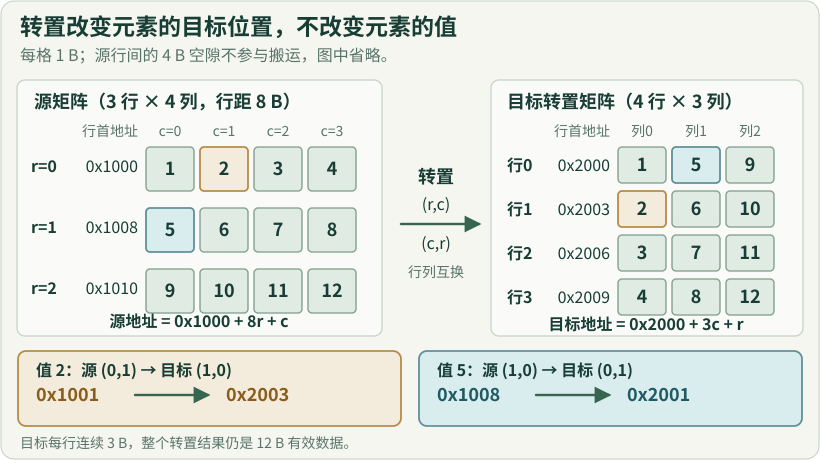
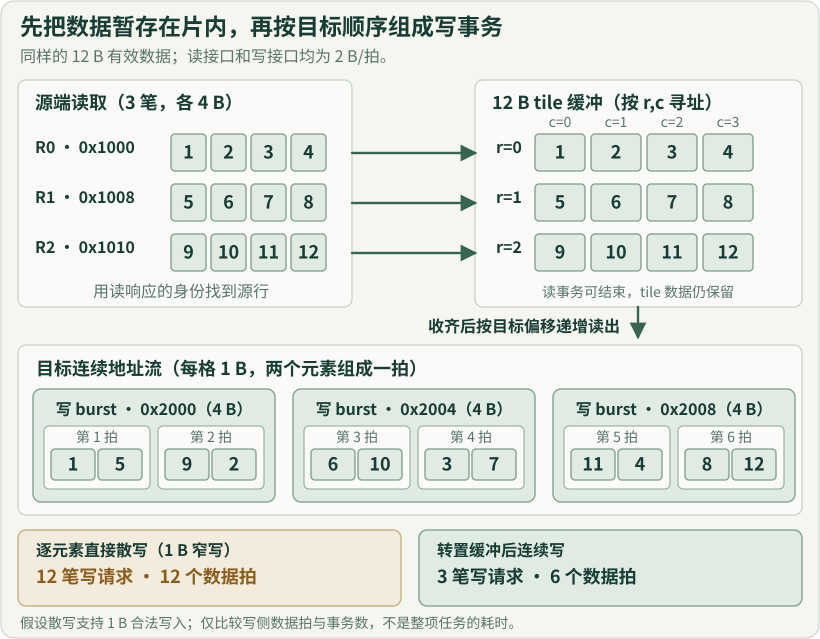
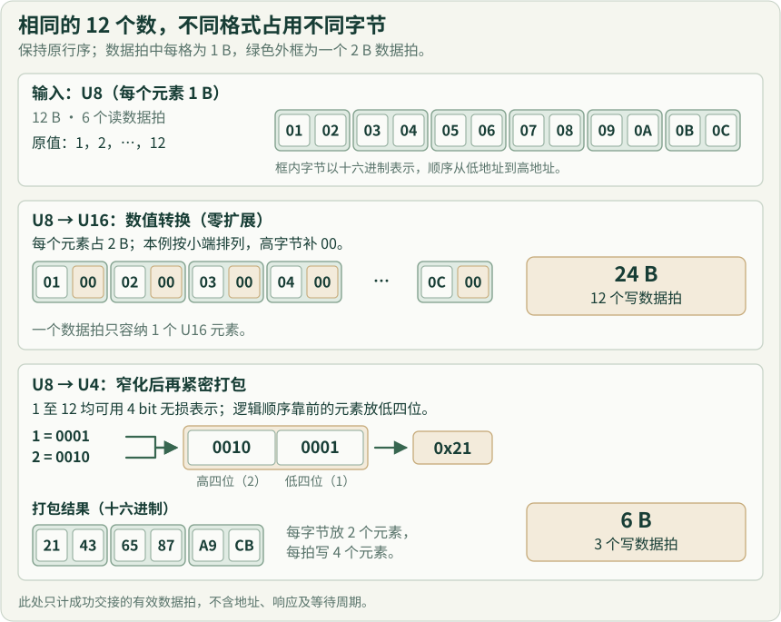
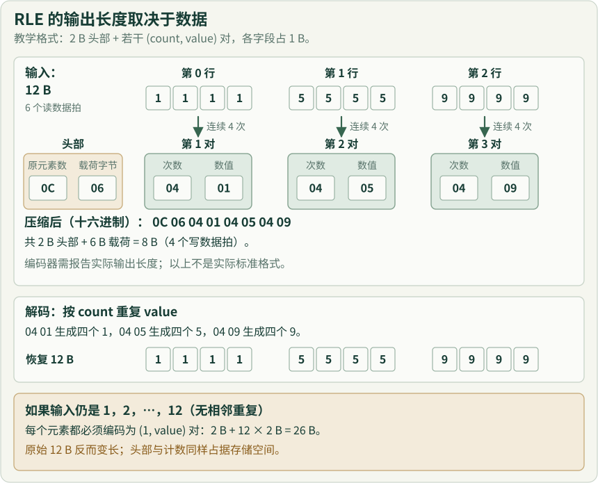

# 搬运数据时，能否顺便改变数据的布局和格式？

在 [E01](e01-dma-task-and-address-generation.md) 和 [E02](e02-outstanding-requests-and-completion.md) 中，DMA 将源矩阵的每个元素复制到目标矩阵中相同行列的位置。即使后一笔读请求先返回，最终得到的矩阵也不变。

但计算单元需要的未必是原来的数据排列。例如，它可能希望把原矩阵的每一列连续存放，或者希望从内存取出紧凑的低位宽数据，在计算前转换成另一种数值格式。

如果先复制，再让另一个执行单元读取、处理和重新写入，就可能增加数据经过存储器的次数。另一种方法是在搬运引擎内部增加数据处理能力，让引擎直接生成消费者需要的数据布局或表示。

下面沿用前两篇的十二个元素，分别改变地址对应关系、数据排列、数值表示和编码长度，观察它们如何影响引擎的实现。

## 原矩阵已经逐行存放，怎样让它按列排列？ {#transpose-addresses}

仍然使用一个 3×4 的无符号整数矩阵 M。每个元素为 8 bit，占 1 B；源行距为 8 B，三个行首地址是 `0x1000`、`0x1008`、`0x1010`。

| M | 第 0 列 | 第 1 列 | 第 2 列 | 第 3 列 |
| --- | ---: | ---: | ---: | ---: |
| 第 0 行 | 1 | 2 | 3 | 4 |
| 第 1 行 | 5 | 6 | 7 | 8 |
| 第 2 行 | 9 | 10 | 11 | 12 |

E01 的目标是紧密存放的 3×4 矩阵，行距为 4 B。现在将目标改为一个按行紧密存放的 4×3 矩阵 T，行距变成 3 B。希望 T 的每一行保存 M 的一列，即 T[c,r] = M[r,c]。

这称为**转置（Transpose）**。元素的数值没有改变，改变的是它在目标矩阵中的逻辑行列位置。对原矩阵而言，这也相当于将原来按行排列的数据改为按列连续排列。

取 M 的第 0 行、第 1 列，元素值为 2，源地址为 `0x1001`。它在 T 中属于第 1 行、第 0 列，目标地址应该是 `0x2003`，而不是 E01 中的 `0x2001`。

相反，M 的第 1 行、第 0 列是 5，它的源地址为 `0x1008`，现在应该写入 `0x2001`。

<figure class="micro-diagram" style="max-width:820px; margin:1.2rem auto" tabindex="0" aria-label="原3乘4矩阵转置为4乘3矩阵的地址映射，窄屏可横向滚动" markdown="1">

<figcaption>分别追踪同一元素的源地址和目标地址。目标是按行紧密存放的转置矩阵，源端行间的无关字节仍不参与搬运。</figcaption>
</figure>

现在仍然以 r、c 表示原矩阵的行号和列号，从 0 开始。源地址和目标地址可以写成：

**源地址 = 0x1000 + 8 × r + c**

**目标地址 = 0x2000 + 3 × c + r**

第一式与 E01 的二维步长规则相同。第二式交换了两个维度对目标地址的作用：原列号 c 每增加 1，目标地址增加 3 B；原行号 r 每增加 1，目标地址增加 1 B。

因此，一种能够独立配置各维度源、目标步长的地址生成器，就可以在不改变数值的情况下产生这组地址。这一例子不要求额外的数值运算器，也不需要软件为十二个元素分别提供十二条命令。

如果计算单元本身就能按所需的地址次序访问原矩阵，甚至不一定需要制作新的物理副本。这里假设消费者需要实际连续存放的 T，才讨论怎样在搬运中重新排列数据。

## 地址算对了，为什么还需要数据重排缓冲？ {#transpose-buffer}

先采用最直接的转置方式：源端仍依次读取三行，每行一笔 4 B 读请求。以第 0 行为例，DMA 收到 1、2、3、4 后，将它们分别写到下列位置。

| 源端返回的元素 | 1 | 2 | 3 | 4 |
| --- | --- | --- | --- | --- |
| 目标地址 | `0x2000` | `0x2003` | `0x2006` | `0x2009` |

这四个位置不连续，不能将四个字节依次放进同一个递增的 4 B 写事务。最简单的做法是按元素分别生成写请求，这是一种**散写（Scatter）**。

E01 和 E02 的对齐访问使用完整的 2 B 数据拍。为了支持上述逐字节写入，本节额外假设目标端允许合法的单字节窄写，一次只更新指定的一个字节。接口物理宽度仍为 2 B。真实硬件也可能使用对齐字和字节使能完成部分写入。

这种转置只需要改变地址对应关系，而不需要把完整矩阵暂存在引擎内。它可以在每一行返回后逐元素写出。但是十二个目标元素要产生十二笔 1 B 写事务，每笔至少需要一个数据拍，还需要处理相应的地址和完成状态。

能否仍从源端连续读取，却让目标端也使用连续的写事务？关键是让原本分散在不同源行的元素先汇合到引擎内部，再按目标顺序取出。

### 先将返回数据放到正确的原始行列位置

为方便观察，构造一个能够保存本块全部十二个字节的重排缓冲，内部每个元素都有独立编号 (r,c)，另保存哪些元素已经有效的状态。

延续 E02 的乱序返回：如果 R1 先回来，DMA 将 5、6、7、8 放入缓冲的第 1 行，而不是按到达顺序填满第 0 行。读标签对应的记录保存该段在重排块中的行号。

本例让数据直接从读返回通路进入这块缓冲。当某个读事务的最后一个数据拍已正确写入缓冲，便可以释放该笔读的匹配记录和标签。缓冲内的元素则继续保留。在这台教学引擎中，直到目标端所有写事务的成功应答均已收到，才释放本块缓冲并报告整块成功。

这与 E02 中每个 4 B 槽一直保留到对应写应答的实现不同。若仍只有两个这样的槽，每个都要等写出才释放，却又规定必须收齐三行才开始写，就会出现第三行没有空间、前两行无法写出的等待循环。

现在已经为整块 12 B 数据分配了位置。即使最多只允许两笔读事务同时在途，只要 R1 返回后其读标签得到释放，就可以用该标签继续发 R2，原来的数据仍安全地留在重排缓冲里。

### 再按目标顺序组成写数据拍

假设缓冲提供两路可独立选择的字节读取通路，每拍可以取得两个元素。收到完整矩阵后，写端先读取原矩阵的第 0 列的前两个元素 1、5，组成目标地址 `0x2000`～`0x2001` 的数据拍。

下一拍读取 9、2。这是目标矩阵第 0 行最后一个元素和第 1 行第一个元素。它们虽然属于两个逻辑行，但在目标地址中正好相邻，可以一起传输。

如果用 p 表示从目标基址开始的字节偏移，缓冲选择逻辑需要读取的原矩阵位置是：

**c = ⌊p / 3⌋，r = p mod 3**

也可以用两个嵌套计数器遍历 c 和 r，而不必在每一拍真的进行除法。目标端依次写入 p = 0 到 11 的十二个字节。

<figure class="micro-diagram" style="max-width:820px; margin:1.2rem auto" tabindex="0" aria-label="重排缓冲按目标转置顺序组成连续数据拍，窄屏可横向滚动" markdown="1">

<figcaption>同一组源数据按原位置暂存，再按目标地址顺序读出。示意结构需要满足每拍选择两个不同字节的内部读能力，不规定具体的寄存器或 SRAM bank 实现。</figcaption>
</figure>

这里沿用每笔最多 4 B、每个完整数据拍 2 B 的限制。可以生成三笔连续写事务：

| 方式 | 源端读事务 / 数据拍 | 目标端写事务 / 数据拍 | 有效数据量（每侧） |
| --- | ---: | ---: | ---: |
| 逐元素散写 | 3 / 6 | 12 / 12 | 12 B |
| 缓冲重排后连续写 | 3 / 6 | 3 / 6 | 12 B |

在这里，增加重排缓冲没有减少有效复制字节数，而是将不连续的目标写入变成了连续的写入。总线数据拍和地址事务减少，代价是增加缓冲容量、选择网络和控制逻辑。

数据拍数量并不是整项任务的耗时。完整暂存的方案要等最后一行到达才能开始输出，也可能因缓冲读口或写端反压而等待。更复杂的实现可以只暂存部分矩阵、尽早组合已经就绪的目标数据拍，不要求所有转置引擎都先收齐整块。

实际硬件还可以处理通道交错、分块或改变张量存储格式等排列变换。例如 [NVDLA v1 的 RUBIK 单元](https://nvdla.org/hw/v1/ias/unit_description.html#rubik) 具有专用的数据重排模式，能够改变 feature 数据的布局而不进行数值运算。

要注意，本节的主动重排与 E02 的响应重排不同。E02 是按原有的逻辑对应关系放置响应，必要时恢复约定的交付顺序；这里是搬运任务本身要求改变元素对应的目标位置。

## 如果要搬的元素没有规则的步长呢？ {#gather-scatter}

刚才的转置有规则的二维地址关系。如果希望只取原矩阵的四个元素，而且次序是 M[2,0]、M[0,2]、M[1,3]、M[0,0]，就不一定能用一组固定的步长描述相邻访问。

可以让引擎接收一个索引列表。每个索引指定一个源位置，引擎按列表中的位置生成读请求，再将返回的元素排列成连续数据。

| 列表位置 | 源索引 | 源地址 | 值 | 连续目标地址 |
| ---: | --- | --- | ---: | --- |
| 0 | (2,0) | `0x1010` | 9 | `0x2000` |
| 1 | (0,2) | `0x1002` | 3 | `0x2001` |
| 2 | (1,3) | `0x100B` | 8 | `0x2002` |
| 3 | (0,0) | `0x1000` | 1 | `0x2003` |

假设源端也允许本例所需的合法单字节读。四个读请求的源地址不连续，每笔的目标偏移却由列表位置确定。从离散位置取得元素并将它们聚集到一起，称为**聚集读取（Gather）**。

例如列表位置 1 的读数据先返回，DMA 就应根据其请求记录将值 3 放到聚集结果的第 1 个位置。不能因为 3 最先到达，就把它当作列表的第 0 个元素。

反过来，也可以从连续源取得 9、3、8、1，根据相同的索引列表将它们写到另一个按行紧密存放的三行四列区域。目的地址按列表顺序分别为 `0x2008`、`0x2002`、`0x2007`、`0x2000`。这是一种由索引指定目的地址的散写。

本例列表的目标位置互不重叠。若不同列表项写同一个地址，就需要明确最终应该保留哪一个值、按什么顺序写，或者由接口禁止重复索引。不能像 E02 的独立目标行那样默认任意写入顺序都正确。

这种访问需要保存或者取得索引、产生地址，随后再追踪它与返回数据的对应关系。索引本身也需要占用存储空间和搬运带宽。如果多个相邻索引恰好对应连续地址，能够合并请求的引擎还可以减少小事务。

现实中常将多个离散地址区间组织为 Scatter-Gather（SG）描述符链。它不必支持任意粒度的索引操作：每个描述符可能只是一个有起始地址和长度的连续段，硬件依次取得这些描述符。

例如 [AMD AXI CDMA 的 SG 描述符](https://docs.amd.com/r/en-US/pg034-axi-cdma/Scatter-Gather-Transfer-Descriptor-Definition) 保存源、目的地址、长度和下一描述符指针。而 [NVIDIA PTX ISA 9.1 的 tiled gather4/scatter4（5.5.3.4）](https://docs.nvidia.com/cuda/archive/13.1.2/parallel-thread-execution/index.html) 提供了一种按特定坐标聚集或分散行的数据搬运能力。两者的命令语义和访问粒度不同。

因此讨论某个 DMA 是否支持 gather/scatter 时，应进一步核对它能够生成的地址模式、访问粒度以及索引来源，而不是只看一个功能名称。

## 如果数据的位置不变，能否改变每个数的表示？ {#type-conversion}

现在恢复 E01 的原矩阵行列顺序，不再转置，也不选择部分元素。计算单元希望每个操作数采用 16 bit 无符号整数（U16），而源内存仍以 8 bit 无符号整数（U8）存放。

对第一个元素 1 来说，原来保存的是八个比特 `00000001`。在高八位补零后，得到十六位无符号整数 `0000000000000001`，它仍表示数值 1。

这种操作称为**零扩展（Zero Extension）**。如果在 DMA 的返回数据与写数据之间增加这样的转换逻辑，就不必先把所有 U8 写到目的区，再由另一引擎将其读出转换。

但改变数值格式也改变了地址与流量。转换后每个元素占 2 B，目标矩阵紧密存放时行距为 8 B。目标地址现在是 **0x2000 + 2 × (4r + c)**。

假设采用小端字节顺序，一个值为 1 的 U16 在两个连续地址上分别保存 `01`、`00`（十六进制）。读端一拍得到两个 U8，转换后得到两个 U16，共 4 B。若目标接口仍为 2 B/拍，就需要两个写数据拍。

实际数字格式转换未必只是补零。例如 A04 中的 FP16 使用指数和有效数字表示数值，整数 5 转成 FP16 的比特编码是 `0x4500`，不能把 U8 的高位简单补零就当作浮点格式。

当目标格式无法精确表示源值时，还需要定义舍入、溢出和饱和等行为。[A02 的整数表示](../01-foundations/a02-number-representation-and-arithmetic.md) 和 [A04 的浮点与低精度格式](../01-foundations/a04-floating-point-and-low-precision.md) 已推导这些机制，本篇只观察它们进入搬运路径后会产生怎样的数据。

实际计算芯片也可以把转换电路放在局部数据路径中。例如 [Tenstorrent Tensix 的 Unpacker 和 Packer](https://docs.tenstorrent.com/tt-metal/v0.70.1/tt-metalium/tt_metal/advanced_topics/compute_engines_and_dataflow_within_tensix.html) 在本地 SRAM 与计算寄存器之间处理数据表示。它们是具体的片上数据处理通路，不表示所有普通 DMA 都具有数值转换能力。

## 如果一个元素只需要四个比特呢？ {#packing}

反过来观察原矩阵的十二个数。最小值是 1，最大值是 12，均能由 4 bit 无符号整数（U4）准确表示。

先把每个 U8 元素转换为 U4。本例无需改变其数值。但是，若仍为每个 U4 分配一个完整字节，只是高四位都为零，那么存储空间仍然需要 12 B。

怎样让两个四位元素使用同一个字节？可以规定按矩阵逻辑行优先顺序，靠前的元素占低四位，靠后的元素占高四位。

下面假设处理通路按这个逻辑顺序取得元素。若多个读事务乱序返回，应根据行号和元素偏移暂存并按所需次序交付，或直接把每个元素放到正确的打包位置，不能把到达顺序当作矩阵顺序。

比如 1 的四位编码为 `0001`，2 的四位编码为 `0010`。将 2 放在高四位、1 放在低四位，得到 `00100001`，即十六进制 `0x21`。

按相同方式处理后续元素，得到六个字节：`21 43 65 87 A9 CB`。这称为**打包（Packing）**。将对应位段取出来并恢复成单独元素的过程称为解包（Unpacking）。

<figure class="micro-diagram" style="max-width:860px; margin:1.2rem auto" tabindex="0" aria-label="整数零扩展和四位打包造成输入与输出字节数变化，窄屏可横向滚动" markdown="1">

<figcaption>两个操作分别以同一个 U8 矩阵为输入。零扩展改变元素位宽；四位打包让两个已转换元素共享一个存储字节。假定目标紧密存放，不计额外对齐填充。</figcaption>
</figure>

打包数据的顺序是格式的一部分。例如读出 `0x21` 后，解包电路从低四位得到 1、高四位得到 2。若消费者使用相反顺序，就会交换两个元素。

本例的十二个数都在 U4 的 0～15 范围内，所以可以无损地转换位宽并打包；若一个 U8 的值是 20，U4 无法表示 20，直接丢弃高位会变成 4。是否允许截断、饱和或者采用其他转换规则，需要单独规定。

因此，紧密打包并不等于量化算法，也不意味着所有降低位宽的转换都保持数值不变。打包负责组织编码的位段；数值转换负责确定应当保存什么编码。

现在每个读数据拍仍含两个原始 U8，却只生成一个打包字节。要组成一个完整的 2 B 写数据拍，可以让输出缓冲先接收第一个打包字节，再与下一读数据拍所产生的打包字节一起发出。

这里新的控制状态是：尚未凑满一个输出数据拍的有效字节数，以及对应的目标偏移。如果目标暂停接收，必须保留尚未交付的数据。与 E02 一样，要根据输出资源的接纳条件控制输入端的推进。

对于六个紧密存放的打包字节，完整写出需要三个 2 B 数据拍。不应把“一拍最多写四个 U4”理解成整条搬运路径每拍必然处理四个元素：源端每拍只能取得两个 U8。

## 如果数据重复出现，能否连输出长度也改变？ {#compression}

前面的转置只改变元素排列，U16 转换和 U4 打包则使每个元素具有不同的、预先确定的编码长度。还有一种处理方式，让实际输出长度由数据内容决定。

为了观察这一点，保持相同的矩阵形状、8 bit 元素和源布局，但将三个源行的数据分别改为四个 1、四个 5、四个 9。仍然包含十二个元素。

如果四个连续的 1 都保存为单独的字节，就需要 4 B。能否只保存一次数值 1，再附上这个数连续出现四次的信息？

一种简单的无损编码称为**游程编码（Run-Length Encoding，RLE）**：记录连续相同元素出现的次数和它的值。为便于推导，本例规定 count 和 value 都用 1 B 表示，count 取 1 到 255。

像上一节一样，压缩引擎按矩阵逻辑行优先顺序消费有效元素（不读取源端的间隙），而不是按读响应的到达顺序编码。遍历这十二个数，只需产生三个 (count,value) 对：`(4,1)`、`(4,5)`、`(4,9)`，共占 6 B。

这里再规定一个 2 B 的块头：第一个字节保存原元素数 12，第二个字节保存编码载荷长度 6。完整编码块为 8 B。这是用于解释数据路径的自定义格式，不是某种实际压缩标准。

<figure class="micro-diagram" style="max-width:860px; margin:1.2rem auto" tabindex="0" aria-label="重复数据的简单游程编码和解码，窄屏可横向滚动" markdown="1">

<figcaption>这里故意只改变原矩阵的元素值，以观察编码长度对内容的依赖。块头也是实际传输的数据，必须计入输出字节数。</figcaption>
</figure>

### 压缩引擎怎样生成这段编码？

可以增加一个比较器和一个游程计数器。每读到一个新元素，就判断它是否与当前游程的值相同。相同则增加计数；不同时，将此前的 count 和 value 送到输出缓冲，再开始记录新的游程。

例如先观察第一个源数据拍中的 1、1，游程计数增加到 2。读完第 0 行后计数为 4。接下来读到第 1 行的第一个 5 时，生成 `(4,1)`。到最后一个元素后，还需要将尚未输出的最后一个游程 `(4,9)` 交付。

这种逻辑需要保存当前值、连续计数和是否已经读完源块。本模型可以每次处理一个元素；若源端一次返回两个元素，可以先保存再逐个消费。支持多元素并行处理的编码器还需处理同一拍内部及跨拍的游程边界。

编码之前不知道最终载荷长度。这个教学引擎可以先将生成的游程对暂存起来，等到源块处理完成，获得实际载荷长度后，再拼接块头并写入目标区。

压缩任务的成功需要确认块头和全部实际编码字节均已写入。完成状态也可报告实际产出的长度，供后续消费者确定编码块的范围。

本例十二个元素全不相等时，每个元素都需要一个单独的 (count,value) 对。载荷就变成 24 B，加上块头共 26 B，反而大于原来的 12 B。

如果为这项编码任务保留完整输出空间，最坏需要 26 B 的目的区域，暂存的编码载荷最多为 24 B，块头还需要相应状态。若仅根据重复数据的 8 B 结果预留空间，就无法保证下一块数据能够编码完成。

真实系统还可能允许流式编码、预先分配上限、在缓冲不足时报告错误、选择另一种编码或直接存放原数据。若允许多种编码，需要使消费者知道实际使用的格式。不能悄悄覆盖目标区之后的数据。

例如 [Intel QAT 官方关于压缩输出缓冲不足的说明](https://www.intel.com/content/www/us/en/support/articles/000094259/technologies/intel-quickassist-technology-intel-qat.html) 展示了实际压缩引擎需要处理目标容量不足的情况。这是一种专用压缩硬件，不应当把它的功能视为普通 DMA 必备能力。

### 解码引擎怎样恢复这十二个数？

反过来，让搬运引擎读取刚才的 8 B 编码块。先取得原元素数和载荷长度，再读取第一个游程对 `(4,1)`。

解码通路保存 value = 1、剩余 count = 4。若目标仍每拍可以接收完整的 2 B，就可以先产生两个 1。只有当这两个字节成功交付后，才将剩余计数减到 2，再输出剩下两个 1。

如果目标写端暂停，解码器必须保留当前游程及尚未成功交付的输出。只有当前游程全部消耗后，才能用下一个游程替换这些状态，除非另外准备了缓冲。如果某个游程只剩一个字节，还可以暂存它，与下一个游程的第一个字节凑成完整数据拍。

因此，一次读入的 2 B 编码可能生成多个输出数据拍。解码使源端传输量减少，却依然需要将完整的 12 B 交付给消费者。

还要核对输入载荷是否按规定消耗、每个游程是否符合格式约定、实际输出元素数是否等于块头声明的长度，并确保输出没有超出约定的目标范围。最后再等待所有必要的写入成功确认，才能报告本块解码完成。

实际压缩不一定采用 RLE。例如 [NVDLA 的压缩权重格式](https://nvdla.org/hw/format.html) 可以使用标记零元素的位图以及非零数据、分组长度等辅助信息。压缩流量需要将元数据和对齐开销一起计算。

NVDLA 的 [硬件单元说明](https://nvdla.org/hw/v1/ias/unit_description.html) 还展示了压缩数据的取入及计算前解码分别位于不同的硬件单元。这说明数据处理能力既可以集成在搬运引擎内部，也可以部署在靠近消费者的专用路径中。

## 新增处理逻辑会怎样改变搬运吞吐？ {#throughput}

重新汇总刚才的独立实验。仍假设每侧总线宽度为 2 B，完整对齐事务每拍传 2 B；逐元素散写采用前文新增的单字节窄写能力。以下只统计载荷的数据交接拍数，不包含地址、响应、取索引、内部缓冲读写及等待。

| 搬运任务 | 源端载荷 | 目标端载荷 | 源数据拍 | 目标数据拍 |
| --- | ---: | ---: | ---: | ---: |
| 普通复制 | 12 B | 12 B | 6 | 6 |
| 转置：逐元素散写 | 12 B | 12 B | 6 | 12 |
| 转置：缓冲重排 | 12 B | 12 B | 6 | 6 |
| U8 → U16 | 12 B | 24 B | 6 | 12 |
| U8 → U4 并打包 | 12 B | 6 B | 6 | 3 |
| RLE 编码（重复值） | 12 B | 8 B | 6 | 4 |
| RLE 编码（1～12） | 12 B | 26 B | 6 | 13 |
| RLE 解码（重复值） | 8 B | 12 B | 4 | 6 |

表中 RLE 的传输字节数包含 2 B 块头，格式内的载荷长度字段仍不含块头。实际源矩阵还可能有额外的存储访问开销。源、目标载荷不同并不表示元素出现了丢失，例如 U16 扩展后仍然是十二个数。

### 源端和目标端的字节数不同时，应该怎样比较？

对固定宽度的一对一元素转换，可以将读、处理、写三个阶段的吞吐都换算为元素数。例如假设读、写路径分别提供 Br、Bw 字节/拍的有效服务带宽，每个源元素占 sin 字节，每个目标元素占 sout 字节，处理通路每拍最多转换 P 个元素。

若有充足的独立缓冲、上述资源可以同时推进，也没有额外地址开销或反压，则持续数据流的元素吞吐 X 满足：

**X ≤ min(Br / sin, P, Bw / sout)**

对于 U8→U16，假设读写两侧各 2 B/拍且转换电路能处理 2 个元素/拍，得到 X ≤ min(2, 2, 1) = 1 元素/拍。目标端写入能力限制了稳态吞吐。

如果处理通路本身在稳定流量下每两拍只能完成一个元素，则它先成为瓶颈，即使读写接口还有容量也无法得到更高的实际吞吐。

对于紧密 U4 打包，平均每个输出元素占 0.5 B。假设转换、打包能够每拍处理两个元素，写接口每拍可交付四个打包元素，但源端每拍仅能提供两个，所以整条通路的持续处理率仍不超过 2 元素/拍。

这些是稳态上限，不是本篇十二元素短任务的执行时间。实际还需考虑入口接纳、请求延迟、流水线填排、半满数据拍、各级缓冲和共享的物理端口。[A06 的流水线与吞吐](../01-foundations/a06-pipeline-and-throughput.md) · [D03 的供数与输出能力](../04-compute-arrays/d03-array-size-bandwidth-and-utilization.md)

对于变长压缩与解压，不能直接拿一个固定的每元素编码长度套到所有数据。应根据实际编码长度、处理速率和额外元数据分析流量，并按最坏或接口承诺的输出上限管理容量。

### 为什么减少外部流量不一定使整项任务更快？

在刚才的转置缓冲模型中，若内部只允许每拍取一个字节而不是两个，两个等宽的外部接口仍无法保证输出每拍都交付 2 B。数据要经过内部选择网络；如果读写位置落在同一个不能同时服务的 SRAM bank，还可能产生冲突。

因此，多了一个缓冲和重排单元，既提供了合并连续事务的条件，也增加了面积、端口、内部存储访问、数据选择和控制成本。[存储系统：SRAM 的单端口、双端口与多端口](../../storage/02-sram/foundations/single-port-dual-port-multi-port.md)

格式转换的扩展倍数、压缩数据的游程长度与写接口的接纳速度也会改变内部数据积累情况。E02 的请求标签和在途计数仍然必要，但不能仅按输入字节数预留空间。如果输出会扩大，就必须另有能够接收转换结果的容量，或使转换通路响应下游反压。

例如 U8→U16 的任务即使已经成功写入 12 B，仍未完成本例所需的 24 B 输出；U4 打包则只需确认 6 B。完成判定要跟踪输入消耗、处理通路排空和目标侧写入确认，不能只比较源字节数。

这就是具有处理能力的搬运引擎与单纯复制器的重要差异：除了知道正确的源和目标地址，还要跟踪数据的表示、处理进度、已产生但尚未交付的输出，以及最终写入的实际长度。

普通 DMA 可以只实现复制、填充或少数地址模式；支持索引访问、布局重排、打包或压缩的引擎需要对应的硬件能力。它们也可以是彼此独立的专用数据处理单元，并非所有能力都必须由同一台 DMA 实现。

例如 [XDMA 架构研究（2025）](https://arxiv.org/abs/2508.08396) 将多维地址生成与可插入的数据变换模块组织到搬运路径中。这是一个具体的研究设计，可以进一步了解此类能力怎样扩展，但不应用其性能数据替代本文的教学推导。

## 从一项独立搬运任务到多个执行实体的协作 {#next}

通过 E 专题，我们已经可以沿着一块数据分析独立搬运引擎：

- E01：将任务参数展开为合法的读写请求。
- E02：保留多个请求的状态，以便在等待响应时继续推进其他访问。
- E03：改变元素位置或编码，并为处理后产生的数据提供相应的保存和写入能力。

接下来，假设一块数据还在被计算引擎使用，搬运和处理引擎能不能提前准备下一块？即使准备好数据，谁来判断某个缓冲可以覆盖，以及下一个执行实体可以开始工作？

这些问题由 [F 专题：多执行实体与资源协作](../06-resource-cooperation/README.md) 继续解释，尤其是 [F01 的计算与搬运重叠](../06-resource-cooperation/f01-overlap-and-buffer-reuse.md) 和 [F02 的任务控制与同步](../06-resource-cooperation/f02-task-control-and-synchronization.md)。更一般的专用运算，以及稀疏格式下的操作数匹配和有效计算能力，由 [G 专题：专用计算与稀疏计算](../07-specialized-compute/README.md) 讨论。

[返回数据搬运与处理引擎导读](README.md)
