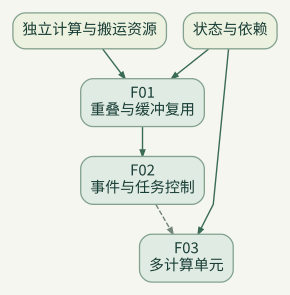

# 多执行实体与资源协作

一个芯片可以有多个能够独立推进工作的执行实体，例如计算单元、数据搬运引擎，或多个处理器核心。资源协作研究这些执行实体怎样分配工作、满足依赖和共享硬件资源。

第一块矩阵正在计算，下一块还在内存里。如果有独立的数据搬运引擎和两个输入缓冲区，能否趁着计算还没结束，把下一块数据搬进来？即使两个引擎能够同时工作，也要确定它们是否会争用同一个存储端口，以及什么时候可以释放缓冲区。

先观察各个引擎的执行过程，再找出维持正确执行顺序所需的控制机制。接着将一个矩阵乘法分给多个计算单元，追踪新增的任务分发、数据交换和资源竞争。

## 知识关系

<figure class="micro-v2-map" markdown="1">

<figcaption>知识衔接示意。虚线表示关联或辅助阅读。点击可查看大图。</figcaption>
</figure>

虚线表示可以参考的知识，不是必须完成的前置路线。

## 计划阅读顺序

本路线共规划三篇文章，F01、F02 已发布，F03 正在准备。前两篇围绕引擎间的协作递进，第三篇也可以从多单元共享存储的例子独立读起。

| ID | 文章 | 内容范围 | 状态 |
| --- | --- | --- | --- |
| F01 | [第一块数据还在计算，第二块数据能开始搬运吗？](f01-overlap-and-buffer-reuse.md) | 逐拍对比串行与重叠、双缓冲、多缓冲、资源占用、端口竞争、缓冲复用 | 已发布 |
| F02 | [多个引擎各自执行，怎样知道下一项工作可以开始？](f02-task-control-and-synchronization.md) | 事件、barrier、semaphore、完成与可用、局部消费/全体同步、硬件调度、集中/层级/分布式控制、进展条件 | 已发布 |
| F03 | 把同一块矩阵交给两个计算单元，需要交换哪些数据？ | Core/Tile/Cluster、硬件分发、共享资源、输入复制/部分和归约、负载分发、异构引擎与 CPU/GPU/NPU/DSP 概念对照 | 未发布 |

## 阅读衔接

- [共同计算基础](../01-foundations/README.md)解释模块自身怎样推进、等待和使用资源。
- 熟悉[数据搬运与处理引擎](../05-data-movement/README.md)以及[计算阵列与数据流](../04-compute-arrays/README.md)，有助于理解搬运到计算的协作，但不是所有多计算单元组织都依赖 DMA。
- 本路线关注硬件如何分发工作、满足依赖和共享资源。[存储系统](../../storage/README.md)负责存储机制，[芯片与系统互连](../../interconnect/README.md)负责通信机制，软件任务划分与调度策略不在这里展开。
- 接下来阅读[性能分析与设计权衡](../08-performance/README.md)，综合计算整个任务的执行时间与资源成本。

[返回计算微架构系列总览](../README.md)
