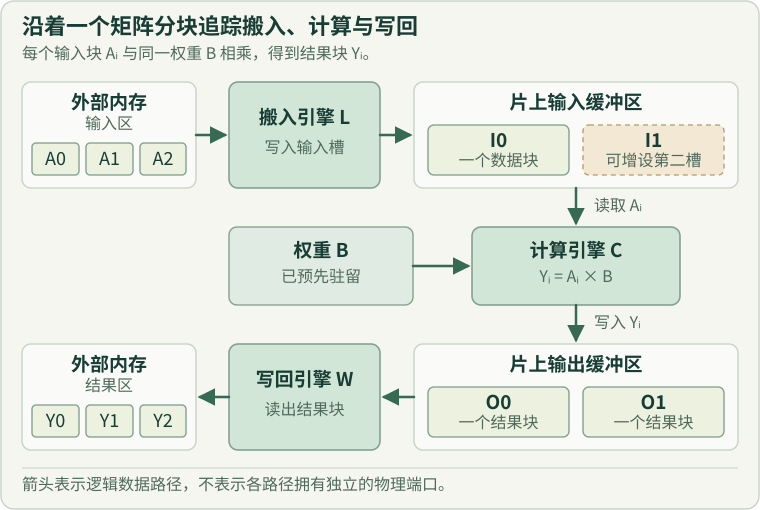
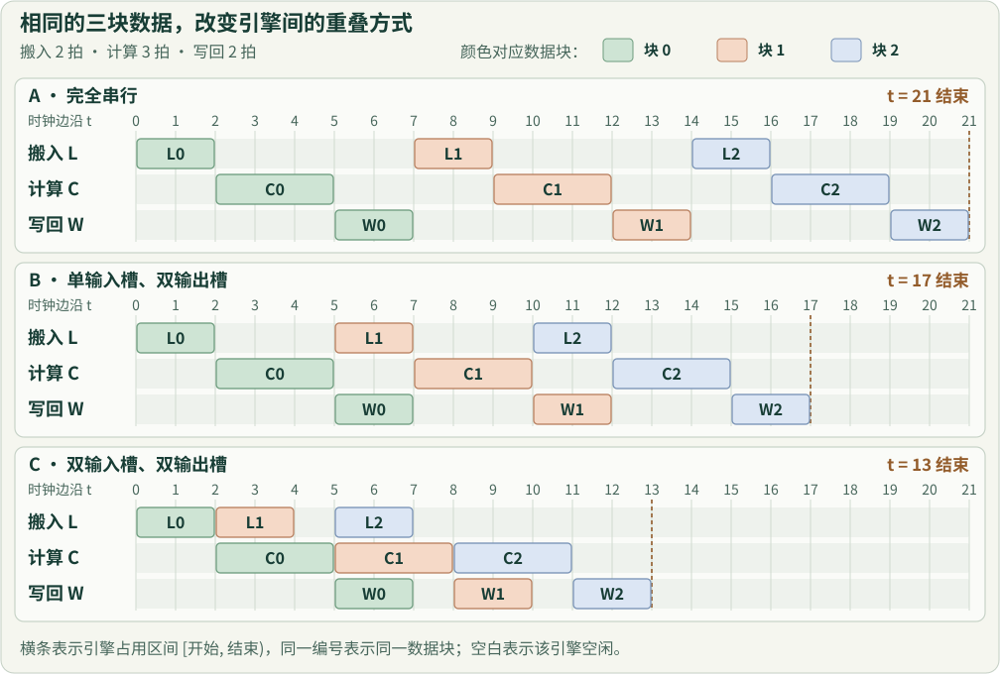

# 第一块数据还在计算，第二块数据能开始搬运吗？

在一颗计算芯片中，计算单元需要不断取得新的操作数，并把已经得到的结果送到下一处存储位置。硬件可以用独立的引擎承担这些工作，不必让计算单元先搬完一块数据，再负责计算和送出结果。

然而，有三个独立的引擎，并不意味着三项工作一定可以同时进行。例如，计算单元还要读取第一块数据。如果搬运引擎现在将第二块数据写入同一个位置，第一块就可能算错。

本篇跟踪三块数据从内存搬入、计算到写回的过程。先找出单缓冲为什么使引擎等待，再增加缓冲空间，观察可以提前进行哪些工作，以及共享资源怎样限制这种重叠。

## 一块矩阵怎样经过三个引擎？ {#three-engines}

假设要计算矩阵乘法 Y = AB。其中 A 有六行两列，B 有两行两列。把 A 每两行划成一块，得到 A₀、A₁、A₂ 三个 2 × 2 的输入块。

每个输入块都与同一个 B 相乘，得到一个 2 × 2 的输出块：Y₀ = A₀B，Y₁ = A₁B，Y₂ = A₂B。将三个输出块按行放回，就得到完整的 Y。

由于三块输出使用 A 的不同行，任何一块都不需要另一块的计算结果。这里直接给定分块方式，不讨论怎样选择分块。

为观察数据在不同硬件之间的位置，先构造下面的教学系统。

- 搬入引擎 L（Load）：从外部内存取一个 A 块，写入片上的输入缓冲槽 I。
- 计算引擎 C（Compute）：从 I 槽读取这一块操作数，利用已经驻留的 B 计算，将整个 Y 块存入输出缓冲槽 O。
- 写回引擎 W（Writeback）：从 O 槽取走计算结果，写到外部内存中相应的 Y 位置。

L 和 W 可以由独立的 DMA（Direct Memory Access，直接内存访问）资源实现。DMA 收到搬运命令后，可以自行发出读写请求。在这里，我们只观察命令执行期间的数据交接，不展开请求的生成和返回过程。

<figure class="micro-diagram" style="max-width:920px; margin:1.2rem auto" tabindex="0" aria-label="三个引擎和片上输入、输出缓冲槽，窄屏可横向滚动" markdown="1">

<figcaption>逻辑数据路径；箭头表示数据移动方向，不规定物理端口数量。先只启用输入槽 I0，随后启用 I1。两个输出槽始终保留。</figcaption>
</figure>

### 规定每项工作的服务时间

沿用 [A01 的时钟边沿记法](../01-foundations/a01-state-and-control.md)，用 t 表示边沿 Eₜ 的时刻。例如 [2,5) 表示 E₂ 到 E₅ 之间的三拍，占第 2、3、4 拍。

| 阶段 | 每块服务时间 | 开始条件 | 结束时本例保证的事实 |
| --- | ---: | --- | --- |
| L 搬入 | 2 拍 | L 可接纳；一个输入槽可写 | 整块输入已写入，C 可读 |
| C 计算 | 3 拍 | C 可接纳；整块输入可读；一个输出槽已预留 | 不再读取该输入槽；整块输出已写入，W 可读 |
| W 写回 | 2 拍 | W 可接纳；整块输出可读 | 目标消费者可读结果；输出槽可以复用 |

下文的 L₀、C₀、W₀ 分别表示三个引擎处理第 0 块的工作，不是三台新的引擎。其他编号以此类推。

这些时间是为了推导而指定的服务时间，不是实测数据。B 在 E₀ 之前已准备好，不计其初始搬运；三块输入在外部内存可读，三个目标位置互不重叠。计时到最后一块写回后目标消费者可读为止。

本例的 L、C、W 各一次服务一块，不在引擎内部重叠多块；计算需要等整块输入就绪。计算开始时就为整块结果预留 O 槽，并在计算完成时释放 I 槽。这些约定用于保护数据，而不是所有计算引擎必有的限制。

每块有四个输入元素和四个输出元素，L 和 W 各需在两拍内搬完四个元素，即服务期间平均每拍两个元素。先假定输入读写、输出读写与外部存储路径都能满足这些工作需要，互不阻塞。

所有必要命令均可及时交付，省略额外的命令接纳、状态更新和唤醒延迟，因此一个阶段在 Eₜ 完成交接后，后续阶段可以在 Eₜ 之后的区间开始服务。实际硬件可能需要更多控制周期。

## 为什么第一块在计算时，不能直接搬入第二块？ {#single-buffer}

先让三个引擎严格串行工作：L 把 A₀ 搬到 I0，C 计算 Y₀，W 把 Y₀ 写回。只有当 W₀ 完成，才开始 L₁。如此依次处理三块数据，每块需要 2 + 3 + 2 = 7 拍，总共 21 拍。

但仔细观察第一块的执行过程，W₀ 从 E₅ 开始取走 O0 中的结果，而 C₀ 此时已经不再读取 I0。只要 L 和 W 的数据通路可以同时服务，L₁ 就可以在 [5,7) 写入 I0，同时 W₀ 读 O0。

这样，每一项工作的时间都没变，只是把原来先后进行的搬入和写回放到了同一段时间内。三块的结果分别在 E₇、E₁₂、E₁₇ 可读，比完全串行少了 4 拍。

还能不能进一步提前？

E₂ 时，A₀ 已经搬完。L 有能力执行下一项命令，但 C 刚开始读取 I0。若 L 也在 E₂ 之后将 A₁ 写入 I0，C 仍需要的 A₀ 可能被覆盖。一旦读到了 A₁ 的数，计算出的 Y₀ 就不是所需结果。

尽管 A₁ 的数学计算不依赖 Y₀，这两项工作也不能直接重叠：它们需要在同一时间使用同一个存储位置，而且要求其中保存不同的数据。这里等待的是**可复用的存储空间**，不是上一块的数学结果。

因此，在只有一个输入槽的方案中，L₁ 必须等 C₀ 不再使用 I0。本例约定在 E₅ 释放 I0，于是 C 在 [5,7) 等待下一块搬入。一个独立的搬入引擎仍无法让计算持续进行。

## 增加一个输入槽，哪些工作能够提前？ {#double-buffer}

现在只增加一块与 I0 同样大小的输入缓冲区 I1，不改变任何引擎的服务时间和输出资源。

E₂ 时，C 开始读取 I0 中的 A₀。L 不必再等 I0，而是把 A₁ 搬到 I1。两项工作不再要求同一位置保存不同数据，因此只要有足够的读写服务能力，就能够同时推进。

| 时间区间 | 搬入 L | 计算 C | 写回 W |
| --- | --- | --- | --- |
| [0,2) | A₀ → I0 | — | — |
| [2,4) | A₁ → I1 | A₀ → Y₀（O0） | — |
| [4,5) | 等待可复用输入槽 | 继续计算 Y₀ | — |
| [5,7) | A₂ → I0 | A₁ → Y₁（O1） | O0 → Y₀ 的目标位置 |
| [7,8) | — | 继续计算 Y₁ | — |
| [8,10) | — | A₂ → Y₂（O0） | O1 → Y₁ 的目标位置 |
| [10,11) | — | 继续计算 Y₂ | — |
| [11,13) | — | — | O0 → Y₂ 的目标位置 |

E₄ 时，A₁ 已可读，但 C₀ 还没结束。A₁ 要在 I1 中等待至 E₅。在这个例子中，提前搬完数据消除了 C₁ 的供数等待，并没有增加第二套计算硬件。

E₅ 是关键的一次交接：C₀ 已不再读取 I0，且已经把 Y₀ 存入 O0。L₂ 可以复用 I0，C₁ 可以读取 I1，W₀ 则可以读 O0。三个引擎在这两拍中都在工作，却处理三块不同的数据。

这就是**双缓冲（Double Buffering）**：在一个缓冲槽保存当前需要使用的数据时，用另一个槽准备后续的数据。两个槽可以轮流交换职责，因此也常称为乒乓缓冲（Ping-pong Buffering）。

<figure class="micro-diagram" style="max-width:960px; margin:1.2rem auto" tabindex="0" aria-label="同样三块数据在串行、单输入槽和双输入槽三种组织下的统一时间轴，窄屏可横向滚动" markdown="1">

<figcaption>三种组织完成同样的三个分块。横条只代表该引擎占用的时间，不代表数据从缓冲区消失的时刻；终点为最后一块结果对目标消费者可读。</figcaption>
</figure>

在第三种组织里，C 从 E₂ 到 E₁₁ 连续工作了 9 拍，首块仍需要先等 2 拍，末块算完后还需要 2 拍写回。因此总时间为 2 + 9 + 2 = 13 拍。

若保持相同条件并继续增加独立数据块，后续各块可以每 3 拍开始一次计算。这与 [A06 的流水线](../01-foundations/a06-pipeline-and-throughput.md) 类似，只是这里重叠的是不同引擎处理的完整数据块，而不是同一条运算流水线的内部级。

## 某个引擎完成后，哪些缓冲区可以复用？ {#buffer-lifetime}

双缓冲并不是只要交替使用两个地址就能正常工作。假设 L 很快完成搬入，在 E₄ 就继续将 A₂ 写入 I0。虽然 I0 对应的是比 I1 更早的块，C₀ 却还要使用 A₀，覆盖仍会破坏计算。

跟踪输入槽 I0 中的数据生命周期，就能知道安全复用的条件。本例中，I0 从 E₀ 开始专门保留给 A₀，经历写入、数据就绪和 C₀ 的读取过程，直到 E₅ 之后才允许写入 A₂。

| 边沿后的状态 | I0 | I1 | O0 | O1 |
| --- | --- | --- | --- | --- |
| E₀ | 正在填入 A₀ | 空闲 | 空闲 | 空闲 |
| E₂ | C₀ 读取 A₀ | 正在填入 A₁ | C₀ 预留 | 空闲 |
| E₄ | C₀ 仍读取 A₀ | A₁ 可读，等待计算 | C₀ 预留 | 空闲 |
| E₅ | 旧 A₀ 释放；填入 A₂ | C₁ 读取 A₁ | W₀ 读取 Y₀ | C₁ 预留 |
| E₇ | A₂ 可读，等待计算 | C₁ 仍读取 A₁ | Y₀ 已交付，空闲 | C₁ 预留 |
| E₈ | C₂ 读取 A₂ | 空闲 | C₂ 预留 | W₁ 读取 Y₁ |
| E₁₁ | 空闲 | 空闲 | W₂ 读取 Y₂ | 空闲 |
| E₁₃ | 空闲 | 空闲 | 空闲 | 空闲 |

表中“预留”表示该输出槽已经分配给某块计算，即使结果尚未写入，也不能再把它分配给另一块。一个槽当前归哪项工作使用、谁有权读写它，就构成了它的**所有权**。释放并不要求把旧值清零，而是允许新工作覆盖它。

这里有两种不同的交接：写入完成后，新数据可被消费者读取；最后一个旧消费者不再需要这个位置后，存储空间才可归还给下一项工作。

例如 C₀ 到 E₅ 已经完成，但 O0 中的 Y₀ 才开始被 W₀ 读取。若立即允许另一项计算覆盖 O0，写回结果也可能出错。因此，不应拿“计算完成”当作所有缓冲都能释放的通知。

本例保守地在写回目标可见时才释放 O 槽。如果 W 有独立的发送缓冲，能够保证不再读取 O0，O0 可能更早释放，即使数据还在传输。类似地，若 C 先把输入全部读入内部寄存器，I 槽也可能在计算结束前释放。具体时刻取决于真实的数据通路和交接约定。

若只保留一个输出槽，E₅ 时 C₁ 即使已经拥有完整的输入，也无法预留输出位置。按本例规则，它必须等 W₀ 在 E₇ 释放 O0。这是又一种让计算等待的原因。双输入缓冲并不能代替输出资源。

## 两个输入槽的地址不同，为什么仍可能无法同时读写？ {#shared-port}

现在保持双输入槽和双输出槽，只改变输入存储器的服务能力：I0、I1 是同一片单端口 SRAM 中不同的地址范围。这个端口每拍只能接纳一次读或写操作，不能同时接纳两者。

此前 E₂ 之后的两拍里，C 要读 I0，L 要写 I1。虽然地址不重叠，两个请求却要经过同一条物理访问路径。这次不会因为空间不足而等待，而是因为端口不能同时服务两个请求。

为方便逐拍比较，再约定 L 搬入一块时独占该端口两拍，C 计算一块时持续占用它三拍；其他资源保持独立。E₂ 冲突时先安排 C₀ 使用端口，待其释放后再安排 L₁。

| 时间区间 | 共享输入端口 | 独立写回引擎 W |
| --- | --- | --- |
| [0,2) | L₀ 写 I0 | — |
| [2,5) | C₀ 读 I0 | — |
| [5,7) | L₁ 写 I1 | W₀ 读 O0 |
| [7,10) | C₁ 读 I1 | — |
| [10,12) | L₂ 写 I0 | W₁ 读 O1 |
| [12,15) | C₂ 读 I0 | — |
| [15,17) | 空闲 | W₂ 读 O0 |

三块数据在共享输入端口上合计占用 3 × (2 + 3) = 15 拍。最后一次计算使用端口后，还需要两拍写回，所以这次任务至少需要 17 拍。表中的访问连续占用端口，恰好达到这个下界。

双槽仍然分开保存数据，却已经失去了 L 和 C 同时访问输入区的能力。结果与单输入槽方案一样是 17 拍，但两种等待的根因不同：前者缺少可覆盖的位置，这里缺少共同的物理端口服务能力。

真实的阵列可能只在部分计算周期使用 SRAM。若有空闲时隙，DMA 仍有机会写入下一块。也可以采用独立读写端口或不同的存储 bank，不过还需检查是否共享其他路径，以及实际访问延迟和端口能力。

AMD Versal AI Engine 的[存储模块说明（AM009）](https://docs.amd.com/r/en-US/am009-versal-ai-engine/AI-Engine-Memory-Module)就是一个实际例子：该模块有 DMA 和多个单端口 bank，同一个 bank 上的同时访问需要仲裁。增加缓冲地址并不自动增加 bank 或端口。

如果两个 DMA 引擎共用外部内存接口，也要同时核查搬入和写回的需求。每个引擎能达到的独立带宽，不代表它们同时工作还能各自达到这一带宽。关于端口和带宽如何核算，见[SRAM 的端口组织](../../storage/02-sram/foundations/single-port-dual-port-multi-port.md)与[片上带宽预算](../../storage/01-memory-hierarchy/04-npu-case/on-chip-bandwidth-budget.md)。

## 再多增加一个缓冲槽，计算就一定更快吗？ {#more-buffers}

回到具备独立端口的 13 拍日程。E₄ 时 A₁ 已经搬完，I0 和 I1 都被占用。若再增加一个 I2，L₂ 可以在 [4,6) 提前填入 A₂，而不用等待 E₅。

不过 C₁ 要算到 E₈ 才释放计算引擎。因此 C₂ 仍从 E₈ 开始，最终仍在 E₁₃ 交付。第三个槽只是让 A₂ 更早进入片上存储，并没有缩短本次计算时间。

现在令 L₂ 偶尔因外部存储等待而需要 4 拍，其他服务时间不变。继续比较两个和三个输入槽：

| 输入槽数量 | L₂ 搬入 A₂ | C₂ 计算 Y₂ | W₂ 写回 | 最后一块可读 |
| --- | --- | --- | --- | --- |
| 2 个 | [5,9) | [9,12) | [12,14) | E₁₄ |
| 3 个 | [4,8) | [8,11) | [11,13) | E₁₃ |

第三个槽在 E₄ 就给搬入引擎提供了空间，可以利用原本空闲的一拍提前开始。于是 A₂ 在 C₁ 结束时刚好就绪，避免了计算等待。

这说明多缓冲能够吸收一部分服务延迟的变化。但若所有数据块持续都需要 4 拍搬入，一台 L 引擎长期最多每 4 拍提供一块。即使增加更多缓冲，也不能让 L 在每 3 拍内持续提供一块新数据。计算引擎最终仍需等待。

在本例中，双缓冲比单缓冲多占一块 2 × 2 输入矩阵的存储容量；三缓冲再多占一块。实际芯片的块会大得多，还要考虑其他任务占用的空间、额外的状态记录与带宽。增加缓冲的收益要与这些成本一起判断。

例如 NVIDIA 的 [CUTLASS GEMM 实现](https://docs.nvidia.com/cutlass/4.3.5/media/docs/cpp/efficient_gemm.html#pipelining)使用两组共享存储 tile，使当前运算读取一组，同时另一组接收后续数据。[AMD AI Engine 的缓冲区分配说明（UG1079）](https://docs.amd.com/r/2022.2-English/ug1079-ai-engine-kernel-coding/Buffer-Allocation-Control)也讨论了不同执行实体之间采用双缓冲及容量受限时采用单缓冲的情况。它们是这种机制的实际用法，不代表本例的服务时间也适用于这些硬件。

## 回到开始的问题：怎样判断下一块能否开始搬入？ {#conditions}

第一块仍在计算时，第二块可以开始搬入，需要同时满足几个条件：搬入命令和源数据已经准备好；有可以写入且不会覆盖仍需使用数据的位置；搬入引擎和所需的端口、传输路径等资源能够提供服务。

因此，独立执行引擎为重叠提供了硬件能力，双缓冲让两代数据可以共存，而足够的端口和带宽让读写能够实际同时推进。缺少其中一项，日程就可能出现等待。

本文已经给出一个正确的执行日程，却还没有指定硬件怎样知道 A₂ 可以写入 I0、Y₀ 可以被 W 读取，或某个计算引擎已经能接收下一块。执行实体可以根据预先安排的命令序列、局部状态或其他控制逻辑决定何时推进，并不必然需要一个统一的中央调度器。

这些问题将在下一篇 F02《多个引擎各自执行，怎样知道下一项工作可以开始？》中进一步讨论。

## 阅读衔接

- [A07：下游来不及接收数据，上游怎样知道何时停止？](../01-foundations/a07-handshake-and-backpressure.md)：理解交接、保存有效数据和反压。
- [A08：多项工作同时就绪，谁先使用计算资源？](../01-foundations/a08-dependencies-and-scheduling.md)：理解数据依赖和资源竞争是不同的约束。
- [数据搬运与处理引擎](../05-data-movement/README.md)：继续了解搬运引擎怎样处理命令和数据请求。
- [激活缓冲与双缓冲](../../storage/01-memory-hierarchy/04-npu-case/activation-buffer-and-double-buffering.md)：从存储容量和供数路径的视角看缓冲区与端口组织。

[返回多执行实体与资源协作](README.md)
