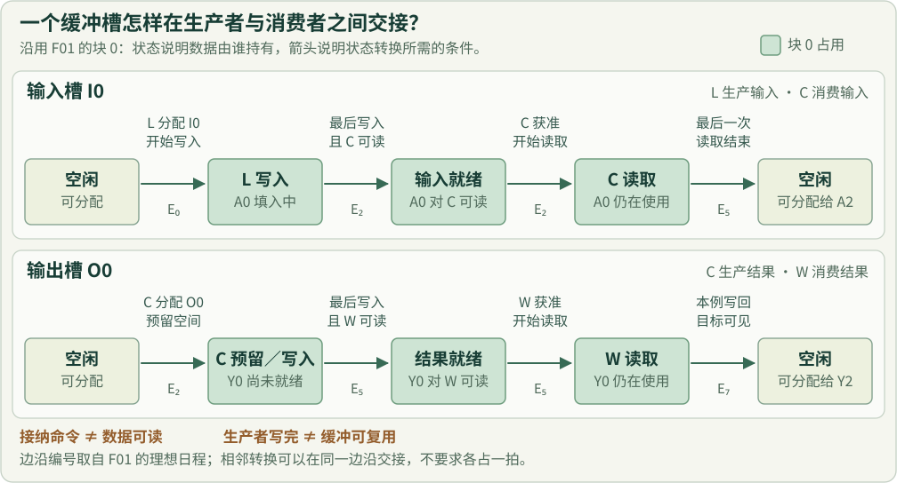
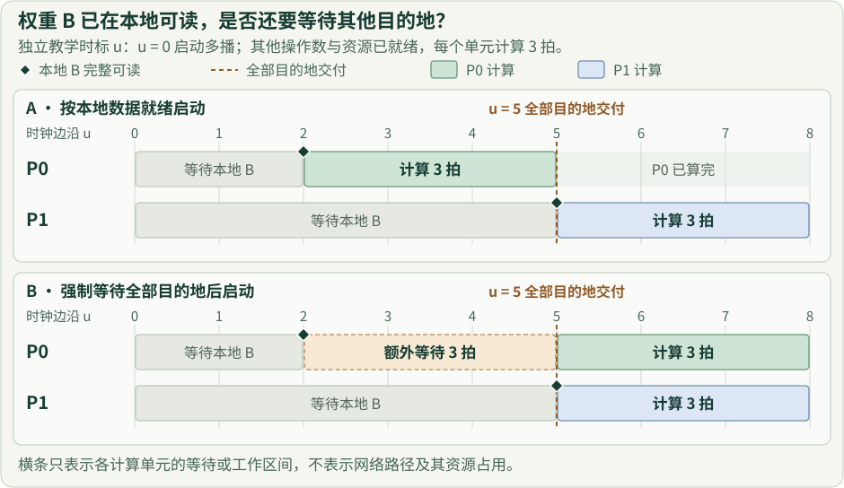
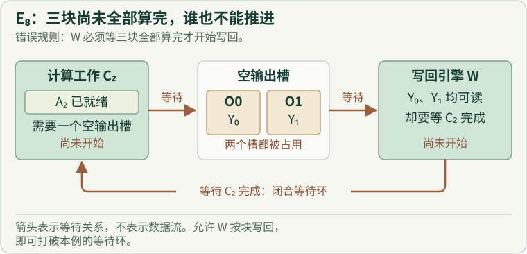

# 多个引擎各自执行，怎样知道下一项工作可以开始？

在 [F01](f01-overlap-and-buffer-reuse.md) 中，搬入引擎、计算引擎和写回引擎通过两组缓冲区协作。我们给三个独立的矩阵分块排出了一张 13 拍的执行日程。

但硬件不能只靠这张时间表正确工作。如果第二块数据比预计的时间晚到，计算引擎仍按原定时刻开始取数，就可能读到缓冲区中的旧数据。若它已经计算完毕，写回引擎还在使用结果，下一次计算也不能提前覆盖结果槽。

**任务控制**要让不同的执行实体知道自己还需要等待什么，并在条件满足时取得相应资源、推进工作。本文从 F01 的交接过程出发，理解硬件怎样维护这些条件，以及怎样避免同步使本来可以完成的工作停下来。

## 第二块已经搬完，为什么下一次搬运和计算还不能开始？ {#dependencies-and-resources}

沿用 F01 中的三个矩阵乘法 Y₀ = A₀B、Y₁ = A₁B、Y₂ = A₂B。权重 B 已经驻留。I0、I1 为输入槽，O0、O1 为输出槽；L、C、W 分别表示独立的搬入、计算和写回引擎。下标 i 表示该引擎为第 i 块执行的工作。

如前篇，每块搬入、计算、写回分别需要 2、3、2 拍；各引擎一次服务一块，先假定存储路径允许并行，计算前预留完整的输出槽。Eₜ 表示时钟边沿，区间 [2,5) 表示从 E₂ 到 E₅ 的三拍。本篇仍省略额外的命令交付和状态唤醒延迟。

先观察 E₄ 到 E₅ 的变化：

| 时刻 | 输入槽 | 输出槽 | 引擎状态 |
| --- | --- | --- | --- |
| E₄ 沿后 | I0 仍被 C₀ 使用；I1 的 A₁ 已可读 | O0 已为 C₀ 预留；O1 空闲 | L 空闲；C 正在执行 C₀；W 空闲 |
| E₅ 的交接 | C₀ 不再读取 I0；I1 的 A₁ 仍可读 | O0 的 Y₀ 已可读；O1 空闲 | C₀ 完成，计算执行资源空闲 |

在 E₄，L 已有能力搬入 A₂，却没有可覆盖的输入槽。A₁ 已经可读，C₁ 却还不能使用计算引擎。这几个分块在数学上相互独立，但下一次搬运和计算暂时无法取得所需的硬件资源。

因此，不能只给 L 或 C 接一条来自另一引擎的“完成”信号。我们需要知道的是数据与资源的具体状态，以及这一状态属于哪项工作。

### 命令已经接收，是否意味着马上就会执行？

假设给每个引擎增加一个能够保存等待命令的队列。为了简化讨论，我们已将每项工作要使用的槽位写入命令：例如 L₂ 要填入 I0，C₁ 读取 I1 并写入 O1，W₀ 读取 O0。

C 可以在执行 C₀ 时先接纳 C₁ 的命令，只要命令队列还有空间。接纳只表示硬件承担了保存和处理这项命令的责任，不意味着它已经取得计算资源或读取了输入。

把启动与完成分开，就是这里说的异步执行。提交方在成功交付命令后，可以先处理其他工作，不必等该命令执行结束。若接口还支持非阻塞提交，队列满时也能返回未接纳的状态，而不必一直等空位。异步执行不要求引擎使用不同的时钟，也不自动保证实际并行。

| 事件或状态 | 本例中的含义 |
| --- | --- |
| 命令接纳 | 命令及其身份已被硬件保存 |
| 数据就绪 | 当前命令需要的正确数据已对该消费者可读 |
| 可执行 | 数据、目标空间和当前执行所需的资源条件均满足，命令允许参与选择 |
| 发射或取得执行许可 | 完成选择并成功交付至执行入口，取得所需资源 |
| 执行开始 | 引擎实际开始为这项工作服务 |

发射与执行开始在有的硬件中可以合并，有的设计还会在入口等待内部流水级。本例把成功取得许可并开始服务记在同一个边界。这样我们既能沿用 F01 的日程，也不会把接纳命令误作占用某个执行资源。

例如一个流水化计算引擎可能允许多个命令同时在途。就算其中一项尚未完成，也可能有空闲流水级、端口和上下文用于新工作。F01 的 C 恰好一次只服务一块，不能把这一约束用到所有计算节点上。[A08](../01-foundations/a08-dependencies-and-scheduling.md) 已解释就绪候选、发射与资源仲裁的共同原理。

## 怎样让接收数据的一方知道这次写入已经完成？ {#event-and-visibility}

E₂ 时，L₀ 刚把 A₀ 搬完，C₀ 应当开始读取 I0。C 怎样知道 I0 现在是 A₀，而不是以前留下的数？

可以让 L 完成此次写入后，向 C 报告一个事件（Event）：I0 中属于块 0 的数据已经可读。C 检查这个事件，同时检查 O0 是否可预留及自身资源是否可用，在条件满足后再开始工作。

事件描述某个有意义的状态变化。它可以由一个硬件信号、一个状态位、一个带任务号的队列记录或一个计数值表示。重要的是，接收方能根据约定判断它是否关心这次变化，而不是规定所有芯片都必须实现同一种事件电路。

L 不应在最后一笔写请求刚发出时就报告 I0 可读。因为请求可能仍在互连上，数据可能还没有进入 I0。即使存储器已经更新，若消费者经由不同路径访问，也要按照该系统的可见性规则确认它能取得新数据。

在本文教学系统中，生产者先完成必要写入并使对应消费者能够读取，再发布数据就绪事件；消费者观察到该事件后才允许读数。这是本文采用的交接契约，不表示任意完成信号天然具有这样的效果。

实际例子见 [Tenstorrent 的 cb_push_back 接口](https://docs.tenstorrent.com/tt-metal/latest/tt-metalium/tt_metal/apis/kernel_apis/circular_buffers/cb_push_back.html)：写入循环缓冲区中的 tile 与向消费者公布它是可消费的两项操作。互连中不同写入和通知之间的次序、地址可见性由各自的接口契约决定，详见[事务次序与完成](../../interconnect/NOC/05-system-integration/transaction-ordering-and-completion.md)。

### 一个脉冲够不够？

E₄ 时，L 已经报告 I1 中的 A₁ 可读。但 C₀ 仍在计算。等到 E₅，假如那条就绪信号已消失，C₁ 将无法知道数据是不是已经到齐。

因此，如果就绪发生在消费者开始等待之前，它需要有一种不会漏掉该事实的表示。例如，每个输入槽配一个就绪状态位；L 发布数据时设置它，C 接手后按约定更新状态。或者让事件队列保留尚未消费的通知，直到接收者确认。

如果只使用瞬时信号，也可以让接收端在保证能够采样的时序中锁存它。关键不是信号必须保持多久，而是发送方与接收方之间不会丢失这一有意义的状态变化。这与 [A07 的握手](../01-foundations/a07-handshake-and-backpressure.md) 所解决的交接问题相同。

## 为什么数据已经可读，缓冲区还不能复用？ {#ownership-and-lifecycle}

到 E₅，C₀ 已经把 Y₀ 写入 O0，W₀ 可以读取结果。但 L₂ 要复用的是输入槽 I0，后续计算若需要一个输出槽，也不能直接拿走仍保存 Y₀ 的 O0。

数据就绪和槽位空闲需要不同的记录。算术运算结束、结果写入、对指定消费者可读、引擎有新的执行机会、最后一次读取结束及槽位获准复用，都是不同的观察边界。本例部分边界恰好发生在 E₅，实际硬件中的时刻可以不同。

对每个输入槽，我们可以用少量状态记录现在处于哪一个阶段：空闲、已分配给 L 填写、数据就绪、由 C 读取。O 槽也有类似的状态，只是 C 是生产者，W 是消费者。

<figure class="micro-diagram" style="max-width:900px; margin:1.2rem auto" tabindex="0" aria-label="输入槽与输出槽的状态和所有权交接，窄屏可横向滚动" markdown="1">

<figcaption>追踪 F01 的 I0 与 O0，而不是把所有引擎的完成统一成一个信号。图中 O 槽按本例约定在目标可读后归还；其他设计可以在确认不再读 O 槽时更早释放。</figcaption>
</figure>

以 I0 为例，L 取得空槽使用权后，才允许写 A₀。写完后它交出的是「当前 A₀ 可以读取」的事实，不是「I0 可以重新写入」。C 读取 A₀ 期间，其他命令不能覆盖 I0。

C 最后一次读取 I0 后，才交出「这一使用代次已经消费完，可以重新分配」的事实。若存在多个消费者，就要等所有仍需通过 I0 读取这代数据的消费者结束，或者保证它们已经取得所需副本。

这样可以允许其他无关工作继续。例如在 E₅ 交接后，只要所需资源条件满足，三个引擎就分别根据三个事实推进：

| 待启动工作 | 数据与资源条件 | E₅ 之后的动作 |
| --- | --- | --- |
| L₂ | A₂ 在外部内存可读；I0 已归还；L 及搬入路径可用 | 分配 I0，写入 A₂ |
| C₁ | I1 中 A₁ 可读；O1 空闲；C 与相应访问路径可用 | 消费 I1，预留 O1 |
| W₀ | O0 中 Y₀ 可读；写回路径与 W 可用 | 读取 O0，将 Y₀ 送往目标 |

表中判断的是 E₅ 沿后可以进行哪些服务，不表示 E₅ 才产生的寄存器状态能倒过来影响该沿已经采样的信号。硬件实际增加的交接拍数应在性能估算中计入。

### 同一个槽先后保存不同的数据，怎样区分旧事件？

L₀ 在 I0 产生 A₀，稍后 L₂ 在 I0 产生 A₂。如果通知中只有地址 I0，一个旧代次的重复或迟到通知可能被误当成 A₂ 已经可读。

为避免这种混淆，可以把每次分配的任务编号或使用代次与槽位一起记录。例如 I0 第一次分配给块 0，下一次分配给块 2；C₂ 只接受属于这次分配的数据就绪事件。

硬件也可以在有严格顺序、不会遗留旧通知的队列中用读写位置隐含该身份，而不一定传送显式代次号。无论采用哪种方式，都必须保证旧状态不会授权新数据的读取或覆盖。有限位宽的编号还需确保不会与尚存的旧记录发生混淆。

这种记录和转换可以看成槽位的有限状态机，与 [A01 的状态记录](../01-foundations/a01-state-and-control.md) 同属一类硬件方法。命令队列可以引用这组状态来判断是否就绪，也可以由各引擎在局部维护。

## 有好几个空槽，怎样控制谁能拿到一个？ {#semaphore}

假设下一批运算不再预先指定每个输入槽的编号，只要求 L 取得一个可以写入的槽。与其逐一问消费者是否已经用完，我们可以维护一组可分配槽位，并记录剩余空槽有多少个。

允许成功分配一个槽就减少一个许可，消费者归还一个槽就增加一个许可。这是**计数信号量（Counting Semaphore）**的一种使用方式：用一个非负计数表达有限资源的许可数。计数为零时，没有新的许可可以取得。

仍用两个输入槽。在 F01 的双缓冲日程中，空槽许可数会出现下列变化：

| 时刻 | 操作 | 剩余许可数 | 空闲槽 |
| --- | --- | ---: | --- |
| E₀ 之前 | 初始化 | 2 | I0、I1 |
| E₀ | L₀ 取得一个槽，分配 I0 | 1 | I1 |
| E₂ | L₁ 取得一个槽，分配 I1 | 0 | 无 |
| E₄ | A₁ 已可读，但是尚未消费；L₂ 仍等待 | 0 | 无 |
| E₅ | C₀ 归还 I0，L₂ 取得它 | 0（先归还 1，再取得 1） | 无 |
| E₈ | C₁ 归还 I1 | 1 | I1 |
| E₁₁ | C₂ 归还 I0 | 2 | I0、I1 |

计数只能回答还有多少许可，不能说明哪一个槽空闲。因此分配器还需要维护空闲槽列表、位图或等效状态。若允许多项请求同时争取空槽，则“检查还有许可、挑选槽、扣减许可并标记为已分配”必须作为不可被其他分配打断的一次成功交接。否则两个请求都看到 1，可能把同一个槽分给不同的数据。

如果一项命令需要多个资源，得到一个许可也不代表所有资源都可用。例如 C₁ 输入就绪后，仍要获得输出槽和计算引擎的许可。实际取得资源的粒度和时机应由硬件能力决定：可以在发射时预留，也可以在途等待后续服务，但必须保存尚未交接的数据。

信号量也可用于表示一定数量的数据已经就绪。有的硬件用二值锁来表示独占访问许可，有的用计数或循环缓冲区指针记录可交付的数据。事件与信号量不一定由两套不同电路实现；区别在于它们在具体契约中表达的是某次状态变化、可消费份数还是可取得的资源许可。

例如 [AMD Versal AI Engine 的存储模块（AM009）](https://docs.amd.com/r/en-US/am009-versal-ai-engine/AI-Engine-Memory-Module) 支持 DMA 与计算引擎通过硬件锁同步。NVIDIA 的 [CUDA 异步屏障生产者—消费者例子](https://docs.nvidia.com/cuda/cuda-programming-guide/04-special-topics/async-barriers.html#producer-consumer-pattern-using-barriers) 则分别表示缓冲区已填好和可重新填入，两种通知不要求生产者与消费者每次共同停下来等待。

## 数据已经送到一个计算单元，为什么还要等另一个？ {#local-and-global}

F01 假设权重 B 已经在计算引擎附近。现在改变这个条件：芯片中有两个计算单元 P0 和 P1，它们分别计算 Y₀ = A₀B 与 Y₁ = A₁B，拥有各自的输入、权重和输出空间。暂不讨论具体的分发结构或阵列内部数据流。

B 只有一份待发送的数据，可以通过一次**多播（Multicast）**将它交付到两个目的地。两个单元的 A 块、计算资源和输出空间都已准备好，只有本地的 B 还没到达。

为观察交付差异，另用一条教学时间轴 u，不与 F01 的 t 日程相加。设多播在 u = 0 开始；P0 的 B 副本在 u = 2 完整可读，P1 的副本在 u = 5 完整可读。两个单元各需要 3 拍完成各自的小矩阵乘法。

| 时刻 u | P0 | P1 | 多播的交付状态 |
| --- | --- | --- | --- |
| 2 | B 已可读 | B 尚未可读 | 仅 P0 已交付 |
| 5 | 本地计算完成 | B 刚刚可读 | 两个目的地都已交付 |
| 8 | 结果已就绪 | 本地计算结束 | 两份计算结果均已就绪 |

如果 P0 只需要自己的 B 副本，且没有额外的次序和共享资源限制，它在 u = 2 就能开始，不必等待多播的其他目的地。P1 在 u = 5 开始，两个结果分别在 u = 5、8 产生。

若控制器只在所有目的地都收到数据后才唤醒计算，P0 也要等到 u = 5。两份结果都延迟到 u = 8。这个简单算例中最后一份结果时间相同，但 P0 的结果早三拍产生，可能使它自己的后续工作更早开始。

<figure class="micro-diagram" style="max-width:900px; margin:1.2rem auto" tabindex="0" aria-label="多播局部交付与等待所有目的地的时间对照，窄屏可横向滚动" markdown="1">

<figcaption>两种唤醒条件的区别。u 轴只观察本次多播及计算；到达延迟为教学假设，不代表某一互连或芯片的实测结果。</figcaption>
</figure>

由此可见，一项多目的地传输至少可以有两类不同的完成条件：某个指定目的地的数据已经可用，以及全部指定目的地都已完成交付。对前一种条件感兴趣的消费者，不一定要等后一种。

如果硬件只有整项多播完成的报告，就无法仅凭这个报告提前唤醒 P0；它还需要能确认局部交付的状态或通知，并保证该通知对相应数据的可见性。发送端也要等所有必要的源读取结束或数据已安全转移后才能复用源缓冲，源缓冲释放时刻并不必然等于全目的地交付时刻。

Tenstorrent 的[多核矩阵乘法多播例子](https://docs.tenstorrent.com/tt-metal/latest/tt-metalium/tt_metal/labs/matmul/lab3/lab3.html) 中，每个接收核心先预留空间，等本地的有效信号，再将数据公布给自己的计算内核。该例的正确性依赖于数据写入与通知在指定 NoC 路径上的顺序约定。这里不假设产品一定具有图中的到达时差。多播数据如何经过路由器复制，见[广播与多播树](../../interconnect/NOC/06-ai-noc-specifics/broadcast-multicast-tree.md)。

### 那什么时候才需要让所有参与者都等一等？

假设在完成各自的小矩阵乘法之后，P0 和 P1 要共同进入下一阶段。在下一阶段中，两者都可能读取对方产生的结果。因此在双方的结果都可用前，不允许任何一方开始该阶段。

可以为这两个参与者建立一个**屏障（Barrier）**。在本例中，每个单元先使自己的结果可被对方读取，再报告当前阶段到达。只有 P0 和 P1 都到达，才允许它们通过屏障，进入下一阶段。

屏障可以用到达状态位或计数器等电路实现。假如本轮初始还差两个参与者，到达一次就扣除一个；当计数为零，向等待者发布本轮通过条件。实现时必须区分参与者及阶段，保证同一个参与者不会被错误地重复计入；重复使用时也不能把上一轮的释放误作下一轮的释放。

屏障的范围不是整颗芯片，而是这个同步操作约定的参与集合。例如 [C02 的共享存储同步](../03-parallel-execution/c02-simt-and-warp-scheduling.md) 面向指定线程。屏障通过后的数据可见性取决于它保证的内存语义，不能仅用计数达到零推断所有地址的写入都已完成。

如果 P0 的后续工作只需要自己的结果，也没有其他次序或资源约束，为此增加一个全体到达条件就没有必要。屏障适用于真的需要共同进入下一阶段的工作；点对点就绪通知则允许没有这种共同条件的消费者各自推进。

## 这些状态一定要由一台中央调度器维护吗？ {#control-organization}

回到 F01 的 L、C、W。在 E₅ 发生交接时，需要有地方记录 I0 已归还、O0 已可读，还需要让各引擎获取对应的资源许可。但是，不要求所有记录位于一个控制器中。

可以采用下列几种硬件组织。它们需要保证的依赖和所有权关系相同，区别在于由谁保存状态、选择工作并发出命令。

| 组织方式 | 怎样推进这三项工作 | 适用条件与代价 |
| --- | --- | --- |
| 集中控制 | 一个控制模块观察待执行命令、槽状态和引擎接纳能力，然后分别向 L、C、W 发射 | 对较小系统易于统一协调；实体多时，状态收集、扇出与发射能力可能成为限制 |
| 分布式控制 | L 观察空槽，C 等本地输入和输出许可，W 观察结果就绪；各自从本地命令流推进，交换交接通知 | 减少集中收集状态和控制往返的需要；各处必须遵守同一所有权与进展协议 |
| 层级控制 | 上层分发一组工作或资源范围，下层控制模块在各自范围内选择并发射具体命令 | 可以限制集中控制的规模；需要处理上下层资源分配和跨范围依赖 |

无论控制决定在哪儿作出，如果 L 与 C 共用一个输入 SRAM 端口，都需要能够排除同一时刻不相容的访问。分布式控制并不是让两个引擎独立决定自己必然取得共享端口；共享处仍需握手、仲裁或已保证无冲突的使用计划。

软件可以预先安排好每个引擎的命令序列，而硬件在每条命令处等待相应的交接条件。这不同于让硬件在全部任务之间动态选择执行顺序。若进一步按固定时刻启动，则必须能保证数据到达、资源服务和时序的约束，不能只套用 F01 理想的 13 拍时间表。

例如 [NVDLA v1 架构说明](https://nvdla.org/hw/v1/hwarch.html) 给出了管理处理器配置并激活独立硬件模块、再处理完成中断的方式。[Maia 100](../../chip-architectures/microsoft-maia-100/README.md) 则展示了层级控制处理器与执行引擎之间的硬件信号量交接（[Hot Chips 2024，第 9 页](https://hc2024.hotchips.org/assets/program/conference/day2/81_HC2024.Microsoft.Xu.Ramakrishnan.final.v2.pdf#page=9)）。

[Groq TSP](../../chip-architectures/groq-tsp/README.md) 说明了预安排的执行时序也可以是硬件的工作组织方式。这里比较的是控制职责的放置，不选择软件的任务映射或调度方案。

## 如果每项等待条件都没有错读数据，系统就一定能完成吗？ {#progress}

此前的规则保证了未准备好的数据不被读取、仍在使用的槽不被覆盖，但还需要检查系统是否能够不断推进工作。

仍然保留 F01 的两个输入槽、两个输出槽和三个引擎。现在给 W 增加一条看起来很安全的限制：必须等 C₀、C₁、C₂ 全部计算完成，才能开始任何写回。

- C₀ 在 E₅ 完成，Y₀ 保存在 O0 中。W 因新增限制不读 O0。
- C₁ 在 E₈ 完成，Y₁ 保存在 O1 中。W 仍不开始写回。
- 此时 A₂ 已在 I0 中就绪，C 可以服务新工作，却没有可预留的输出槽。因此 C₂ 不能开始。

<figure class="micro-diagram" style="max-width:780px; margin:1.2rem auto" tabindex="0" aria-label="额外全体计算屏障与两个输出槽造成的循环等待，窄屏可横向滚动" markdown="1">

<figcaption>在这个特定状态中，每项依赖都等待环中的另一项解除；没有外部工作会归还输出槽。去掉这一无必要的全体等待即可让 W 先释放 O0。</figcaption>
</figure>

系统陷入了**死锁（Deadlock）**：C₂ 需要空输出槽，空槽需要 W 写回释放；而 W 被限制为等待 C₂ 完成。在没有取消、抢占或其他释放来源的本例中，即使每个引擎都遵守自己的启动约束，三项条件也不会自行满足。

解除 W 的额外限制，使它在每个输出块就绪后便可取得写回资源，就能打破这个等待环。若确实存在一项工作需要所有三块结果同时保留，另一种可能的解法是预留足以容纳这些结果的空间。解决哪一种死锁，需要根据实际等待关系判断。

### 一直在尝试，为什么也可能没有进展？

还有两种现象需要与死锁区分。

- **活锁（Livelock）**：假设共用端口的 L 和 C 在同时提出请求时都撤销，下一拍又同时重试，并不断重复。控制状态一直变化，但没有请求成功。可以用明确的仲裁选择或改变重试协议打破这种循环。
- **饥饿（Starvation）**：共享端口服务多个命令流，始终优先处理其他持续到达的请求，C 的一个持续符合条件的请求却一直得不到服务。其他工作可以不断完成，但它长时间甚至无限等待。

饥饿不等同于任何一次正常排队。适当的轮询、请求年龄或有界公平仲裁可以为等待者提供机会，但也要满足请求持续有效、获准的服务能够在有限时间结束等前提。[AMD AM009](https://docs.amd.com/r/en-US/am009-versal-ai-engine/AI-Engine-Memory-Module) 的各存储 bank 使用轮询仲裁，就是共享端口仲裁的一种实例。

从执行实体之间的依赖看，设计既要保证正确性（不提前消费或覆盖），也要保证适当的进展条件（满足前提的工作最终能够继续）。本文的等待环涉及任务和缓冲区，不去推导路由网络中的通道依赖；后者见[死锁、活锁与饥饿](../../interconnect/NOC/04-routing-and-flow-control/deadlock-livelock-starvation.md)。

### 如果一项正在搬运的工作被取消，可以立即归还它的缓冲吗？

还是看 L₂。在 E₆ 时它正在写 I0；现在因为错误或取消不再需要 A₂。控制逻辑应阻止依赖 A₂ 的计算按成功路径启动，同时确认 L₂ 会不会再有写操作到达 I0。

如果只删除命令记录、修改槽代次，却没有阻止已经在途的真实写入，下一项工作复用 I0 后仍可能被旧写入覆盖。因此，取消不是简单地清除就绪状态。

可以让引擎停止发新请求，并按协议等待所有已经接纳的旧访问结束；也可以采用能在目标端真正阻止旧访问副作用的机制。只有确认旧访问不再影响槽位、旧消费者也已不再使用它后，才允许重新分配。旧事件应和新代次隔离，许可也不能重复归还。

这并不意味着已经写入其他位置的结果一定能撤销。例如 [AMD AXI CDMA 的错误处理说明](https://docs.amd.com/r/en-US/pg034-axi-cdma/Error-Interrupts) 明确，发生错误后仍需完成已提交的 AXI 传输，之后才报告引擎已停止。实际的失败和取消方式取决于设备及系统契约。

## 回到 F01 的交接点，硬件真正需要知道什么？ {#summary}

在 F01 的 E₅，不同引擎能够同时推进，不是因为系统收到一个含糊的“第一块完成”信号，而是因为 C₀ 不再使用 I0、Y₀ 对 W 可读、C 有新的接纳机会，且三项后续工作取得了各自所需的资源。

Event、Semaphore 和 Barrier 可以分别用于表达指定状态变化、资源许可和多参与者的阶段条件。重要的不是名称，而是硬件怎样保证事件对应正确的数据及代次、多个访问者不会取得冲突的资源，以及这些条件不会形成阻止进展的循环。

前两篇主要观察多个执行职责不同的引擎。下一篇 F03《把同一块矩阵交给两个计算单元，需要交换哪些数据？》将视角移到多个完整计算单元，进一步追踪工作如何分发、哪些操作数需要复制、何时需要交换部分结果。

## 阅读衔接

- [F01：第一块数据还在计算，第二块数据能开始搬运吗？](f01-overlap-and-buffer-reuse.md)：理解本篇的执行日程和缓冲复用条件。
- [A08：多项工作同时就绪，谁先使用计算资源？](../01-foundations/a08-dependencies-and-scheduling.md)：理解依赖判断、候选选择和共享资源仲裁。
- [E01：一块数据从内存搬到计算单元，DMA 要做哪些工作？](../05-data-movement/e01-dma-task-and-address-generation.md)：观察一条搬运命令内部怎样推进请求和写入。
- [Maia 100](../../chip-architectures/microsoft-maia-100/README.md)、[Tenstorrent Wormhole](../../chip-architectures/tenstorrent-wormhole-n150s/README.md)：观察实际处理器中不同执行实体的交接方式。

[返回多执行实体与资源协作](README.md)
