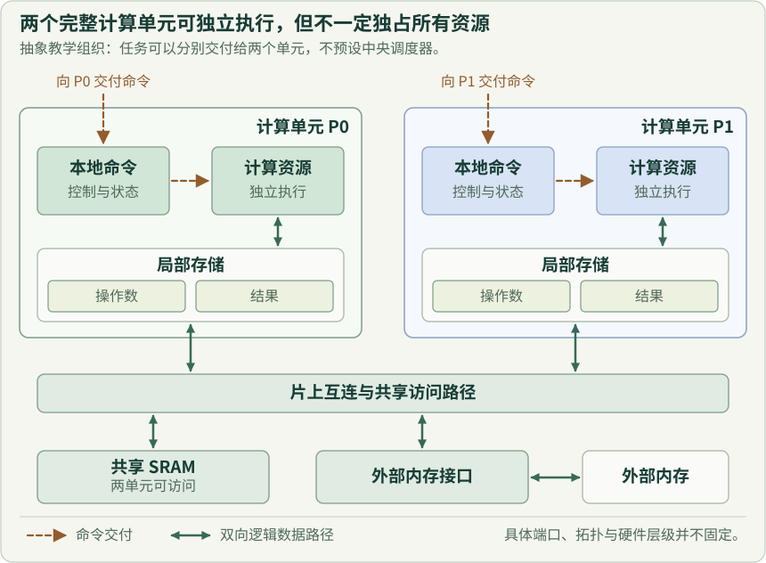
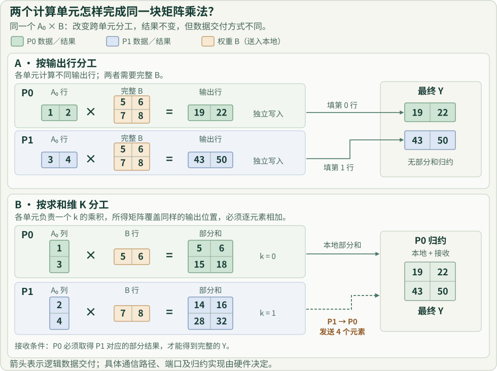

# 把同一块矩阵交给两个计算单元，需要交换哪些数据？

在 [F01](f01-overlap-and-buffer-reuse.md) 中，一个计算引擎依次处理三个矩阵分块，搬入和写回引擎可以在它计算时提前工作。[F02](f02-task-control-and-synchronization.md) 进一步解释了这些引擎怎样通过状态、事件和资源许可进行协作。

现在增加第二套能够独立工作的计算单元。我们既可以让两个单元分别处理不同的矩阵分块，也可以让它们共同完成同一个分块。前一种方式需要将工作和数据交付给合适的单元；后一种方式还可能在单元之间产生新的数据依赖。

本篇从两个具有局部存储的计算单元出发，追踪任务、操作数和部分和怎样跨越单元边界。这样就能理解，为什么增加计算资源既可能增加并行机会，也可能增加数据复制、通信和同步的成本。

## 增加第二个计算单元，究竟增加了哪些资源？ {#compute-unit-boundary}

仍然计算 Y = AB。沿用 F01 中 A 为 6×2、B 为 2×2 的矩阵，将 A 每两行分成一个输入块 A₀、A₁、A₂，得到三个独立输出块 Y₀、Y₁、Y₂。

F01 的计算引擎 C 可以独立接受一项计算命令、读取一块输入并产生一块输出。现在将计算资源扩展为两个完整的执行实体 P0、P1。先为每个单元配置自己的计算资源、局部存储和保存命令或执行状态的电路。

两者还可以访问上级的共享存储，通过片上互连传递数据。这里的局部存储用于保存单元当前需要的操作数及结果；共享存储可以容纳要被多个单元使用的数据，并连接更上层的内存。

<figure class="micro-diagram" style="max-width:840px; margin:1.2rem auto" tabindex="0" aria-label="两个带局部状态和局部存储的计算单元，以及共享存储和互连，窄屏可横向滚动" markdown="1">

<figcaption>用于观察任务和数据跨越单元边界的教学结构。相邻方框不代表固定的物理布局；共享路径、控制位置和端口数量可随具体设计改变。</figcaption>
</figure>

在本教学模型中，P0 和 P1 并不是 [D01 中的单个 PE](../04-compute-arrays/d01-macs-and-array-data-paths.md)。一个 P 可以包含多个乘加单元、向量运算资源和内部数据通路。本文不再观察内部每个乘加位置的时序，而是将整个 P 作为可以接收工作、保存状态和交换数据的实体。

在具体芯片中，这样的资源组织可能称为 Core（核心）或 Tile（计算块）。若若干单元还共享更上层的控制、存储和互连，它们可能被组织成 Cluster（簇）。这些名称没有统一的硬件层级定义，不能只根据名称判断单元里面有多少计算资源。

例如 CPU 的核心通常能够执行自己的指令流；GPU 的某些产品把一组执行资源、线程状态和共享存储组织成 SM；NPU 的 tile 可能同时包含计算和搬运引擎。后面再用具体产品说明这些边界。

## 三个分块怎样交给两个计算单元？ {#task-distribution}

假设每个 P 都支持完整的 2×2 输入块计算，仍需要 3 拍服务一个块。这是沿用 F01 的计算服务时间，不改变阵列内部的处理能力。

为了单独观察计算任务分发，先假定每块在被分配时所需的数据已经可取，结果空间也可用，两个单元拥有独立的供数与输出服务能力。不计额外的搬入、写回和命令交付时间，时间从第一个计算开始计到最后一个计算结果在局部空间就绪。

| 服务区间（拍） | 只有一个计算单元 | 两个计算单元 P0、P1 |
| --- | --- | --- |
| [0,3) | 计算 Y₀ | P0 计算 Y₀；P1 计算 Y₁ |
| [3,6) | 计算 Y₁ | P0 计算 Y₂；P1 空闲 |
| [6,9) | 计算 Y₂ | 两个单元均已结束 |

在这些条件下，一个单元需要 9 拍，两个单元需要 6 拍。最后一项工作只占一个单元，所以另一单元会空闲 3 拍。这个计算阶段的加速为 9/6 = 1.5 倍，不是两倍，也不是整个 F01 日程的执行时间。

但怎样让这三个任务真正进入相应的硬件？

每项工作首先要有能够被硬件解释的描述，例如计算类型、操作数所在的位置、要保存结果的位置、相应的任务编号和需要满足的依赖。命令交付之后，由负责该工作的执行单元或其控制逻辑判断能否开始服务。

一种组织方式是预先给 P0 安排 A₀、A₂，给 P1 安排 A₁，并送入各自的命令入口。各单元按自己的命令序列执行，必要时等待数据和资源许可。这不要求硬件动态改变分配结果。

另一种方式是让两台单元从一组可分配的任务中取得工作。假设前两个块已经被分别接纳，当第三个块能够执行时，硬件可以将它交给一个符合条件且能够接纳新任务的单元。若两个单元同时申请同一项工作，还需保证它只被分配一次。

这就是硬件提供的**任务分发**能力：依据命令的要求和目标实体的接纳条件，将工作交付给合适的执行位置。分发可以由共享控制逻辑、层级控制模块或多个局部控制器协作完成，不预设必须有一台中央调度器。

### 为什么一个单元空闲，另一个单元的任务也不一定能交给它？

改变一个条件：A₂ 已经放在 P0 的局部存储中，P1 不能直接访问这个位置。假如 P1 先空出来，也不能直接在原地读取 A₂。要让 P1 执行，可能需要重新安排数据传输、目标缓冲和依赖关系。

另外，某个单元可能还有足够的计算通路，却没有新的命令位置、寄存器空间或者结果缓冲。回忆 [C03](../03-parallel-execution/c03-gpu-resources-and-execution-efficiency.md) 中多个线程组的资源分配：空闲的运算位置不一定代表整个执行实体能接纳更多工作。

因此，硬件可以在支持重新分发的范围内缓解工作分布不均，但不能把任何尚未完成的任务随意转移到任何单元。正在执行的工作还可能包含部分结果和其他局部状态。软件怎样划分任务、选择放置位置以及搜索更好的分配计划，不在这里展开。

### 一个单元同时接纳两项工作，怎样知道数据属于谁？

不同工作可能在同一个单元保留各自的进度和局部结果。例如 P0 已经开始计算第一个块，另一项命令已在等待队列中。如果两个任务都用编号为 0 的局部位置，就要区分这些编号是同一物理位置，还是分别属于不同的资源范围。

一个**执行上下文（Execution Context）**保存某项执行所需的状态，例如程序位置、寄存器状态，或者块级命令的参数、访问范围和执行进度。具体保存内容取决于这是一个指令流还是一个块级任务。

将工作交付给某个单元时，需要将它与正确的上下文关联，并分配可以使用的资源。数据响应、完成通知和缓冲释放也要回到对应的任务和代次。[B08](../02-cpu/b08-hardware-multithreading-and-resource-sharing.md) 和 C03 分别展示了 CPU 与 GPU 如何在共享执行资源时保存多个执行状态。

隔离还需要明确哪些地址、缓冲区和状态可以被当前任务读写。独立的上下文或不同的局部地址空间并不自动提供完整的访问权限保护，也不代表任务之间没有带宽竞争。即使两项任务不会相互覆盖数据，它们仍可能共享同一存储控制器。

## 如果两个计算单元要共同完成一个分块呢？ {#split-one-tile}

前面每个单元独立完成一个 2×2 输出块。现在只取其中的一块 Y₀ = A₀B，将其内部的工作分给 P0 与 P1。选取下列具体的矩阵元素，便于跟踪它们被送到了哪里。

| A₀ | 第 0 列 | 第 1 列 |
| --- | ---: | ---: |
| 第 0 行 | 1 | 2 |
| 第 1 行 | 3 | 4 |

| B | 第 0 列 | 第 1 列 |
| --- | ---: | ---: |
| 第 0 行 | 5 | 6 |
| 第 1 行 | 7 | 8 |

例如左上角的输出需要 1×5 + 2×7 = 19。四个输出依次为 19、22、43、50。

要注意，本节改变了观察边界与初始条件：A₀、B 都已在上级共享 SRAM 中准备好，两个计算单元的局部操作数空间起初为空。最终结果要写到共享存储中的 Y₀ 区域。这样可以比较两种分工在单元边界产生的传输。

本例采用每个输入或权重元素 1 B、部分和与最终输出元素 4 B 的整数计算，所有结果都能精确表示。输入装入本地后可以复用；只统计有效数据，不计报文头、对齐、缓存行等额外传输。拆分后每项工作形状不同，不再沿用前面完整块的 3 拍服务时间。

### 让每个单元负责一行输出

P0 负责输出的第 0 行。它用 A₀ 的第 0 行 (1, 2) 乘以 B 的两列，得到 (19, 22)。为了完成两个点积，P0 需要 A₀ 的两个元素及 B 的全部四个元素。

P1 负责第 1 行。它用 A₀ 的第 1 行 (3, 4) 乘以同一个 B，得到 (43, 50)。因此，它也需要一份完整的 B。

| 单元 | 收到的 A₀ | 收到的 B | 产生的结果 |
| --- | --- | --- | --- |
| P0 | (1, 2)，2 B | 全部，4 B | (19, 22)，8 B |
| P1 | (3, 4)，2 B | 全部，4 B | (43, 50)，8 B |

在这种分工下，每个单元都取得了计算自己的输出元素所需要的全部操作数。两份结果占据 Y₀ 中互不重叠的地址范围，因此可以分别写回。最终消费者需要整个 Y₀ 时，再等待两行都可用，不需要让 P0、P1 交换部分和。

不过，两个单元的局部存储都需要收到完整的 B。若从共享存储分别读取 B，会产生两次相同数据的读取。支持多播的硬件可以将一次读取的 B 交付给多个目的地，这与 F02 中权重 B 的局部数据就绪相对应。

### 让每个单元负责一个求和项

现在改变分工方式。矩阵乘法的每个结果需要将两个乘积相加，其中乘积的编号 k 对应 A₀ 的列和 B 的行。这个维度称为求和维（通常记作 K）。

这一次，P0 负责 k = 0，将 A₀ 的第 0 列 (1, 3) 与 B 的第 0 行 (5, 6) 相乘。P1 负责 k = 1，将 A₀ 的第 1 列 (2, 4) 与 B 的第 1 行 (7, 8) 相乘。

两边各有四个乘积，但 P0 仅有左上角的 5，P1 仅有左上角的 14。其余输出也是一样，每个结果都少了另一边的贡献。

| 输出位置 | P0 的部分结果 | P1 的部分结果 | 最终结果 |
| --- | ---: | ---: | ---: |
| 第 0 行第 0 列 | 1×5 = 5 | 2×7 = 14 | 19 |
| 第 0 行第 1 列 | 1×6 = 6 | 2×8 = 16 | 22 |
| 第 1 行第 0 列 | 3×5 = 15 | 4×7 = 28 | 43 |
| 第 1 行第 1 列 | 3×6 = 18 | 4×8 = 32 | 50 |

每边产生的部分结果矩阵形状都是 2×2。不能像前一种方案那样把它们按输出地址直接拼接，而要把相同位置的两个贡献相加。这种合并称为**归约（Reduction）**。

<figure class="micro-diagram" style="max-width:900px; margin:1.2rem auto" tabindex="0" aria-label="按输出行和按求和维切分同一矩阵，分别造成权重复制和部分和归约，窄屏可横向滚动" markdown="1">

<figcaption>两个方案都执行八次乘积。按求和维分工时，单元内只算出部分结果，还需要在选定的归约位置合并贡献。图中不展开各单元内部的计算时序。</figcaption>
</figure>

为继续计量，约定第二种方案由 P0 最终归约，P1 将四个 4 B 的部分结果发给 P0，共 16 B。P0 取得相应的部分和后，与本地结果逐元素相加，再写回整个 Y₀。

P1 计算结束并不表示整个 Y₀ 已经完成。P0 还要等自己需要的正确部分和到达、归约通路及接收空间可用，才能合并。P1 的部分结果在最后一次源读取结束前也不能被覆盖。这正是 F02 的交接契约在跨单元环境中的应用。

若硬件能够按元素或按片段交付，也可以在某些部分和可读后提前开始对应的归约，而不必等待所有部分结果到齐。若归约放在两边、额外引擎或支持归约的互连中，传输方向和资源需求又会改变。

实际计算中的沿 K 分工常称为 Split-K。例如 [NVIDIA CUTLASS 的并行归约说明](https://docs.nvidia.com/cutlass/4.3.1/media/docs/cpp/efficient_gemm.html#parallelized-reductions) 展示了一种跨线程块生成部分矩阵、再用额外内核归约的实现。那是具体软件与硬件接口的安排，不表示所有实现都必须使用两个内核。浮点计算还需注意归约顺序可能影响舍入结果，见 [A04](../01-foundations/a04-floating-point-and-low-precision.md)。

## 如果输入搬得更少，计算就一定更快吗？ {#communication-budget}

将两种分工的有效数据量列在同一张表中：

| 计量边界 | 按输出行分工 | 按求和维分工，在 P0 归约 |
| --- | ---: | ---: |
| 两个 P 的输入入口交付量 | A₀：4 B；B：8 B；合计 12 B | A₀：4 B；B：4 B；合计 8 B |
| 单元间传递部分和 | 0 B | P1 → P0：16 B |
| 最终输出写至共享存储 | 16 B | 16 B |

这些数表示不同位置上的传输，不能直接用其中任意一列代替整颗芯片的外存流量或网络流量。

例如前一种方式中，如果 B 由共享 SRAM 分别读取并单播到两个单元，源端合计读取 A₀ 的 4 B 和两份 B 的 8 B。如果硬件能够对 B 的一次读取进行多播，源端可能只需读取 8 B（包括 A₀ 的 4 B）。但两个目的地仍各自收到四个权重元素。

如果两个单元以前已经缓存或驻留了所需的 B，它们可能根本无需在这一轮重新搬入 B。外部内存究竟读了多少，还要另外考虑数据最初位于哪里，以及缓存和局部存储如何复用数据。

另一方面，沿 K 分工虽然使输入入口少接收 4 B，却增加了部分结果需要跨越的单元边界。若 P1 完整产生 16 B 部分和后，才通过一条有效载荷服务率为 4 B/拍的专用通路发送给 P0，传输至少需要 4 拍；额外启动、等待和交付时间还可能存在。

这只是该路径传输的下界，不是整个矩阵计算新增的固定延迟。如果可以一边产生部分和一边传输、归约，部分时间可以与计算重叠。反过来，若部分和需要先写入共享 SRAM，再由 P0 读出，这一交接还会占用该存储器的写入和读取资源。

### 将数据放在局部存储，还是放在共享存储？

两种位置需要解决的问题不同。

- **局部副本：** P0、P1 各保存一份 B，可重复从自己的存储路径读数。供数资源可以独立，但需要两份空间，并维护副本与对应任务的有效性。
- **共享存储：** 若 P0、P1 都能够读同一个 B，可以避免在局部预存两份完整的 B。不过每次取数仍需占用共享路径，能否同时读到需要的元素取决于端口、bank、互连和可复用机制。

沿 K 分工还会产生临时的部分结果。每个 P 在本例中产生 16 B 部分和，并需要保留它们直到后续消费者安全接手。P0 还需要能够接收和合并 P1 的贡献；具体接收空间可以逐片段分配，也可能需要保存整块。不能只按最终输出的大小判断所需的缓冲空间。

即使有两个计算单元，如果它们都要通过只能接纳有限请求的共享 SRAM 接口，仍可能出现供数等待。增加局部缓冲或改变数据复制方式只能改变访问需求和等待位置，不能自动提高共享接口的服务能力。

对于由软件明确管理的 scratchpad 和由硬件管理的 cache，局部数据的取得、保留及一致性保证也可能不同。相关机制已在[存储系统中的 cache 与 scratchpad](../../storage/01-memory-hierarchy/02-access-paths/cache-vs-scratchpad.md)中解释。

[Tenstorrent 多核矩阵乘法的多播示例](https://docs.tenstorrent.com/tt-metal/latest/tt-metalium/tt_metal/labs/matmul/lab3/lab3.html) 展示了由部分核心读取操作数、再交付给其他核心的组织方式。它减少重复外存读取，但目的单元仍需接收数据。这类机制的实际网络实现见[广播与多播树](../../interconnect/NOC/06-ai-noc-specifics/broadcast-multicast-tree.md)和[归约与集合通信网络](../../interconnect/NOC/06-ai-noc-specifics/reduction-and-collective-networks.md)。

## CPU、GPU、NPU 和 DSP 的多个计算单元，有哪些不同？ {#processor-organization}

现在我们有了可用于观察实际芯片的一组问题：工作以什么形式进入执行单元？执行状态在哪里保存？数据从什么地方取得？哪些工作需要跨单元交换数据？

不同种类的处理器都可以使用多个执行实体，但它们所采用的控制粒度、计算资源和存储组织不必相同。

| 类型和观察层级 | 工作进入局部实体的方式 | 局部资源与共享资源的典型关系 |
| --- | --- | --- |
| CPU：处理器核心 | 硬件按线程上下文执行指令，软件组织线程及任务 | 核心内有取指、控制、执行和局部状态；多核可共享更高级缓存和内存接口 |
| GPU：SM（NVIDIA 的一种组织） | 将线程块分配给可接纳它的 SM，再由局部控制逻辑安排 warp 的指令 | 寄存器、块内共享存储及执行通路位于 SM 内部；多个 SM 可以共享更上层的缓存、存储接口 |
| NPU：支持块级任务的 tile | 向搬运、张量、向量等引擎提交命令或指令流，由相应控制逻辑推进 | 一个 tile 可含局部存储和多种引擎；多个 tile 可共享上级 SRAM、互连或搬运资源 |
| DSP：可编程数字信号处理核心 | 执行面向信号处理的程序指令，可利用并行计算通路 | 具有局部状态、运算路径及存储资源；某些实现还连接专用加速器、DMA 或共享系统存储 |

表中描述的是观察方式及常见组织，不是对所有 CPU、GPU、NPU 或 DSP 的结构规定。下面用具体实现核对边界。

- **CPU / DSP：** [TI AM62Dx 数据手册](https://www.ti.com/lit/ds/symlink/am62d-q1.pdf) 给出 Cortex-A53 集群中的各核心 L1 与共享 L2，同时集成带矩阵乘法加速器的 C7x 向量 DSP 和本地存储。CPU 与 DSP 能拥有不同的计算资源，但不代表应用能脱离软件自动分出矩阵任务。
- **GPU：** [CUDA 编程模型](https://docs.nvidia.com/cuda/cuda-programming-guide/01-introduction/programming-model.html) 中，常规 kernel 启动后由硬件调度器将线程块分配到符合资源条件的 SM（[CUDA 的线程块调度说明](https://docs.nvidia.com/cuda/archive/13.4.3/cuda-programming-guide/02-basics/writing-cuda-kernels.html)）。一个块在一个 SM 内执行，不同块可能分批运行，不能假定它们的驻留或执行顺序。块内共享存储的访问范围与跨 SM 的交付也不同；特定架构另有跨线程块协作的硬件能力。
- **NPU：** [Maia 100 的公开架构图（Hot Chips 2024，第 9 页）](https://hc2024.hotchips.org/assets/program/conference/day2/81_HC2024.Microsoft.Xu.Ramakrishnan.final.v2.pdf#page=9) 展示了 cluster、tile 两级控制、读写引擎及 SRAM。各执行命令通过信号量满足输入就绪、输出空间等条件。这是一种层级控制与局部协作并存的实现。

CPU 的一个 core、GPU 的一个 SM 或 NPU 的一个 tile 不一定具有相同的计算能力、数据路径或资源规模。GPU 中称为 CUDA Core 或 Tensor Core 的运算资源也不能直接视为整个 SM 的等价物。

比较多核、多个 tile 或多个阵列时，要先确认究竟在统计哪一层资源。

### 两种计算资源一定能执行同一种工作吗？

前面假设 P0、P1 都支持 2×2 矩阵乘法。如果两个单元采用不同的执行资源，情况就会变化。例如让一个张量引擎完成 Y₀ = A₀B，再让向量引擎在所有输出元素上执行加偏置等操作。

后者并不需要再做一次矩阵乘法。两者可以利用各自擅长的运算通路，或者由支持全部运算的可编程单元依次执行。若由两个独立引擎完成，就需要明确前者结果放在哪里、后者何时能够读取，以及两者是否共享存储端口或结果缓冲。

异构组织提供更多种类的硬件服务能力，但也增加了工作适配、数据交接和资源分配的需求。不能因为某台向量引擎空闲，就把它不支持的矩阵命令交给它。有关矩阵乘法之后的其他运算，将在[专用计算与稀疏计算](../07-specialized-compute/README.md)中深入讨论。

不同系统可能通过逐条指令、块级命令，或输入数据与资源条件满足后触发工作。控制粒度也可以在同一芯片中共存；不能简单把指令驱动等同为 CPU、数据流驱动等同为 NPU。真正需要比较的是执行实体可接收的工作、保存状态及推进数据的方式。

## 回到最初的问题：扩大到多个单元，应该检查什么？ {#summary}

若将不同输出行交给不同单元，往往能够独立完成各自的结果，但共享操作数可能需要复制或共享访问。若将同一输出的求和项分给不同单元，输入可以按求和维分开，却需要合并同一输出位置的部分结果。

因此，分析多个计算单元之间的协作时，应沿着任务和数据检查：

- 工作由哪个执行实体接纳，是否需要同时取得计算、状态和存储资源。
- 操作数在哪里产生和保存，哪些单元需要自己的副本，哪些可以共用一个来源。
- 结果在哪里首次产生，哪些数据已经可消费，哪些仍需要等待其他贡献。
- 哪些数据需要跨越单元边界，传输会占用哪些端口、存储和互连资源。

F01 解释了不同引擎的重叠条件，F02 解释了保证正确协作的控制机制，F03 把这些问题放到多个完整的计算单元中。它们共同回答的不只是怎样提高并行度，而是增加并行工作以后，需要为数据和控制提供哪些新的硬件条件。

## 阅读衔接

- [F01：第一块数据还在计算，第二块数据能开始搬运吗？](f01-overlap-and-buffer-reuse.md)：理解计算、数据搬运与缓冲复用。
- [F02：多个引擎各自执行，怎样知道下一项工作可以开始？](f02-task-control-and-synchronization.md)：理解跨执行实体的数据依赖、局部就绪与资源许可。
- [D03：为什么扩大计算阵列，不一定能同比例提高吞吐？](../04-compute-arrays/d03-array-size-bandwidth-and-utilization.md)：对照单个阵列内部的计算资源、供数与利用率。
- [Maia 100](../../chip-architectures/microsoft-maia-100/README.md)、[Tenstorrent Wormhole](../../chip-architectures/tenstorrent-wormhole-n150s/README.md)：观察实际 tile 与多引擎组织。

接下来可以阅读[专用计算与稀疏计算](../07-specialized-compute/README.md)，了解不同运算如何分配给合适的硬件资源；也可以阅读[性能分析与设计权衡](../08-performance/README.md)，将各项工作和资源的占用合并到完整性能分析中。

[返回多执行实体与资源协作](README.md)
