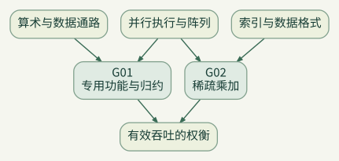

# 专用计算与稀疏计算

专用计算用针对特定操作的硬件资源执行运算；稀疏计算则利用数据中不必参与有效运算的元素，减少不必要的工作。两者都需要考虑额外的控制和数据处理成本。

矩阵乘法得到结果之后，还可能需要逐元素变换、比较、求和或其他计算。这些工作是否适合用同一组乘加单元完成？如果参与乘加的元素有一半是零，硬件能否直接省去一半的时间？

两篇文章分别追踪复杂算子的执行和稀疏数据的处理，解释芯片为何需要不同的计算资源，以及额外的数据处理怎样影响有效吞吐。两篇可独立阅读。

## 知识关系

<figure class="micro-v2-map" markdown="1">

<figcaption>知识衔接示意。点击可查看大图。</figcaption>
</figure>

## 计划阅读顺序

下表为本路线的文章规划。正文尚未发布的条目不提供文章链接。

| 编号 | 文章 | 阅读重点 | 状态 |
| --- | --- | --- | --- |
| G01 | 矩阵乘法算完了，其他运算由谁完成？ | 逐元素、归约树/scan、特殊函数、查表/近似、复杂算子的硬件协作，以 Softmax 或 RMSNorm 举例 | 未发布 |
| G02 | 一半的数据都是零，为什么计算未必能快一倍？ | 稀疏表示与元数据、索引解析、跳零、操作数匹配、不规则计算、负载失衡与开销 | 未发布 |

## 与其他路线的关系

- [共同计算基础](../01-foundations/README.md)：理解基本算术、数值格式、数据通路与流水线。
- [并行执行与 GPU](../03-parallel-execution/README.md)和[计算阵列与数据流](../04-compute-arrays/README.md)：理解如何分发、执行和汇聚多个运算。
- [数据搬运与处理引擎](../05-data-movement/README.md)：了解索引访问、格式转换与压缩/解压的硬件实现。

本路线将算子的数学表达和稀疏模式作为已知条件，重点解释硬件如何执行，不讨论模型训练、剪枝或软件内核生成。

[返回计算微架构系列](../README.md)
