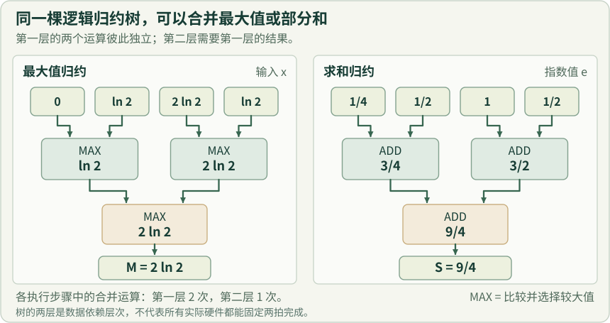
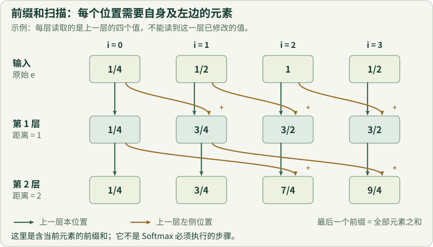
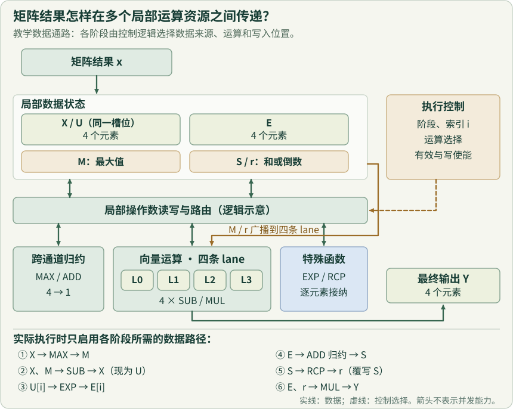

# 矩阵乘法算完了，其他运算由谁完成？

在 [D01](../04-compute-arrays/d01-macs-and-array-data-paths.md) 中，多个 MAC 共同完成矩阵乘法。每个输出由一组乘积相加得到。但 AI 模型并不会在每次矩阵乘法结束后直接输出答案。

例如，Attention 需要将一行分数转换成一组归一化权重。这个过程不仅有乘法，还有比较、求和和指数运算。即使计算阵列已经空闲，也不一定能像执行矩阵乘法那样高效地完成这些工作。

芯片可以使用**逐元素执行通路、跨元素归约通路和特殊函数运算单元**完成这些计算。它们可以是独立资源，也可以共享原有的运算电路。为什么要这样组织？我们沿着一行矩阵结果，观察数据接下来需要经过哪些通路。

## 矩阵乘法之后，还需要哪些运算？ {#work-after-matmul}

设一行矩阵乘法的输出为 x：

| 元素编号 i | 0 | 1 | 2 | 3 |
| --- | ---: | ---: | ---: | ---: |
| x[i] | 0 | ln 2 | 2 ln 2 | ln 2 |

这里 ln 是自然对数。我们故意选择这些分数，使指数运算得到容易手算的值。这不是某个实际模型的测量数据。

如果后续需要加偏置、截断负值或改变数值尺度，每个输出元素只需要该位置的输入和相应参数。这类工作称为**逐元素运算（Element-wise Operation）**。

但 Attention 中使用的 Softmax 不同。我们需要让这一行中的每个分数都参与决定最终的归一化权重。Softmax 对参与同一次归一化的元素进行指数运算，再除以它们的指数之和。数学意义和归一化轴见[算法与模型：Attention 与 Transformer](../../workload/01-foundation-model-components/attention-and-transformer.md)及[张量的轴、广播和归约](../../workload/00-overview/tensor-shapes-and-cost.md)。

为了避免指数运算的输入过大，可以先从所有分数中减去同一个最大值 m。结果都不大于 0，且至少一项等于 0；因此指数都不大于 1，且至少一项等于 1。所有指数都乘了同一个因子 exp(−m)，这个因子在分子和分母中抵消。

在本篇的四个有限实数算例中，计算过程为：

| 步骤 | 计算 | 数学结果 |
| --- | --- | --- |
| 找最大值 | m = max(x) | 2 ln 2 |
| 逐元素减法 | u[i] = x[i] − m | (−2 ln 2, −ln 2, 0, −ln 2) |
| 逐元素指数 | e[i] = exp(u[i]) | (1/4, 1/2, 1, 1/2) |
| 求和 | s = Σe[i] | 9/4 |
| 求倒数 | r = 1/s | 4/9 |
| 逐元素乘法 | y[i] = e[i] × r | (1/9, 2/9, 4/9, 2/9) |

四个权重相加为 1。表中是数学上的理想值，实际浮点编码、指数、倒数及乘法都可能存在近似或舍入误差。本篇暂不讨论掩码、NaN、无穷大和特殊输入的处置；真实实现需要遵守算子的数值语义。

稳定 Softmax 的这个计算顺序可参考 [Milakov 与 Gimelshein，Online normalizer calculation for softmax，第 2 节](https://arxiv.org/pdf/1805.02867)。它是便于观察数据依赖的一种方法，不是 Softmax 唯一可行的实现。

### 能不能把所有运算都交给 MAC？

回忆 [A03](../01-foundations/a03-multiplication-and-accumulation.md) 中的 MAC：乘法得到乘积，再将它加到累加状态。在矩阵阵列中，多个 MAC 的输入、累加和输出路径也围绕这种工作组织。

若通路允许独立选择操作数，MAC 可以将一个乘数设为 1 来完成加法，也可以将加数设为 0 来完成乘法。有些矩阵引擎确实支持逐元素运算。

但是，找到四个数中的最大值，需要比较并选择其中一个数，而不是将四项乘积累加。指数运算需要得到一个非线性函数值，也不是一次普通的乘加就能完成。

即使可以由多次基本算术构造这些结果，硬件还要能够提供常数、保存中间状态、选择运算方式，并在不同数据之间传递结果。如果一座阵列只能接收特定形状的矩阵块，完成这些运算时还可能有大量路径得不到有效使用。

因此，问题不是 MAC 是否有能力参与这些运算，而是**当前运算需要什么数据通路，已有资源是否提供了这种通路**。

## 四条向量通道为什么还不能直接找到最大值？ {#elementwise-and-reduction}

在 [C01](../03-parallel-execution/c01-scalar-simd-and-vector-execution.md) 中，四条物理执行通道可以同时完成四项独立的加法。我们为本例也准备四条通道，每条能够完成减法、乘法等基本运算。

一旦最大值 m 已经得到，就可以让四条通道各取一个 x[i]，并从共同的标量来源取得同一个 m。它们能独立得到四个 u[i]，不需要交换彼此的减法结果。

问题在于：m 怎样得到？

如果每条通道只能读取自己的元素，通道 0 只知道 0，通道 1 只知道 ln 2。没有任何一个通道知道整行最大的是 2 ln 2。

这与 [A03 中合并四项乘积](../01-foundations/a03-multiplication-and-accumulation.md#reduction) 的问题相似。若输入足够且有跨通道的连接，可以先比较两对数，再比较两个胜出的数。

- 第一层比较 x[0] 和 x[1]，得到 ln 2；同时比较 x[2] 和 x[3]，得到 2 ln 2。
- 第二层比较这两个结果，得到整行最大值 2 ln 2。

每次比较后还需要通过选择通路保留较大的操作数。这两层数据通路组成一棵比较选择树。随后把 m 保存在一个标量位置，向四条通道提供这个值。

当四项指数运算最终得到 e 时，可以采用相同的分组方式。区别是这一次每个节点执行加法，产生两个部分和 3/4 和 3/2；再将它们相加，得到 s = 9/4。

<figure class="micro-diagram" style="max-width:820px; margin:1.2rem auto" tabindex="0" aria-label="最大值和求和的两层归约树，窄屏可横向滚动" markdown="1">

<figcaption>两种归约都将四个元素合并成一个值。图中每个节点代表一次二输入运算，不规定必须为它配置独立的运算器。</figcaption>
</figure>

将若干元素合并为一个结果的操作称为**归约（Reduction）**。这里讨论同一行内部的归约，不是跨计算单元的通信协议。

若使用一个二输入加法器逐项累加，需要依次完成三次加法（从第一个元素开始）。若提供两条并行加法路径以及适当的级间连接，第一层可同时完成两次加法，第二层完成最后一次。

在每层服务时间为一拍、输入均已就绪的教学条件下，时间由三拍缩短为两拍。两者仍然都进行三次加法。一般地，对 2 的整数次幂 N 个元素，平衡二叉树有 log₂N 层、N−1 次合并。更多运算器、连线和级间寄存器换来了更短的依赖路径。

不必为比较树与加法树分别设置完整硬件。如果节点允许选择比较或加法，并且跨通道路径能够将结果送到下一层，同一套资源也可以先求最大值，再求和。但它们的工作不能在占用相同资源时无条件重叠。

这种重组要求合并操作允许相应的结合顺序。浮点加法受舍入影响，不满足严格的结合律；树形求和可能与顺序累加得到不同的末位结果。应按所要求的精度与运算语义决定允许的顺序，参见 [A04](../01-foundations/a04-floating-point-and-low-precision.md)。

实际硬件还可以通过通道交换网络、共享存储或分批局部归约构造这些树，并不一定具有物理上完整的固定树。对于比物理通道更长的一行，必须进一步合并各批的部分结果。相关组内交换见 [C02](../03-parallel-execution/c02-simt-and-warp-scheduling.md#exchange-and-sync)。

## 如果不是只要最终的和，而是要每个位置的部分和呢？ {#prefix-scan}

继续使用 e = (1/4, 1/2, 1, 1/2)。如果现在希望每个位置都得到从第 0 个元素到当前位置的累积和，结果应该是 (1/4, 3/4, 7/4, 9/4)。

这称为**包含当前位置的前缀扫描（Inclusive Prefix Scan）**。普通求和归约只产生一个 9/4，不能直接作为四个位置的结果。

直观地看，逐项累加可依次得到四个前缀。但如果四条通道能够交换中间数据，可以尝试分层合并：

- 第一层：每个编号 i 大于等于 1 的通道，把自己的值与前一个通道的值相加。编号 0 保持原值。这时各位置都包含最多两个原始元素。
- 第二层：每个编号 i 大于等于 2 的通道，把第一层结果与相距 2 的第一层结果相加。其余保持第一层的值。至此每个位置都得到完整前缀。

<figure class="micro-diagram" style="max-width:820px; margin:1.2rem auto" tabindex="0" aria-label="四元素前缀扫描的两级交换与相加，窄屏可横向滚动" markdown="1">

<figcaption>本例是逐级扩大合并范围的一种实现。每层使用上一层的状态，不能让同一层中刚修改的值意外参与其他位置的运算。</figcaption>
</figure>

本例第一层有三次加法，第二层有两次。用五次加法、两层计算得到所有前缀。顺序累加只需三次加法，但后三个前缀依次依赖前一个前缀。两种方案的操作数、输出数相同，计算资源和中间数据传递不同。

这种扫描通路可以用固定连接实现，也可以由具有跨通道交换能力的向量单元分阶段完成。对更长的向量，还可以使用先求各组的部分和、再将前面的组和传给后续组等方法，减少总操作次数。

参见 [Blelloch，Prefix Sums and Their Applications](https://www.cs.cmu.edu/afs/cs/academic/class/15750-s09/www/Handouts/PrefixSumBlelloch.pdf) 和 [NVIDIA GPU Gems 3，第 39 章 Parallel Prefix Sum](https://developer.nvidia.com/gpugems/gpugems3/part-vi-gpu-computing/chapter-39-parallel-prefix-sum-scan-cuda)。

**前缀扫描不是本例 Softmax 的必要步骤。** 在这里引入它，是为了对比分散在多条通道的数据如何合并，以及合并后的信息需要到达哪些输出位置。接下来仍沿用 Softmax，只需要整行的最大值和总和。

## 指数、倒数和平方根怎样变成硬件运算？ {#special-functions}

产生 u 之后，需要分别求四个指数值。虽然四个指数运算彼此独立，却不能因此认为四条现有的加减乘通道就能直接计算指数。

如果函数能够写成若干普通算术的组合，就可以利用已有的加法器、乘法器等计算。不过一个有限电路不能保存任意实数的精确函数值，需要在支持的输入格式和精度要求下构造结果。

**特殊函数单元（Special Function Unit，SFU）** 是一种面向指数、倒数、平方根等运算的专用执行资源。不同处理器所称的 SFU 支持的函数和实现方式并不相同。下面从构造指数值的需要出发，观察几种常用机制。

### 能否把需要的函数值提前算好？ {#lookup}

在真实的运算通路中，输入的比特数有限。如果只有 8 位输入编码，那么至多存在 256 种编码。可以为每种合法编码提前生成符合目标格式和误差要求的函数值，再用输入编码选择相应的表项。

这就是查找表（Lookup Table，LUT）的一种实现思路。它可以由 ROM 或其他存储/逻辑结构构成，运行时主要执行索引和取值。

若每项结果为 16 位，为所有 256 种编码准备结果需要 512 B 的表项数据。如果输入扩展至 16 位且仍为每种编码准备一个 16 位结果，数据量就达到 128 KiB。这里只计算表内容，不包括译码、电路布线和读端口。

如果要求每拍四项函数值，还需要相应的并行读取能力。因此，直接查表不一定比算术电路更小或更快。

### 只需要保存一小段函数的表吗？ {#range-reduction-and-approximation}

指数有这样的性质：将任意有限输入 a 写成 a = k ln 2 + t，其中 k 是整数、0 ≤ t < ln 2，则

**exp(a) = 2k × exp(t)。**

例如本篇的第一个指数输入 a = −2 ln 2，k = −2，t = 0，只需要得到 exp(0) = 1，再缩小到原来的 1/4。其他三个输入在数学上也对应 t = 0。

这称为**范围缩减（Range Reduction）**：先把输入转换成较小区间内的参数，再计算这个区间上的函数，最后恢复原来的尺度。在二进制浮点表示中，改变 2 的整数次幂尺度可以主要通过调整指数实现，边界还需要规格化、下溢等处理。

范围缩减需要常数、比较或取整、乘减电路及足够的中间精度。它自身也不是免费的运算。但将需要近似的范围缩小后，可以减少用来覆盖完整输入范围的表和计算资源。

现在假设缩减后的 t = 0.25，不再恰好落到本例的 t = 0。我们希望得到 exp(0.25) ≈ 1.284025。

若硬件只保存 exp(0) = 1 和 exp(0.5) ≈ 1.648721 两个采样点，可以让 0.25 返回最近采样点的值；也可以读出这两个值，用乘法和加法做线性插值，得到约 1.324361。后者在这个例子中减少了误差，但仍不等于精确函数值。

还可以让表存放某一小段的多项式系数，而不是该段每个输入对应的结果。例如，0 附近的一个二次近似是 1 + t + t²/2。对 t = 0.25 得到 1.28125。用乘加路径可以按 1 + t × (1 + t/2) 逐步计算。

实际设计可以根据输入的高位或比较结果选择区间，再使用区间内的位置和对应系数计算。增加分段数量、提高系数精度或多项式次数，可能降低误差，但会增加表容量、乘加运算和中间状态需求。

一次这样的特殊函数运算可以组织为四个阶段：

| 阶段 | 输入与状态 | 需要的能力 |
| --- | --- | --- |
| 范围缩减 | 由 a 得到 k、t | 常数、算术、选择 |
| 选择区间 | 由 t 得到区间编号与局部位置 | 索引、译码 |
| 计算近似值 | 系数与局部位置 → 近似的 exp(t) | 查表、乘加与级间状态 |
| 恢复尺度 | 近似值与 k → 近似的 exp(a) | 尺度调整、规格化与舍入 |

这里展示的是可行的计算方式，不是说每个 SFU 都要采用这四个物理流水级。近似次数与区间必须根据目标格式、误差要求和整个输入范围验证，不能只靠一个点的误差判断。

参见 [de Dinechin 与 Pasca，Floating-point exponential functions for DSP-enabled FPGAs](https://citeseerx.ist.psu.edu/document?doi=a756381106295f683d89f3359429cda341eb7f41&repid=rep1&type=pdf)，其中展示了浮点指数的范围缩减、表及近似运算的具体硬件方案。

### 如果一开始的值不够准确，能否继续修正？ {#iteration}

Softmax 的四个指数值相加后得到 s = 9/4。需要为四条向量通道提供同一个倒数 r = 4/9。

不一定要直接用一座除法器去计算每个 y[i]。可以先计算一个公共倒数，再将它提供给四个乘法器。另一种特殊函数的实现方法就由此引出。

假设从表中读到倒数的初始近似 r₀ = 1/2。若 r₀ 恰好等于 1/s，那么 s × r₀ 就应该为 1。现在 s × r₀ = 9/8，显然偏大。

可以按下面的规则修正近似值：

**rj+1 = rj × (2 − s × rj)。**

若将当前误差写成 ε = 1 − s × rj，这次计算后的误差就变成 ε²（理想实数条件）。当初始误差的绝对值小于 1 时，误差会不断缩小。这是 Newton 迭代求倒数的一种形式。

| 状态 | r 的值 | 说明 |
| --- | ---: | --- |
| 初始 r₀ | 0.5 | 取表中的假定近似值 |
| 修正一次 r₁ | 0.4375 | r₀ × (2 − 2.25 × r₀) |
| 修正两次 r₂ | 0.4443359375 | r₁ × (2 − 2.25 × r₁) |
| 目标 1/s | 0.444444… | 数学值 |

每轮修正需要两次乘法、一次减法，并保存新 r 以供下一次计算。多执行几轮可能获得更高精度，却也延长反馈路径占用时间。浮点舍入和内部位宽限制最终精度，不保证无限迭代就能获得任意精确值。

对于正数 a，还可以用查表取得倒数平方根的初始近似值 q，再按适当的规则迭代。例如 Newton 形式 q ← q × (3 − a × q²)/2。得到 q ≈ 1/√a 后，乘以 a 可近似得到 √a。零、负数等特殊输入需要单独处理。

也存在直接构造除法和平方根的硬件算法。这里不要求所有函数都通过迭代实现。参见 [Ercegovac、Muller 与 Tisserand，Simple Seed Architectures for Reciprocal and Square Root Reciprocal](https://doi.org/10.1109/ACSSC.2005.1599944)。

### 为什么这几种办法可以组合？

查表能够较快提供一个初始值或者一段函数的参数；分段近似用算术计算减少表项需求；迭代可以继续修正当前结果。它们不是三种必须独占的硬件类型。

一个特殊函数单元可以共享系数表、乘加电路及中间寄存器，通过不同的运算控制选择不同计算路径。也可以布置多条流水级，提高独立输入的接纳能力。

但支持多种函数不意味着每种函数都有相同的延迟、接纳间隔和精度。例如 [NVIDIA PTX ISA 的浮点运算](https://docs.nvidia.com/cuda/parallel-thread-execution/index.html) 同时定义了近似指数、倒数、倒数平方根以及带舍入模式的平方根指令。指令语义说明硬件或实现必须提供怎样的结果，不能由指令名称推断内部电路和固定周期。

## 一行 Softmax 怎样经过这些计算资源？ {#local-data-path}

现在回到同一行 x。假设矩阵引擎已把四个结果交给一个本地缓冲。我们给后处理路径配置以下资源：

- 四条物理向量通道，每条能计算减法或乘法，也能取得一个共同标量。
- 一条可选择比较或加法的二层归约通路，能读取四个元素并交付一个标量。
- 一条特殊函数通路，支持指数和倒数，能够分批接收元素。
- 两个四元素位置 X/U、E，两个标量状态 M、S/R，以及可接收四个结果的出口 Y。

<figure class="micro-diagram" style="max-width:820px; margin:1.2rem auto" tabindex="0" aria-label="向量通道、归约通路与特殊函数资源的局部数据通路，窄屏可横向滚动" markdown="1">

<figcaption>一组可选的本地连接。图中各路径对应不同执行阶段，并不表示资源同时执行所有操作。矩阵计算的内部通路以及更上层的调度没有画出。</figcaption>
</figure>

M 用于暂存最大值。X 中的原始 x 在全部减法完成后不再需要，因此本例复用其四个存储位置来保存 u。指数值 e 需要先参与求和，随后还要再次参与最终乘法，因此将其保存在 E 中。

归约结果 s 保存在 S/R 中。求倒数结束后，不再需要旧 s，可以在同一位置保存 r。最后，将 E 的每个元素与广播给四条通道的 r 相乘，并交付 y。

### 逐拍观察资源何时获得输入

为了比较资源数量对执行时间的影响，先规定一个教学时序模型，整个区间使用相同的时钟：

- E₀ 沿后，四个 x 已经在 X 中，不统计此前的矩阵计算与搬入。
- 归约的每层延迟为一拍；向量减法与乘法各一拍，均能同拍处理四个元素。
- 特殊函数通路的指数延迟为两拍，接纳间隔（II）为一拍；倒数延迟假设为两拍。这些是人为规定的服务时间，并非前面近似、迭代方案的实际周期。
- 本例保守地等待 E 的四个值全部写入后再求和；各资源端口、广播、写入和结果出口都满足所列并发要求，不引入额外停顿。

每段 Eₐ → Eᵦ 表示从起始沿后的已就绪状态开始计算，在结束沿后交付结果。一个结果在该边沿写好后，后续周期才使用其值。

| 执行区间 | 占用的资源及工作 | 在结束沿后保存的结果 |
| --- | --- | --- |
| E₀ → E₁ | 归约第 1 层，比较两对 x | ln 2、2 ln 2 |
| E₁ → E₂ | 归约第 2 层，再比较 | M = 2 ln 2 |
| E₂ → E₃ | 向量通道，广播 M 并相减 | X/U = (−2 ln 2, −ln 2, 0, −ln 2) |
| E₃ → E₅ | 指数通路接纳 u[0] | E[0] = 1/4 |
| E₄ → E₆ | 指数通路接纳 u[1] | E[1] = 1/2 |
| E₅ → E₇ | 指数通路接纳 u[2] | E[2] = 1 |
| E₆ → E₈ | 指数通路接纳 u[3] | E[3] = 1/2 |
| E₈ → E₉ | 归约第 1 层，两路加法 | 3/4、3/2 |
| E₉ → E₁₀ | 归约第 2 层，加法 | S/R = 9/4 |
| E₁₀ → E₁₂ | 特殊函数通路求倒数 | S/R = 4/9 |
| E₁₂ → E₁₃ | 向量通道读取 E，广播 r 并相乘 | Y = (1/9, 2/9, 4/9, 2/9) |

注意：指数通路中两项工作可以同时在途。按照 [A06 的流水线模型](../01-foundations/a06-pipeline-and-throughput.md)，一项指数需要两拍并不意味着每两拍才接纳一项。

这里向量和归约通路可能在等待，而 SFU 正在计算。获得四个 e 共用了五拍。如果为四个指数提供四条同样的通路和足够的取数、写入能力，它们可同时开始，两拍后全部产生结果。

保持其他条件不变：

| 教学模型 | 一条指数通路 | 四条指数通路 |
| --- | ---: | ---: |
| 四个 e 全部就绪所需周期 | 5 | 2 |
| 从 E₀ 到四个 y 交付的周期 | 13 | 10 |
| 指数运算数 | 4 | 4 |
| 其余运算数 | 相同 | 相同 |

这里的 13/10 = 1.3 是单行后处理延迟的理想比值，不是整颗芯片、真实模型或连续多行的吞吐加速比。四条特殊函数路径增加了硬件资源需求；若实际供数不足，也无法同时接纳四个输入。

也可以让归约通路先处理已经得到的两个 e，或让另一行的独立工作占用暂时空闲的资源。前一种方法仍要为之后的部分和保留状态，后一种方法还需避免行之间的状态混用。这些是 [F01](../06-resource-cooperation/f01-overlap-and-buffer-reuse.md) 和 [F02](../06-resource-cooperation/f02-task-control-and-synchronization.md) 已建立的重叠与交接条件在复杂算子中的应用。

## 为什么中间结果不一定要写回更上层存储？ {#intermediate-residency}

如果指数通路只输出到更上层的共享存储，而归约和向量通路都必须从那里读数，会发生什么？

假设 e 的四个元素都按 32 位保存，并且这三个阶段不共享局部缓冲。指数产生四个元素并写入指定的共享存储，归约从那里读一遍，最后的乘法再读一遍。

| 在指定的局部计算资源与上层共享存储边界上 | 物化 e 后分别读取 | E 驻留本地 |
| --- | ---: | ---: |
| 四个 e 写入上层 | 16 B | 0 B |
| 归约读取 e | 16 B | 0 B |
| 最终乘法读取 e | 16 B | 0 B |
| e 对应的跨边界有效载荷合计 | 48 B | 0 B |

两种情况都产生同样的四个 e。此处只统计它们跨越指定存储边界的有效载荷，不包含 x、y、标量、协议开销和内部路径。不是说采用第一种实现就一定产生 48 B 的 HBM 访问。

如果直接让 E 成为这些资源共同可访问的小型本地缓冲，就能保留 e 到最后一次乘法完成，避免这 48 B 的跨边界数据交接。但归约和乘法仍然要取得 e，内部存储、读写端口、连线和控制仍会产生成本。

还可以采用寄存器之间的转发：当一项指数结果产生后，同时向归约路径提供数据并保存一份，供后续乘法使用。这样可能减少局部缓冲的一次读取，但不能在尚需最终乘法时丢掉 e，也不能在两个消费者无法接收时无条件继续覆盖原来的状态。

对于很长的行，所有 e 可能无法同时驻留。可以选择分段保留、写到其他存储或重新计算部分中间值。不同计算顺序也可以改变需要保留的数据量，例如 [Online Softmax 原始研究](https://arxiv.org/pdf/1805.02867) 所描述的在线更新归一化因子的方法。这里比较的是硬件能提供怎样的执行与数据交接条件，不讨论软件如何选择融合方案。

## 换成 RMSNorm，哪些资源还可以继续使用？ {#rmsnorm}

如果矩阵乘法后需要的不是 Softmax，而是 RMSNorm，那么同样可以先将算子的表达式分解为硬件需要执行的操作：

- 四条通道将输入元素分别平方；
- 归约通路求这些平方值的和；
- 通过乘常数得到均方并加上指定的小量 ε；
- 特殊函数通路计算倒数平方根；
- 向量通道使用广播的倒数平方根与原始输入相乘，并可执行各位置的尺度乘法。

数学语义见 [RMSNorm 原论文](https://arxiv.org/abs/1910.07467)、[PyTorch RMSNorm 定义](https://docs.pytorch.org/docs/2.15/generated/torch.nn.RMSNorm.html)及[算法与模型系列](../../workload/01-foundation-model-components/attention-and-transformer.md)。

如果已有向量通路支持平方、求均方与加 ε，特殊函数通路还支持倒数平方根（或者已有算术通路能够构造该运算），就可以复用这些资源，不必另造一套固定 RMSNorm 电路。

与 Softmax 相比，RMSNorm 不需要求最大值和指数，但原始输入仍要用于最终乘法。虽然平方值可能在完成归约后释放，原始 x 却不能简单地就地覆写。这个例子说明：相同的计算资源在不同的任务中可以复用，但中间状态的生命周期不一定相同。

## 如何决定一条通路应该做成什么样的计算资源？ {#dedicated-versus-programmable}

本篇已经出现三种不同的运算需求：元素之间独立处理、多个元素的信息汇聚，以及需要查表或多次算术的函数计算。

可以让一个可编程运算单元通过指令序列执行所有受支持的步骤。这样能复用加法器、乘法器和寄存器，适合多种计算，但需要相应的控制以及数据交换能力，并消耗更多指令或运算机会。

也可以在矩阵引擎旁设置单独的向量、归约和特殊函数通路。对应运算不必经过不合适的矩阵阵列，多个独立任务还有机会同时使用不同资源，但每种资源需要自己的连接、状态或端口，工作量不足时也会空闲。

还可以设计一个固定用途的后处理数据通路，使一组预定的计算自动接续。例如硬件在矩阵结果交付时执行受支持的偏置和激活操作。这样可以减少中间写回及控制开销，但只能处理预先实现的运算和输入条件。

**专用计算资源不等于固定功能电路。** 一条向量通路或 SFU 可以由不同指令选择不同运算，归约通路也可以在不同命令下求和或求最大值。固定功能块往往也具有参数配置能力。可编程范围与数据通路针对什么工作优化，是两个方面。

真实芯片提供了不同的组织例子：

- [Google Cloud TPU 架构说明](https://docs.cloud.google.com/tpu/docs/system-architecture-tpu-vm) 区分矩阵乘单元 MXU、向量单元与标量单元，其中向量单元用于激活、Softmax 等工作。具体引擎规模随 TPU 代际而变化。
- [Meta MTIA 2i 原论文，第 3.2、4.3 节](https://aisystemcodesign.github.io/papers/MTIA-ISCA25.pdf) 描述点积引擎、归约引擎和 SIMD 引擎，SIMD 引擎包含用于近似非线性函数的查表资源；论文还讨论了多个引擎协作执行 Softmax。参见[芯片架构实例：Meta MTIA](../../chip-architectures/Meta_MTIA/README.md)。
- [Tenstorrent Tensix 的计算引擎和数据流文档](https://docs.tenstorrent.com/tt-metal/v0.67.1/tt-metalium/tt_metal/advanced_topics/compute_engines_and_dataflow_within_tensix.html) 描述矩阵引擎（FPU）和向量引擎（SFPU）通过共享 Dst 寄存器交接中间结果。它们的功能、寄存器容量和交接同步有具体约束，不能将这种结构当作全部 AI 芯片的标准实现。

这些例子说明了为什么矩阵乘法能力并不能代表全部计算能力。即使矩阵引擎峰值很高，逐元素、归约、特殊函数及中间结果供给仍可能成为完成一个算子的限制。

## 回到最初的问题 {#summary}

观察矩阵乘法之后的工作时，可以先识别数据依赖，而不是先寻找某个名称的加速器：

- 哪些结果只依赖对应元素，能够交给独立通道？
- 哪些结果要求汇集多个元素，需要归约或跨通道交换？
- 哪些函数需要额外的算术、查表和近似，必须满足怎样的精度？
- 哪些值还会被后续工作读取，需要留在寄存器或局部缓冲中？
- 各条路径能够以怎样的速率接收工作，增加的面积和控制资源能否被实际利用？

本篇中的四元素 Softmax 只是一种教学实现。真正的计算单元设计，需要同时考虑运算语义、数据依赖、资源的能力、数据交接和数值误差，而不是让所有工作都适应同一种计算阵列。

下一篇计划讨论一个不同的问题：若参与矩阵乘法的部分数据本来就是零，硬件怎样减少这些运算的工作量？减少了实际运算数，是否也会减少相同比例的执行时间？

[返回专用计算与稀疏计算导读](README.md)。
