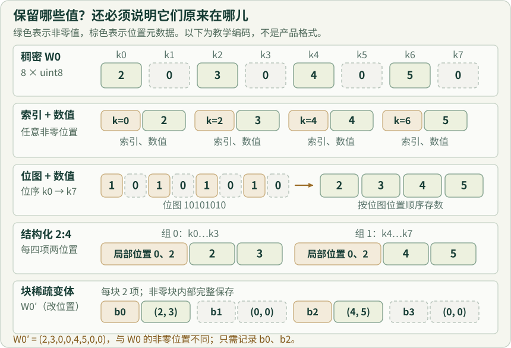
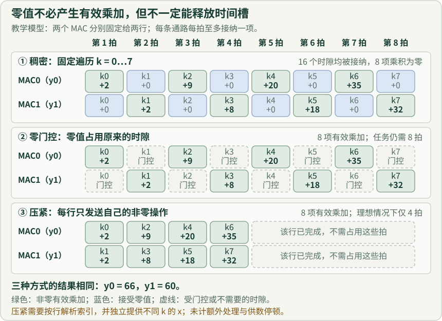
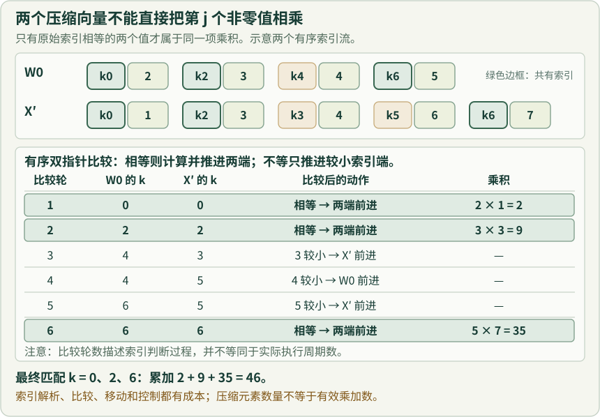

# 一半的数据都是零，为什么计算未必能快一倍？

在 [D01](../04-compute-arrays/d01-macs-and-array-data-paths.md) 中，MAC 不断接收新的操作数，将乘积累加到部分和。计算一组点积时，硬件通常按约定的顺序处理其中的每一项。

在不溢出的整数点积中，假如其中一半的权重是零，那么至少一半乘积为零。既然这些乘积不改变累加的结果，为什么还要计算它们？

**稀疏计算（Sparse Computation）**利用数据中可以省略的元素，减少原有计算中的无效工作。但数值上有零，不代表硬件少执行了一拍。要判断真正节省了什么，需要沿着操作数的存放、选择、匹配与计算过程观察。

本篇沿着共享同一个输入向量的两个八元素点积，观察零值分布、数据通路和控制成本怎样影响执行时间。

## 如果一半的权重是零，点积中哪些项还需要计算？ {#dense-and-sparse}

设 X 是一个八元素输入向量，W 是两个权重行，分别与 X 做点积，得到两个输出 Y[0]、Y[1]。

| 元素编号 k | X[k] | W[0,k] | W[1,k] |
| ---: | ---: | ---: | ---: |
| 0 | 1 | 2 | 0 |
| 1 | 2 | 0 | 1 |
| 2 | 3 | 3 | 0 |
| 3 | 4 | 0 | 2 |
| 4 | 5 | 4 | 0 |
| 5 | 6 | 0 | 3 |
| 6 | 7 | 5 | 0 |
| 7 | 8 | 0 | 4 |

本例的元素采用 8 位无符号整数，乘积使用足够位宽，累加状态 ACC 为 32 位且初始为 0。没有溢出或中间舍入。计算的数学表达仍然是沿 k 求和：

**Y[i] = Σ X[k] × W[i,k]，k = 0～7。**

例如第一行依次产生 2、0、9、0、20、0、35、0，累加得到 66。第二行产生 0、2、0、8、0、18、0、32，结果为 60。

W 的十六个位置中有八个零，零元素数占一半。一般地，我们把零元素数占全部逻辑元素数的比例称为**稀疏率（Sparsity）**，非零元素所占比例为密度。

虽然八项乘积不改变最终的数学结果，但这两个点积的定义没有变化。如果芯片仍以十六个位置的形式取得权重，并按每个 k 进行乘加，这就是用稠密执行方式处理一组含零的数据。

### 普通 MAC 会怎样执行这些零值？

为了观察过程，先假设两个 MAC 分别负责 W 的两行，均可以每拍接收一对操作数，并在拍末更新各自的 ACC。数据已在本地存储，假定读端口、写入及控制条件满足日程。

回忆 [A03 中的乘加反馈通路](../01-foundations/a03-multiplication-and-accumulation.md#mac)。在第 1 拍，两个 MAC 得到 X[0] = 1，分别与权重 2、0 相乘，产生 2、0，再更新各自的累加状态。

第 2 拍改为取得 X[1] = 2，配上权重 0、1。第 3 拍处理 k = 2，依此类推。八拍结束时，两个 ACC 分别得到 66 和 60。

在这条教学稠密数据通路中，每个 k 都要被接纳。即使某个乘积为零，操作数仍需按对应位置交付，乘法器和累加通路仍会接收该项工作。ACC 的数值可能没有变化，但不能由此推断输入、时钟和内部信号都没有活动。

实际电路针对零输入可能已经有局部优化。这里先采用不做跳零控制的稠密执行模型。

## 检测到零值，可以让 MAC 不工作吗？ {#zero-gating}

如果计算通路能够在合适的时刻知道一个乘数为零，就能阻止这项不改变结果的累加。例如，对于本例的无符号整数编码，可以检查一个操作数的全部有效位是否均为 0。

假设第 2 拍 MAC0 的 W[0,1] = 0。检测逻辑发现零后，可以让 ACC0 保持原值 2，并抑制不需要的乘加通路开关活动。例如控制输入寄存器更新、隔离运算电路的输入，或在满足时序条件时使用时钟门控。

这样做可以减少部分电路的活动和动态能耗，称为**计算门控（Computation Gating）**。仅禁止 ACC 写入，不一定会关闭乘法器内部的翻转；检测结果也必须在能够有效阻止相应活动之前可用。

那么能不能让 MAC0 提前取得 k = 2，让它占用原本分配给零值 k = 1 的计算机会？

不能仅凭零值门控做到这一点。在原本的固定次序中，第 2 拍分配给 k = 1，第 3 拍分配给 k = 2。即便第 2 拍阻止了 MAC0 的无效运算，下一项仍然要等原本的位置到达。

两个 MAC 仍需要八拍。变化的是哪些槽位真的需要启动乘加，而不是这批工作占用多少拍。这与 [C01 中的掩码](../03-parallel-execution/c01-scalar-simd-and-vector-execution.md#tail-mask) 类似：关闭某个位置，并不会自动让后面的元素移到该位置。

如果希望同时减少计算时间，就不能只阻止零值对应的运算，还要让下一项有效工作有机会提前进入空出来的位置。这就是**计算跳过（Computation Skipping）**与门控的区别。

[Sparseloop 原始论文，第 III.A 节](https://people.csail.mit.edu/emer/media/papers/2020s/2022/2022.10.micro.sparseloop.pdf) 对压缩、门控和跳过分别建模；它们是不同能力，并非只要拥有其中一种就会拥有另外两种。

### 什么情况下才能省略乘加？

本例使用整数且累加不溢出，零乘积可以省略。真实硬件还需要遵守原有的数值语义。例如 IEEE 浮点运算中 0 × Inf 的结果为 NaN，不能将所有零乘积直接当成对累加状态无影响。

浮点的正负零、NaN 传播、舍入及求和顺序也需要符合所要求的运算语义。参见 [A04 的浮点特殊值](../01-foundations/a04-floating-point-and-low-precision.md#special-values)及 [CUDA 浮点特殊值说明](https://docs.nvidia.com/cuda/cuda-programming-guide/05-appendices/mathematical-functions.html#special-values)。若数据采用带零点的量化表示，数值上的零也未必对应全 0 比特。

本文余下的算例保持整数语义，不改变原来的数学计算。至于怎样通过训练或剪枝使权重变为零，属于[算法与模型](../../workload/README.md)中的模型设计问题。

## 不保存零值，硬件怎样知道该取哪一个 X？ {#compressed-representation}

现在想让 MAC0 只接收四个非零权重 2、3、4、5，MAC1 只接收 1、2、3、4。

假如只是把这些值连续存放，MAC0 读取第二个值 3 时，怎样知道它应该与 X[2] 而不是 X[1] 相乘？

原来的稠密格式中，数组位置直接隐含了 k。省略零元素后，存储位置与逻辑位置不再相同。硬件必须从其他信息恢复每个值的原始位置。

这些用于说明元素位置、分组、边界或编码方式的辅助信息称为**元数据（Metadata）**。接下来只观察 W[0]，比较几种记录原始位置的方法。

### 直接保存每个非零值的索引

最直接的办法，是把原编号 k 和非零值一起保存：

| 压缩数据编号 | 0 | 1 | 2 | 3 |
| --- | ---: | ---: | ---: | ---: |
| 非零值 | 2 | 3 | 4 | 5 |
| 原始索引 k | 0 | 2 | 4 | 6 |

读取第二个非零值时，同时取得索引 2。于是计算通路使用这个索引选择 X[2] = 3，再将 3 × 3 = 9 加入 ACC。

这种表示可以处理不同位置上的任意非零值。每行的非零数可能不同，因此还需要知道某行有多少项，或者通过行边界等信息找到该行的压缩数据范围。

真实稀疏矩阵可组织为 CSR（压缩稀疏行）、CSC（压缩稀疏列）等格式，按相应维度保存边界、位置和非零值。具体编码也可记录与前一个非零位置的距离，而不是绝对索引。这里先用直接索引说明核心问题。

### 还可以只标记哪些位置存在有效值吗？

W[0] 的八个位置中，编号 0、2、4、6 为非零。可以规定：

- 从 k = 0 到 7 分别保留一个有效位，非零置 1，零置 0。
- 按 k 的顺序存放非零值 2、3、4、5。

这组按元素位置排列的位称为**位图（Bitmap）**。它在本例中为 (1,0,1,0,1,0,1,0)。

解析逻辑可保存尚未处理的位图及非零值指针，从位图找到下一个 1 的位置，取出指针对应的值。当该项成功交付后，清除此有效位并更新值指针。

如果每拍只检查位图的一位，经过一个 0 仍可能用掉一拍。想直接找到下一项，需要优先选择逻辑等机制；想同拍找到多个位置，还需要相应的多位置选择、读取和交付能力。

因此，压缩数据的长度缩短后，还要检查**解码之后的有效操作数生产速率**，不能只用压缩后的元素数估计周期。

## 如果限制零值出现的位置，能够减少哪些硬件成本？ {#sparsity-patterns}

前面的索引和位图允许零出现在任意位置，也允许某一行的非零数是任意值。这种不规定局部非零分布的模式常称为**非结构化（Unstructured）稀疏**。

灵活性越高，硬件就越需要查找下一项、处理变化的长度和位置。能否通过约束零值分布，让每一组数据的解析结果具有更规则的形状？

### 每四个元素中只保留两个位置

把 W[0] 的 k = 0～3 和 k = 4～7 分别看成一组。两组都是两个非零值和两个零，恰好满足 **2:4 结构化稀疏**的模式。

第一组的有效值为 2 和 3，组内位置为 0 和 2。第二组的有效值为 4 和 5，组内位置也是 0 和 2。原来的全局索引可以由组号和组内位置恢复。

对这种模式，可为每组固定准备两个值的位置，并编码从四个位置中选择哪两个。六种不同位置组合可以用三个比特的教学编码表示。若非零数少于两个，固定双值格式也可能仍需保留一个为零的值槽。

硬件不用在任意长的序列中寻找下一对有效元素，主要根据组号和位置编码，从对应的四个 X 中选择两个。例如第一组 X = (1,2,3,4)，位置为 (0,2)，就选择 (1,3)。

约束让供数和解析更规则，但硬件仍需要完成位置选择。这也不意味着一座原本不支持这种模式的 MAC 阵列只需将数据改为 2:4 就能自动加速。

真实 [NVIDIA Ampere 结构化稀疏说明](https://developer.nvidia.com/blog/exploiting-ampere-structured-sparsity-with-cusparselt/) 中，Sparse Tensor Core 利用位置元数据选择另一侧操作数，并针对每组四个位置中至少两个为零的模式组织执行。

其具体分组轴、元素格式、指令形状和元数据布局都由受支持的实现规定。例如 [PTX ISA 的 sparse matrix storage](https://docs.nvidia.com/cuda/parallel-thread-execution/index.html#warp-level-sparse-matrix-storage) 中某些 FP16/BF16 2:4 指令使用两个 2-bit 位置索引，不能把本文的三比特教学编码当作产品格式。

### 如果一次省略一整块呢？

改变 W[0] 中非零元素的位置，得到 W'[0] = (2,3,0,0,4,5,0,0)。仍有四个非零值，但现在可以将相邻两个元素作为一个小块：

- 块 0：(2,3)，保留。
- 块 1：(0,0)，省略。
- 块 2：(4,5)，保留。
- 块 3：(0,0)，省略。

只需保存块索引 0、2 及两个完整块。硬件根据块索引找到 X 的相应位置，可以在块内部继续采用稠密数据通路。

这是一种**块稀疏（Block Sparsity）**，也是结构化稀疏的一类。实际矩阵还可以采用二维的矩形块。省略一整块的前提是该块所有元素均为零；非空块中仍可能包含零，块内的零不一定会再次被跳过。

<figure class="micro-diagram" style="max-width:820px; margin:1.2rem auto" tabindex="0" aria-label="非结构化索引、位图、2:4 分组和块稀疏数据表示，窄屏可横向滚动" markdown="1">

<figcaption>前三种表示对应同一 W[0]。块稀疏示例改变了值的位置，以说明整块省略的条件，不是对原 W[0] 进行无损格式转换。位置和位图均按编号从左到右排列。</figcaption>
</figure>

给稀疏模式增加约束，通常可以减少控制分支与元数据开销，保留更规整的计算粒度。但同样是 50% 的零，全局的零数并不能说明每组都满足 2:4，也不能说明存在足够多的全零块。

## 现在只计算非零项，可以从八拍变成四拍吗？ {#compacted-execution}

回到原来的 X 和 W，不改变任何元素的值，也不改变两个点积的输出。现在改为让每个 MAC 都按照自己的非零权重流执行。

MAC0 的控制状态不再表示公共的 k 递增，而是保留自己已经消费了多少个压缩项。读取第 0 项得到 (k=0, w=2)，读取第 1 项得到 (k=2, w=3)。

MAC1 同样有自己的状态，第 0 项却是 (k=1, w=1)，第 1 项是 (k=3, w=2)。

假定两个非零流和完整的 X 都已在本地，位置解析、操作数选择和 MAC 通路能够每拍为每个 MAC 提供一项正确配对的输入。两份 ACC 已清零，并有独立的状态和结果交付能力。保持原来的时钟与每拍一项乘加的服务能力。

| 计算拍 | MAC0 的 k 与乘积 | ACC0 | MAC1 的 k 与乘积 | ACC1 |
| ---: | --- | ---: | --- | ---: |
| 1 | 0：1×2 | 2 | 1：2×1 | 2 |
| 2 | 2：3×3 | 11 | 3：4×2 | 10 |
| 3 | 4：5×4 | 31 | 5：6×3 | 28 |
| 4 | 6：7×5 | 66 | 7：8×4 | 60 |

在这个条件下，后续的有效工作连续占据本来需要遍历零位置的时间。四拍后就能产生与稠密计算相同的结果。

<figure class="micro-diagram" style="max-width:820px; margin:1.2rem auto" tabindex="0" aria-label="稠密执行、零值门控和非零项压紧后的逐拍对比，窄屏可横向滚动" markdown="1">

<figcaption>同一组点积、同样两个 MAC。深色有效槽表示需要的非零乘加。压紧模型假设位置解析和两个独立的 X 供数路径可以持续满足计算需求。</figcaption>
</figure>

| 执行方式 | 完成相同点积的拍数 | 总 MAC 槽位（2 × 拍数） | 非零乘加数 |
| --- | ---: | ---: | ---: |
| 稠密执行 | 8 | 16 | 8 |
| 零值门控，保持原槽位 | 8 | 16 | 8 |
| 跳过零值，压紧有效工作 | 4 | 8 | 8 |

这里的 MAC 槽位是观察区间内每拍两个 MAC 的可用计算机会，不表示真实电路内部发生了多少次乘法翻转。压紧路径只在假设的条件下实现 8/4 = 2 倍单任务速度，即耗时减半。

### 原来的 X 供数通路还够用吗？

在原来的八拍稠密日程里，两个 MAC 在同一拍使用相同的 X[k]。例如第 1 拍都使用 X[0] = 1。可以从本地存储读取一个 X，再把它广播到两个 MAC。这正是 [D01](../04-compute-arrays/d01-macs-and-array-data-paths.md#broadcast) 已介绍的操作数复用。

压紧后，第 1 拍 MAC0 需要 X[0] = 1，MAC1 需要 X[1] = 2。两个请求的索引不再相同，单次读取后广播已经无法满足它们。

如果原有的 X 端口每拍只能取得一个元素，没有预取的数据副本，也没有其他可用的供数路径，那么八个不同的 X 至少需要八拍才能全部交付。四拍计算日程就无法成立。

可以增加独立端口、采用能够同时提供所需元素的分布式缓冲，或者提前将不同索引需要的值送到 MAC 附近。但前提是额外的数据获取、存储与选择能力本身能够跟上。

稀疏执行减少了乘法次数，却可能破坏某些原有的广播与规则复用关系。[D03](../04-compute-arrays/d03-array-size-bandwidth-and-utilization.md#input-bandwidth) 中计算资源等待操作数的现象，在这里同样存在。

若输入权重并非事先压缩，还要先从原始数据中检测并生成有效项。一遍扫描至少要读取进行检测的原始范围；扫描、压紧与计算可以流水重叠，但不能凭空省去未处理的数据及相应开销。

## 如果 X 自身也包含零，两个稀疏流怎样找到共同的 k？ {#operand-matching}

刚才 W 被压紧，但 X 保持稠密存放，因此可以根据 W 的索引直接选择任意 X[k]。

现在仅改变 X，将其改为 X' = (1,0,3,4,0,6,7,0)。它也可以用非零值及索引进行压缩。仍观察 W[0]：

| 数据 | 位置与非零值（k, value） |
| --- | --- |
| X' | (0,1), (2,3), (3,4), (5,6), (6,7) |
| W[0] | (0,2), (2,3), (4,4), (6,5) |

两行压缩后的第二个值恰好都有编号 2，但后续就不一样了。若不读索引，直接把两个非零流的第三个值相乘，会错把 X'[3] 与 W[0,4] 配对。

点积要求参与同一项乘加的两个元素具有**相同的原始索引**。只有位置同时出现在两个非零流中的项才需要乘加。

对于这里按 k 升序且无重复索引的列表，可以让硬件分别保存两个读指针，并比较指针当前位置的索引。

- 如果两个索引相等，就把这一对值送进 MAC，交付成功后推进两个指针。
- 如果两个索引不同，就跳过较小索引对应的项。由于另一流按升序排列，此后不可能再出现这个更小的索引。较大索引及其值保留，以便与下一项比较。
- 任一流到达末尾时，所有可能匹配的项已经处理完。还需等待已经接纳的乘加完成，才能交付最终和。

<figure class="micro-diagram" style="max-width:820px; margin:1.2rem auto" tabindex="0" aria-label="两个压缩操作数依据逻辑索引寻找可相乘的元素，窄屏可横向滚动" markdown="1">

<figcaption>压缩后存储位置不同，必须匹配原始逻辑位置。这个例子用有序索引及双指针说明一种实现，不规定真实稀疏硬件必须使用这样的算法。</figcaption>
</figure>

| 比较轮次 | X' 当前索引 | W[0] 当前索引 | 本轮行动 | 产生的乘积 |
| ---: | ---: | ---: | --- | ---: |
| 1 | 0 | 0 | 两个指针推进 | 2 |
| 2 | 2 | 2 | 两个指针推进 | 9 |
| 3 | 3 | 4 | X' 指针推进 | — |
| 4 | 5 | 4 | W 指针推进 | — |
| 5 | 5 | 6 | X' 指针推进 | — |
| 6 | 6 | 6 | 两个指针推进 | 35 |

最后只需执行三次乘加，得到 46；W[1] 与 X' 同理只匹配 k = 3、5，得到 26。

但寻找这三对数据，一共执行了六轮比较。若匹配通路每拍只完成一轮决策，那么仅匹配过程就需要六拍服务时间。乘加可能与之重叠，也可能还要等待交付和流水线排空，不能把三次乘加直接换算成整个点积只需要三拍。

这种匹配可称为寻找两组非零位置的交集。也可以通过位图相与后查找有效位、选择网络或者其他索引结构确定共同位置。选择哪条通路取决于编码方式、可并行的比较数和供数能力。

[Eyeriss v2 原论文，第 IV.A 节](https://eems.mit.edu/wp-content/uploads/2019/04/2019_jetcas_eyerissv2.pdf) 展示了激活和权重都处于压缩表示时的具体数据通路：利用地址信息、零计数确定需要的权重和部分和位置。它不是本文这套双指针电路，但面临相同的逻辑位置匹配问题。参见[芯片架构实例：Eyeriss v2](../../chip-architectures/eyeriss-v2/README.md)。

## 稀疏率相同，两个 MAC 都可以提前结束吗？ {#load-imbalance}

回到只有权重稀疏、X 稠密的原始模型。W 的两行各有四个非零项，MAC0 和 MAC1 恰好都有四拍工作。

现在只改变 W 中零的分布。设 W[0] 有六个非零项、W[1] 有两个非零项，整个 W 依然包含八个非零项，稀疏率仍为 50%。

在固定分工下，MAC0 只能为 Y[0] 累加，MAC1 只能为 Y[1] 累加。保持理想的非零项解析、供数及每拍一次有效 MAC 的条件：

- MAC1 执行两拍后完成自己负责的输出。
- MAC0 还需要四拍，直到第六拍才能产生另一个输出。
- 整项任务必须等待两个输出都完成，因此需六拍。

<figure class="micro-diagram" style="max-width:820px; margin:1.2rem auto" tabindex="0" aria-label="总非零数均为八但固定分工不同造成的负载失衡，窄屏可横向滚动" markdown="1">

<figcaption>这里只改变非零元素分布，并比较固定分工下的工作数量。两种分布各自的稠密执行时间均为八拍，不要求它们产生相同的数值输出。</figcaption>
</figure>

两个方案都有八次非零乘加，但前者在八个计算槽位中完成全部工作，后者需要十二个槽位。按 [D03 的有效槽位口径](../04-compute-arrays/d03-array-size-bandwidth-and-utilization.md#shape)，后者的有效槽位比例为 8/12 ≈ 66.7%。

此时加速比为 8/6 ≈ 1.33，而不是 2。即使元数据解析和供数均没有限制，非零项分布也会影响实际执行时间。

能否在 MAC1 提前完成后，让它去帮助 MAC0 完成剩余项？这会改变原来的固定分工。新的执行资源要取得 W[0] 的剩余操作数，知道这些乘积属于 Y[0]，保存相应的部分和，最终再把部分和合并。

这样的任务分发、结果身份和归约成本，已经在 [F03](../06-resource-cooperation/f03-multiple-compute-units.md) 中建立了基础。稀疏计算增加的困难是这些工作量可能由数据内容决定，而不只是由矩阵形状决定。

2:4 等约束可以使某个受约束维度内每组的保留槽位数固定，块内执行也可以维持一定规则性。这有助于降低某些负载失衡问题，但不保证所有分块、执行单元与其他层的工作量相同。

## 减少存储空间、搬运量和计算时间，是同一个收益吗？ {#cost-accounting}

现在回到原本各有四个非零权重的两行 W。我们只统计这两行 8 位权重在指定存储边界上的编码数据，不统计 X、输出或压缩过程的临时缓冲。

如果仍以稠密格式保存，每行八个字节，合计 16 B。如果采用本文定义的压缩方式，还要计入元数据和格式边界。

| 教学格式 | 每行保存的值 | 每行位置及边界信息 | 两行编码量 |
| --- | ---: | --- | ---: |
| 稠密 | 八个位置（8 B） | 原位置隐含于排列顺序 | 16 B |
| 显式索引 | 4 B | 四个 3-bit 索引，按行补齐至 2 B；另存行非零数 1 B | 14 B |
| 位图 | 4 B | 八个位置的位图 1 B | 10 B |
| 固定 2:4 格式 | 两组，各 2 B | 两个 3-bit 教学位置码，按行补齐至 1 B | 10 B |

这里假定矩阵形状已知，编码按行顺序读取；位图本身可用于确定该行随后有多少非零值。若要随机访问变长编码的任意一行，还可能需要额外的地址或边界信息。真实存储粒度、地址对齐和事务协议未计入。

即使权重中有一半为零，显式索引格式仍需要原始存储量的 87.5%。本例位图和固定 2:4 教学格式需要 62.5%。压缩收益不仅取决于非零值数，也取决于每个值所需要的元数据。

若这些数据只存放在压缩格式中，存储容量可以减少。如果搬运引擎将编码和元数据一同送到计算端，还可能减少某条路径的搬运量。但若随后必须解压成完整八元素行，计算单元仍然可能按原来的八个位置执行。

例如 [NVDLA 的压缩权重格式](https://nvdla.org/hw/format.html#fig-memory-mapping-of-compressed-weight) 使用位图、非零值和其他辅助数据；其[卷积序列控制器（CSC）权重供数路径说明](https://nvdla.org/hw/v1/ias/unit_description.html#convolution-sequence-controller) 描述了解压后交付计算阵列的过程。仅知道压缩率，尚不足以推导该阵列的计算周期。

因此应分别检查三个量：

| 观察对象 | 决定收益的条件 |
| --- | --- |
| 存储空间 | 编码后的值、索引、边界和对齐需要多少空间 |
| 数据搬运量 | 具体在哪条路径上传输压缩数据，又在哪里恢复或重新组织数据 |
| 执行时间 | 解析、选择、匹配和供数是否能持续产生有效工作，计算日程是否真的缩短 |

数据表示与存储边界之间的关系可参考 [E03](../05-data-movement/e03-layout-and-format-processing.md#compression)；这里关心的是解码以后的数据怎样进一步驱动计算，而不重新讨论搬运引擎设计。

## 稀疏率越高，实际加速比是否越大？ {#speedup}

沿用两个八元素点积的教学硬件。现在从没有零的两行权重开始，逐步将部分元素置零。为了只观察零的数量，先假定两行的非零数相同，且压缩状态、选择通路和数据供给满足此前的理想条件。

| W 的零元素比例 | 每行非零数 | 固定槽位的稠密执行 | 理想跳过后的执行 | 理想速度比 |
| ---: | ---: | ---: | ---: | ---: |
| 0% | 8 | 8 拍 | 8 拍 | 1 |
| 50% | 4 | 8 拍 | 4 拍 | 2 |
| 75% | 2 | 8 拍 | 2 拍 | 4 |

注意每一行表格分别比较**同一组权重数据**在两种硬件上的执行，不是把改变权重后的数学答案当作原来的答案。75% 的例子假设可变长度跳过能够处理更稀疏的行，并非固定双值 2:4 通路一定还能再省一半时间。

对一个每拍能消费一项有效乘加的通路，如果原有 N 项中有比例 s 可以省去，且所有其他条件均不变，理想剩余工作量是 N × (1−s)。当非零项数恰好落在这些服务粒度内、且任务的执行时间只由这些乘加决定时，速度比才是 1/(1−s)。

这个关系不是通用的稀疏硬件性能公式。全零任务仍需确立正确结果、维护任务状态及交付条件，不能用公式推断无限速度。

例如原始 50% 稀疏例中，若位置解析与启动需要额外两拍且不能重叠，实际执行区间就变成两拍准备加四拍计算，共六拍；速度比从 2 变成 8/6 ≈ 1.33。若这些开销比减少的四拍还长，使用这条稀疏路径反而可能更慢。

在前面的单端口例中，X 的数据交付至少需要八拍；在双边稀疏匹配例中，比较轮数可能多于乘加数；在不均衡例中，单元间负载又会限制整体完成。它们不是都需要简单相加的固定开销，因为不同工作可能重叠。

### 怎样理解厂商标出的稀疏峰值？

支持特定稀疏指令的硬件可以按照原始稠密计算的等价工作量报告峰值。例如 [NVIDIA A100 的官方稀疏性能表](https://developer.nvidia.com/blog/accelerating-inference-with-sparsity-using-ampere-and-tensorrt) 中，在支持的稀疏模式及数据类型下，稀疏 Tensor Core 的峰值等效吞吐是对应稠密 Tensor Core 的两倍。

同样的矩阵形状是统计等价工作量的依据，不意味着硬件真的对零值又进行了乘加，也不意味着任何含 50% 零的输入、完整算子乃至整个模型都能获得两倍加速。

例如在本文四拍日程中，若按逻辑上十六项稠密等价 MAC 计算，吞吐是 16/4 = 4 个等价 MAC/拍；实际执行的非零 MAC 为 8/4 = 2 个/拍。两者对应不同统计口径，与两个物理 MAC 并不矛盾。

当数据模式不符合硬件约束，或者解码供数、状态交接及非矩阵运算成为限制时，端到端性能还要根据任务日程分析。不应该只用一个稀疏峰值替代全部执行时间。

## 回到最初的问题 {#summary}

要判断稀疏数据能否带来性能收益，不能只看数据中有多少零。还需要沿数据通路分别回答：

- 是否能够在不改变所要求的数值结果的条件下省略这项运算？
- 怎样记录和找到非零位置，元数据及解析成本有多少？
- 对应的其他操作数怎样到达计算资源，原有的复用关系是否仍然成立？
- 跳过的位置是否能够由下一项有效工作占用，解析、匹配和计算是否能重叠？
- 不同执行单元的有效工作量是否均衡，输出何时才真正全部可用？

G01 解释了不同运算需要的计算能力与数据交接；G02 则进一步解释，即使所有任务仍然只是点积，数据的零值分布也会改变对硬件资源的需求。

接下来可以阅读 [H01：执行单元增加一倍，为什么任务不一定提前一半结束？](../08-performance/h01-task-time-and-bottlenecks.md)，把这些资源的服务能力、工作量和依赖放到共同的任务时间分析中。

[返回专用计算与稀疏计算导读](README.md)。
