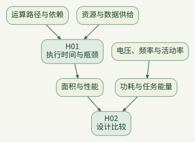

# 性能分析与设计权衡

微架构性能分析研究硬件在指定任务下完成了多少有效工作、花了多少时间，以及是什么限制了它的速度。设计权衡则进一步比较不同硬件组织的性能和实现成本。

假设一块硬件原来有四个乘加单元，现在增加到八个。在单元能力不变且供数充足时，每拍可以进行的乘加更多了。但如果输入数据还在等待搬运，或者后续运算依赖前一次的结果，任务究竟能节省多少时间？

先沿实际执行过程找出限制完成时间的资源与依赖，再在同一任务下比较三种设计选择：增加并行单元、扩大缓冲区，或提高时钟频率。除了比较计算速度，还要看每种改变占用了多少硬件资源，消耗了多少能量。

## 知识关系

<figure class="micro-v2-map" markdown="1">

<figcaption>知识衔接示意。点击可查看大图。</figcaption>
</figure>

## 计划阅读顺序

本路线共规划两篇文章，H01 正文已开放。前面各条路线中涉及的延迟、吞吐和利用率将在这里汇合，用于分析完整任务的性能及设计代价。

| ID | 文章 | 内容范围 | 状态 |
| --- | --- | --- | --- |
| H01 | [执行单元增加一倍，为什么任务不一定提前一半结束？](h01-task-time-and-bottlenecks.md) | 峰值/有效吞吐、利用率、资源服务约束、计算强度/Roofline、排队、关键路径和运行时间下界、解析/周期/事件模型、性能计数与校准 | 已发布 |
| H02 | 增加并行单元、扩大缓冲区，还是提高时钟频率？ | 以同一任务比较面积、性能、功耗、任务能量、资源复用、门控、电源状态、DVFS、设计权衡 | 未发布 |

H01 使用同一个分块矩阵乘法，在 4 MAC、8 MAC 等配置下比较资源服务下界与执行日程。H02 将继续使用该系统，进一步比较改变硬件资源需要承担的实现成本。

## 阅读衔接

- 可按自己的学习目标选择前置路线：[指令执行与 CPU](../02-cpu/README.md)、[并行执行与 GPU](../03-parallel-execution/README.md)、[计算阵列与数据流](../04-compute-arrays/README.md)。
- [数据搬运与处理引擎](../05-data-movement/README.md)解释外部数据供给和在途请求。
- [多执行实体与资源协作](../06-resource-cooperation/README.md)为分析多资源竞争和执行重叠提供具体例子。
- 电压、门延迟和电路功耗的物理原理可参阅[半导体与电路基础](../../semiconductor-foundations/README.md)，设计实现与签核流程可参阅[芯片开发与实现](../../chip-development/process/README.md)。这里侧重微架构的定量分析和设计选择，不展开模拟器软件开发或 EDA 流程。

[返回计算微架构系列总览](../README.md)
