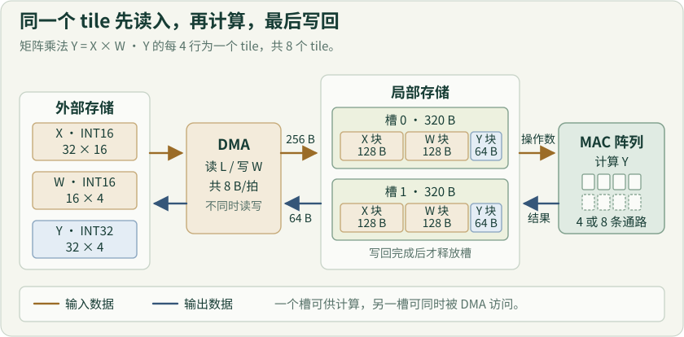
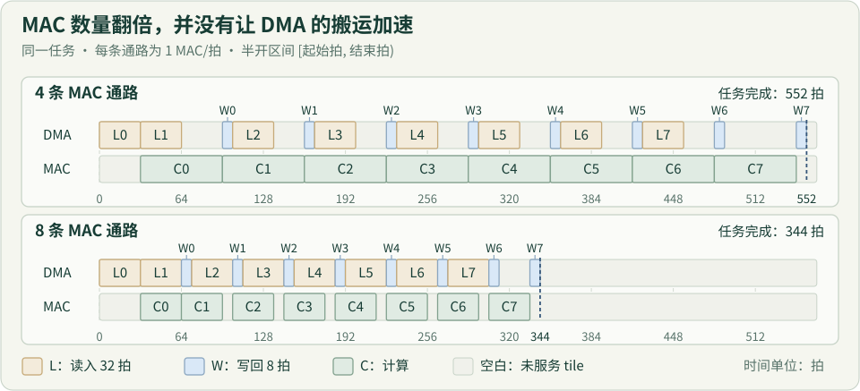
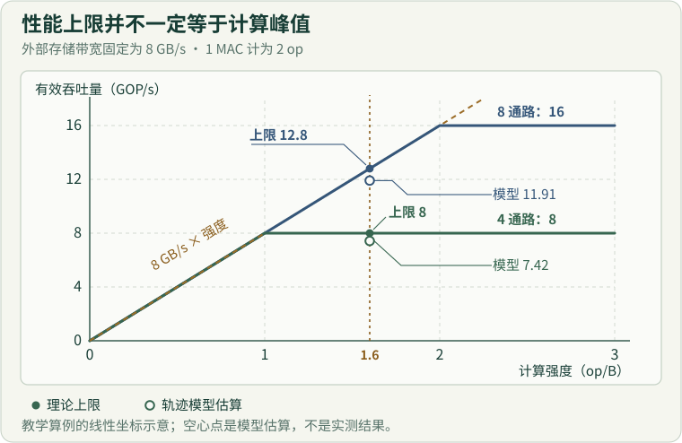

# 执行单元增加一倍，为什么任务不一定提前一半结束？

性能分析研究一个给定任务需要硬件完成哪些工作、这些工作在哪里执行，以及它们为什么需要这么长时间。它的目的不只是计算吞吐量，而是找出缩短任务时间需要改变哪些条件。

在 [D03](../04-compute-arrays/d03-array-size-bandwidth-and-utilization.md)中，我们看到扩大计算阵列可能改变有效 MAC 槽位的比例。在 [F01](../06-resource-cooperation/f01-overlap-and-buffer-reuse.md)中，计算和数据搬运又可以在条件允许时同时进行。

现在把它们放进同一个系统。假设增加一倍的 MAC，原来需要 552 ns 的矩阵乘法变成 344 ns。算术执行的时间已经减半，完整任务却没有减半。剩下的时间花在哪里？如果继续增加计算单元，还能节省多少时间？

这些数字不是某款芯片的实测数据。下文构建一个可以手算和验证的教学模型，沿着同一批数据解释它们是怎样得到的。

## 先确定要完成什么工作 {#workload}

设任务是矩阵乘法 Y = XW，其中 X 为 32×16，W 为 16×4，Y 为 32×4。输入采用 INT16，结果与累加采用 INT32，并假设输入数值范围足以避免溢出。任务开始时 X、W 在外部存储器中可读，片上缓冲为空；所有 Y 写回并对目标消费者可读时，任务才结束。

沿用 [D01](../04-compute-arrays/d01-macs-and-array-data-paths.md) 的点积：Y[i,j] 由同一行 X 与同一列 W 的 16 项乘积累加得到。因此每个输出元素需要 16 次 MAC（乘加），全部 128 个输出共需要：

**有效 MAC 次数 = 32 × 4 × 16 = 2,048 MAC**

为便于与性能规格对应，本篇将一次 MAC 按一次乘法和一次加法计为 2 op，包含从零开始的第一次累加。因此任务的有效计算量 F = 4,096 op。这里的 op 是整数运算口径，不是浮点运算 FLOP，也不表示必须执行两条独立指令。

这个计算量只统计原任务规定的有效运算。不把可能发生的填零、重复计算或空槽计入分子。若换成更稀疏的算法或不同计算精度，还需要明确是否保留同一任务语义及统计口径。

### 硬件怎样分批完成这些运算？

我们将 X 按行分为八块，每块 4×16。每一块都与完整 W 相乘，得到一块 4×4 的 Y。不同输出块没有数学上的相互依赖，不需要在块间归约部分和。

假设硬件有一个计算阵列、一台 DMA 和两个片上缓冲槽。每槽同时保存一块输入、该块所需的 W，以及输出空间。两个槽轮流交给不同的输出块使用；一个槽从开始搬入到写回完成都为同一个块保留。

<figure class="micro-diagram" style="max-width:840px; margin:1.2rem auto" tabindex="0" aria-label="矩阵乘法的分块、共享 DMA、局部缓冲槽及 MAC 阵列，窄屏可横向滚动" markdown="1">

<figcaption>教学系统的数据路径。DMA 的搬入与写回共享外部传输服务能力；阵列与 DMA 可以访问不同槽并同时工作。图中的容量只统计矩阵数据，不包含实际实现的额外寄存器与控制状态。</figcaption>
</figure>

与 F01 中预驻留权重的系统不同，本例规定每块都从外部存储器重新搬入 W。这不是唯一的数据流，而是先研究一种具体实现。我们稍后会看到这个选择如何改变数据搬运量。

| 每块需要的数据 | 元素个数 | 字节数 | 外部传输方向 |
| --- | ---: | ---: | --- |
| X 的四行 | 4×16 | 128 B | 搬入 |
| 完整 W | 16×4 | 128 B | 搬入 |
| 对应的 Y | 4×4 | 64 B | 写回 |
| 合计 | — | 320 B | 读 256 B，写 64 B |

两个槽的矩阵数据容量共 640 B。八块都执行完时，外部存储接口需要服务的有效载荷 Q = 8×320 = 2,560 B，其中读 2,048 B，写 512 B。

如果 W 可以在片上完整驻留并供所有块复用，W 只需读一次。此时同一任务的外部有效载荷可以减少到 1,024+128+512 = 1,664 B。如果这些数据的片上读写端口或生命周期不支持这种复用，则不能直接假设流量会减少。

**计算量由任务和计算方案决定，跨越某个接口的搬运量还取决于数据的存放与复用方式。**

不能只按矩阵大小统计流量，也不能把外部存储流量直接当作阵列入口的流量。[D02](../04-compute-arrays/d02-stationary-dataflows-and-reuse.md)已经从数据通路的角度解释了这种区别。

## 计算阵列一秒钟最多能完成多少工作？ {#peak-and-effective-throughput}

先不管搬运。假设我们只有 4 个 MAC 单元，每个单元每次服务一次乘加，时钟频率 f = 1 GHz，即每拍 1 ns。

沿用 [A06](../01-foundations/a06-pipeline-and-throughput.md)中的接纳间隔（Initiation Interval，II）：对于已经提供有效操作数的独立计算，一个单元可以每隔 II 拍接纳一组新操作数。若有 P 个相同单元，且它们可以同时得到工作，理论峰值为：

**Rpeak = 2 × P × f / II**

其中 f 的单位为 Hz，II 的单位为拍/次，结果为 op/s。因本例的计数约定，一次 MAC 对应 2 op。

II 不等于运算延迟。如果一个流水化单元需要四拍产生第一份结果，但每拍都可以接纳一份独立输入，其 II 仍可为 1。反过来，假如下一次累加必须等待上一次的结果，单靠这个接纳能力并不能保证每拍一次有效 MAC。

为将注意力集中在系统资源上，本例规定每个 MAC 的计算延迟与 II 均为一拍，部分和留在单元中，每拍可使用上一拍的结果。阵列的局部供数路径、累加器切换和结果保存足以维持这个速度，不另计开销。实际实现需要分别验证这些条件。

一块 Y 有 16 个独立输出。4 个 MAC 可以同时负责 4 个输出，每组连续算 16 拍，再切换到下一组，共算四组，即 64 拍。换成 8 个 MAC，只需两组，即 32 拍。

| 阵列配置 | 4 MAC | 8 MAC |
| --- | ---: | ---: |
| 理想峰值 MAC/s | 4 GMAC/s | 8 GMAC/s |
| 峰值算力 | 8 GOP/s | 16 GOP/s |
| 一块输出的算术服务时间 | 64 ns | 32 ns |
| 八块输出的算术服务时间之和 | 512 ns | 256 ns |

这里 G 表示十进制的 10⁹。在本例中，增加 MAC 确实将算术服务时间减半。但如果任务还要等待输入与写回，表中最后一行不等于任务完成时间。

## 将搬运和计算放到同一条时间轴 {#execution-timeline}

DMA 在服务期间每拍搬运 8 B 有效载荷，相当于 8 GB/s（10⁹ B/s）。暂不引入请求往返延迟、协议开销和带宽波动。读、写共享这个服务能力，同一时刻只能由其中一项独占 DMA。

沿用 F01 中的分阶段记法：Lᵢ 表示搬入第 i 块所需的 X 和 W；Cᵢ 表示计算该块的 Y；Wᵢ 表示将其写回。i 从 0 到 7。Wᵢ 是写回阶段的编号，不是矩阵 W 的元素。每块的工作为：

| 阶段 | 4 MAC 服务时间 | 8 MAC 服务时间 | 开始条件 |
| --- | ---: | ---: | --- |
| Lᵢ 搬入 | 256/8 = 32 拍 | 32 拍 | DMA 空闲，有空槽 |
| Cᵢ 计算 | 64 拍 | 32 拍 | 本块输入已全部可读，阵列空闲 |
| Wᵢ 写回 | 64/8 = 8 拍 | 8 拍 | 本块输出已全部可读，DMA 空闲 |

计算与 DMA 访问不同槽时，假设局部存储端口和内部路径也能同时提供服务。每块的 L、C、W 必须保持先后关系，但不同块可以重叠。

为了得到可复现的执行日程，指定一项简单的服务规则：阵列按块编号处理就绪的输入；DMA 每次启动一项不被中途抢占的搬运，优先写回已经完成的输出，否则在有空槽时搬入下一块。各阶段完成的边沿即可交接，不另计唤醒时间。这只是用于分析的一种控制规则，不限定具体硬件采用中央调度还是局部控制。

### 4 个 MAC：搬运部分被计算隐藏

第 0 块在 [0,32) 搬入，在 [32,96) 计算。这里 [a,b) 表示时钟边沿 Eₐ 至 Eᵦ 的 b−a 拍。此时 DMA 已能向另一个槽搬入第 1 块，在 E₆₄ 完成。

E₉₆ 时，第 0 块计算完成。阵列可以立刻开始 C₁，DMA 可以开始 W₀。E₁₀₄ 时 W₀ 完成，第 0 块的槽被释放，DMA 又可以搬入第 2 块。

E₁₃₆ 时，第 2 块输入已经可读，比 C₁ 的结束时刻 E₁₆₀ 更早。以此类推，阵列从 E₃₂ 开始连续完成八块的计算，最后再写回 8 拍。

**T₄ = 32 + 8 × 64 + 8 = 552 ns**

注意，这仍然不表示 DMA 只花了 40 ns。在 552 ns 的窗口中，DMA 实际服务了 320 拍，其中大量服务与阵列计算同时进行，因此不能再将这些时间全部加到任务时间上。

### 8 个 MAC：下一块数据来不及准备

这次 C₀ 在 E₆₄ 就完成。恰好 L₁ 也在 E₆₄ 完成，因此 C₁ 可以立即开始。DMA 先写回第 0 块，再从 E₇₂ 开始搬入第 2 块。

问题出现在 E₉₆：C₁ 已经结束，但 L₂ 到 E₁₀₄ 才完成。这 8 拍内阵列没有新的输入可用，而 DMA 仍在工作。W₁ 对应的结果也已经准备好，却要等待 DMA 完成当前搬入。

<figure class="micro-diagram" style="max-width:1000px; margin:1.2rem auto" tabindex="0" aria-label="四个及八个 MAC 的八块矩阵执行时间轴，窄屏可横向滚动" markdown="1">

<figcaption>横条是对应资源的服务区间，空白表示该资源无服务；并不表示缓冲内没有数据。两条日程采用相同任务、搬运带宽、两个缓冲槽及控制规则；终点是最后一块写回完成。</figcaption>
</figure>

| 块编号 | 搬入 L（8 MAC） | 计算 C（8 MAC） | 写回 W（8 MAC） |
| ---: | --- | --- | --- |
| 0 | [0,32) | [32,64) | [64,72) |
| 1 | [32,64) | [64,96) | [104,112) |
| 2 | [72,104) | [104,136) | [144,152) |
| 3 | [112,144) | [144,176) | [184,192) |
| 4 | [152,184) | [184,216) | [224,232) |
| 5 | [192,224) | [224,256) | [264,272) |
| 6 | [232,264) | [264,296) | [304,312) |
| 7 | [272,304) | [304,336) | [336,344) |

后续每块的计算开始时刻相隔 40 拍，而不是 32 拍。原因是搬入和写回要共同消耗 DMA 的 40 拍服务时间。即使计算可以更快结束，DMA 也无法按同样速度不断提供新块。

最后一块在 E₃₄₄ 写回完成。因此 **T₈ = 344 ns**。相同任务的加速比为 T₄/T₈ = 552/344 ≈ 1.60，而不是 2。

### 怎样判断硬件为什么没有工作？

观察 E₉₆ 后的状态，可以区分不同的直接等待条件，也可以追溯它们之间的因果关系：

- 阵列无法开始 C₂：它存在 L₂ → C₂ 的数据依赖，输入尚未全部可读。这不是 C₂ 需要 C₁ 的数学结果。
- W₁ 已具备数据，却不能开始占用正在服务 L₂ 的 DMA：这是就绪工作之间的资源竞争。
- L₃ 只需一个空槽，但两个槽都被尚未写回的块占用，此时 DMA 也忙：这是空间与所有权约束。

当 L₂ 供数迟于阵列的消耗节拍时，计算单元出现空闲。供数不足描述这种可观察的现象，而上游服务能力、排队、共享端口或缓冲约束可能分别成为它的根因。这些原因并不总是互斥；不能直接把多个等待计数相加。

4 MAC 的方案中，DMA 也有许多空闲拍，但它在这些拍里没有可安全占用的空槽，或者已满足了阵列的需求。继续增加 DMA 峰值带宽未必能减少这些时间。

这正是 [A08](../01-foundations/a08-dependencies-and-scheduling.md)和 [F02](../06-resource-cooperation/f02-task-control-and-synchronization.md)区分数据就绪、资源可用与实际执行的意义。

## 怎样从日程得到完整任务的性能指标？ {#task-metrics}

前面计算了峰值算力 Rpeak。现在用任务实际完成的有效运算量除以任务时间，得到**有效吞吐量** Reff = F/T。下表用的是上述模型给出的 T，不是物理芯片测量值。

| 指标（完整任务窗口） | 4 MAC | 8 MAC |
| --- | ---: | ---: |
| 任务完成时间 T | 552 ns | 344 ns |
| 峰值算力 | 8 GOP/s | 16 GOP/s |
| 有效吞吐 F/T | 7.42 GOP/s | 11.91 GOP/s |
| 有效 MAC 槽位比例 F/(Rpeak×T) | 92.8% | 74.4% |
| DMA 服务时间 | 320 ns | 320 ns |
| DMA 忙碌时间 / T | 58.0% | 93.0% |
| 外部有效载荷吞吐 Q/T | 4.64 GB/s | 7.44 GB/s |

槽位比例的分母是任务期间阵列具备的全部理想有效计算容量。在本例中 II=1 且每次算术服务都占满阵列，所以它恰好等于阵列算术服务时间除以 T。

真实硬件并不一定满足这个关系。例如阵列可能一直在处理指令却只有部分 lane 参与有效计算；忙碌比例高不代表有效计算利用率高，也不等于功耗或电路翻转比例。见 [D03 的阵列形状分析](../04-compute-arrays/d03-array-size-bandwidth-and-utilization.md#shape)。

这里还要区分三个尺度：单次 MAC 的延迟为 1 拍，接纳间隔为 1 拍；单块 C 的算术服务时间为 64 或 32 拍；整个任务的完成时间是 552 或 344 拍。即使所有单元的延迟相同，系统仍可能具有不同的任务吞吐和完成时间。

## 不画完整日程，能否先知道任务最快需要多久？ {#lower-bound}

对于上面的八块数据，我们可以画出所有事件。但真实任务可能包含数万个块，并且不同执行实体还会共享多个存储端口、互连接口和缓冲区。如果每种方案都要先画完整日程，早期的架构比较会很困难。

我们能不能先找到任何合法执行日程都不能突破的时间下界？

### 资源必须有足够的时间提供服务

八块总共需要 4,096 op。即使阵列一直满速运行，4 MAC 也至少需要 512 ns，8 MAC 至少需要 256 ns。

外部传输则必须搬运 2,560 B。由于本例的 DMA 读、写共用一个最大服务能力为 8 GB/s 的路径，其服务时间至少为 320 ns。

如果计算与搬运同时开始、同时结束，任务时间仍不能小于这两个时间中的较大者。但也不必将二者相加，因为不同资源可以同时工作。

对于其他系统，可以分别统计每种资源 r 被要求提供的服务量 Dᵣ，以及该资源所能提供的最大服务速率 Sᵣ。两者单位要对应，例如 op 与 op/s、B 与 B/s，或请求数与请求/s。

**T ≥ Dᵣ / Sᵣ**

若读、写各有独立路径，应该分别建立约束；若使用同一资源服务两类请求，就要统计总服务需求。还要检查共享路径的上限、片上存储读写、操作数广播及结果交付等是否另有更紧的约束。

### 任务中的先后关系也必须满足

即使 DMA 和阵列都没有其他工作，第 0 块也得先搬入，再计算，最后写回。它们是一条不能相互重叠的依赖路径。因此单看这一条路径，4 MAC 方案至少需 32+64+8 = 104 ns，8 MAC 至少需 72 ns。

更一般的做法是将工作表示成有向无环依赖图：节点是一次操作或服务，边表示后一节点必须等待前一节点完成。在给定每个节点的最短执行时间及交接规则时，最长的必经依赖路径就是依赖关键路径，其长度记为 Tdep。

多个相互独立的块无需等待彼此的数学结果，不能把八条相同路径全部首尾相接当成依赖关键路径。但有额外约束时，例如两个任务必须依次使用同一个资源，或者下一块必须等待某个槽释放，可以根据具体日程增加这些顺序边。这会产生更长的路径。

这是一项任务的时间依赖关系，不是芯片中决定时钟周期的组合电路关键路径。

将资源服务和依赖两类约束合起来，在给定模型下有：

**T ≥ max(Tdep, maxᵣ(Dᵣ / Sᵣ))**

| 时间下界来源 | 4 MAC | 8 MAC |
| --- | ---: | ---: |
| 阵列服务量 / 峰值能力 | 512 ns | 256 ns |
| 外部传输量 / 最大服务能力 | 320 ns | 320 ns |
| 单块数据依赖路径 | 104 ns | 72 ns |
| 三个下界的最大值 | **512 ns** | **320 ns** |
| 前面构造的合法日程 | 552 ns | 344 ns |

下界说明任务不可能更快到什么程度，而合法日程说明在指定条件下可以怎样执行。两者不一定相等。

例如 4 MAC 的阵列不可能早于第一次搬入完成开始计算，而最后一个计算结果还需要写回，因此这里还可以用首尾依赖进一步将下界收紧为 32+512+8 = 552 ns。8 MAC 方案的日程则比简单下界多 24 ns；仅凭这个下界不能证明它就是最短日程。

需要注意，严格下界要求 Sᵣ 是该模型条件下可用服务速率的上限。在真实硬件上，持续带宽的测量结果通常受请求模式、并发及其他流量影响；一次微基准的实测带宽不能直接成为所有任务的严格上限。

## 为什么计算强度能够帮助判断瓶颈？ {#roofline}

现在我们已有计算量 F、数据传输量 Q 和两种资源的最大速率。与其分别记住 512 ns 和 320 ns，不如问一个更直接的问题：外部路径每传输 1 B 本任务的数据，平均支撑多少有效计算？

定义该外部接口上的**计算强度（Operational Intensity）** I：

**I = F / Q = 4,096 op / 2,560 B = 1.6 op/B**

因此，如果 DMA 能持续提供 Bext = 8 GB/s 的有效载荷服务，该接口所支撑的平均有效计算速率最多为 Bext×I = 12.8 GOP/s。同时阵列每秒提供的计算容量不能超过自身峰值。

这就得到 **Roofline 模型**的基本关系：

**Reff ≤ min(Rpeak, Bext × I)**

原始 [Roofline 论文（Williams、Waterman、Patterson，2009）](https://doi.org/10.1145/1498765.1498785) 采用浮点运算量、DRAM 流量及可持续存储带宽分析性能。这里将同样的资源服务思路用于整数 MAC，并明确了共享 DMA 接口的读写统计及假设上限。改变统计边界或者运算口径，必须重新计算强度与上限。

<figure class="micro-diagram" style="max-width:800px; margin:1.2rem auto" tabindex="0" aria-label="四个和八个 MAC 的 Roofline 与任务模型吞吐点，窄屏可横向滚动" markdown="1">

<figcaption>为便于观察采用线性坐标。水平段由阵列峰值约束，斜线段由外部传输服务约束。点表示前面教学日程的有效吞吐，不是测量结果。</figcaption>
</figure>

斜线与水平线的交点对应 I* = Rpeak/Bext。本例 4 MAC 的交点为 1 op/B，8 MAC 的交点为 2 op/B。对于 I = 1.6 op/B 的任务，4 MAC 的计算上限更低；8 MAC 的传输上限更低。

这解释了为什么只增加阵列资源会转移性能约束。两条日程也提供了更具体的证据：前者阵列连续计算，后者 DMA 接近持续服务，阵列开始等待数据。

但较低的 Roofline 上限不证明实际执行已经受到这项资源限制。例如只保留一个槽，使用 8 MAC 时每块的三个阶段无法重叠，任务需 8×(32+32+8) = 576 ns，即约 7.11 GOP/s，远低于同样的 12.8 GOP/s 上限。

计算强度、阵列数量、DMA 带宽均未改变，改变的是可共存的数据与执行日程。

Roofline 不直接描述有限任务的首尾开销、局部数据依赖、请求启动延迟、端口冲突及缓冲等待。可以为不同接口分别建立上限，再用行为模型解释任务为什么没有达到上限。关于不同存储层级的分析，见 [计算受限与访存受限](../../storage/01-memory-hierarchy/03-performance/memory-bound-vs-compute-bound.md)。

### 改变哪项条件能够缩短当前任务？

沿用本例的服务规则，每次只改变一项资源。根据同样的时间推进方法，可以得到下面的结果：

| 方案 | MAC 数 | 外部 DMA 最大服务速率 | 缓冲槽数 | 任务时间（模型） |
| --- | ---: | ---: | ---: | ---: |
| 原始方案 | 4 | 8 B/拍 | 2 | 552 ns |
| 增加计算资源 | 8 | 8 B/拍 | 2 | 344 ns |
| 在上一方案基础上继续增加 MAC | 16 | 8 B/拍 | 2 | 328 ns |
| 8 MAC，增加传输能力 | 8 | 16 B/拍 | 2 | 276 ns |
| 8 MAC，减少一个槽 | 8 | 8 B/拍 | 1 | 576 ns |
| 8 MAC，增加一个槽 | 8 | 8 B/拍 | 3 | 344 ns |

以上所有方案均保持 1 GHz 与同一任务，且相应的局部供数与输出路径仍能满足阵列要求。增加到 16 MAC 后每块计算只需 16 拍，却已经接近 320 ns 的 DMA 服务时间下界。

把带宽提高到每拍 16 B 后，L 变成 16 拍、W 变成 4 拍，8 MAC 阵列可以从第 16 拍开始连续完成 256 拍的计算，最后写回 4 拍，因此模型得到 276 ns。约束再次转向阵列。

减少到一个槽会禁止当前计算和下一块搬入的重叠；增加第三个槽却没有缩短这个八块日程。额外缓冲只能增加提前准备数据的机会，不能增加 DMA 长期能够提供的服务量。

如果扩大或重新组织缓冲区，使 W 只搬入一次，外部数据量可以变为 1,664 B，强度约为 2.46 op/B。这时传输上界提高到约 19.69 GOP/s。不过，新的驻留方案还必须考虑预加载、实际布局、端口服务和数据生命周期，不能仅由新的强度推出任务完成时间。[H02](h02-microarchitecture-design-tradeoffs.md) 将比较这样的设计选择及其代价。

## DMA 的最大带宽足够，为什么数据还有可能无法按时返回？ {#in-flight-and-little}

前面的时间轴给 DMA 指定了一个理想的服务速率。真实数据请求需要经过地址解析、仲裁、存储访问、返回等环节。外部路径每拍有能力传输 8 B，并不意味着 DMA 每拍都有返回的数据可以接收。

[E02](../05-data-movement/e02-outstanding-requests-and-completion.md)解释过：允许更多请求在途（Outstanding），可以让后续请求在上一笔等待响应时继续推进。现在我们用这个关系检查前面的 8 GB/s 假设有没有可能成立。

在同一外部接口进行一个独立的、长时间连续读请求实验。假设每笔读返回 64 B 有效载荷，从 DMA 接纳到最后一个字节可用并释放表项，平均历时 Wreq。

如果请求持续进入，也持续完成，定义 N̄ 为该边界内平均在途的请求数，λ 为长期完成率（请求/s）。每个请求从进入到离开都占据一个在途表项，所占时间计入所有请求在途时间的总和。对这个总和除以观察时间，既可以得到平均在途数量，也可以得到完成率与平均停留时间的乘积。

这就是 **Little 定律**：

**N̄ = λ × Wreq**

它要求统计的是同一类请求、同一个系统边界和相容的观察窗口。对于长期稳定运行、存在有限平均值的系统，可以使用长时间平均；对于从空系统开始且最终所有请求均离开的完整窗口，也可按实际占用时长求出相同关系。

任意截取短窗口，若不处理未完成请求，就不能直接使用完成请求的平均延迟来解释全部占用。它不要求请求必须按某种特定随机分布到达。

若每笔请求的有效载荷固定为 q = 64 B，那么这个读请求实验的平均有效载荷吞吐可以写成：

**Bread = q × λ = q × N̄ / Wreq**

假设每笔请求至少需要 100 ns 才能完成，且最多允许 4 笔在途，那么 N̄ ≤ 4，Wreq ≥ 100 ns。因此，这个实验的读吞吐不超过 4×64 B/100 ns = 2.56 GB/s，即使物理接口的上限为 8 GB/s。

如果希望在读实验中达到 8 GB/s，并且平均停留时间为 100 ns，则平均在途数量必须达到 12.5；整数表项容量至少为 13 笔。若实际排队使平均停留时间增长，所需在途数量还会增加。

增加 DMA 的在途容量，可以减少等待响应期间没有其它可推进工作造成的空闲，但无法提高物理接口本身的传输上限。13 个表项也不是达到目标吞吐的充分条件，还需检查存储器、队列、请求分布及返回数据的接收能力。

这里验证的是独立读实验的供数能力，并没有把稳态平均吞吐直接代入八块任务的每一次 L、W 完成时刻。如果将这个请求机制并入前面的系统，还需考虑冷启动、有限请求数、读写竞争和缓冲生命周期。

关于该定律的推导及有限观察窗口，可参考 Little 的[原始论文（1961）](https://doi.org/10.1287/opre.9.3.383)及[五十周年回顾（2011）](https://doi.org/10.1287/opre.1110.0940)。存储系统系列的[带宽与延迟](../../storage/01-memory-hierarchy/03-performance/bandwidth-vs-latency-fundamental.md)进一步解释了请求并发与有效带宽。

## 怎样将手算变成能预测行为的性能模型？ {#modeling}

Roofline 和服务量下界是一种解析分析：根据工作量、资源能力和约束计算性能界限。它能快速排除明显不可能的结果。若要估算 344 ns 这样的任务完成时间，甚至分析哪个请求阻塞了哪个槽，则还要把执行过程中的状态与变化表示出来。

前面的教学日程本身已经是一个小型的行为模型：

| 建模对象 | 需要记录什么 |
| --- | --- |
| 输出块 | 未搬入、搬入中、输入就绪、计算中、结果就绪、写回中、已交付 |
| 缓冲槽 | 当前归属，何时可读，何时可以释放 |
| 计算阵列 | MAC 数、II、依赖及每块的算术服务时间；当前服务对象 |
| DMA | 读写共享的服务能力，当前搬运及仲裁规则 |
| 阶段间依赖 | 何种完成才满足后续工作的开始条件 |

在 E₉₆，如果 C₁ 完成，模型将槽 1 的状态改为结果就绪。它同时检查 DMA 是否空闲，发现 L₂ 还在占用 DMA，于是保留 W₁ 的等待状态。到 E₁₀₄，L₂ 完成使 C₂ 具备输入；DMA 也可以开始 W₁。

每一次状态变化都对应硬件可能观察到的事实，而不是随机为任务附加一段等待时间。复杂一些的模型可以继续将 L₂ 拆为多个读请求，并依据 E02 中的在途表项、响应匹配和反压条件决定它们何时完成。

### 模型怎样推进时间？

如果需要研究逐拍的端口仲裁、信号交接和流水线停顿，可以每个时钟周期更新符合目标行为的状态，得到周期级的模型。

如果一个阶段启动以后，在确定的下一时刻之前没有需要观察的变化，也可以直接推进到下一次事件。例如模型在 E₇₂ 注册 L₂ 将于 E₁₀₄ 完成，但只推进到目前所有待发生事件中最早的 E₉₆；处理 C₁ 的完成后，再继续处理 L₂ 的完成。

事件推进方式不意味着可以跳过期间会改变结果的仲裁或反压。它能否保持目标硬件的逐拍行为，取决于模型是否表示了全部相关状态与时序，而不是取决于是否用循环逐拍推进。

因此，解析关系、周期精度和事件推进不必是互斥的三项选择。可以用解析模型估算一个阵列块的服务时间，再让事件模型处理块间依赖；也可以在需要时对 SRAM 请求逐拍建模。选择粒度时要看所研究的问题和可接受的误差。

[NoC 的建模层次](../../interconnect/NOC/07-evaluation-methodology/modeling-layers-analytical-event-cycle.md)进一步区分了行为粒度、时间分辨率和推进方式。实际模拟器如 gem5 也提供[事件推进机制](https://www.gem5.org/documentation/learning_gem5/part2/events/)，但本篇不展开其软件实现。

## 怎样知道模型没有把硬件想得太理想？ {#validation}

假设真实芯片采用类似的 8 MAC 系统，测试发现完成同一任务比模型的 344 ns 更慢。这个差值还不能告诉我们模型哪里不准确。有可能是外部请求延迟被省略，也有可能是阵列的供数条件不成立，或者写回完成的定义不同。

先确保模型与被测系统使用同样的精度、时钟、矩阵、初末数据状态及完成边界。若测试包含额外初始化或只测量算术时间，应分别统计，而不是使它们混入同一个 T。

随后检查能对应硬件行为的证据。有些硬件具有性能计数器，可以累积事件数量、服务周期或其他状态；执行轨迹则可以记录带时间信息的事件及其关联对象。

| 需要核查的假设 | 可记录的计数或轨迹 | 前面 8 MAC 模型的预期 |
| --- | --- | --- |
| 执行了多少有效计算？ | 有效 MAC、完成输出元素；必要时核查掩码或填充 | 2,048 MAC，128 个输出 |
| 数据复用是否符合预期？ | 经过指定外部接口的读写有效载荷、请求次数 | 读 2,048 B；写 512 B |
| 阵列何时提供服务？ | 有效计算槽位数、阵列服务周期、发射及等待原因 | 256 拍有效算术服务 |
| DMA 是否受到供数或接收约束？ | 忙碌周期、在途量、响应间隔、队列或反压状态 | 320 拍服务；该简化模型未给出逐请求延迟 |
| 块何时满足开始条件？ | 块 ID、命令接纳、开始、完成、结果可读和槽释放时刻 | C₁ 完成至 L₂ 完成相隔 8 拍 |

这些名称是希望观察的量，不代表所有芯片都有相应的计数器。真实计数器还可能统计指令数而非 MAC 数、请求数而非有效字节数、某个引擎的忙碌周期而非等待时间，需要核查其定义及采样方式。

例如测到计算等待了 8 拍，不能立刻断言提高 DMA 带宽就能节省 8 拍。其他工作可能同时推进，而该等待也可能由共享队列的拥塞导致。结合块 ID 查到 L₂ 晚于 C₁ 完成，再检查请求时间戳和槽状态，才能将现象逐步关联到具体机制。

NVIDIA [Nsight Compute Profiling Guide](https://docs.nvidia.com/nsight-compute/ProfilingGuide/index.html#warp-stall-reasons) 中的 warp 等待采样也是一例：一个 warp 无法发射时，其他 warp 可能在使用发射资源。因此等待采样的数量并不自动等于整个硬件损失的执行时间。[gem5 的统计说明](https://www.gem5.org/documentation/learning_gem5/part1/gem5_stats/)则展示了模拟器如何输出模型中的事件及统计量。

### 先分别核查资源，再核查完整任务

如果真实系统的 DMA 无法持续服务 8 B/拍，可以先运行数据搬运的独立微基准，观测不同请求大小和在途容量的返回时间与有效载荷；再运行仅使用已就绪数据的阵列计算，观察真实 II、填排和局部供数。

将这些观测用于调整模型中相应的参数，称为模型校准。只将最后的任务时间调成一样并不足够：偏慢的 DMA 与偏慢的阵列可能恰好产生相同的任务时间，却需要完全不同的设计修改。

随后换用没有参与参数校准的矩阵形状、缓冲配置或读写比例，比较预测值与实际结果。既检查总时间的误差，也检查资源服务量、阶段交接和瓶颈转移是否一致。若误差仍无法解释，就需要增加对应的行为或重新检查假设。

对还没有制造的芯片，可以利用更细粒度的 RTL 仿真、已有 IP 的测量结果或经过验证的组件模型作为参考，但要说明其适用范围。模型预测不因使用了更细的时间粒度就成为实测数据。

## 回到开始的问题：增加 MAC 为什么只获得 1.60 倍加速？ {#implications}

在本例的 4 MAC 方案中，计算阵列从首块输入准备好后持续工作，较慢的计算节拍给了 DMA 提前搬入的时间。

换成 8 MAC 以后，计算时间减半，DMA 需要服务的数据量却没变。共享 DMA 逐渐跟不上消耗速度，阵列开始等待。增加资源获得的收益，取决于缩短的服务时间是否位于决定任务完成的路径上，以及还有哪些资源提供同一个任务所需的服务。

所以分析微架构性能时，应先明确任务和观察边界，再统计有效计算量与逐接口流量，找出资源及依赖下界，建立合法执行日程，并利用计数器、执行轨迹或实验核查模型。不是用某一个峰值指标代替整个过程。

接下来在 [H02：增加并行单元、扩大缓冲区，还是提高时钟频率？](h02-microarchitecture-design-tradeoffs.md) 中，我们将沿用这个矩阵乘法系统，比较增加 MAC、扩大缓冲区、提高频率等不同方案。除了运行时间，还需要考虑计算、存储与搬运资源的面积、功耗和完成任务的总能量。

## 阅读衔接

- [A06：第一份结果还没出来，为什么下一份运算可以开始？](../01-foundations/a06-pipeline-and-throughput.md)：接纳间隔和相关输入的执行。
- [D03：为什么扩大计算阵列，不一定能同比例提高吞吐？](../04-compute-arrays/d03-array-size-bandwidth-and-utilization.md)：从阵列内部解释形状、填排、供数与利用率。
- [E02：第一笔请求还没有返回，为什么 DMA 能发出第二笔请求？](../05-data-movement/e02-outstanding-requests-and-completion.md)：在途请求和 DMA 内部完成条件。
- [F01：第一块数据还在计算，第二块数据能开始搬运吗？](../06-resource-cooperation/f01-overlap-and-buffer-reuse.md)：缓冲槽生命周期与执行重叠。
- [带宽峰值与有效带宽](../../storage/01-memory-hierarchy/03-performance/effective-bandwidth-vs-peak.md)：存储层级中带宽统计的不同边界。
- [算法与模型中的工作负载分析](../../workload/06-chip-workload-analysis/workload-analysis-methodology.md)：从任务语义出发分析计算量、访存及约束。

[返回性能分析与设计权衡](README.md)
