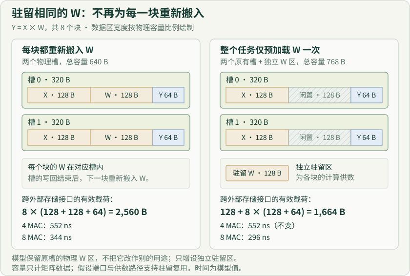
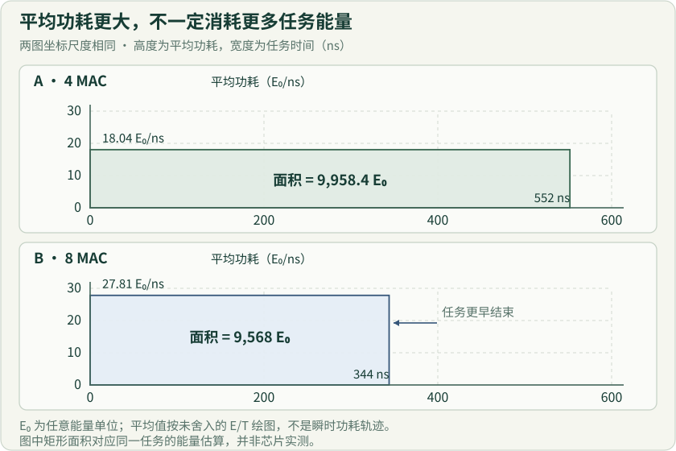
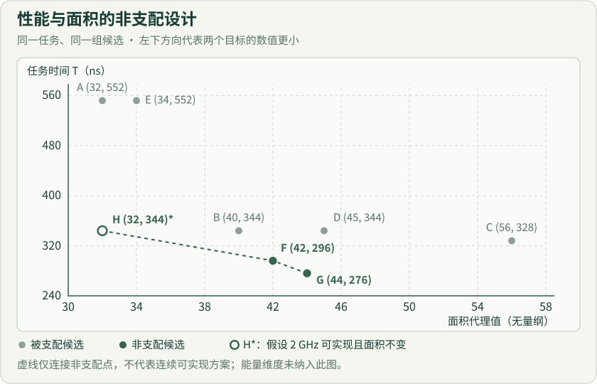

# 增加并行单元、扩大缓冲区，还是提高时钟频率？

微架构设计权衡研究的是：为了让硬件更快地完成任务，需要改变什么结构，增加多少实现成本，又会改变哪些资源的能量消耗。

[H01](h01-task-time-and-bottlenecks.md) 中，4 个 MAC 执行一项矩阵乘法需要 552 ns。增加到 8 个 MAC 后，任务时间缩短到 344 ns；再增加到 16 个，却只缩短到 328 ns。计算能力已经不是唯一的性能限制。

此时可以有不同选择：继续增加 MAC，减少重复搬运，提高 DMA 的传输能力，或者让现有 MAC 工作在更高频率。哪一种更好？

只比较任务时间还不足以回答这个问题。下文沿用 H01 的系统和工作负载，先分析每种改变如何影响执行过程，再将面积、功耗和任务能量纳入比较。

## 增加计算单元，究竟增加了哪些硬件？ {#parallel-units}

回顾 H01 的教学系统：X 为 32×16，W 为 16×4，Y = XW 为 32×4。输入为 INT16，输出和累加为 INT32，输入数值范围保证不溢出。共有八块 4×4 的输出，每块需要 256 次有效 MAC，整项任务需要 2,048 次。

原始硬件有 4 个 MAC，两个各 320 B 的局部缓冲槽，一台读写共享的 DMA。MAC 的延迟与接纳间隔均为一拍，时钟为 1 GHz。DMA 服务期间每拍搬运 8 B。任务从片上缓冲为空开始，到所有输出写回并对目标消费者可读为止。

每个 MAC 保存一个输出的部分和，并连续计算该输出的 16 项乘积。4 个 MAC 需要分四组完成一块的 16 个输出，8 个只需两组，16 个可以同时计算整块输出。

| MAC 数量 | 4 | 8 | 16 |
| --- | ---: | ---: | ---: |
| 一块输出的算术服务时间 | 64 ns | 32 ns | 16 ns |
| 外部接口传输量 | 2,560 B | 2,560 B | 2,560 B |
| 完整任务时间（H01 模型） | 552 ns | 344 ns | 328 ns |

这里每个 MAC 的算术功能不变。更多物理单元让更多输出同时推进，但增加的不只是乘法与加法电路。

为了在同一拍计算更多输出，可能需要更多累加状态、寄存器读写端口及操作数选择通路；还可能需要扩大广播网络、存储读带宽和结果接收能力。如果这些资源没有同步提供服务，增加后的 MAC 就无法达到理想的接纳速率。

反过来，某些资源可以由多个 MAC 分享。例如，多个输出需要同一个权重时，一份权重可以经广播送到多个单元。是否必须增加读端口，取决于数据访问模式与实际共享路径。参见 [D02 的数据复用](../04-compute-arrays/d02-stationary-dataflows-and-reuse.md) 和 [D03 的阵列供数](../04-compute-arrays/d03-array-size-bandwidth-and-utilization.md#input-bandwidth)。

**硬件面积不是由 MAC 数量一个参数决定的。** 运算单元、存储阵列、控制逻辑、布线及满足时序所需的结构共同决定怎样实现这个微架构。

这也是为什么将 MAC 数量翻倍，面积未必翻倍，能够交付的性能也未必翻倍。

### 同一个物理资源，可以由不同工作共享吗？

在 4 MAC 的方案中，四个单元会先服务前四个输出，再服务后四个输出。相同电路分时服务不同的工作，不需要为每个逻辑输出都配置一套 MAC。

另一个例子是 H01 中的 DMA：搬入 L 和写回 W 共用一条传输资源。当写回已就绪而 DMA 正在搬入，结果只能等待。

若改成独立的读、写路径，可能让两种搬运重叠。但是要确认从发出请求、局部存储访问到外部接口的整条路径都支持同时服务。只增加两个控制引擎，而下游仍共用相同的 8 B/拍资源，并不能消除这项带宽约束。

这就是**资源共享与资源专用**的取舍：

- 共享可以减少重复实例，给不同类型工作分配同一组服务机会。但需要选择、仲裁、状态切换或保存，并可能引入排队与延迟。
- 专用资源可以独立提供服务，减少相互争用，有时还可以简化通路。但当对应的工作不足时，专用资源可能长时间闲置。

共享并不总能节省最终面积；为了连接更多使用者所增加的选择和控制逻辑也有成本。专用也不总能提高吞吐，其他资源和任务依赖仍可能限制并行行为。

## 扩大缓冲区，为什么可能只减少搬运而没有减少时间？ {#buffer-and-reuse}

H01 中，两个缓冲槽均有 128 B 的 X、128 B 的 W 和 64 B 的 Y 空间。每算一块，DMA 都重新读一次完整的 W。八次读入的 W 内容实际相同。

现在不改变任务和计算阵列，而是在原有两个槽之外增加一块独立的 128 B 局部存储。第一次使用时把 W 完整搬入，整个任务期间不覆盖 W。后续各块只需要搬入自己的 X。

原有两个物理槽仍各有 320 B，其中为 W 预留的区域不再需要使用。新增后的矩阵数据容量为 768 B。这是一种保留原有结构的增量设计，不是实现复用所需的最小容量。

<figure class="micro-diagram" style="max-width:900px; margin:1.2rem auto" tabindex="0" aria-label="原有双槽重复读入 W 与额外权重驻留存储的对照，窄屏可横向滚动" markdown="1">

<figcaption>两种方案都处理相同的八块输出。新增权重区域在整个任务期间保存 W；原有槽中为 W 分配的空间闲置。图中容量不含累加器、控制状态和其他实现开销。</figcaption>
</figure>

| 外部接口有效载荷 | 每块重新读 W | W 在片上驻留 |
| --- | ---: | ---: |
| X 读入 | 1,024 B | 1,024 B |
| W 读入 | 1,024 B | 128 B |
| Y 写回 | 512 B | 512 B |
| 合计 | 2,560 B | 1,664 B |

减少了 896 B，即原来接口有效载荷的 35%。因为不再跨外部接口读 W，**计算量没有减少，外部传输需求减少了**。

注意，阵列仍然需要在计算每块时取得 W 中的元素。只是不必再通过外部存储读取。局部存储与操作数供给路径必须能以所需速率提供这些数据；图中的容量本身不能保证读带宽。

### 为什么 4 MAC 仍然需要 552 ns？

重新沿 H01 的执行日程计算。共享 DMA 仍提供 8 B/ns，先在 [0,16) 搬入完整 W，然后在 [16,32) 搬入第一块 X。后续每块的 X 搬入只需 16 ns，Y 写回仍需 8 ns。

若保持 4 个 MAC，第一块输入仍在第 32 ns 就绪。从这一刻开始，计算阵列原本就能够持续工作 512 ns，没有因为下一块尚未准备好而停顿。现在 DMA 更早完成下一块输入，阵列的 64 ns/块的计算节拍却没有改变。

所以最后一次计算仍在 544 ns 结束，再写回 8 ns，完整任务仍需 **552 ns**。

权重驻留不是没有作用，而是被减少的外部服务时间本来就没有阻碍计算阵列持续工作。

### 如果改成 8 MAC 呢？

原来使用 8 个 MAC 时，一块计算只需 32 ns，而每块搬入与写回占用共享 DMA 40 ns。数据准备逐渐跟不上阵列的消耗节拍。

W 驻留之后，每块只需 16+8 = 24 ns 的 DMA 服务。首次 W 和 X 搬入仍共需 32 ns，但后续计算不再因供数而出现 H01 中的 8 ns 间隙。

按原来的槽所有权和 DMA 写回优先规则，阵列可以从 32 ns 连续执行八块计算，最后写回：

**T = 32 + 8 × 32 + 8 = 296 ns**

| 配置 | 原流量方案 | W 驻留方案 |
| --- | ---: | ---: |
| 4 MAC 完整任务时间 | 552 ns | 552 ns |
| 8 MAC 完整任务时间 | 344 ns | 296 ns |
| 外部服务时间总量 | 320 ns | 208 ns |

同一项数据复用改变，在两种阵列配置中的性能收益并不相同。4 MAC 受算术服务能力限制；8 MAC 原本需要等待数据，减小传输量后，限制再次转向计算阵列。

这里还要区分两种扩大存储空间的方式：

- 增加第三个原样缓冲槽，可以让更多块同时在片上存在，但若 W 仍每块都重读，外部流量不变。H01 已验证 8 MAC 的任务时间仍为 344 ns。
- 增加或重新组织驻留空间，改变哪些数据可以复用，从而减少经过外部接口的服务量。

因此，增加缓冲容量本身不是目的。应先确定哪些数据需要同时存放，哪部分传输可以省去，以及这些变化能否缩短决定任务结束的路径。

如果从头重新组织本例的存储，可以让每个槽只保留 X 和 Y，加上公共 W，逻辑数据容量只需 2×(128+64)+128 = 512 B。这进一步说明，权重驻留不是简单地依靠更大的 SRAM；还需要设计适当的分区、访问通路和生命周期。实际采用的存储宏容量、端口与面积仍需评估。

## 提高时钟频率与增加并行单元，是一回事吗？ {#frequency}

现在回到原始的 4 MAC 配置，不改变数据流和存储组织。此前每个单元每拍执行一次有效 MAC，计算域工作在 1 GHz。

假设同一个物理计算域可以正确工作在 2 GHz，并且延迟与 II 仍为一拍。一个时钟周期从 1 ns 缩短到 0.5 ns。一块输出需要的算术拍数仍是 64 拍，但对应时间从 64 ns 缩短为 32 ns。

这与 8 MAC 工作在 1 GHz 时的算术服务时间相同。

| 方案 | 8 MAC，1 GHz | 4 MAC，2 GHz |
| --- | ---: | ---: |
| 每拍最大有效 MAC | 8 | 4 |
| 一拍的时长 | 1 ns | 0.5 ns |
| 一块输出的算术拍数 | 32 | 64 |
| 理想峰值 | 8 GMAC/s | 8 GMAC/s |
| 一块输出的算术服务时间 | 32 ns | 32 ns |

二者获得相同峰值吞吐量的方法不同。第一种在同一拍执行更多独立工作；第二种仍在原有的物理通路上逐组计算，只是两次相邻执行之间的时间更短。

这里还规定 DMA 所在的域保持 1 GHz，外部传输能力仍为 8 B/ns；假设跨域交接不带来额外时间，局部存储及供数路径能够支持新的计算速度。因此与 8 MAC、1 GHz 的阶段服务时间相同，按照 H01 的规则得到 **344 ns**。

这并不代表整个系统的时钟同步翻倍后，任务必然减半。如果 DMA 的绝对带宽受外部接口或存储器限制，它每秒提供的服务量可能不变。跨域缓冲和同步方式也可能引入新的延迟。

### 为什么不能只修改一个频率参数就得到真实芯片？

时钟周期是所有相关寄存器之间传递和采样数据的时间预算。缩短它，需要确认组合逻辑、连线、寄存器、存储器与其他约束是否允许这样的工作点。

半导体系列已经解释了[供电电压与频率](../../semiconductor-foundations/supply-voltage-and-frequency/README.md#timing)及[建立和保持时间](../../semiconductor-foundations/pvt-and-path-delay/README.md)。在微架构层面，提高频率可能要求增加流水级、修改数据通路、调整跨域接口及提高电压。

如果为提高频率而将 MAC 拆成更多流水级，则 II 可能仍是 1，但一次累加结果的延迟可能增加。需要独立的累加状态或其他反馈组织才能保持接纳能力。因此不能简单地将原方案的所有拍数除以新频率。

增加并行单元也可能改变频率上限：更大的广播扇出、更长的连线和拥挤的布局都可能改变关键路径。

所以表中的 2 GHz 方案只是一项**假设该工作点可实现**的性能比较。实际设计能否满足它，需要结合工艺库、存储宏、布局布线和时序检查来确定。

## 怎样比较完成同一任务所消耗的能量？ {#task-energy}

上一节中，增加 MAC 和提高频率可以取得相同的任务时间。但是，它们同时改变了硬件实例的数量、信号切换的速度，以及可能需要的供电条件。

首先区分两个量：

- **功率（Power）**是单位时间内能量的消耗速率，单位 W，即 J/s。
- **能量（Energy）**是某一段时间消耗的总量，单位 J。

在一项任务的开始到完成之间，瞬时功率 P(t) 可以不断变化。任务能量就是这段时间内功率对时间的积分。完整任务的平均功率为 Pavg = E/T。

短时间的大功率、长期平均功率和整项任务能量是不同的指标。即使两个方案平均功率相同，耗时不同，任务能量也会不同。

### 数据搬运的能量花在哪里？

MAC 需要内部逻辑切换，部分和需要更新。将操作数从局部存储读出，或把结果送至下一个位置，也需要驱动存储器的读写电路、总线、选择器和连线。

外部访问则可能经过 DMA、片外接口以及外部存储器。即使最终使用的是同一个 W 元素，在不同存储层级重复搬运，也需要使这些电路再次工作。

因此，做 2,048 次有效 MAC 并不足以确定整项任务的能量。需要知道数据怎样通过不同资源，以及这些资源处于什么状态。[Eyeriss 的原始论文](https://doi.org/10.1109/JSSC.2016.2616357) 就说明了局部数据复用对该加速器数据搬运能量的作用。其具体测量数字属于特定实现，不适用于本例。

一种常用的架构级分析方式是按照动作分类：分别统计运算、特定存储器读写、传输、状态转换等次数，乘以各动作在相应实现条件下的单位能量，再计入各状态持续期间的背景能量。

**E ≈ Σᵢ Nᵢ eᵢ + Σⱼ Pⱼ Δtⱼ**

Nᵢ 是第 i 类动作的发生次数，eᵢ 是每次动作的增量能量；Pⱼ 与 Δtⱼ 是第 j 类背景状态的功率及停留时长。各项的计算边界不能重复，也不能漏掉必要的动作或状态。

[Accelergy 原始论文（Wu、Emer、Sze，2019）](https://research.nvidia.com/publication/2019-11_accelergy-architecture-level-energy-estimation-methodology-accelerator-designs) 提供了一种从架构组件描述和工作负载动作计数估算能量的方法。实际分析可以从 H01 的执行轨迹获取计数，并用对应组件的实现资料标定单位能量，而不是使用一个通用的每 MAC 能量。

## 用同一个简化模型比较面积与任务能量 {#cost-model}

为了说明为什么设计选择会产生不同的比较结果，现在为前面的性能模型补充一套成本假设。以下所有面积、能量和功率系数都是刻意选取的**教学用相对成本**，不是某种工艺的综合、功耗估算或实测结果。

### 先为硬件资源建立一个面积成本

设面积代理值 a 按以下规则计算：

| 资源 | 假设面积成本 |
| --- | ---: |
| 固定控制及其他不变资源 | 10 |
| 每个 MAC 单元及其对应的局部通路 | 2 |
| 每 64 B 局部矩阵数据存储 | 1 |
| 每 8 B/ns 的 DMA 传输能力对应的硬件 | 4 |

令 M 表示 MAC 数量，S 表示物理局部数据存储容量（B），b 表示 DMA 服务速率（B/ns），则定义：

**a = 10 + 2M + S/(64 B) + 4b/(8 B/ns)**

例如原始方案的 a = 10+8+10+4 = 32。换成 8 个 MAC，其他条件不变，a = 40。

a 是无量纲的比较分数，不是 mm²。这个模型为便于计算假设各项可以相加，忽略存储宏的离散规格、bank 数量、复用路径、布线、时钟和物理实现的非线性变化。DMA 的面积成本只是针对这里两种假设硬件规格的取值，不表示真实带宽必然与面积成正比。

面积只统计待比较的片上硬件，外部存储器的物理面积在各方案中视为不变。

### 再计算任务的能量

定义 E₀ 为一个任意的教学能量单位。它没有指定对应多少焦耳。固定的任务工作量是 2,048 MAC；按前面的不同执行方式，经过外部接口的有效载荷 Q 为 2,560 B 或 1,664 B。

在普通的 1 GHz 工作点，规定：

| 动作或状态 | 能量计算假设 |
| --- | --- |
| 一次有效 MAC 的运算 | 1 E₀ |
| 与一次有效 MAC 对应的局部供数、累加状态访问及结果保存，按任务平均折算 | 0.5 E₀ |
| 跨共享 DMA 接口的每 1 B 有效载荷（含相关缓冲读写、DMA、接口及外部存储的增量活动） | 2 E₀ |
| 任务窗口内的剩余背景功率 | 0.1a E₀/ns |

这里将局部计算活动与搬运活动分开计数，不在两个类别重复计入同一读写。背景功率只用于补充未被上述动作系数覆盖的片上开销，假设在整个窗口恒定；不计外部存储器的背景功耗等未建模项目。

实际硬件的活动能量依赖数据、访问方向、距离、位宽、供电和工作状态。教学模型固定这些系数，只是为了观察任务时间、流量和资源数量改变后的关系。

对原始 4 MAC 方案，任务能量可分为：

- 运算及局部活动：2,048 × (1+0.5) = 3,072 E₀。
- 外部传输相关活动：2,560 × 2 = 5,120 E₀。
- 背景能量：3.2 E₀/ns × 552 ns = 1,766.4 E₀。

因此 E = 3,072+5,120+1,766.4 = 9,958.4 E₀。平均功率代理值为 9,958.4/552 ≈ 18.04 E₀/ns。

### 为什么功率更低，完成任务反而消耗更多能量？

改用 8 MAC 后，执行的有效 MAC 数及外部传输量都没变。按假设，两类增量活动仍共消耗 8,192 E₀。

面积代理值从 32 增至 40，背景功率升到 4 E₀/ns，但任务窗口缩短为 344 ns，所以背景能量变为 4×344 = 1,376 E₀，低于原始方案。

| 方案 | 4 MAC | 8 MAC |
| --- | ---: | ---: |
| 任务时间 | 552 ns | 344 ns |
| 平均功率（E₀/ns） | 18.04 | 27.81 |
| 任务能量代理（E₀） | 9,958.4 | 9,568 |

<figure class="micro-diagram" style="max-width:800px; margin:1.2rem auto" tabindex="0" aria-label="较低平均功率和较长执行时间的能量对比，窄屏可横向滚动" markdown="1">

<figcaption>矩形代表同一任务窗口的平均功率与时间，面积代表任务能量。实际瞬时功率不是恒定的矩形；这里所有数值均为教学成本模型结果。</figcaption>
</figure>

这个算例中，较低平均功率的方案反而消耗更多任务能量。原因不是 MAC 执行了更多有效工作，而是背景功率持续了更长时间。

如果 8 MAC 的局部供数和时钟网络需要远高于本例设定的能量，结论可能反过来。因此不能将“更快完成任务”直接等同于“更省能量”。

另一方面，4 MAC 配置增加权重驻留后，任务时间仍为 552 ns，却省掉了 896 B 传输相关活动。在本模型中节省 1,792 E₀，新增存储使背景能量增加 0.2×552 = 110.4 E₀，任务能量降为 8,276.8 E₀。

**缩短任务时间和减少任务能量并不总是同一件事。** 这正是不能只用峰值算力或平均功率选择设计的原因。

## 硬件处于等待状态时，还需要消耗功率吗？ {#power-management}

在 H01 的 8 MAC 日程中，阵列有若干个 8 ns 的空闲间隔。此时 DMA 可能仍在服务，缓冲槽中也可能保存着尚未写回的数据。

即使没有发生有效 MAC，时钟网络仍可能驱动寄存器；部分控制逻辑和输入信号也可能变化。保持通电的电路还具有漏电。若能让某些不需要工作的资源减少这些活动，就可能减少能量。

### 时钟门控（Clock Gating）

当一组状态不需要更新时，可以关闭通向相关时序单元的时钟，使其不再因每个时钟边沿而发生不必要的切换。

与只令寄存器保持原值相比，合适的时钟门控还可以减少相关时钟支路的活动。但逻辑仍处于供电状态，漏电并不会因此消失；如果外部输入仍然变化，部分组合逻辑也可能继续翻转。操作数隔离可以针对后者减少无效切换。[G02](../07-specialized-compute/g02-sparse-computation-and-operand-matching.md#zero-gating) 中零值检测与无效运算的门控也是类似的区分：减少切换并不自动等于减少执行拍数。

在上面的阵列中，可以让已经完成 C₁、等待 C₂ 输入的 MAC 通路停止不必要的时钟活动。不过数据到达时必须能及时恢复时钟，不能丢失完成事件或破坏依赖。

[AMD Zynq 的 Standby 模式说明](https://docs.amd.com/r/en-US/ug585-zynq-7000-SoC-TRM/Standby-Mode) 就给出了保持供电但关闭大部分时钟、仍保留漏电与唤醒逻辑开销的实际设备例子。

### 电源门控（Power Gating）

如果某个电路区域在较长时间内不需要工作，可以通过控制其供电来减少漏电。与时钟门控不同，被关闭供电的普通状态存储通常不能再保证原有数据有效。

例如仅仅看到阵列没有发出 MAC，并不表示可以关掉整个计算与局部存储区域的电源。可能还有 DMA 请求正在写入该区域，或有计算结果等待交付。

因此必须先确定哪些操作已经结束、哪些状态要保留，以及怎样保护仍通电的其他电路。通常需要等待在途工作结束，保存或保持必要状态，隔离边界，再按目标实现的电源管理约定关闭供电。唤醒后也要等状态和接口重新有效。

进入和退出低功耗状态还需要时间与能量，可能引入唤醒等待。

假设转换时间暂忽略，且额外转换能量为 Esw、原空闲与睡眠背景功率分别为 Pidle、Psleep，则在 Pidle > Psleep 时，节能需要：

**空闲时长 > Esw / (Pidle − Psleep)**

例如另作一个独立教学假设：每 ns 能节省 0.5 E₀，进入和退出共需额外 6 E₀，则至少跨过 12 ns 的平衡点才有收益。H01 的 8 ns 等待间隔不足以抵消这笔转换能量。

这组假设未用于前面的任务能量表。实际还要核查转换时长、状态重装、预留的唤醒时间及供电恢复条件。相关机制见 [SRAM 的漏电、保持与唤醒](../../storage/02-sram/foundations/sram-power-leakage-retention.md) 和 [芯片开发中的低功耗设计](../../chip-development/process/02_frontend_design_and_verification/07_low_power_design.md)。

### 动态电压频率调整（DVFS）

前文假设 4 MAC 的计算域可以从 1 GHz 调至 2 GHz。如果硬件支持经过验证的多个电压与频率组合，也可以根据任务需求选择不同时钟和供电工作点。

DVFS 并不等于只改变时钟频率。提高频率有时需要提高电压，以满足更短的周期预算；降低频率则可能允许使用较低电压。Linux 的 [OPP（Operating Performance Point）说明](https://docs.kernel.org/power/opp.html) 将设备支持的工作点描述为频率与电压的组合。

半导体系列已从电容充放电推导[电压、频率与切换能量的关系](../../semiconductor-foundations/supply-voltage-and-frequency/README.md#dvfs)。在相同有效切换电容和次数的理想条件下，单次切换的能量随供电电压平方变化；频率决定相同次数的切换在多长时间完成。

因此，仅提高频率不能推导出同一任务的切换能量必然翻倍。但是如果需要同时提高电压，或者引入新的流水级和时钟活动，任务能量就可能增加。

为比较 4 MAC、2 GHz 的教学方案，再假设计算域的两个工作点均已满足时序条件，且较高工作点需要参考电压的 1.25 倍。这个电压比例不是从频率推导的，也不是实际芯片规格。

假设这些局部供数相关电路与 MAC 位于同一电压域，运算和局部供数相关的每次动作能量都乘以 1.25² = 1.5625，DMA 与外部传输动作能量不变。较高工作点的背景功率另假设为 4 E₀/ns，而非普通工作点的 3.2 E₀/ns。任务开始前已处于该频点，不另计切换代价。

则 4 MAC、2 GHz 的完整任务仍需 344 ns，能量代理值为：

**E/E₀ = 3,072 × 1.5625 + 5,120 + 4 × 344 = 11,296**

这个高频方案和 8 MAC、1 GHz 一样快，按面积代理模型还更小，却需要更多任务能量。若换用其他可用电压、活动或背景功率参数，结果可能不同。

真正的 DVFS 选择还需要比较电源域和时钟域的过渡开销、可持续功率、温度、供电能力及任务对时间的要求。受供电、散热或功率预算限制时，额定高频不一定是能够持续运行的工作频点。本文不深入具体的电源控制器或调频策略。

## 数值精度和专用化也会改变设计选择吗？ {#precision-and-specialization}

之前我们固定 INT16 输入与 INT32 累加。现在假设某些任务的输入值都在 INT8 可精确表示的范围内，并且目标硬件支持 INT8 运算。如果保持同样的数值语义和 INT32 累加，则 X 和 W 的存储字节数可以减半。

在每块重新读 W 的方案中，X 和 W 各从 128 B 减至 64 B，Y 仍为 64 B。若数据能够紧密存放，且接口无额外传输填充，外部有效载荷变为 8×(64+64+64) = 1,536 B，比原来减少 40%，而不是 50%。

较窄的数值格式还可能允许更小的乘法器、较窄的数据通路或在相同面积内布置更多并行运算资源。但累加器、控制、寻址和接口未必同比例缩小；若需要转换、量化参数或处理打包填充，还要计算相应开销。

如果原数值不能直接以 INT8 精确表示，就不能只改数据宽度、假装仍在完成完全相同的任务。使用近似格式时需要确认任务所允许的数值误差，并重新评估硬件支持。[A04](../01-foundations/a04-floating-point-and-low-precision.md) 已经介绍了数值表示及算术格式。

### 专用化与可编程性的代价在哪里？

4 MAC 和 8 MAC 不是唯一的架构选择。若硬件只需要处理固定的矩阵形状和数值格式，可以针对这些条件安排数据传递、部分和与控制路径，避免很多不需要的通路。

若要处理多种数据形状、精度、布局或运算，可能需要更多选择器、地址生成、配置状态及执行控制，使同一资源可以服务更多任务。额外电路、时序与验证带来成本，但若实际任务经常变化，这些能力可能提高整个硬件的使用价值。

例如 [TPU 的原始架构论文](https://research.google/pubs/in-datacenter-performance-analysis-of-a-tensor-processing-unit/) 描述了一种面向神经网络推理的整数矩阵乘加及软件管理片上存储的专用组织。它的取舍与目标工作负载相联系，不表示所有任务都适合该结构。

专用化与共享也不是相互排斥的。一个为矩阵乘法专门设计的 MAC 阵列仍可分时服务多个输出；一个可编程处理器也可以配置不同类型的专用功能单元。应该关心的是，新增能力是否服务实际任务，及实现它需要多少硬件和验证成本。

[I01](../09-compute-paradigms/i01-reconfigurable-and-spatial-computing.md) 将进一步解释怎样让物理数据通路支持可配置的运算和连接。

## 如果只能选择一个方案，怎样进行比较？ {#pareto}

回到同一项 H01 矩阵乘法，不改变数值格式或任务语义。将前面的面积代理、任务时间以及能量模型应用到八个候选方案。所有方案沿用相同的初始数据状态、完成边界与执行规则；额外局部供数和接口等条件仍按前述教学假设。

| 方案 | 改变的资源 | MAC 数 / 计算域频率 | 存储容量 | DMA 服务速率 |
| --- | --- | --- | ---: | ---: |
| A | 原始方案 | 4 / 1 GHz | 640 B | 8 B/ns |
| B | 增加 MAC | 8 / 1 GHz | 640 B | 8 B/ns |
| C | 继续增加 MAC | 16 / 1 GHz | 640 B | 8 B/ns |
| D | B 增加一个槽 | 8 / 1 GHz | 960 B | 8 B/ns |
| E | A 增加 W 驻留 | 4 / 1 GHz | 768 B | 8 B/ns |
| F | B 增加 W 驻留 | 8 / 1 GHz | 768 B | 8 B/ns |
| G | B 增加 DMA 带宽 | 8 / 1 GHz | 640 B | 16 B/ns |
| H | A 提高计算域频率 | 4 / 2 GHz | 640 B | 8 B/ns |

方案 E、F 的 W 只初次读入一次，外部传输量为 1,664 B；其余方案都为 2,560 B。方案 H 假设同样面积的计算域满足更高工作点，其他频率、带宽及能量条件见上一节。

| 方案 | 任务时间（ns） | 面积代理值 a | 任务能量代理（E₀） | 平均功率（E₀/ns） |
| --- | ---: | ---: | ---: | ---: |
| A | 552 | 32 | 9,958.4 | 18.04 |
| B | 344 | 40 | 9,568 | 27.81 |
| C | 328 | 56 | 10,028.8 | 30.58 |
| D | 344 | 45 | 9,740 | 28.31 |
| E | 552 | 34 | 8,276.8 | 14.99 |
| F | 296 | 42 | 7,643.2 | 25.82 |
| G | 276 | 44 | 9,406.4 | 34.08 |
| H | 344 | 32 | 11,296 | 32.84 |

这些数字是前述假设的模型输出，面积代理值不是综合报告，平均功率也只是模型能量除以任务时间，不能当作芯片的实际功率。比较时尤其不能从这些平均值直接推断瞬时峰值电流或散热需求。

### 什么是 Pareto 关系？

先只比较面积和任务时间。将每个方案放在平面上，越靠左表示面积代理值越小，越靠下表示任务完成越快。

<figure class="micro-diagram" style="max-width:850px; margin:1.2rem auto" tabindex="0" aria-label="八个候选方案的时间与面积代理值 Pareto 对比，窄屏可横向滚动" markdown="1">

<figcaption>在给定的有限候选集和教学参数下，只最小化面积代理值与任务时间。H 假设高频工作点可实现。连线仅示意这些候选的取舍关系，不表示线段上的每种设计都可实现。</figcaption>
</figure>

如果存在另一个方案，在所有被比较的目标上都不更差，且至少有一个目标严格更好，那么原方案被这个新方案**支配（Dominated）**。

例如 B 与 D 的任务时间相同，但 B 的面积更小；再增加第三个存储槽对这项任务没有产生速度收益。F 的面积小于 C，而且任务完成更早。此时可以优先排除 D 和 C。

如果再比较 H、F、G，H 的面积最小，但 F 更快，G 又比 F 更快且面积更大。对于只考虑时间和面积的这八个候选，它们都没有被其他点支配，构成该比较的 **Pareto 前沿**。

现在将任务能量也加入比较。H 与 B 虽然具有相同时间且 H 的面积较小，但 H 的能量较高，所以不能仅凭二维图排除 B。E 同样不能只因为与 A 一样慢、面积更大就排除，因为 E 的任务能量更低。

在这组模型中，C 与 D 在时间、面积和任务能量三个目标上仍被支配（分别可由 F、B 比较得到）。其他候选需要根据目标间的具体取舍选择。若再把平均功率或峰值功率作为约束或比较目标，还要为这些量建立相应模型，重新判断关系。

### 有了前沿，就能直接选出最好的硬件吗？

仍然不能。假设现在有两个要求：任务时间不超过 300 ns，面积代理值不超过 44。按表中模型，F 和 G 都满足。

- 如果优先降低任务能量，F 更合适。
- 如果优先缩短任务时间，G 更合适。

若面积代理值上限再从 44 缩小到 43，则 G 不满足条件。这时只有 F 留在满足这两项约束的候选集中，而不是因为 F 在所有指标上都比 G 更好。

实际芯片中，还需将设计约束换成可验证的量，例如最大面积、可用存储宏、可达到的时钟工作点、任务正确性、封装与供电能力、热限制及工作负载分布。某个候选甚至可能因某一项约束而无法实现，应该先从比较范围中去掉。

早期的成本模型适合帮助发现值得进一步研究的方案，而不能代替后续实现。实际面积与频率需要用相应工艺的实现资料核查；功耗和能量估算需要结合对应电路、活动及供电状态。再利用详细仿真、实现或实测对结果进行校准。芯片开发系列的[微架构设计](../../chip-development/process/02_frontend_design_and_verification/02_microarchitecture_design.md)、[静态时序分析](../../chip-development/process/03_backend_physical_design/05_static_timing_analysis.md)与[功耗分析](../../chip-development/process/03_backend_physical_design/06_power_analysis.md)继续讨论这些工程过程。

## 回到开始的问题：应该增加哪种资源？ {#implications}

本例中，4 MAC 先受到算术服务能力限制。增加 MAC 后，外部传输开始阻碍计算，再增加缓冲或带宽的收益就取决于究竟改变了哪些服务需求和执行约束。

提高频率能够缩短每拍的实际时间，却要检查工作点、反馈依赖、供数和其他时钟域是否支持。降低不必要的活动或重复流量可以减少任务能量，但并不一定缩短任务时间。

从 H01 和 H02 建立的共同分析过程来看，微架构设计可以按下面的顺序进行判断：

1. 明确任务语义、数值精度、初末数据状态和必须满足的设计约束。
2. 根据实际执行机制分析计算、存储与互连所需的工作，以及等待发生在哪里。
3. 选择候选的资源数量、存储组织、执行方式和工作点，重新检查它们能否提供服务。
4. 用相同边界统计时间、面积、功耗和任务能量。明确模型假设、误差及尚未验证的条件。
5. 在满足要求的可实现候选中比较取舍，并针对影响选择的参数继续验证。

不存在脱离任务和约束的最优微架构。改变矩阵形状、数据复用、精度或延迟要求之后，今天的非支配方案也可能被另一种组织取代。

这也是计算微架构与性能建模相结合的意义：不是根据某项硬件指标预设正确答案，而是理解数据怎样经过硬件，再用有明确条件的证据比较设计。

## 阅读衔接

- [H01：执行单元增加一倍，为什么任务不一定提前一半结束？](h01-task-time-and-bottlenecks.md)：完整任务的执行日程、资源下界与模型验证。
- [D02：同一块矩阵，哪些数据应该留在计算单元里？](../04-compute-arrays/d02-stationary-dataflows-and-reuse.md)：不同的数据驻留与复用结构。
- [半导体与电路基础：降压能省多少电，时钟还能跑多快？](../../semiconductor-foundations/supply-voltage-and-frequency/README.md)：电压、门延迟和 DVFS 的物理基础。
- [芯片开发与实现：低功耗设计](../../chip-development/process/02_frontend_design_and_verification/07_low_power_design.md)：低功耗状态、隔离、保持、时序和验证。

[返回性能分析与设计权衡](README.md)
