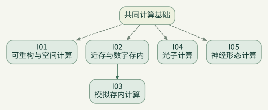

# 其他计算范式

其他计算范式从计算资源的连接方式、计算发生的位置、数值的承载介质或触发方式等方面，改变常规数字处理器的计算组织。

如果一块芯片接到不同任务，它能否改变运算单元之间的连接？如果运算涉及的数据大部分留在存储器中，将计算放到存储器旁边或内部又会发生什么？

这条拓展路线以已知的数据通路、计算阵列和资源协作为参照，理解这些计算范式如何实现运算，以及它们省去了哪些工作、又引入了哪些约束。各分支可独立进入；数字与模拟存内计算适合顺序阅读。

## 知识关系

<figure class="micro-v2-map" markdown="1">

<figcaption>知识衔接示意。虚线表示关联或辅助阅读。点击可查看大图。</figcaption>
</figure>

近存和存内计算还需要存储器件及阵列的相关知识；模拟存内计算进一步涉及模拟信号转换和精度误差。光子和神经形态计算属于独立拓展分支，不是理解常规 CPU、GPU、NPU 的前置知识。

## 计划阅读顺序

本路线规划五篇文章，I01–I03 正文已开放。其他分支可以从共同计算基础进入；I02 与 I03 适合顺序阅读。正文尚未发布的条目不提供链接。

| 编号 | 文章 | 阅读重点 | 状态 |
| --- | --- | --- | --- |
| I01 | [计算任务改变后，硬件的数据通路也能改变吗？](i01-reconfigurable-and-spatial-computing.md) | 固定与可重构数据通路、空间计算、数据流驱动、FPGA 与 CGRA | 已发布 |
| I02 | [如果把计算单元放到存储器旁边或内部，会发生什么？](i02-near-memory-and-digital-cim.md) | 传统/近存/数字存内计算对照、搬运成本、存储阵列求值 | 已发布 |
| I03 | [怎样利用模拟电路完成矩阵乘加？](i03-analog-computing-in-memory.md) | 模拟存内计算、外围电路、ADC/DAC、精度与误差、能耗取舍 | 已发布 |
| I04 | 如果不用电子传输数值，怎样利用光完成计算？ | 光子计算的信息承载、基本机制及计算组织 | 未发布 |
| I05 | 如果计算不再按照统一时钟推进，而是由事件触发，会怎样？ | 神经形态计算、神经元状态、脉冲与事件驱动；不暗示所有神经形态芯片都是无时钟实现 | 未发布 |

I01 从先加后乘和先乘后加的两个计算任务出发，追踪同一组运算单元之间的配置、有效连接、数值和状态。理解这种计算组织不需要先学习存内、光子或神经形态计算。

## 与其他路线的关系

- [共同计算基础](../01-foundations/README.md)：用常规数字运算和控制机制作为对照，I01 尤其关联 A01 的选择器、A05 的数据通路与 A06–A08 的执行控制。
- [计算阵列与数据流](../04-compute-arrays/README.md)：理解阵列中的乘加、部分和、数据驻留与移动。
- [性能分析与设计权衡](../08-performance/README.md)：比较不同计算组织的吞吐、精度、任务能量与资源成本。
- [存储系统](../../storage/README.md)：I02、I03 按需回顾存储阵列与访问路径。
- [半导体与电路基础](../../semiconductor-foundations/README.md)：补充逻辑门、模拟信号和电路时序等背景。

本路线介绍机制而非产品或工具链。不同计算范式各有适用条件，不能简单按名义算力或单个运算的能量指标判断优劣。

[返回计算微架构系列](../README.md)
