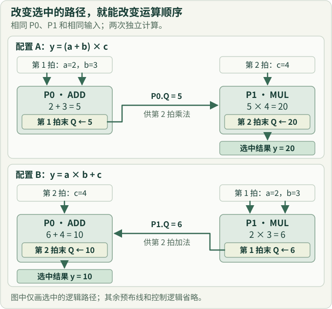
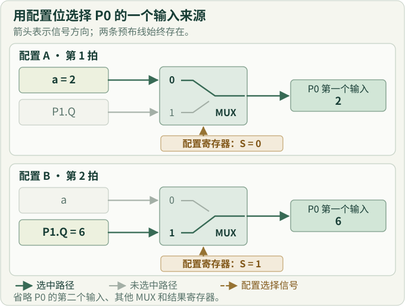
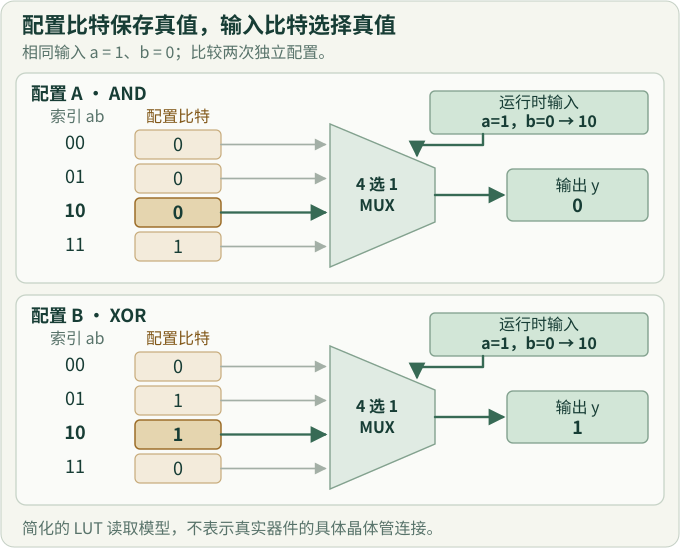

# 计算任务改变后，硬件的数据通路也能改变吗？

在[A05](../01-foundations/a05-datapath-and-control.md)中，硬件通过控制信号不断选择操作数、运算单元和结果的保存位置。因此，即使电路已经制造出来，也能通过改变命令来完成不同的计算。

还有另一种方法：在开始一批计算之前，先选择运算单元的功能及它们之间的数据路径。随后，让一份份数据经过已经配置好的电路。这是可重构计算的一种组织方式。

为什么需要这种能力？如果一种电路能够直接完成某组运算，换一种计算任务后，原来的连接关系可能就不合适了。下面跟踪两次具体计算，看看硬件应该改变什么，以及怎样在同一块硅片上实现这种改变。

## 同样是一次加法和一次乘法，为什么需要不同的连接？ {#fixed-path}

假设有三份输入 a = 2、b = 3、c = 4。我们需要支持两种任务：

- 任务 A：(a + b) × c = 20。
- 任务 B：a × b + c = 10。

采用十六位无符号整数，以下算例的中间结果和最终结果都不会溢出。

如果专门为任务 A 设计电路，可以让 P0 完成加法，P1 完成乘法，并将 P0 的结果通过寄存器送到 P1。每组输入先生成中间结果 5，再将 5 与 4 相乘得到 20。

这样的硬件可以处理不同的 a、b、c，但它只能直接执行先加后乘的依赖关系。若换成任务 B，乘法的操作数应该是 a、b，而乘积 6 必须送到加法器，再与 c 相加。原有的单向连接不能直接满足这个需求。

<figure class="micro-diagram" style="max-width:760px; margin:1.2rem auto" tabindex="0" aria-label="两个计算任务中，加法与乘法之间相反的数据传递方向，窄屏可横向滚动" markdown="1">

<figcaption>图中对照的是两个任务分别需要的有效路径，接下来再解释怎样让同一块芯片支持它们。每级结果在拍末保存；c 与本组中间结果对应，省略其等待或对齐状态。</figcaption>
</figure>

当然，可以像 A05 那样，让两个运算单元都连接到通用寄存器文件。先发一条加法命令，再发一条乘法命令，通过公共状态保存并传递中间结果。换任务时，交换命令的顺序并改变操作数来源即可。

这种指令或命令控制的方式可以复用运算资源，也能通过旁路直接交接一些结果。但每项运算仍需要正确的操作、源、目标和执行许可。

如果接下来要反复执行任务 B，每组数据都经过从乘法器到加法器的路径。能不能预先将这条路径选好，让中间结果在两个单元之间直接交接？

## 怎样用配置选择数据的去向？ {#configurable-routing}

从 P0 的第一个输入开始。任务 A 需要 a；任务 B 则需要 P1 的结果。回忆[A01 中的选择器（MUX）](../01-foundations/a01-state-and-control.md#select-decode)：两路数据接到选择器的两个输入，选择信号决定哪一路出现在输出端。

现在让 P0 的第一个输入使用这样的 MUX。两条候选线路在电路制造时就已经存在。用一个配置寄存器保存选择位 S：

- S = 0：选取外部输入 a。
- S = 1：选取 P1 结果寄存器的输出 Q1。

<figure class="micro-diagram" style="max-width:700px; margin:1.2rem auto" tabindex="0" aria-label="配置寄存器中的选择位控制加法单元的输入选择器，窄屏可横向滚动" markdown="1">

<figcaption>配置位不是参加运算的操作数。它决定哪一条已经存在的候选路径生效；并没有重新制造金属连线。这里仅画出 P0 的一个输入。</figcaption>
</figure>

以同样方式为两个运算单元的其他输入和最终结果出口设置选择器。对于这组教学电路，配置表可以写成：

| 需要选择的位置 | 配置 A | 配置 B |
| --- | --- | --- |
| P0 的两个输入（ADD） | a、b | Q1、c |
| P1 的两个输入（MUL） | Q0、c | a、b |
| 最终结果的来源 | Q1 | Q0 |
| 中间结果的传递方向 | P0 → P1 | P1 → P0 |

Q0、Q1 分别表示 P0、P1 的结果寄存器输出。每次只启用表中选定的输入来源。本例的两种有效路径都没有环路。

将表中各项转换成选择器所需的比特，写入配置寄存器，配置就完成了。执行一份数据或许只需要两拍，而同一份配置可以保持几万拍、处理很多组数据。如果配置允许的来源里没有某条路径，就不能仅靠修改选择位让数据凭空到达那个位置。

这与 A05 每次运算由控制逻辑发出 MUX 选择信号的机制有联系：底层都是选择电路。区别在于，这里的配置可以预先确定多个运算单元之间的有效连接，在一批运算期间保持它，而不是每次交接结果时重新指定路径。

真正的可编程互连可以包含多级选择和交换资源。以 [AMD UltraScale 的互连资源](https://docs.amd.com/r/en-US/ug574-ultrascale-clb/Interconnect-Resources)为例，逻辑块、DSP 与片上存储资源通过可编程交换矩阵接入信号路径。本例只展示最小的选择机制，不假设实际芯片的任意两个单元都直接相连。

## 能不能连运算单元的功能一起配置？ {#configurable-functions}

上例中 P0 只能执行加法，P1 只能执行乘法。若希望两个单元同时执行两个独立的加法，光改变数据路径仍然不够。

[A02 的 ALU](../01-foundations/a02-number-representation-and-arithmetic.md#alu)已经展示了如何用控制信号选择不同的运算电路。可以用类似的方法，让 P0 和 P1 都具备加法、乘法等功能，并用各自的配置字段选择本轮工作所需的功能。

如果要同时做两个独立加法，还需保证两个单元能各自取得操作数、交付结果。此时，除了配置数据从哪里来、到哪里去，还需要配置每个单元执行什么运算。原先的 P0 → P1 路径可以先做加法再做乘法，也可以不改变连接方向，只交换两个单元的运算功能。更大的网络还可以同时改变功能与连接，使多个单元形成不同的计算结构。

但如果单元内部没有实现某种运算，写一个新的运算编号并不会让它突然具备这种能力。我们能否设计一种更灵活的功能单元，让配置直接决定它能够实现哪种逻辑函数？

### 从一个两输入逻辑函数开始

设有两个一位逻辑输入 a、b。一个 AND 门和一个 XOR 门的输入组合相同，但每种组合对应的输出不同。我们可以列出真值表：

| a | b | AND | XOR |
| --- | --- | --- | --- |
| 0 | 0 | 0 | 0 |
| 0 | 1 | 0 | 1 |
| 1 | 0 | 0 | 1 |
| 1 | 1 | 1 | 0 |

不一定要用一套专门的门电路来实现 AND、另一套门来实现 XOR。也可以使用四个保存配置值的比特和一个四选一 MUX。

把输入 a、b 解释为选择编号，将真值表中对应的那一行作为输出。例如，a = 1、b = 0 时，编号为二进制 10。如果该位置保存 0，输出就是 0；改成 1 后，相同的输入就会输出 1。

<figure class="micro-diagram" style="max-width:650px; margin:1.2rem auto" tabindex="0" aria-label="两个输入作为索引选择四位配置之一，改变真值表使电路具有不同功能，窄屏可横向滚动" markdown="1">

<figcaption>四个配置位按输入 00、01、10、11 的顺序排列。本图是两输入查找表的逻辑模型，不是某款器件的晶体管级电路。</figcaption>
</figure>

这样，只要改变四个保存的比特，就能改变这个电路实现的逻辑函数，这类结构称为**查找表（Look-Up Table，LUT）**。

如果有 k 个逻辑输入，共有 2k 种组合。一个能够任意设置对应输出的单输出 LUT，需要为每种组合保存一个比特。两个输入需要 4 位，六个输入需要 64 位。

注意，这里的 LUT 输入是正在变化的数据信号，输出是由预先保存的配置决定的逻辑值。这里不是处理器执行一条访存指令后，再用软件查一张表。

### FPGA 怎样组织这样的电路？

刚才的 LUT 只能产生一个逻辑输出。要实现多位加法，可以用多个 LUT 表示所需的逻辑函数，再利用可编程互连将它们接起来。若还需要逐拍保存结果，则将输出送入触发器。

这种细粒度的可配置逻辑与互连，是**现场可编程门阵列（Field-Programmable Gate Array，FPGA）**的主要组织方式之一。

实际 FPGA 不需要将所有电路都用通用 LUT 拼接。[AMD UltraScale 的 CLB 文档](https://docs.amd.com/r/en-US/ug574-ultrascale-clb/CLB-Resources)列出了六输入 LUT、触发器、专用进位链等资源；同系列的互连还可连接 DSP 和块存储器（BRAM）等专用硬块。六输入 LUT 的逻辑函数由 64 位初始化值指定，参见[官方 LUT 说明](https://docs.amd.com/r/en-US/ug574-ultrascale-clb/LUT-Primitives)。

将所需的逻辑功能、连接等信息组织成配置数据，装入器件的配置逻辑，可以建立一个特定用途的数据通路。比如在另一轮工作中，将同一片可编程逻辑用于不同的计算电路。具体配置存储和装载方式取决于器件；参见[AMD UltraScale 配置位流](https://docs.amd.com/r/en-US/ug570-ultrascale-configuration/Configuration-Bitstream)。

这里的配置与计算程序都可以由软件准备。但前者可以定义电路的有效功能和连接，并不要求每收到一个数据就从配置位流中读取一条算术指令。

## 如果不需要改变每一个逻辑门呢？ {#cgra}

回到任务 A 和任务 B。我们真正需要改变的是十六位操作数在加法器、乘法器和寄存器之间的路径，并不需要为每一个任务重新组织加法器内部的进位逻辑。

如果提前把经常需要的加法器、乘法器、局部寄存器以及字级连接资源做好，再用配置选择这些完整运算单元，就不必用许多比特级 LUT 和通用布线重新构造它们。

一种这样的组织是**粗粒度可重构阵列（Coarse-Grained Reconfigurable Array，CGRA）**。它通常以一组可以配置的处理单元（PE）及互连为基础，处理多位数值或数据向量。配置可以指定运算功能、操作数来源、结果传递位置等。

| | FPGA 的细粒度可编程资源 | 典型 CGRA 的粗粒度可编程资源 |
| --- | --- | --- |
| 可配置对象 | 小型布尔函数、比特级连接等 | 已实现的字级运算、寄存器和传输路径 |
| 构建十六位加法 | 可以将逻辑资源与进位资源组合，也可调用合适硬块 | 可以直接选择已有的十六位加法功能（若支持） |
| 能改变的范围 | 可以构造更多不同的逻辑电路，受资源与布线能力限制 | 受已有运算集合、数据宽度、连接和状态容量限制 |
| 需要保存的信息 | 逻辑函数及互连等配置 | 运算选择、端口选择、路径、时序上下文等配置 |

这是两种典型粒度的比较，不是绝对的器件分类。FPGA 也含粗粒度硬块；CGRA 的单元可能异构，并不是每个单元都能执行任意运算。CGRA 可以作为 ASIC 的内部计算资源，也可以在 FPGA 上实现原型。ASIC 是为特定用途设计并制造的芯片，并不意味着其中不能存在可配置数据通路。

例如， [Mei 等人在 DATE 2004 介绍的 ADRES](https://cecs.uci.edu/~papers/date08/PAPERS/2004/DATE04/PDFFILES/09G_2.PDF)使用带运算单元、局部寄存器文件、输入选择和配置存储的可重构资源。该设计支持按执行周期选择配置上下文，说明粗粒度可重构不要求整个任务始终只使用一份静态配置。

[Plasticine（ISCA 2017）](https://csl.stanford.edu/~christos/publications/2017.plasticine.isca.pdf)则以可重构的多级 SIMD 运算流水线和存储单元为基础，配置计算级的功能及数据流路径。这些是不同的具体实现，而不是 CGRA 必须遵循的唯一结构。

更大的系统中，还需要将运算单元与存储、地址生成和通信资源组织起来。可以在[芯片架构实例：SambaNova SN40L](../../chip-architectures/SambaNova/README.md)中查看一个具体的粗粒度数据流系统。

## 将计算分配给不同位置，和重复使用同一个单元，有什么区别？ {#space-and-time}

现在暂时固定任务 A，连续处理三组输入。我们希望每组输入都执行一次加法和一次乘法。

| 输入组 | a | b | c | (a + b) × c |
| --- | ---: | ---: | ---: | ---: |
| 0 | 2 | 3 | 4 | 20 |
| 1 | 1 | 2 | 5 | 15 |
| 2 | 3 | 4 | 2 | 14 |

先用一个可以切换 ADD/MUL 的单元。每组数据先占用它一拍完成加法，再占用它一拍完成乘法。第一步结果经过寄存器保留，到下一拍再使用。同一个物理运算位置，在不同时间执行不同的运算，这是一种**时间复用**。

再用两个单元，将 ADD 配置到 P0、MUL 配置到 P1，选择 P0 → P1 的数据路径。第一组数据在 P1 做乘法时，第二组就可以在 P0 做加法。不同的运算步骤被分配到不同的物理位置，这体现了**空间计算（Spatial Computing）**的思想。

为了看清区别，假设：

- 加法与乘法都可以在各自的一拍内执行并在拍末保存结果。
- 输入、输出和中间状态的容量及端口足够。对于每个中间结果，与它对应的 c 同样被保存并交给下一步；两者不会错配。
- 开始前输入已准备好、配置已完成；执行中无反压。计算区间不计配置、外部搬运等时间。

在这些条件下，可以写出以下日程。表中的加法和乘法使用对应输入组的数据，箭头后的数字是该拍末的结果。

| 拍 | 一个单元（时间复用） | P0（空间分工） | P1（空间分工） |
| ---: | --- | --- | --- |
| 1 | ADD 组 0 → 5 | ADD 组 0 → 5 | — |
| 2 | MUL 组 0 → 20 | ADD 组 1 → 3 | MUL 组 0 → 20 |
| 3 | ADD 组 1 → 3 | ADD 组 2 → 7 | MUL 组 1 → 15 |
| 4 | MUL 组 1 → 15 | — | MUL 组 2 → 14 |
| 5 | ADD 组 2 → 7 | — | — |
| 6 | MUL 组 2 → 14 | — | — |

一个单元需要六拍，两个单元需要四拍。第一组结果仍在第二拍末产生，变快的是连续多组数据的交付速度。这样安排需要两个可以同时工作的运算单元以及对应的存储和传递路径。

若共有 N 组数据（N ≥ 1），本例单单元顺序执行需要 2N 拍；空间分工的两级流水需要 N + 1 拍。第一组需要两拍，以后每拍可完成一组。[A06](../01-foundations/a06-pipeline-and-throughput.md#latency-and-ii)已经解释了延迟和启动间隔之间的区别。

这里没有证明两个方案能达到一样的时钟频率，也没有比较实际芯片面积。它只是说明将依赖图上的运算分配到不同物理位置后，可以使不同组的运算重叠。

空间计算不是可重构硬件独有的能力。固定设计的流水线、[D01 的脉动阵列](../04-compute-arrays/d01-macs-and-array-data-paths.md)同样利用空间分工。可重构计算的进一步能力，是改变这些空间位置承担的工作和有效连接。

同一块可重构阵列也可以复用物理单元。例如，当一个计算包含很多步骤而只有两个 PE 时，可将一部分运算同时分配到两个位置，再在其他时刻使用这些 PE 执行其他步骤。空间与时间两种映射方式可以在同一任务中组合。

## 配置已经选好，下一拍一定有数据可算吗？ {#execution-control}

上面的四拍日程假设输入不会断流。若第二组数据来晚一拍，P0 就无法在第 2 拍产生这一组的中间结果。

如果 P1 在第 3 拍仍按原先的日程启动，直接使用 P0 上一次保留的值 5，就可能将组 0 的中间结果误当成组 1 的结果。可重构连接只决定了从哪里取数，并没有自动保证这些数是有效的。

可以给中间结果增加有效状态，并用缓冲保存与它匹配的 c。当 P1 的两个操作数都有效且属于同一组、运算资源可接收，而且结果有位置保存时，才执行本组计算。交接成功后，缓冲中的旧数据才可以被释放或替换。

若输出端暂时被阻塞，则 P1 不能不断覆盖旧结果。反压还可能通过 P1 传到 P0。[A07 的 VALID/READY 机制](../01-foundations/a07-handshake-and-backpressure.md#valid-ready)提供了一种具体的交接方式。

对于一个配置后自主推进的数据通路，局部控制就可以根据输入和资源状态决定何时开始运算，不一定每次都等待外部发来 ADD 或 MUL 命令。这体现了**数据流驱动（Dataflow-driven）**的执行思想。

另一种方法是预先确定每项运算应该发生的时刻，在满足所有到达和服务时间假设的条件下，由计数器或控制状态机按照日程推进。这两种方法可以共享同一份运算与路径配置。

注意区别三个问题：

| 问题 | 可能的选择 |
| --- | --- |
| 怎样描述要完成的运算？ | 指令、任务描述、配置字段等 |
| 怎样组织运算资源？ | 固定路径、可配置路径，空间分工或时间复用等 |
| 何时执行某项运算？ | 按预定时序启动，或根据实际数据与资源状态决定 |

这些并非互斥的体系。[B03 的动态发射](../02-cpu/b03-dynamic-issue-and-out-of-order-execution.md#scoreboard)也会根据指令的操作数就绪状态决定能否发射；因此数据依赖驱动并不是可重构架构特有的能力。一份配置也可能指示局部控制器逐次执行指令或命令。

[Plasticine 论文第 3.5 节](https://csl.stanford.edu/~christos/publications/2017.plasticine.isca.pdf)展示了不同的执行协议。在其流式控制中，输入 FIFO 有数据、输出 FIFO 有空间才可推进；其他协议可使用控制令牌和信用量协调不同阶段。这是一个带时钟和局部控制的空间架构实例，不是无时钟电路。

这里所说的数据流驱动，关注的是运算的启动条件；[D02 的数据流与复用](../04-compute-arrays/d02-stationary-dataflows-and-reuse.md)关注的是运算的映射以及输入、权重和部分和怎样驻留。理解这两个问题都有助于设计计算系统，但二者描述的并不是同一件事。

## 能够随时改变数据路径，会付出什么代价？ {#costs}

回到最小的 MUX。若一条路径永远只能送来 a，就不用为了选择 Q1 而设置一条额外的候选连线、选择器以及配置状态。增加灵活性并非没有代价。

### 为什么配置资源会占用芯片面积和时序预算？

支持更多路径和运算，需要相应的选择逻辑、配置存储、布线和可能闲置的硬件。即使某次配置没有使用某个候选连接，它在硅片上仍占有空间。

如果数据要经过更多级选择、沿较长的物理路径传播，也可能增加延迟和翻转能量。回忆[半导体与电路基础中的门延迟与连线负载](../../semiconductor-foundations/fanout-and-wire-delay/README.md)。为了满足时序，设计可能还需要更强的驱动或更多寄存器。

[Kuon 与 Rose 的 2007 年对照研究](https://www.eecg.toronto.edu/~jayar/pubs/kuon/kuontcad06.pdf)以 90 nm FPGA 和标准单元 ASIC 的核心逻辑为对象，分析了面积、关键路径延迟和功耗的区别。专用存储和乘法器等硬块可以缩小部分差距。它不能提供适用于所有现代器件的固定开销倍数。

当可重构粒度变粗时，可以减少在更细粒度上不必要的通用资源，但这也限制了能够生成的电路种类。某个算法若找不到适合的功能或连通路径，剩余 PE 即使空闲，也不一定能帮助它更快完成工作。

### 能否在计算尚未结束时直接切换配置？

假设 P0 刚产生任务 A 的中间结果 5，P1 还没有使用它。此时直接切换成配置 B，P1 将改为乘 a、b，P0 则开始等待 P1 的乘积。原来的 5 可能永远不会被传给正确的消费者。

所以，修改正在使用的配置之前，必须处理旧任务的状态。最简单的教学做法是先停止接收新输入，等旧任务完成并交付结果，再装载新配置、初始化或恢复需要的状态，最后启动新任务。

一些实现支持提前准备多个配置上下文，或只重配置部分区域。但能否同时执行仍取决于区域隔离、在途数据、接口和状态约定，不能把部分重配置理解为任意时刻都能无代价改变正在使用的电路。参见 [AMD 的 Dynamic Function eXchange 文档](https://docs.amd.com/r/en-US/ug909-vivado-partial-reconfiguration/Introduction-to-Dynamic-Function-eXchange)。

对于反复使用同一配置的计算，配置装载的成本可以分摊到很多组数据。如果任务频繁变化而且每批工作很少，装载、排空和准备的时间就可能在总时间中占比较大。

例如本例将配置 A 装好之后，三组计算只需四拍。在一个需要先装载配置的实际场景下，应再计入不能与执行重叠的配置时间、输入准备和输出交付时间。不能将四拍与传统处理器的完整任务时间直接比较。

### 哪些工作适合这种组织？

如果一段计算包含重复的依赖结构，并且中间结果可以沿配置好的局部路径交接，就有机会减少部分命令处理和中间数据搬运，并利用多个运算阶段的空间并行。

如果控制流和数据依赖频繁变化、可用的计算和连接资源不足，或者能够并行的工作很少，预先配置的一条流水线未必能充分利用资源。传统的指令驱动处理器、固定功能加速器或混合方案可能更适合。

比较时还需要检查存储是否能持续供数、路径是否冲突、输出是否及时被接收，以及配置切换和控制逻辑的成本。可用 [H01 的任务时间与资源瓶颈分析](../08-performance/h01-task-time-and-bottlenecks.md)把这些条件放到同一条执行时间轴上。

## 回到最初的问题：硬件究竟改变了什么？ {#summary}

同一对加法器和乘法器，通过选择不同的已有输入来源，可以直接支持先加后乘或先乘后加。进一步把运算功能也交给配置，就能让同一组物理资源承担不同的计算步骤。

可重构硬件改变的是已制造电路中可用的逻辑功能、有效连接和工作组织，而不是每次计算时重新制造线路。空间计算描述步骤怎样分配到不同物理位置，数据流驱动则描述怎样根据数据和资源状态启动运算。三者可以结合使用，但不能等同。

如果希望进一步了解电路的实现成本，可以选读[旧版 FPGA 与 ASIC 的对照分析](../../microarchitecture/09-power-implementation/fpga-vs-asic/lut-mux-and-10x-overhead.md)。若想查看细粒度可编程逻辑与字级运算资源共存的实际器件，可读[AMD Versal 架构实例](../../chip-architectures/amd-versal-vc1902/README.md)。

I 专题的其他分支还会改变计算发生的位置、执行运算的信号以及触发方式。它们不是可重构与空间计算的后续实现步骤，不必先读完本篇才能进入。

[返回其他计算范式导读](README.md)。
