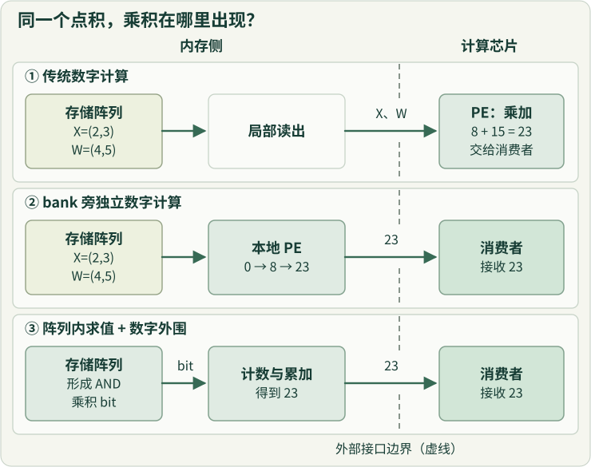
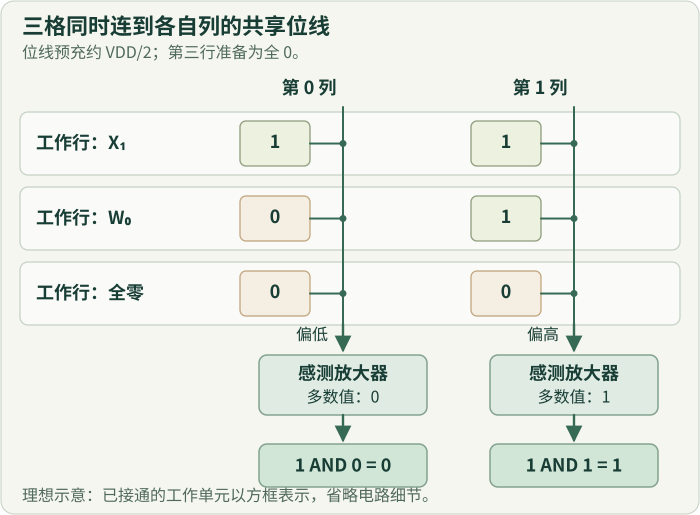
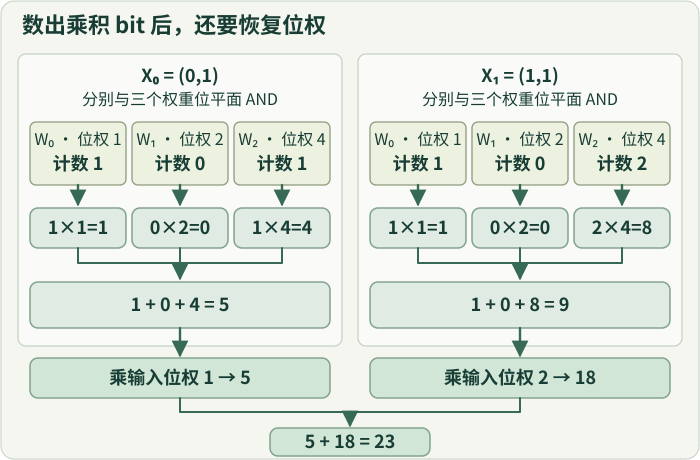

# 如果把计算单元放到存储器旁边或内部，会发生什么？

在[D02](../04-compute-arrays/d02-stationary-dataflows-and-reuse.md)中，我们尝试将权重留在计算单元附近，减少重复搬运。但对于尚未留在计算侧本地存储中的权重，运算时仍要从远处读入。

还有一种方法：不是把数据送到原来的计算单元，而是将运算电路放到数据所在的位置附近。甚至可以让存储阵列本身参与运算。这就是近存计算与存内计算试图改变的事情。

下面用同一个点积，比较三种计算路径。我们不仅关心最后的答案，还关心第一个乘积在哪里产生，以及哪些数据必须经过存储器的对外接口。

## 为什么算一个点积还需要搬运数据？ {#ordinary-computation}

设输入向量 X = (2, 3)，权重向量 W = (4, 5)。为了便于追踪二进制运算，本例规定输入为两位无符号整数，权重为三位无符号整数。

希望得到：

**y = 2 × 4 + 3 × 5 = 23**

假设第一次计算开始前，X 和 W 都已存入内存；计算侧没有它们的副本。最后要让计算芯片上的消费者取得 y。这是一项教学任务，后面各种实现都保持这个初始位置和结果交付条件。

按照[A03 的乘加机制](../01-foundations/a03-multiplication-and-accumulation.md#mac)，计算芯片上的一个处理单元（PE）可以先取得操作数 2 和 4，计算乘积 8，并将它保存到累加寄存器中。

然后取得 3 和 5，生成乘积 15，将它与旧的部分和 8 相加，得到 23。这时结果已在计算侧，可以交给下一项运算使用，也可以根据任务要求另外写回内存。

在第一次乘法发生时，2 和 4 已经离开原来的存储单元。它们经过了存储阵列的读出电路、内存侧的局部数据通路、存储与计算芯片之间的接口，以及计算侧的接收与缓冲电路。

不论完成算术需要多少电路，这些路径上的信号变化都需要时间和能量。单位时间内能够跨过接口的数据量也有限。在[存储层级中的数据搬运分析](../../storage/01-memory-hierarchy/01-system-basics/locality-working-set-data-movement.md)里，我们已看到：同一个请求的数据量与实际搬运的数据量还可能不同。

当一项计算依赖大量此前不在计算侧、且短时间内难以复用的存储数据时，这些传输就可能成为主要约束。

## 如果让数据少走一段路呢？ {#near-memory}

假设将刚才的 PE 从计算芯片搬到存储器的 bank 旁。这里的一组 bank 提供本地存储访问，PE 通过局部通路取得操作数。其内部仍然是数字乘法器、加法器以及累加寄存器。

现在 2 和 4 仍须从存储单元读出，但不必穿过内存与计算芯片之间的接口。乘积 8 在 bank 旁产生，保存为本地部分和。第二次乘加后，23 也已经在内存侧。

计算芯片的消费者只需要取回结果 23，不必再把四个操作数读回去。改变的是乘加器的物理位置，不是二进制乘法的计算规则。

这种组织可利用较宽的局部数据路径，避开一部分对外接口的服务限制。为 bank 配置独立的 PE，还可以让多个 bank 并行处理不同的数据。但并行程度取决于本地端口、计算资源及共享路径的服务能力。

真实器件中，Samsung 在 2021 年 Hot Chips 33 展示的 Aquabolt-XL 就把计算单元放在 HBM 存储核心 die 的 bank 旁。其计算单元接入局部数据总线，具备寄存器组、控制器以及 16 路 FP16 SIMD 乘法和加法电路。

在这种实现中，外部内存命令提供访问地址，并可在计算模式下触发已配置的局部指令。计算单元使用局部读出的数据与寄存器中的操作数完成算术。它不是用普通 DRAM cell 直接形成浮点乘积。本文的整数点积也不是对该芯片的性能或指令日程测量。[Aquabolt-XL 的原始架构说明，第 8–10 页](https://hc33.hotchips.org/assets/program/conference/day1/20210813_HC33_Aquabolt-XL_PIM_Jin_Kim_slide.pdf#page=8)

如果只统计内存侧与计算芯片之间传递的有用数值，并假设完全紧密地编码，原方案读出两份二位输入和两份三位权重，共 10 bit。

bank 旁计算只需返回结果。要表示本任务格式下所有可能的点积，最大值为 2 × 3 × 7 = 42，因此固定使用六位无符号结果。此处跨接口的有效数值信息是 6 bit。

这 10 bit 与 6 bit 只是教学模型的有效载荷，不是实际总线事务字节数，不含命令、地址、填充和协议开销。开始前若由主机提供输入，还需要把输入送到存储侧。

## 如果存储阵列能直接交出运算结果呢？ {#in-array}

上面的 bank 旁计算仍然需要读出完整的 2 和 4，再由一个独立的乘法器产生 8。存储阵列提供的还是原来的数据。

有没有可能在阵列读取过程中就形成一部分计算结果？这样，阵列不必向独立运算单元交付所有原始操作数。

<figure class="micro-diagram" style="max-width:760px; margin:1.2rem auto" tabindex="0" aria-label="比较计算芯片PE、bank旁PE和参与求值的存储阵列三种数据路径，窄屏可横向滚动" markdown="1">

<figcaption>虚线表示内存侧与计算芯片之间的接口边界。各图只画出数值路径，省略命令、地址及返回确认。第三种路径所需的阵列求值机制将在下面推导。</figcaption>
</figure>

这三种方案首先改变的是**计算发生的位置**。为了避免名称造成混淆，本文沿用[旧版存内计算专题的位置口径](../../microarchitecture/08-in-memory-computing/01-overview/cim-pim-nmc-taxonomy.md)：

- 存储 die 外、靠近存储器的独立计算逻辑称为近存计算（Near-Memory Computing，NMC），例如堆叠内存的独立逻辑底座上的计算单元。
- 存储 die 内、bank 旁与存储阵列分开的独立处理逻辑，本 Wiki 进一步记为 PIM。
- 当存储单元、位线或读出电路本身参与求值时，记为存内计算（Compute-In-Memory，CIM）。

这些名称在文献中不完全统一。例如 [A Modern Primer on Processing in Memory](https://arxiv.org/abs/2012.03112) 将 PIM 用作广义名称，并区分利用存储结构计算与靠近存储的处理逻辑。

NMC 和本文狭义的 PIM，都是将独立处理逻辑放到存储数据附近的方式。判断一个实现，不应只看名称，而要能指出原始操作数在哪道边界之前变成了哪一种结果。

另外，计算位置与数值求值方式是两个不同的维度。bank 旁的 FP16 乘加器是数字电路，但这并不意味着阵列完成了数字存内计算。下面研究怎样让阵列产生离散的逻辑计算结果，而不只是原样读出存储值。

## 怎样让同一条位线给出两个 bit 的 AND？ {#bitwise-in-memory}

先缩小问题，不急着让存储器完成两位数和三位数相乘。回到[A03 的部分积](../01-foundations/a03-multiplication-and-accumulation.md#partial-products)：两个单独的比特相乘，只有二者都是 1 时乘积才是 1。这与 AND 的真值表相同。

如果存储阵列能在读出时完成两个存储位的 AND，最小的一步乘法就已经移到了阵列中。

以 DRAM 为例。在[普通 DRAM 的感测与恢复](../../storage/03-dram/foundations/1t1c-cell-destructive-read.md)中，一列有多个存储电容，通过访问晶体管连接到共享位线。

普通读先把位线预充到约 VDD/2，再连接选中行的存储单元。若单元存 1，位线电压略微升高；若存 0，位线电压略微降低。感测放大器随后将微小差异判决成一个确定的比特，并恢复被读出的电荷状态。

现在改变一项条件：在同一子阵列内，选三行单元同时接到同一列的位线上。暂时假设三个单元电容相等，充放电状态理想，且感测电路能可靠判决。

如果三格存的是 1、1、0，两份高电压单元与一份低电压单元共同影响位线，电荷共享后的电压偏向高侧。反过来，1、0、0 会让位线偏向低侧。

这里感放输出的是三个比特的多数值：两个或三个为 1 时，输出 1；其余情况输出 0。

将第三个单元固定为 0。这时要让多数值为 1，前两个单元就必须都存 1。于是得到两个操作数的 AND。

| 第一个 bit | 第二个 bit | 第三格固定值 | 感测结果 |
| ---: | ---: | ---: | ---: |
| 0 | 0 | 0 | 0 |
| 0 | 1 | 0 | 0 |
| 1 | 0 | 0 | 0 |
| 1 | 1 | 0 | 1 |

<figure class="micro-diagram" style="max-width:720px; margin:1.2rem auto" tabindex="0" aria-label="两列在三行同时激活时分别判决为0和1，形成两个AND结果，窄屏可横向滚动" markdown="1">

<figcaption>理想化的 DRAM 三行激活示意。方框表示已接通的工作单元，连线表示同一列共享的位线，省略访问管及存储电容的电路细节。向下的箭头表示数据的感测与交付方向。图中不是实际器件的电压测量结果。</figcaption>
</figure>

这一机制来源于 Seshadri 等人在 2017 年提出的 Ambit 研究。它利用 DRAM 内部的电荷共享执行按位 AND、OR，并基于电路仿真以及系统评估验证所提方案。虽然求值过程依赖模拟电压变化，向后续逻辑交付的却是离散的一位结果，而不是表示多位乘加和的模拟量。

感放会把判决结果恢复到参加操作的三个单元，覆盖原值。因此 Ambit 在同一子阵列中预设工作行：先把两个操作数行及全零控制行复制到工作行，求值后再把结果保存到指定位置。

这些额外的行、复制及译码控制都是实现成本。不能假定普通 DRAM 就能同时激活任意三行，并安全地完成相同运算。[Ambit 原论文第 3 节](https://research.ece.cmu.edu/safari/pubs/ambit-bulk-bitwise-dram_micro17.pdf#page=4)

## 怎样从两个 bit 的 AND 恢复完整的乘加？ {#bit-plane}

现在回到 X = (2, 3)，W = (4, 5)。根据二进制表示，输入的二位编码分别为 `10`、`11`，权重的三位编码分别为 `100`、`101`。

若要让阵列同时处理点积中的两项，就需要把数据组织成适合刚才的按列求值方式。将点积的第 0 项放在第 0 列，第 1 项放在第 1 列。

但每个输入或权重有多个比特。可以把两个数的同一位放到同一行，形成一个**位平面**（Bit Plane）。

| 阵列中的一行 | 第 0 列：2 配 4 | 第 1 列：3 配 5 | 位权 |
| --- | ---: | ---: | ---: |
| X₀（输入低位） | 0 | 1 | 1 |
| X₁（输入高位） | 1 | 1 | 2 |
| W₀（权重低位） | 0 | 1 | 1 |
| W₁（权重中位） | 0 | 0 | 2 |
| W₂（权重高位） | 1 | 1 | 4 |

因此，X₁ = (1, 1)，W₀ = (0, 1)。从两者各复制一行到指定工作位置，再准备全零的第三行，就得到上一张图中的两列状态。

左列是 1 AND 0，输出 0；右列是 1 AND 1，输出 1。这次阵列交出的不是四个原始操作数 bit，而是两个乘积 bit。

这两个 bit 属于不同的点积项。要计算点积结果，除了执行乘法，还必须将同一位权的乘积相加。可以在阵列外围连接数字加法逻辑，统计这次输出中有多少个 1。

这种统计称为 **Population Count（Popcount）**。本例只有两个输出位，直接将两个一位整数相加即可得到 0、1 或 2，因而至少需要两位来表示计数。

接下来要记住这些 1 原来是哪两个位平面相乘产生的。本次选的是 X₁ 与 W₀，输入位权为 2，权重位权为 1。因此一个 1 代表的真实乘积贡献是 2 × 1 = 2。

### 为什么要计算六组位平面？

一个两位输入与一个三位权重相乘，有 2 × 3 = 6 对比特需要求积。本例中，每对位平面在同一行操作中分别处理两个点积项，得到两个乘积 bit。

每组先得到两个 AND 输出，再通过 Popcount 得到计数，最后按输入和权重的位权进行加权。全部过程如下：

| 输入与权重位平面 | 两列的 AND 输出 | Popcount | 乘积位权 | 对 y 的贡献 |
| --- | --- | ---: | ---: | ---: |
| X₀ 与 W₀ | (0, 1) | 1 | 1 | 1 |
| X₀ 与 W₁ | (0, 0) | 0 | 2 | 0 |
| X₀ 与 W₂ | (0, 1) | 1 | 4 | 4 |
| X₁ 与 W₀ | (0, 1) | 1 | 2 | 2 |
| X₁ 与 W₁ | (0, 0) | 0 | 4 | 0 |
| X₁ 与 W₂ | (1, 1) | 2 | 8 | 16 |

先将输入低位平面的三份贡献相加，得到 1 + 0 + 4 = 5。高位平面的三份贡献则是 2 + 0 + 16 = 18。

最后将所有贡献合在一起，**y = 5 + 18 = 23**。

<figure class="micro-diagram" style="max-width:700px; margin:1.2rem auto" tabindex="0" aria-label="低位输入和高位输入分别产生计数及加权结果，最终得到23，窄屏可横向滚动" markdown="1">

<figcaption>图中先按权重位权求出两个输入位平面的部分和，再按输入位权合并。它与表中直接对每个计数乘上两个位权等价，并不是另一种数值算法。</figcaption>
</figure>

一般地，输入第 i 位的位权为 2i，权重第 j 位的位权为 2j。记 Cij 为对应位平面相与之后数出的 1 的个数，则无符号点积为：

**y = ∑i ∑j 2i+j Cij**

在本例中 i = 0, 1，j = 0, 1, 2，Cij ∈ {0, 1, 2}。数字外围可以直接把计数左移 i+j 位，累加到六位结果寄存器中。

注意，数两个 1 不能只报告“这一行有没有 1”。例如 X₁ 与 W₂ 会生成两个 1。如果只用一个 OR 输出，最后一组就会少计一个位权为 8 的乘积，结果从 23 变为 15。

这里没有任何一处必须先把完整的乘积 8 和 15 分别写入寄存器。原来的乘法被拆成单 bit 求积，每份相同位权的贡献先跨列相加，再按位权累加。数学结果没有改变，改变的是产生和聚合部分积的位置。

### 六组计算是不是只需要六拍？

不一定。六组是数学上的工作分解，不是固定的执行时序。

对于刚才的 DRAM 教学实现，需要提供工作行、两行操作数的复制、零行初始化、三行激活、感测、结果保存，以及将所需结果交付给数字外围。若只提供一组工作行，就不能在相同工作行内同时处理多个位平面对。

若硬件提供更多独立阵列及计算资源，可以让不同位平面对并行求值，但也可能需要复制数据或增加归约电路。

本文增加的 Popcount 和数字累加器是假设的存储侧外围。Ambit 原论文支持按位运算机制，并不声称它本身就提供了这里的完整点积路径。

真实的数字存内计算还可以采用其他结构。例如 2021 年的 [Colonnade 研究](https://pure.kaist.ac.kr/en/publications/colonnade-a-reconfigurable-sram-based-digital-bit-serial-compute-/)使用定制 SRAM 单元中的数字计算电路实现位串行乘加，支持可配置输入与权重的位宽。它并不要求采用刚才的 DRAM 三行激活和同样的外围计数方案。

对于任一数字求值方案，都要检查数值表示的正确性。本例只支持无符号整数。若用补码表示负数，符号位的权重需要取负，计数后的加权与累加电路也要遵守[A03 的有符号部分积规则](../01-foundations/a03-multiplication-and-accumulation.md#signed-products)。数字计算并不意味着可以忽略判决错误、有限位宽或溢出。

## 如果两个点积项存放在不同阵列，谁来得到 23？ {#cross-array-reduction}

目前的两个点积项在同一个阵列的两列中，数字外围可以直接统计每一组 AND 的结果。实际上，大向量不一定放得进一块阵列，也可能被分散到不同 bank 中。

为看清归约问题，假设将本例两个点积项分别放到阵列 A 和阵列 B。

- 阵列 A 只有输入 2、权重 4 的对应位。将本地六组乘积位加权累加，得到 8。
- 阵列 B 只有输入 3、权重 5 的对应位。用相同方式得到 15。

两处都完成了自己的计算，但没有任何一处已经保存 23。

若在内存侧提供一个共享加法器，可以让两个阵列分别送出 8 和 15。在加法器完成 8 + 15 之后，只把 23 送到计算芯片。

若没有这样的存储侧归约通路，则要把两个部分和返回计算芯片，由计算芯片的加法器合并。哪种方案跨外部边界的数据量更少，取决于结果归约的位置及结果编码宽度。

在实际系统中，不同阵列可能先后交付各自的贡献。共享加法器需要知道它收到的是哪个输出元素的哪一部分，并保证每份部分和恰好使用一次。只有全部必要贡献完成，完整输出才能交给后续消费者。

如果第一个部分和还未被读取，本地寄存器又被下一项任务覆盖，就不能通过重新安排最后一次加法恢复正确结果。这里仍要遵守[F02 的任务完成与同步条件](../06-resource-cooperation/f02-task-control-and-synchronization.md)。

对于矩阵运算，还可将不同输出元素分配给不同阵列。若每个阵列产生的都是完整的输出元素，就不用相互求和，但仍可能需要分发共同的输入。数据怎么分块，会决定是否需要共享归约。

因此，局部完成不等于完整任务完成。[G01 的归约机制](../07-specialized-compute/g01-specialized-functions-and-reduction.md)中的加法树、流水线和中间状态仍然需要，只是它们现在处理的是从存储侧返回的部分和。

## 减少外部搬运，是否就意味着运算更便宜？ {#costs}

先回到单个完整点积，并假设存储侧可以完成全部归约。三种方案的交付过程如下。

| 实现 | 阵列与独立计算电路之间主要传什么 | 经过内存对外接口的有用数值 |
| --- | --- | ---: |
| 计算芯片上的 PE | 原操作数 | 10 bit：两份 X、两份 W |
| bank 旁的数字 PE | 原操作数 | 6 bit：最终结果 |
| 阵列产生 AND，数字外围累加 | 乘积 bit，而非完整操作数 | 6 bit：最终结果 |

后两种方案都减少了这次跨外部边界的有效数值流量。但从表中不能推出阵列内求值一定比 bank 旁的方案快。

对于 bank 旁的 PE，原始操作数仍须经过阵列读出、局部传输、寄存器和运算单元。对数字 CIM 教学方案，仍要准备位平面、处理工作行中的复制和感测、传递乘积 bit、累加及跨阵列归约。各段的数据量、可并行程度和每次操作成本并不相同。

### 哪些情况下外部搬运的收益更大？

前面的计算假设计算芯片还没有 X 和 W 的本地副本。

如果将任务放大为大量权重与一个输入向量的乘加，权重不能全部保留在计算侧，每次计算都要再读一次，那么将运算放到权重旁就可能避免大量重复的跨接口传输。

但如果普通 PE 可以将同一份权重保存在本地缓冲区，为多组输入反复使用，就已经避免了部分重复搬运。此时应该把近存或存内计算与采用相同复用条件的传统方案比较，而不是继续使用每次都搬运全部权重的基线。

[D02](../04-compute-arrays/d02-stationary-dataflows-and-reuse.md#traffic)已经展示怎样按数据驻留方案重新计算流量。[H01](../08-performance/h01-task-time-and-bottlenecks.md)进一步解释，减少某条路径的工作量，只有改变决定任务完成时间的约束时，才会缩短完整任务时间。

### 新增的电路和工作有哪些代价？

| 需要考虑的问题 | 可能出现的代价 |
| --- | --- |
| 能保存多少数据？ | 存储单元附加运算电路、专用工作行、局部缓冲和更大的外围都可能降低有效 bit 容量或存储密度。 |
| 怎样达到要求的精度？ | 位宽扩大可能需要更多轮求值、更宽的计数及累加器；感测须满足可靠判决的要求。 |
| 能支持哪些计算？ | 阵列的求值功能通常有限。未支持的运算仍要由独立计算单元处理，并交接中间结果。 |
| 需要什么控制？ | 需要明确访问与运算模式、阵列位置、命令、数据准备及完成条件；必要时还要协调资源共享与可见性。 |
| 实际需要多少时间和能量？ | 需要合计布局、读写、计算、局部传输、归约、交付及等待；不能只使用阵列执行某项逻辑运算的指标。 |

特别是实际数据按普通整数布局保存时，本例的 CIM 方案还要将输入和权重准备成位平面。若这一转换只执行一次，可供很多次运算复用，成本可以分摊；若每次执行都要重新排列并写入，成本可能较高。

所以，本文的 10 bit 和 6 bit 只能帮助理解哪条路径少传了数值，不能说明整体能耗下降了 40%，也不能用来推导整颗芯片的吞吐率。

## 回到最初的问题：计算放得更近，改变的到底是什么？ {#summary}

同一个点积，在传统数字计算中，2 和 4 要先传到计算侧，乘积在那里产生。在 bank 旁计算中，完整的输入和权重还需要被读出，但乘加和本地归约可以在内存侧完成。

数字存内计算则进一步将一部分求值交给存储阵列。只要后续设备可以根据离散结果正确地计数、加权和累加，就不必让原始操作数全部离开阵列后再执行原来的乘法。

当阵列只能给出一位判决时，两个多位数的乘积还需要多组位平面及数字外围来合成。那么，有没有一种办法使阵列内的物理量本身就代表乘积，并让多个乘积直接在同一处汇合？

下一篇将继续使用 X = (2, 3)、W = (4, 5) 的点积，观察模拟存内计算怎样改变数值的承载方式。

进一步了解具体介质、数字存内计算的位串行排程及 bank 级计算，可以选读旧版的[存储器件与计算路径](../../microarchitecture/08-in-memory-computing/02-memory-technologies/README.md)及[数字存内计算的深入分析](../../microarchitecture/08-in-memory-computing/03-compute-paradigms/digital-cim-deep-dive.md)。

[返回其他计算范式导读](README.md)。
