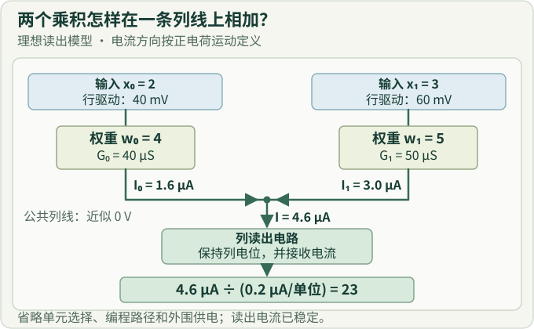
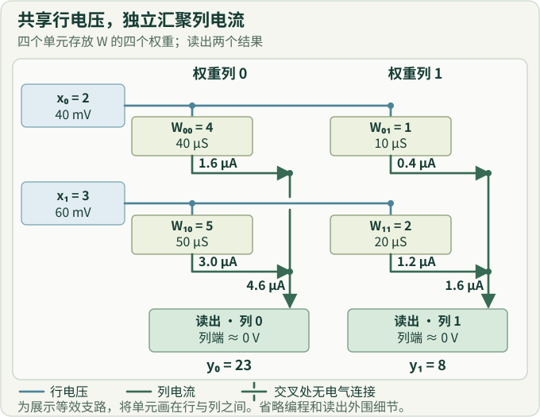
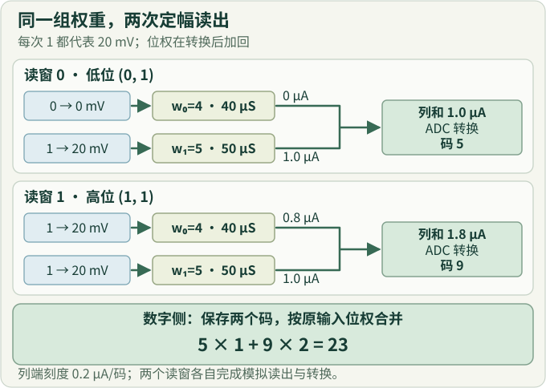

# 怎样利用模拟电路完成矩阵乘加？

在 [I02](i02-near-memory-and-digital-cim.md) 中，我们要计算两个乘积之和：2 × 4 + 3 × 5 = 23。把运算的一部分放进存储阵列的读出路径，权重就不必每次都作为完整的数字送到外部乘法器。

那时我们仍然用离散的比特表示操作数，利用逻辑运算、计数和移位得到结果。如果让一条支路的电流代表乘积，再让多个支路的电流汇到一起，是否可以直接在阵列中得到点积？

这就是**模拟存内计算（Analog Computing-in-Memory，Analog CIM）**的一种实现思路：让存储单元保持的状态参与运算，并用电流、电压或电荷等模拟量表示运算结果。下面仍然跟踪输入 (2, 3)、权重 (4, 5)，看看 23 怎样从数字变成模拟信号，又怎样变回数字。

## 一个存储单元怎样产生乘积？ {#multiply}

[A03](../01-foundations/a03-multiplication-and-accumulation.md#partial-products) 中的数字乘法器，通过逻辑门生成部分积，按二进制位权相加。数字电路用具有容差的高低电平表示比特，乘法的结果由一组比特表示。

现在不急于得到这些比特。先观察一个电阻：如果它的两端有电压差，就有电流流过它。在满足欧姆定律的工作范围内，电流 I 等于两端电压差 V 除以电阻 R。

**I = V/R = V × G**

其中 G = 1/R 为**电导（Conductance）**，单位是西门子（S），表示器件有多容易导电。如果电导不变，增大电压会按比例增大电流；如果电压不变，增大电导也会按比例增大电流。参见 [OpenStax：欧姆定律及其适用条件](https://openstax.org/books/university-physics-volume-2/pages/9-4-ohms-law)。

我们需要的是两个数相乘。能否让输入代表电压，让权重代表电导？这样，流过器件的电流就可以同时体现两个数的大小。

设本篇的理想读出模型采用以下刻度：

- 每 1 单位输入对应电压差 Vₛ = 20 mV，即 0.02 V。
- 每 1 单位权重对应电导 Gₛ = 10 µS，即 0.00001 S。
- 存储单元已经按目标权重编程。读出时，电导在所用电压范围内近似恒定，读操作不改变已存的状态。

输入 x = 2、权重 w = 4 时，我们施加 40 mV、电导为 40 µS，得到电流 1.6 µA。若输入改为 3，电导保持不变，则同一单元产生 2.4 µA。

因为 V = Vₛx、G = Gₛw，所以：

**I = VₛGₛ × xw**

VₛGₛ = 0.2 µA。只要把测得的电流除以这个刻度，就能得到它表示的数值乘积。本例的 1.6 µA 对应 8，2.4 µA 对应 12。电流本身并不是整数 8 或 12；读出电路必须知道约定的刻度。

某些阻变存储器（Resistive RAM，ReRAM 或 RRAM）能通过编程保持不同的电导状态，因此可以用作这样的存储与运算元件。具体读压、可分辨的电导范围、写入及保持特性取决于器件；本文的电压与电导是教学假设，不是实测参数。[阻变存储器的电导编码与读出（选读）](../../microarchitecture/08-in-memory-computing/02-memory-technologies/reram-as-compute-element.md)

## 怎样在同一列中得到两个乘积的和？ {#column-sum}

我们已经可以用支路电流表示一个乘积。现在增加第二个存储单元，让它保持对应权重 5 的电导 50 µS。

第一行接 40 mV，第二行接 60 mV；两条支路的另一端接到同一条列线上。假设列端的读出电路将列线保持在近似 0 V，并接收汇入的电流。忽略连线压降、寄生电容瞬态、泄漏及其他支路，等读出信号稳定后观察电流。

<figure class="micro-diagram" style="max-width:680px; margin:1.2rem auto" tabindex="0" aria-label="两条电导支路汇入同一列的理想点积，窄屏可横向滚动" markdown="1">

<figcaption>理想电流域计算。箭头表示约定方向的电流，两路输入驱动和读出电路共用电压参考；省略编程和选择电路、供电与寄生参数。</figcaption>
</figure>

在第一条支路，40 mV × 40 µS = 1.6 µA；在第二条支路，60 mV × 50 µS = 3.0 µA。两个单元都保持原有的电导状态，没有先输出完整的二进制权重 4 和 5。

电流是单位时间通过某处的电荷量。若节点不再积累净电荷，流入节点的总电流就等于流出的总电流。这是[基尔霍夫电流定律](https://openstax.org/books/university-physics-volume-2/pages/10-3-kirchhoffs-rules)的依据。所以两路电流汇到列线上时，读出电路必须接走 1.6 + 3.0 = 4.6 µA。

按先前约定的刻度换算，有 **4.6 µA ÷ 0.2 µA = 23**。这就是我们需要的点积。

关键在于，两个支路各自形成乘积的模拟信号，电流在公共列线上直接相加。在这个理想模型中，不需要先分别将两个乘积读成数字 8、15，再使用数字加法器求和。真实的电流域阻变阵列运算可以参见 [Hu 等人的 Dot-product Engine，DAC 2016，图 1](https://www.labs.hpe.com/techreports/2016/HPE-2016-23.pdf)。

列端如果没有保持在原先约定的电位，单元两端的电压差就会改变。因此「把电流接到一起」还不够；驱动、公共电压参考与读出电路都是这个计算机制的一部分。

## 将多列连接到同一组输入，会得到什么？ {#matrix-vector}

上一节只有一列权重。现在保持输入 x = (2, 3) 不变，增加第二列权重 (1, 2)。我们需要同时得到两个结果：

- y₀ = 2 × 4 + 3 × 5 = 23。
- y₁ = 2 × 1 + 3 × 2 = 8。

可以用两条行线和两条独立的列线连接四个存储单元。第一行电压从同一个驱动器到达两个单元，第二行电压也同样共享。每个交叉位置的单元有自己的电导。

<figure class="micro-diagram" style="max-width:680px; margin:1.2rem auto" tabindex="0" aria-label="两行两列阵列执行矩阵向量乘法，窄屏可横向滚动" markdown="1">

<figcaption>同一行电压驱动多个权重单元，每列独立汇聚电流。每个标出的连接位置通过存储单元连接到列线；行与列没有直接短接。两个列端都由读出电路保持在 0 V 附近。</figcaption>
</figure>

定义 Wij 为第 i 行、第 j 列的权重，xi 为该行的输入，yj 为第 j 列的点积。每个单元的电导按相同刻度设置为 Gij = GₛWij，行电压为 Vi = Vₛxi。在前面的理想条件下，列 j 汇聚的电流是：

**Ij = ∑i ViGij = VₛGₛ ∑i xiWij = VₛGₛyj**

用矩阵表示，这是行向量乘矩阵 y = xW。本例 W 的两行分别为 (4, 1)、(5, 2)，所以输出向量为 (23, 8)。如果把权重的排布转置，写成列向量的矩阵乘法也可以，关键是弄清每个输出的归约维度对应阵列中的哪一组支路。

这种把存储单元布置在行列交叉位置的结构称为**交叉阵列（Crossbar）**。在电压与电导保持约定比例、各列可以同时读出的理想条件下，所有行列交叉位置的乘积一起产生，属于同一列的乘积汇聚成一个点积。

[D01](../04-compute-arrays/d01-macs-and-array-data-paths.md) 中的计算阵列，则在数字 PE 中产生乘积和部分和，再用数据路径交接。二者的数学依赖关系相同；不同的是产生乘积、保存权重和求局部和的物理机制。

## 为什么还需要外围电路？ {#converters}

此时列端电流已经体现 23，但数字处理单元不能直接把 4.6 µA 当作整数 23 存进寄存器。如果下一级使用数字数值，还要完成一次转换。

输入也有同一个问题。上一级送来的是二进制编码的 2、3，阵列需要的是电压。将数字码转换为模拟量的电路称为**数模转换器（Digital-to-Analog Converter，DAC）**。

本例若按输入幅度直接编码，DAC 需要将输入码 0、1、2、3 分别变成 0、20、40、60 mV，并通过行驱动器让实际行线上建立相应电压。

输出端的**模数转换器（Analog-to-Digital Converter，ADC）**将模拟量转换为有限的数字码。读出电路可先把电流转换成电压或积分成电荷，再由 ADC 采样和转换；并不是所有 ADC 都直接接受列电流。

本例假设整个读出与转换路径的等效刻度为每码 0.2 µA、无偏置、舍入到最近码，超量程时钳在端点。后文沿用该教学模型。

例如，4.6 µA 正好对应码 23。保留这份结果至少需要 5 位无符号数。若输入始终是两位无符号数（最大 3），权重是三位无符号数（最大 7），两项点积最大为 2 × 3 × 7 = 42；固定每码一个点积单位时，完整覆盖 0 至 42 需要至少 6 位，而不仅仅是 5 位。

阵列、输入编码和驱动电路、模拟读出与转换电路、寄存器、数字累加与控制电路，通常共同构成一个**计算宏（Compute Macro）**。需要从接收输入到交付结果跟踪它们，而不能把阵列单独看成一颗能主动收发数字的处理器。

## 如果驱动和存储单元不能可靠区分很多个幅度呢？ {#bit-planes}

用电压幅度表示输入时，增加输入位数意味着需要区分更多电压。如果驱动器和读出电路只需要区分两档输入，是否也能完成原来的点积？

### 把输入按位拆开

原来的输入 2、3 分别为 `10`、`11`。先发送两个输入的最低位 (0, 1)，再发送最高位 (1, 1)。每一窗的 1 都只对应相同的 20 mV，与其在原数中的位权无关。

| 输入位平面 | 行 0 电压 | 行 1 电压 | 列电流 | 理想读出码 |
| --- | ---: | ---: | ---: | ---: |
| 低位 (0, 1) | 0 mV | 20 mV | 0 + 1.0 = 1.0 µA | 5 |
| 高位 (1, 1) | 20 mV | 20 mV | 0.8 + 1.0 = 1.8 µA | 9 |

权重 4、5 始终保存在原来的两个单元中。第一窗只让第二行产生电流，第二窗让两行都产生电流。输出在每个窗内依然是多个模拟信号的和。

<figure class="micro-diagram" style="max-width:680px; margin:1.2rem auto" tabindex="0" aria-label="两个读窗分别得到局部电流并转换成数字后按位权合并，窄屏可横向滚动" markdown="1">

<figcaption>每个窗分别采样、转换和保存结果；不是将两窗电流直接相加。箭头表示信号传递而非电流方向；读窗只表示有先后关系的读出阶段，不限定真实芯片每个阶段的时钟拍数。</figcaption>
</figure>

低位的部分和 5 应按权重 1 计入，高位的部分和 9 应按权重 2 计入。因此数字端把高位结果左移一位，再与低位结果相加：**5 + 2 × 9 = 23**。

这样，驱动器不再需要产生四档电压。每一窗最多求两个三位无符号权重之和，最大码为 14，理想转换只需要 4 位。数字端仍然要有足够宽的累加结果位宽（覆盖所有输入时至少 6 位）。减少了每次转换所需的幅度范围，却增加了读窗数、转换次数与数字状态。

### 权重也可以分开保存

如果电导只能可靠表示较少的等级，也可以将权重分配到不同的物理单元，或用多个阵列保存各自的位平面。

例如权重 4 = `100`、5 = `101`。若把它们分成三个阵列列组，仍以完整输入 (2, 3) 驱动，三组权重从低位到高位分别为 (0, 1)、(0, 0)、(1, 1)。相应点积为 3、0、5。

假设能准确实现这一二值权重乘法，数字端得到 **3 + 2 × 0 + 4 × 5 = 23**。

这两种拆分可以组合使用。一种直接实现是对每个输入位平面分别读取每个权重位平面，再将得到的部分和按对应的输入位权与权重位权乘积加权。这与 A03、I02 的部分积具有同样的数学关系，但部分和是在模拟域产生的。

权重分拆会增加单元数、转换或积累工作；真实设计可以共享或合并某些步骤。参见 [Crafton 等，DAC 2022，图 1](https://bpb-us-e1.wpmucdn.com/sites/gatech.edu/dist/e/220/files/2022/12/Crafton2022DAC.pdf) 中的多单元权重、逐位输入和读出移加机制。

上述模型的零电导表示理想零贡献。实际器件的最小电导可能不为零，需要采用差分、参考或其他编码抵消不需要的背景贡献。

### 电导没有负值，怎样表示负权重？

如果把第二项权重从 5 改成 −5，目标结果是 2 × 4 − 3 × 5 = −7。不能将一只无源电导单元直接设置成 −50 µS。

一种方法是为每个权重准备两个非负电导，约定 G⁺ − G⁻ = Gₛw。仍然使用原来的输入电压，例如把两个权重的电导差分别编码为 50 − 10 = 40 µS 和 10 − 60 = −50 µS。

正组列电流为 40 mV × 50 µS + 60 mV × 10 µS = 2.6 µA；负组列电流为 40 mV × 10 µS + 60 mV × 60 µS = 4.0 µA。两列相减得到 −1.4 µA，按同一刻度换算为 −7。

这种取差可以在适当的模拟读出电路中完成，也可以先转换正负两组再在数字端完成。两种实现所需的量程和误差条件不同。带符号输入也需要专门表示，可以使用正负极性的驱动、两个非负输入组，或在补码逐位处理时对最高位使用负位权。[A03](../01-foundations/a03-multiplication-and-accumulation.md) 已经介绍补码部分积的权重。

不同设计不必采用相同的编码。例如 [NeuRRAM 原论文，图 2h 及图 3e、3f](https://www.nature.com/articles/s41586-022-04992-8.pdf) 的差分权重采用相邻行单元，前向计算使用差分输入；部分输入位权通过模拟积分累加，更高输入位宽的部分结果在数字侧合并。

## 电路确实完成了加法，就一定能读回正确答案吗？ {#errors}

先保持两窗方案的读出条件不变，仅将 ADC 从理想 4 位改成 3 位，每码仍对应 0.2 µA。虽然第一窗的电流 1.0 µA 可以读为 5，但第二窗的 1.8 µA 超出了新量程。3 位转换器最高只能给出码 7，不能给出 9。

数字端因此得到 5 + 2 × 7 = 19，而不是 23。此时阵列中乘积与求和都符合理想模型，错误发生在转换阶段。数字累加器即使加宽，也没有原本丢失的信息。扩大 ADC 量程而保持相同的码数，则会使每个码代表的电流间隔更大，也可能丢失细小的差异。

再做一个独立的实验。恢复 4 位 ADC，但假设第二个单元的实际电导为 56 µS，而不是目标的 50 µS。此时低位窗电流为 1.12 µA，高位窗为 1.92 µA。按原来的理想转换刻度，分别四舍五入到最近码，得到 6、10。

这次数字端得到 6 + 2 × 10 = 26。转换前的码单位数值 5.6 + 2 × 9.6 = 24.8 已偏离了 23，而两次舍入进一步改变了结果。权重偏差跨两个窗重复出现；读出的 26 不是仅由 ADC 位数决定的。

真实计算中，还要沿路径逐段检查非理想因素：

| 哪一段 | 发生了什么 | 为什么影响结果 |
| --- | --- | --- |
| 权重保存 | 器件差异、编程误差、保持状态漂移 | 电导不再等于目标权重对应的值 |
| 输入与阵列 | 驱动偏差、线阻压降、非线性与寄生支路 | 每只器件实际获得的电压差或电流不再与输入、权重成理想比例 |
| 读出与转换 | 噪声、参考和增益误差、有限的量程及分辨率 | 列端模拟量可能跨过另一码的判决门槛或饱和 |

某些误差会固定地偏大或偏小，某些会在每次读取时变化。校准可以补偿某些系统性误差，但不能假定重复读取就能消除所有误差。器件写入、漂移和短时噪声等问题可参见 [Rasch 等，Nature Communications 2023](https://www.nature.com/articles/s41467-023-40770-4) 的模型与实验分析。

ADC 位数决定标称输出码的数量；给定模拟量程后，才可确定理想的码间距。这并不代表整个点积的有效精度。模型使用 INT8、ADC 使用 8 位输出、最终任务达到某种识别准确率，是三个不同的问题。

数字外围也可能需要缩放、舍入或格式转换，不能将几个精度数字直接等同。相关的精度和累加位宽已在 [A04](../01-foundations/a04-floating-point-and-low-precision.md) 中讨论。

## 如果换成另一种存储介质，还能用同一个模型吗？ {#other-mechanisms}

不一定。I02 已经说明，存储阵列本身可以保存数字状态，却在读出时利用物理信号进行判决。不能只看哪种存储器参与计算，也要看求得的局部和是怎样表示的。

在本篇模型中，单元电导代表权重，列电流代表局部和。另一类模拟计算可以由电流在一定时间内积分为电荷，或者由电容间的电荷转移形成输出电压。若一定时长内向电容充入的电荷对应各项贡献，收集的总电荷也可表示部分和；读出时要保持约定的时间、参考电平和电容刻度。

例如，[CAP-RAM](https://arxiv.org/abs/2107.02388) 使用保存数字位的 SRAM 单元，配合电荷域乘加电路完成局部求值，其原型并没有要求在每个 SRAM 单元内保存多级电导。前面提到的 NeuRRAM 则采用电压域读取与电荷积分，不同于本文固定列端电位、直接测量总电流的模型。

普通数字读出也会遇到模拟电压、电流和噪声。若读出电路只判决原始存储比特，再送给外部的数字乘加器，并不表示乘加已经发生在模拟域。在这里判断的依据是：多个操作数第一次结合成乘积或部分和的位置，以及此时保存的是离散数字还是有数值意义的模拟量。

## 算得快、搬得少，为什么仍要检查完整的数据路径？ {#system-cost}

回到我们的两行阵列。权重 4、5 留在单元里，每次点积不必将它们作为两个完整数字送给外部乘法器。而只要读出保持线性，多个支路可以同时形成局部和。使用一个更大的矩阵，在相同的输入下还可以让多个列并行求值。

但从系统收到数字输入到下游接收数字输出，还有一条路径：

| 阶段 | 事情没有消失，而是变成了什么？ |
| --- | --- |
| 准备 | 权重编程与必要的校验、校准，输入缓冲与编码 |
| 阵列执行 | 行驱动、建立信号、支路导电或电荷转移 |
| 读出 | 收集与保持模拟量，ADC 转换，必要的增益或偏置处理 |
| 结果合并 | 跨位平面的移加、分块部分和归约、输出格式处理 |
| 交付 | 缓冲、跨阵列通信与后续算子执行 |

如果多个列共享 ADC，列端同时产生结果也可能需要等待转换。增加并行 ADC 可以减少等待，但需要额外面积、接口和转换资源。若把阵列做得更大，每列可以覆盖更多乘加项，同时线负载、总电流、所需动态范围与误差也可能增大。电路的可用规模取决于这些条件。

如果矩阵的一列无法全部放进同一阵列，可以沿点积的归约维度分片。各块生成的部分和先按各自刻度转换为可合并的数，再通过数字累加路径汇聚。如果沿输出维度分片，则各块产生不同输出，并不需要将不同输出直接相加。参见 [D02 的部分和与数据移动](../04-compute-arrays/d02-stationary-dataflows-and-reuse.md#traffic)。

实际大系统可能还要执行非线性函数、索引、归一化等运算，其中某些并不适合这种局部模拟乘加机制。当权重更新频繁时，也要计算重新编程的时间、能量以及器件允许的写入次数。固定权重、重复计算的场景更容易摊销权重准备成本，但仍需满足目标精度、容量与利用率。

例如 2022 年发表的 NeuRRAM 芯片原论文明确说明：其中报告的峰值吞吐和能效基于阵列充分利用的矩阵向量乘法，并没有算入中间数据的传输；实验板上的部分和累加与中间缓冲由 FPGA 实现。

[原论文的 Reconfigurable architecture 及 Methods 中的 Power and throughput measurements 部分](https://www.nature.com/articles/s41586-022-04992-8.pdf)。这些是特定芯片及实验条件下的结果，而不是所有模拟存内计算系统的端到端性能。

想观察多阵列的归约路径，可以读[芯片架构实例：IBM HERMES](../../chip-architectures/ibm-hermes/README.md)。该研究芯片以 PCM 电导表示权重、以脉冲宽度表示输入，并由片上数字处理单元及互连归并卷积部分和。这是不同于本文定幅电压模型的具体组织。

应当像 [H01](../08-performance/h01-task-time-and-bottlenecks.md) 一样沿任务的实际执行过程寻找瓶颈；并在相同输入输出位置、工作量和精度要求下，比较总时间、能量及面积。一次阵列读出承担的乘加越多，不代表同样大小的矩阵任务一定更早完成或更省能量。

## 回到最初的问题 {#summary}

为什么一组模拟电路能够完成矩阵乘加？在本篇的电流域模型中，读出电压代表输入、存储电导代表权重，支路电流携带它们的乘积，公共列线汇聚多个乘积。列间独立的电流分别表示多个输出。

乘加的数学关系没有改变，改变的是产生乘积和局部和的物理机制。这种组织可以利用存储状态直接求值，减少部分权重搬运及反复构造数字乘加的工作；但仍要承担驱动、转换、精度、归约与通信等代价。

若想继续研究具体器件、误差预算和宏级设计，可以选读[旧版存内计算专题的计算范式](../../microarchitecture/08-in-memory-computing/03-compute-paradigms/README.md)与[电路和计算宏](../../microarchitecture/08-in-memory-computing/04-circuit-and-macro/README.md)；本篇不要求先学习这些器件与电路实现细节。

[返回其他计算范式导读](README.md)
