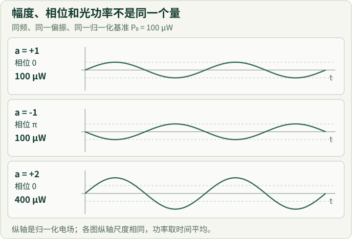
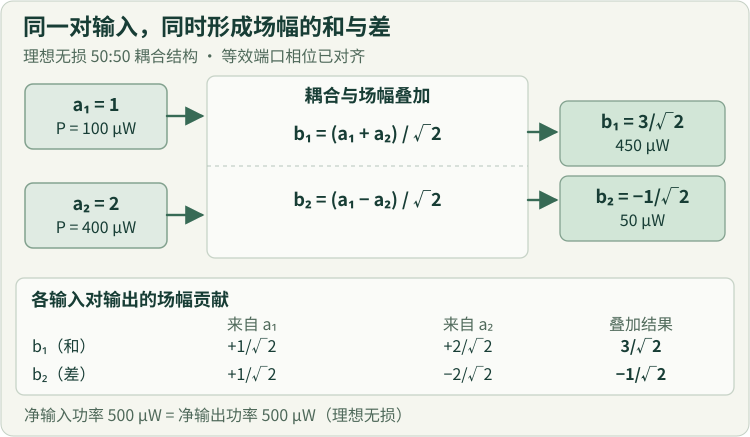
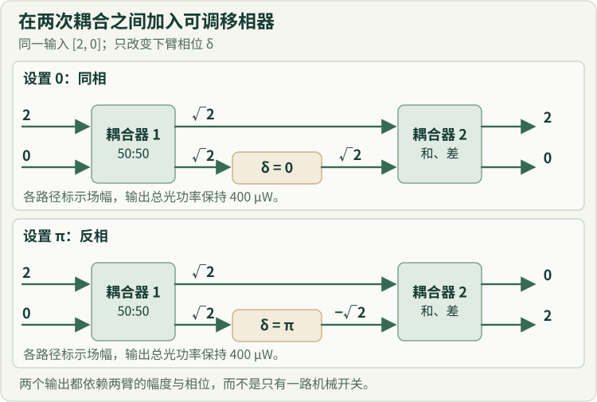
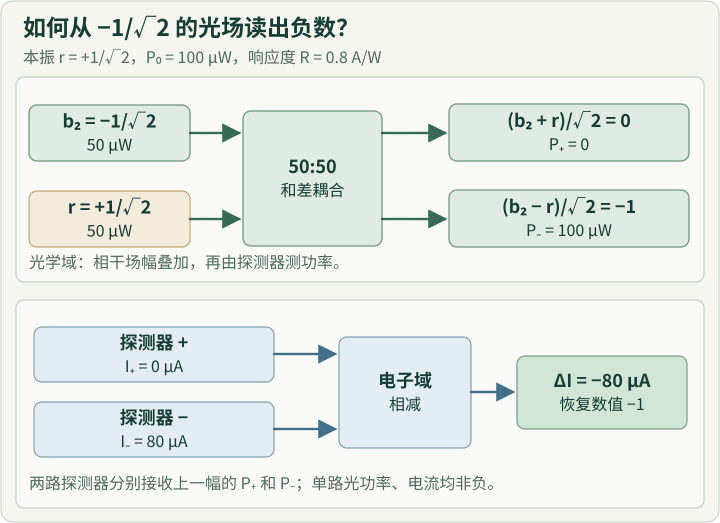

# 怎样让光信号参与矩阵运算？

在[A03](../01-foundations/a03-multiplication-and-accumulation.md)和[D01](../04-compute-arrays/d01-macs-and-array-data-paths.md)中，数字电路用比特表示操作数，并用乘法器、加法器和寄存器完成矩阵运算。想提高计算吞吐，需要为运算单元持续提供数据，并在满足电路时序的条件下组织并行计算。

另一种方法是改变数值的表示方式，利用光信号在传播、调制和干涉过程中发生的变化实现运算。这是**光子计算（Photonic Computing）**的一类实现方式。

这里不只是让光代替电信号传送操作数。我们希望光信号在传播过程中就参与求值。下面追踪一个很小的矩阵向量乘法，从产生输入光信号开始，直到得到可以写回存储器的计算结果。

## 如果不让数字乘加器执行这些运算呢？ {#workload}

假设有两个输入数值 x₁ = 1、x₂ = 2，和一个两行两列的权重矩阵 W：

| W | 输入 1 | 输入 2 |
| --- | ---: | ---: |
| 第 1 行 | 1 | 1 |
| 第 2 行 | 1 | −1 |

要计算列向量 y = Wx，即：

- y₁ = 1 × 1 + 1 × 2 = 3。
- y₂ = 1 × 1 + (−1) × 2 = −1。

数字运算单元可以用有符号整数的乘加完成这两项求值。若直接按矩阵逐项计算，数学上有四次乘法和两次求和。当然，实际数字实现还可以针对本例的 ±1 权重省去通用乘法器。

怎样让两个输入通过某个光学结构，就同时形成代表 3 和 −1 的光信号？首先需要回答一个问题：光怎么表示一个数？

## 亮一点的光，可以表示更大的数吗？ {#encoding}

回忆[光链路](../../interconnect/CPO/04-optical-engine/optical-link-basics.md#modulation)中的调制。发送端用电信号控制光信号的变化，接收端再识别这些变化。本篇也需要将数值编码到光上，但有不同的要求：我们还希望两个光信号相遇时，能够得到两个数的和或差。

先观察一束稳定单频光的电场。电场随时间快速振荡。可以用振幅 A 表示振荡的大小，用相位 φ 表示这个振荡相对于同频参考光的位置。光的频率也能作为信息承载方式，例如不同波长承载不同通道的数据。

本篇假设只有一个光频率和一种偏振状态，各路光取自同一个相干光源，相对相位在计算期间稳定，且光场能够在各输出端口耦合到相同传播模式。暂时忽略器件损耗和噪声。

为方便追踪数值，选定一个光功率基准 P₀ = 100 µW。用无量纲的 a = A·eiφ 表示光场的**归一化幅度**，使某一路光的平均功率满足：

**P = P₀ × |a|²**

其中 A 是非负的归一化振幅，i 是虚数单位。复数只是同时记录振幅和相位的一种方式；对本篇的实数运算，只需先跟踪与参考光同相或反相的幅度。

例如，a = +1 表示与参考光同相，a = −1 表示振幅相同但相位相差 π（180°）。二者的功率都是 100 µW。

<figure class="micro-diagram" style="max-width:720px; margin:1.2rem auto" tabindex="0" aria-label="相同频率的三种归一化光场，正负幅度与功率的对照，窄屏可横向滚动" markdown="1">

<figcaption>曲线表示归一化电场在一个固定位置随时间的变化，不是光功率随时间变成负数。P₀、振幅及相位是本文的教学参数。</figcaption>
</figure>

因此，光场幅度和光强不能混用。若光场分布和模式相同，强度（单位面积的光功率）与振幅的平方成正比；本篇用整个波导模式的功率 P 描述各路光。

### 怎样从存储器里的比特得到光场？

记输入端口的幅度为 a₁ 和 a₂。本例选择 a₁ = x₁ = 1、a₂ = x₂ = 2。

发送端可以用数模转换器（DAC）把数字编码转换成电压，再由驱动电路控制光调制器。改变调制条件可以改变输出光场的振幅和相位。例如，电压可以改变波导（约束光传播的路径）的有效折射率，从而改变光在传播中累积的相位，再利用干涉得到所需的振幅。

具体电压不是 x 本身，也不必与 x 简单成正比。驱动电路需要按调制器的响应，将每个输入值映射到合适的工作点。我们先假设已完成配置与校准，两个端口分别提供 100 µW 和 400 µW 的光功率，且相位与参考一致。

## 两束光汇合时，怎样形成和与差？ {#interference}

先用一个有两个输入、两个输出的理想 50:50 光耦合结构。每个输入都可以向两个输出贡献光场，两路贡献在同一个输出模式内叠加。

暂时只看一个输入对两个输出的贡献。在无损的 50:50 耦合器中，这两份贡献各自的功率为输入的一半，因此每份贡献的幅度大小是输入的 1/√2，而不是一半。

对于一个无损的两输入两输出耦合器，两个输出的相位关系也不能随意指定。我们选择一种等效端口相位约定，使其中一个输出得到同相的两个贡献，另一个输出得到相反符号的两个贡献。实际常见的方向耦合器带有交叉耦合相移，可通过适当的固定移相或端口相位约定实现下面的实数形式。

记两路输出幅度为 b₁ 和 b₂，则该结构对应的关系是：

**b₁ = (a₁ + a₂) / √2**

**b₂ = (a₁ − a₂) / √2**

跟踪相同的两个输入，a₁ = 1 对两个输出的贡献都是 1/√2。而 a₂ = 2 对第一个输出的贡献是 2/√2，对第二个输出的贡献是 −2/√2。

<figure class="micro-diagram" style="max-width:760px; margin:1.2rem auto" tabindex="0" aria-label="理想两输入两输出耦合结构将两个输入光场线性组合为和与差，窄屏可横向滚动" markdown="1">

<figcaption>图中的各项加数是等效场幅贡献，而不是功率；这些贡献也不表示实际存在四条独立波导。图中输出端口已完成所需的相位约定或补偿。</figcaption>
</figure>

| 输出端口 | 叠加后的幅度 | 输出光功率 |
| --- | ---: | ---: |
| 1 | 3/√2 | 450 µW |
| 2 | −1/√2 | 50 µW |

可以核对光功率：两路输入共 500 µW，两路输出也是 500 µW。虽然第一路光变亮，另一路变暗，但理想结构没有产生额外能量。

这就是借助干涉形成数值和与差的机制。场幅相加对输入是线性的，功率则包含交叉项。例如对两路幅度大小 A₁、A₂，相对相位差 Δφ，第一个输出满足：

**P₁ = P₀·(A₁² + A₂² + 2A₁A₂ cos Δφ) / 2**

如果两路光的相对相位不保持稳定，干涉项也会变化。它们的功率虽然可以分别计算，却不能代替相干场幅的求和。

本例的两个输出场幅组成的列向量 b = Wx/√2。W 对应的计算已经在光场中完成，只是整体缩小了 √2 倍。下面还需要解决如何改变权重、怎样读出结果这两个问题。

## 如果权重不是固定的 +1 和 −1，怎样改变计算？ {#mzi}

单个 50:50 结构的混合比例是固定的。希望改变输入对输出的贡献，可以在两个这样的耦合器之间设置移相器，构成一种**马赫–曾德尔干涉仪（Mach–Zehnder Interferometer，MZI）**。

为单独观察可调混合机制，保持 a₂ = 2 的幅度大小不变，暂时将它接到 MZI 的第一个输入，第二个输入不送光。两端采用上一节的等效耦合形式。

第一个耦合器将幅度 2 分成两路，各为 √2。移相器只改变其中一臂的相位，使它在到达第二个耦合器前成为 √2·eiδ。δ 是两臂新引入的相位差。

第二个耦合器再次做场幅的和与差，输出幅度分别为 1 + eiδ 和 1 − eiδ。于是：

- δ = 0 时，两臂同相，两个输出的场幅分别为 2 和 0。
- δ = π 时，两臂反相，两个输出的场幅分别为 0 和 2。

<figure class="micro-diagram" style="max-width:740px; margin:1.2rem auto" tabindex="0" aria-label="两级耦合器和移相器组成MZI，零和π相差时光转移到不同端口，窄屏可横向滚动" markdown="1">

<figcaption>两幅是同一器件在不同移相设置下的两个独立实验。理想耦合器及移相器都不耗散光功率；实际器件存在损耗。</figcaption>
</figure>

若 δ 取中间值，则两个输出的功率比例连续变化。在理想模型中分别为输入功率的 cos²(δ/2) 和 sin²(δ/2)。例如 δ = π/2 时，各有 200 µW。此时两个输出的场幅还包含相位信息，不能直接用 200 µW 当作矩阵元素。

调节 δ 可以控制混合比例，额外移相器可以调节输出之间的相位。通过这样的器件，可以配置输入光场到输出光场的线性变换系数。移相器可以是热光器件或电光器件，具体控制方式取决于实现。

例如[Shen 等人的 Nature Photonics 2017 原论文](https://www.nature.com/articles/nphoton.2017.93)图 2 展示了由两只 50% 耦合器、内部移相器及额外移相器构成的可编程 MZI。其内部移相用于调节耦合比例，另一移相用于调整相位关系。

这也解释了输入端怎样进行幅度调制：选择 MZI 的一个输出口，将另一输出导出或吸收，即可改变送往计算网络的光场振幅。但仍要调好相位，才能使输出幅度对应我们选定的实数。

### 怎样支持更多输入和输出？

如果需要四个输入，一只两输入两输出器件并不足够。但可以让每级器件混合其中两路，随后把各输出继续送到其他器件，逐级改变更多通道之间的光场分布。

理想无损的方形多端口干涉网络只能实现保持总光功率的线性变换，即酉变换。对实数场幅，它可以实现保持向量长度的正交变换。并不是任意数值矩阵都有这种性质。

例如本篇的 W 把输入向量的平方和 5 变成输出的平方和 10。所以光场以 P₀ 对应其平方和时，不能在无损无增益系统中直接产生 Wx。前面的归一化因子 1/√2 正是使总光功率保持不变的比例。

要实现一般矩阵，可以将线性变换拆成若干保持长度的变换与每路独立的缩放，再用可调干涉网络和衰减单元分别实现。这里不推导自动生成配置的算法。

深化：为什么常见方案会用两个干涉网络？

任意实矩阵 W 可以做奇异值分解，写成 W = UΣVᵀ。U、V 是正交矩阵，Σ 是含非负奇异值的对角矩阵（也可以为矩形）。

先让光场经过实现 Vᵀ 的网络，再逐路乘以 Σ 中的缩放系数，最后经过实现 U 的网络。若某个奇异值大于 1，对于纯无源系统，需要先整体缩放矩阵使所有奇异值都不超过 1，再在数字域等位置恢复尺度；也可以另外采用合适的有源增益方案。

这是实现一般矩阵的一种方法，不代表所有光学架构都用相同的网格。[Shen 等人的矩阵分解与衰减结构](https://arxiv.org/abs/1610.02365)；[Clements 等人的可编程多端口干涉网络原论文](https://doi.org/10.1364/OPTICA.3.001460)。

## 光已经形成了负数，为什么不能直接用探测器读出来？ {#readout}

回到 b₁ = 3/√2、b₂ = −1/√2。不少光电探测器在其线性工作区内，产生的光电流与入射光功率成正比。这个过程可参考[CPO 的探测器与接收电路](../../interconnect/CPO/04-optical-engine/optical-link-basics.md#receiver)。

若直接探测 b₂，不论幅度是 −1/√2 还是 +1/√2，光功率都是 50 µW。探测器无法仅凭功率恢复本例所需的符号。

可以再次利用干涉：从同一相干光源引入一束相位已知的参考光（本振光），让它与信号光混合。对于实数场幅 b 及与参考同相的本振幅度 r，再用上一节的理想和差结构，两个光电探测器分别看到：

**P₊ = P₀·(b + r)² / 2，P₋ = P₀·(b − r)² / 2**

二者做差：

**P₊ − P₋ = 2P₀br**

平方项 b² 与 r² 被消去，只留下与信号幅度 b 成正比的量。当 b 是负数时，第二个探测器收到的光功率比第一个更高。两个探测器各自的功率仍非负。

为本例每个输出端口准备一份幅度 r = 1/√2 的本振光。取两个光电探测器的响应度均为 R = 0.8 A/W，并忽略暗电流、非线性和噪声。相应的差分光电流 ΔI = R(P₊ − P₋)。

<figure class="micro-diagram" style="max-width:720px; margin:1.2rem auto" tabindex="0" aria-label="负幅度信号经参考光混合及平衡光电探测获得负差分输出，窄屏可横向滚动" markdown="1">

<figcaption>追踪第 2 个计算输出。为了便于手算，两只探测器响应度相同，且输出电流按同一极性计量。光学部分与电子域做差分别承担不同的工作。</figcaption>
</figure>

| 光场输入 | P₊ | P₋ | ΔI |
| --- | ---: | ---: | ---: |
| b₁ = 3/√2 | 400 µW | 100 µW | +240 µA |
| b₂ = −1/√2 | 0 | 100 µW | −80 µA |

这类利用相位参考并比较两个光电探测输出的办法称为**平衡相干探测**。本例参考光与信号具有相同频率，采用平衡零差探测（Balanced Homodyne Detection）。

接收电路可以把差分电流转换成电压，再用模数转换器（ADC）生成数字量。在理想模型中，按已知的响应度、基准功率和本振幅度恢复数值，等价于用 ΔI 除以 R·P₀ = 80 µA，得到 y₁ = 3、y₂ = −1。

这个恢复关系包含之前的矩阵归一化因子。若需要测量含有任意相位的复数场幅，一次固定本振相位的差分测量只得到其在参考相位上的一个分量，还需要另一正交相位的测量等机制。

[Hamerly 等人的 Physical Review X 2019 原论文](https://doi.org/10.1103/PhysRevX.9.021032)图 1 使用平衡零差探测进行光电乘法。那是另一种计算组织，其参考光也可以编码权重。本文仅用平衡探测恢复已计算出的有符号实数场幅。

## 如果后面还有一层矩阵乘法呢？ {#layers}

刚才为了将两个结果写回数字存储器，将它们从光学域转换回了电子域。

如果下一步是另一个线性变换，而后一级光路能使用当前的输出格式及尺度，就可以直接让光场进入后一级网络。不必在两层之间都先把结果数字化，再用 DAC 和调制器把同一个数变成光场。

但只串联线性光学结构，整个系统仍然是线性的。神经网络中的非线性激活不能仅依靠这样的干涉网络实现，还需要另外的机制。可以将光场读出后用电子电路完成激活，也可以设计光学或混合光电非线性单元。

例如[MIT FICONN 芯片架构实例](../../chip-architectures/mit-ficonn/README.md)介绍了一个实物研究芯片。它在三层光学矩阵变换之间使用混合光电非线性单元，使主路光场不必在每层之间重新数字化；最后仍有相干接收及数字读出。

本文的相干线性计算只是一条实现路线。也有方案将非负输入数值编码为不同波长的光功率，再独立调节光功率的衰减比例。若各通道间的拍频超出探测后电路的有效带宽，探测得到的平均电流可以表示各通道功率的加权和。

这种功率求和与本文同频相干场幅的叠加不是同一个数学模型。对于有符号权重，还可以使用额外的差分路径等机制。参见[Tait 等人的硅光子权重组研究](https://www.nature.com/articles/s41598-017-07754-z)。

## 为什么不能直接用光的传播速度估计整个任务的计算速度？ {#system-costs}

将这次矩阵运算放回芯片系统中。输入与权重配置来自数字存储；激光器提供载波；调制器将输入表示成光场，配置电路设定各干涉单元的状态；光场穿过计算网络；最后的探测、采样和数字化产生可用结果。

| 阶段 | 要承担的工作 |
| --- | --- |
| 输入准备 | 从存储读取数值、整理数据顺序、提供 DAC 和驱动所需的输入 |
| 光源与调制 | 供光，按目标振幅和相位形成信号，补偿调制特性 |
| 计算与控制 | 维持权重配置，传播、干涉、衰减及补偿，按需要调整工作点 |
| 接收与后续处理 | 光电探测、放大、采样、ADC、数值恢复、激活或写回 |

这次任务的有效延迟取决于上述各阶段和它们之间的依赖。光学变换核心的传播时延只是其中一个环节。即使传播很快，连续送入新向量的速率也可能受调制器、电子驱动、接收带宽、采样速率和存储接口限制。

许多光学变换会以空间上的并行路径同时处理多个通道。若相同的权重状态能服务很多输入向量，还可以分摊权重配置及校准成本。但是更多通道需要更多光路、调制及读出接口等资源，较深的网络也会增加光学损耗。

### 为什么多送一点光或多加几个干涉单元，不一定能得到更准确的数？

本例使用精确的振幅与相位、理想耦合和无噪声探测。实际误差可能在多个位置发生：

- 相位设置误差、温度漂移及波导特性改变，会使输入到输出之间的加权系数偏离预期。
- 耦合、波导和器件损耗使光场衰减；不均匀损耗会改变矩阵本身的有效系数。
- 光电转换中的散粒噪声、电子噪声与有限的读出范围，会扰动接收到的值。输入和输出转换还受 DAC、ADC 的精度限制。

例如想让两束光在某端口严格抵消，若它们的振幅只有微小差异，或相位差不是准确的 π，就会产生原本不该出现的输出。当目标输出接近零时，同样大小的绝对误差在结果中所占比例会更大。

提高光功率可以改善某些噪声条件，但会增加激光器供能，探测和调制电路也存在动态范围限制。调节更多参数有机会补偿部分非理想特性，但参数需要存储、测量及调整。

[Hamerly 等人的光电乘法研究](https://arxiv.org/abs/1812.07614)将散粒噪声纳入准确率与能耗讨论，并单独分析光学和电路能量。这些研究的噪声模型和系统条件不能直接用作其他器件的实测精度。

### 应该在哪个边界统计能耗和性能？

即使干涉结构可以通过无源器件完成一部分线性变换，形成并传送光场仍需光源，控制、补偿和转换电路也要消耗能量。光从多个输入通道分配到更多路径后，还需要保证每个接收端的有效信号足够大。

要判断能否获得收益，可以按[H01 的性能分析](../08-performance/h01-task-time-and-bottlenecks.md)选择相同的矩阵工作量、数值范围和允许误差，在相同的输入、输出边界上比较有效吞吐、执行时间和任务能量。若有能重叠的阶段，则应按实际执行日程统计。

例如 FICONN 研究中报告的约 410 ps 延迟对应特定实验光路至片上接收器的边界，并未包含板级输入编程和结果数字化。从[架构实例的时延分析](../../chip-architectures/mit-ficonn/README.md)可以进一步看到这个数是怎么得到的。

矩阵规模、光路配置灵活性、供光和转换的成本、有效精度以及是否频繁切换权重，都会影响最终收益。需要比较实际系统的工作条件，而不能用单个无源核心的延迟或能量估计替代整颗芯片的性能。

## 回到最初的问题 {#summary}

在本篇的同一组输入中，光场振幅携带数值，耦合器将每一路输入按指定系数分配并叠加，产生了代表矩阵向量乘法结果的两路光场。随后，相干探测及电子电路恢复了有符号的数字结果。

真正参与运算的是光场及器件对光场的可控变换，不只是光在传输数据。与[芯片与系统互连中的光链路](../../interconnect/CPO/04-optical-engine/optical-link-basics.md)相比，这里的光不是为了在另一端恢复原来的输入数据，而是为了形成新的计算结果。

光学核心改变的是部分计算的求值机制，并不自动取代存储、控制及所有数字逻辑。设计光子计算系统，需要让光学域和电子域共同满足完整任务的容量、精度、时间和能耗要求。

[返回其他计算范式导读](README.md)
