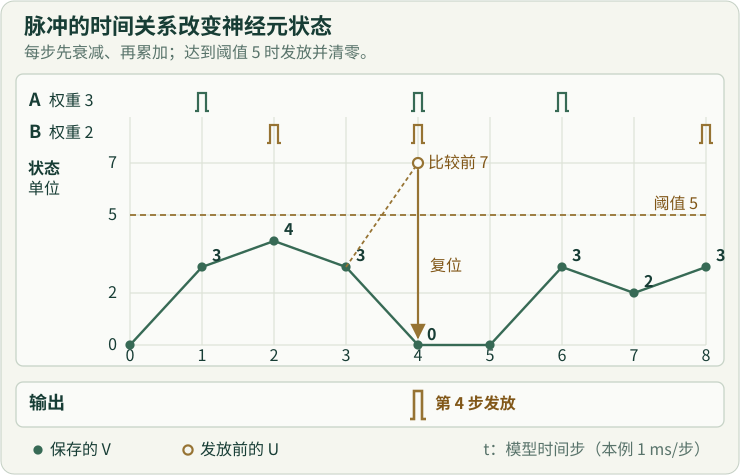
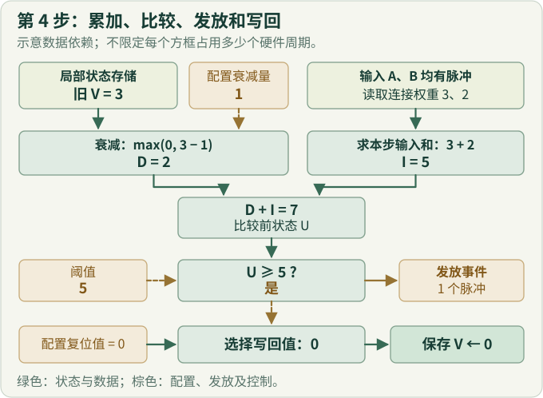
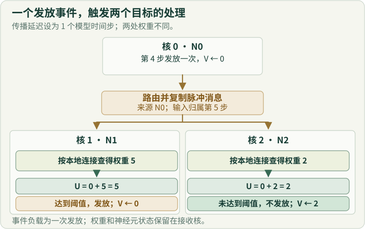

# 当计算由事件触发，硬件怎样更新神经元状态？

在[A01](../01-foundations/a01-state-and-control.md)中，寄存器保存数字系统的状态，控制电路决定它们何时更新。我们可以安排硬件不断读取输入、计算新状态，再将结果写回。

但有些任务的输入并不是每次都发生变化。例如一个感知系统长时间观察基本静止的场景。如果输入只在出现有意义的变化时才发送消息，下游是否也可以少做一些工作？

**神经形态计算（Neuromorphic Computing）**借鉴神经系统的信息处理方式，将计算组织为相互连接的、带有局部状态的神经元及其通信。

其中一条常见路线是执行**脉冲神经网络（Spiking Neural Network，SNN）**：神经元根据收到的脉冲、时间和已有状态进行更新，在满足条件时发出新的脉冲。

下面从一条很小的神经元状态更新规则开始，跟踪输入消息、局部状态和输出事件。这只是神经形态计算的一种组织，并不要求硬件模仿生物神经元的全部物理行为。

## 如果不再向计算单元反复提供完整的输入呢？ {#input-events}

先想象一个神经元 N0 有两条输入连接，分别来自 A、B。A 的连接权重为 3，B 的连接权重为 2。这里把每条有方向、带权重的神经元连接称为**突触（Synapse）**。

在普通数字计算中，可以把每个时刻的两个输入表示为一个向量。两者只取 0 或 1，硬件计算 3 × A + 2 × B，得到这次输入对 N0 的总贡献。

例如 A=1、B=0 时，贡献为 3；A=0、B=1 时，贡献为 2；两者均为 1 时，贡献为 5。

假设我们只关心输入为 1 的时刻。可以不逐次发送两个输入的全部数值，而是让 A 和 B 仅在其值为 1 时发送事件。这里的事件称为**脉冲（Spike）**，一次脉冲代表这个来源在指定时刻发生了一次发放。

接收端不需要为不存在的脉冲乘以零。它只需要知道哪个来源产生了脉冲，就可以查到这条连接的权重，并将该权重计入本次贡献。

这是在具有上述输入语义时才能采用的等价表示。一般的整数或浮点激活不可以直接丢掉其数值，只传一条没有负载的脉冲；怎样编码这些数值是另一个问题。

## 一次脉冲不够，怎样让神经元记住之前收到的输入？ {#neuron-state}

假设 N0 已经收到一个来自 A 的脉冲，贡献为 3。如果只计算本次输入，那么下一次收到 B 的脉冲时，之前的 3 就丢失了。

可以为 N0 保存一个状态 V。每次收到脉冲，根据连接权重增加 V。V 记录此前输入对当前状态仍然保留的影响，类似[A03 的累加器](../01-foundations/a03-multiplication-and-accumulation.md#mac)。

为了让相隔很久的两次脉冲与接连到达的脉冲产生不同效果，再规定 V 随时间衰减。例如，每经过一个时间步，V 减少 1，但不减到 0 以下。

最后给 N0 一个输出条件：若累积后的状态达到阈值 5，就发出一个脉冲，并将 V 清零。下一次从这个新的状态开始累积。

这种“累计输入、状态衰减、达到阈值时发放并复位”的组织，对应**泄漏积分发放神经元（Leaky Integrate-and-Fire，LIF）**的基本思想。

经典 LIF 模型用膜电位表示状态，无输入时，偏离静息电位的部分可随时间指数衰减；达到阈值后复位。见 [Gerstner 等《Neuronal Dynamics》第 1.3 节](https://neuronaldynamics.epfl.ch/online/Ch1.S3.html)。这里采用整数减法简化衰减，不是经典连续时间模型的精确离散化，也不表示生物膜电位的实测轨迹。

### 先规定一步内的状态变化顺序

令 t 表示模型的整数时间步，V(t) 为第 t 步处理结束后保存的状态。初值 V(0)=0。设一个模型时间步代表 1 ms；这不是硬件时钟周期。

V 和权重都采用本例定义的无量纲状态单位，而非伏特。每步衰减 1 个状态单位，阈值为 5；每个来源每步最多发出一个二值脉冲。

采用以下更新规则：

1. 取出上一步保存的 V，先衰减：D(t) = max(0, V(t−1) − 1)。
2. 收齐属于第 t 步的输入脉冲，按权重求和：I(t) = 3 × A(t) + 2 × B(t)。
3. 计算比较前的状态 U(t) = D(t) + I(t)。U(t) ≥ 5 时，本步发放一个脉冲且 V(t)=0；否则不发放，V(t)=U(t)。

暂不考虑额外的偏置、不应期、随机行为及其他内部状态。即使 U 超过 5，本例也只发一个脉冲并清零，不保存超过阈值的部分。

现在给出八步输入。破折号表示没有脉冲，不是一条带零负载的消息。

| t | A 脉冲 | B 脉冲 | 衰减后 D | 输入和 I | 比较前 U | 发放？ | 保存 V |
| ---: | --- | --- | ---: | ---: | ---: | --- | ---: |
| 1 | 有 | — | 0 | 3 | 3 | 否 | 3 |
| 2 | — | 有 | 2 | 2 | 4 | 否 | 4 |
| 3 | — | — | 3 | 0 | 3 | 否 | 3 |
| 4 | 有 | 有 | 2 | 5 | 7 | **是** | **0** |
| 5 | — | — | 0 | 0 | 0 | 否 | 0 |
| 6 | 有 | — | 0 | 3 | 3 | 否 | 3 |
| 7 | — | — | 2 | 0 | 2 | 否 | 2 |
| 8 | — | 有 | 1 | 2 | 3 | 否 | 3 |

<figure class="micro-diagram" style="max-width:740px; margin:1.2rem auto" tabindex="0" aria-label="八个模型时间步的输入脉冲、比较前状态、复位与输出事件，窄屏可横向滚动" markdown="1">

<figcaption>只展示离散时间步的状态。第 4 步比较前状态为 7，发放后复位为 0；线段仅表示相邻步的关系，脉冲符号标记相应时刻的事件，不表示实际电压或脉冲宽度。</figcaption>
</figure>

观察第 3 步。没有新输入，V 仍由 4 下降为 3。到了第 4 步，剩下的输入影响已经减少到 2。N0 再累加 A、B 的两个权重，得到 U=7，于是发放并复位。

第 6 步和第 8 步分别接收到 A、B 的一个脉冲。若这两步没有间隔，累加结果会与实际不同；在本例中第 2 步和第 8 步虽然都只收到 B，却分别得到 U=4 和 U=3。因为两次脉冲到达前保存的状态不同。

这样的网络不仅可以利用脉冲是否出现，还可以利用事件之间的时间关系携带信息。具体的信息编码和学习方法由模型决定。

## 这些规则怎样变成硬件中的数据路径？ {#local-update}

从第 4 步来看，N0 需要三个输入：此前保存的 V=3、衰减量 1，以及本次收到的两份贡献 3、2。此外还需要阈值 5。

采用普通数字电路，就可以用寄存器或 SRAM 保存状态及参数，用加减、比较和选择电路完成更新。状态存在同一核的局部存储器中，不必每步都交给主机再写回来。

<figure class="micro-diagram" style="max-width:700px; margin:1.2rem auto" tabindex="0" aria-label="神经元第4步的读取旧状态、衰减、累加、阈值比较、发放和写回路径，窄屏可横向滚动" markdown="1">

<figcaption>一次模型状态更新中的数据与控制关系。各功能可以用组合和时序电路、共享运算单元或局部微码实现，不要求图中每个方框都对应一个独立硬件单元或一个硬件周期。</figcaption>
</figure>

本例的状态更新电路需要保存这样几类信息：

- 神经元状态：V，采用事件跳步时还需记录状态所对应的时间步。
- 模型参数：衰减量、阈值、复位值。
- 突触信息：每条输入连接的来源或查找标识、目标和权重。
- 临时或在途状态：当前时间步的输入和、尚未交付的输出脉冲等。

这里没有要求每个神经元永久占用一个加法器、比较器和消息发送电路。如果一个核能够访问许多神经元的状态，它可以依次为不同神经元提供运算服务。

例如 [Davies 等，Loihi 原始论文（IEEE Micro 2018）](https://redwood.berkeley.edu/wp-content/uploads/2021/08/Davies2018.pdf)介绍了一种核内共享局部存储、按时间复用并流水化更新多个神经元状态的数字芯片实现。它不是上述教学电路的直接实现。

如果采用正比于连接权重和负载的输入贡献，也可以支持带整数负载的脉冲，而不是只记录是否发放。部分实现还有负权重、多个状态变量和可编程的状态更新规则。具体更新哪些状态，仍由模型及该硬件支持的能力决定。

## N0 发出脉冲后，怎样影响其他神经元？ {#spike-routing}

刚才 N0 在第 4 步发放了一个脉冲。现在加入神经元 N1 和 N2，让 N0 的发放同时影响它们。

本例给 N0→N1 的连接权重 5，N0→N2 的连接权重 2。两个目标神经元采用与 N0 相同的衰减量、阈值及复位规则，初始状态均为 0，不接收其他输入。

另规定每条连接的传播延迟为一个模型时间步。N0 在第 4 步生成的事件应当作为 N1、N2 在第 5 步的输入，而不是第 4 步的输入。这个模型延迟不等于真实网络传输时间。

N0 需要生成一个脉冲消息。消息或路由表要能共同确定它的来源或连接、目的端以及它属于哪个模型时刻；消息可能携带模型时间戳，也可以用通信阶段和目标端缓冲来隐式区分时刻。

本例采用显式逻辑时刻的教学消息：N0 在第 4 步发放；接收侧将该消息归入第 5 步。消息的负载是一次发放，不是 N0 的 U=7 或 V=0。

<figure class="micro-diagram" style="max-width:740px; margin:1.2rem auto" tabindex="0" aria-label="N0的脉冲经互连送给两个目标，接收侧按各自突触权重更新状态，窄屏可横向滚动" markdown="1">

<figcaption>示意将三个神经元分别放在三个核中。发放事件经过路由及复制，两个目的端都在各自的第 5 步处理，权重放在接收侧。图中不指定实际数据包格式、物理网络延迟或每核神经元数。</figcaption>
</figure>

在这个映射方案中，发送侧的路由信息指定哪些核需要收到消息；接收侧根据连接信息取得目标神经元编号和突触权重。若一个核内有多个目标，也可能在核内再次展开这条消息。

[Loihi 原始论文的 Network Connectivity Architecture（图 3）](https://redwood.berkeley.edu/wp-content/uploads/2021/08/Davies2018.pdf)展示了这种组织的一个实例：跨核消息带目标端连接标识，目标核再将其展开为局部突触列表。

消息到达 N1 后，它得到贡献 5。第 5 步衰减后的旧状态仍为 0，所以 U=5，达到了阈值。N1 也发出一个脉冲并复位。

N2 得到的则是贡献 2。它的 U=2，不发放，将 2 保存下来。如果后续没有新输入，第 6、7 步的状态会依次下降到 1、0。

一条脉冲已经引起多个目标的状态处理，而每个目标的行为由自身的连接和状态决定。多个神经元便可以这样组成网络。网络中的连接也可以反馈到此前的神经元；若采用离散时间模型，反馈仍应满足各连接定义的延迟规则。

实际硬件可能用地址事件表示发放：在消息中传递地址或编号，接收端按映射查找连接。跨核转发及复制属于[芯片与系统互连的多播问题](../../interconnect/NOC/06-ai-noc-specifics/broadcast-multicast-tree.md)，并不要求源神经元逐一发送所有权重和完整的状态。

## 如果消息早到、晚到，结果还一样吗？ {#logical-time}

回到 N0 的第 4 步。A、B 都在此步产生输入，但两条消息经过不同路径，抵达核内输入队列的物理时刻可能不一样。

如果接收方先收到 A，就立刻衰减、累加、检查阈值并复位，会发生什么？

上一状态 V=3，衰减后为 2。先加 A 的权重 3，达到阈值 5，发放并复位。如果再把随后到达的 B 的权重 2 累加到复位后的状态，就会留下 V=2，而不是原来规则要求的 V=0。

因此，消息到达的物理次序不能擅自替代模型规定的次序。本例规定同一步先汇总全部贡献，再执行一次阈值判断和复位。不应在每一条消息到达时重复推进状态时间或单独判断阈值。

硬件怎样知道本步的输入已经收齐？只检查当前接收缓冲为空是不够的。仍在传输路径中的消息可能还属于本步。

一种实现方式是将发放和状态更新组织为有时间步边界的阶段。发送方和网络完成本步的消息交付之后，通过同步协议确认相应接收状态可用，再推进下一个模型时间步。也可以采用符合因果约束的局部时间推进，避免无关计算单元总是全体等待；但需要证明没有尚未收到的更早事件会改变当前计算。

[F02 的事件与屏障](../06-resource-cooperation/f02-task-control-and-synchronization.md)区分数据已交付与接收方可开始工作等条件，这里的时间步交接也有类似的约束。

这里需要区分两种时间：

| 时间 | 含义 |
| --- | --- |
| 模型时间 | 规定状态衰减、输入归属、连接延迟及发放顺序的时间 |
| 物理执行时间 | 从消息传输、查权重、读状态到完成写回，在实际电路中消耗的时间 |

一个模型步可以跨越许多硬件时钟周期，也可以由没有统一时钟的局部电路协作完成。忙碌状态下，完成一个模型步可能比空闲状态下消耗更多物理时间；若要与真实感知系统实时交互，还必须满足实际时间约束。

例如第一代 [Loihi 原始论文中的算法时间及 Mesh Operation（图 2）](https://redwood.berkeley.edu/wp-content/uploads/2021/08/Davies2018.pdf)采用异步核间通信，并通过屏障消息排空在途脉冲、推进统一的算法时间步。本文不是在定义这一产品的全部执行协议。

## 神经元没有收到脉冲，这一步就一定不计算吗？ {#skip-empty-steps}

之前的八步例子里，两条连接上共发生六次有效输入事件：A 在第 1、4、6 步发放，B 在第 2、4、8 步发放。

若采用每步计算完整二值输入向量的直接实现，每步访问两个连接项，包括输入为 0 的项。采用事件列表之后，可以只查找发放脉冲的连接，处理相应权重。这还要求那些未收到脉冲的输入对于本次计算等价于 0。

但状态什么时候更新？第 3 步即使没有脉冲，V 也应该衰减。如果只在有脉冲的时刻执行一次减 1，然后直接累加，得到的状态就是错的。

本例可以把“每步减 1”改为等价的跳步计算。除了 V，还为神经元保存最后一次已经求出的状态所对应的时刻 t_last。

若下一次需要在时刻 t 更新状态，在这段时间没有其他输入时，可以直接计算：

**D(t) = max(0, V(t_last) − (t − t_last))**

这里的 t−t_last 按模型时间步计数，衰减为每步 1 个状态单位。该式只是把每步减 1 合并为一次减法，不改变本例的更新规则。

例如第 2 步之后 N0 保存 V=4、t_last=2。第 3 步没有脉冲，在物理存储中可以不写回它的状态。

第 4 步需要更新时，跳过两步的衰减，D=max(0,4−2)=2。再累加 5、判断阈值、发放并复位，得到的结果与逐步计算完全相同。

| 实现方式（仅 N0，8 个模型步） | 输入连接处理项数 | 完成衰减及阈值判断的状态更新次数 |
| --- | ---: | ---: |
| 逐步、完整遍历两条连接 | 16 | 8 |
| 脉冲触发连接处理，状态逐步更新 | 6 | 8 |
| 脉冲触发连接处理，输入时补偿已过去的时间 | 6 | 5 |

最后一种方式在第 1、2、4、6、8 步执行状态更新，且在本例的输入与规则下，没有其他时刻需要读出状态或产生输出。观察区间结束在第 8 步，其最终状态已求出。

这里比较的是本例不同实现处理的连接项数和状态更新次数，不是物理访存次数、指令次数、运行时间或能量实测。后两种实现还可能需要事件接收、索引查找、时间戳、缓冲、步进通知等工作。

能跳过某些状态更新的关键是：在本例中，没有输入时状态不会自己增加到阈值，因此不会漏掉原本应该产生的输出。

如果模型还包含持续驱动、定时发放、独立演变的内部状态或其他时间依赖，就不能简单等到新脉冲才处理。硬件可以逐步更新、设置内部定时事件，或者用匹配该模型的数学更新方法推进时间，并在需要时生成相应事件。

对于指数衰减和有限精度的模型，还要检查合并计算是否与逐步量化的结果一致，不能只凭数学式子认为二者相同。

## 事件驱动是不是意味着芯片不需要时钟？ {#event-and-clock}

本例中，脉冲标记一项待处理的工作。它可以触发查找突触信息、累加输入贡献，或者使接收方的一项工作变得可执行。

这种“根据事件的出现和其他就绪条件推进工作”的方式称为**事件驱动（Event-driven）**。它描述的是工作的触发条件，不是晶体管电路怎样产生采样时间。

普通同步电路也可以在时钟沿检查队列是否有消息。如果没有新工作，控制电路可以不发出不必要的更新许可；如果有消息且资源可用，再按[A07 的握手](../01-foundations/a07-handshake-and-backpressure.md#valid-ready)和[A08 的资源仲裁](../01-foundations/a08-dependencies-and-scheduling.md#issue)交付工作。

也有电路使用局部请求与确认协调数据传输和运算，不依赖全芯片统一的时钟沿。这样的异步电路同样需要满足自身的时序和通信约束。异步不意味着数据在没有约定的时刻随意被采样。

例如 [Furber 等《The SpiNNaker Project》（2014）](https://doi.org/10.1109/JPROC.2014.2304638)描述了一种在通用处理器上运行的事件式处理组织：收到脉冲消息会触发相应工作，而局部定时器的周期事件用于推进神经元状态。这同时包含事件触发的通信处理和按时间执行的状态更新。

另一种实现是 [IBM TrueNorth 的设计论文（2015）](https://redwood.berkeley.edu/wp-content/uploads/2021/08/Akopyan2015.pdf)中介绍的多核数字神经形态芯片，它将异步通信与局部同步逻辑结合起来。

所以应该把三个问题分别看待：

| 问题 | 本篇讨论的内容 |
| --- | --- |
| 计算对象是什么？ | 带局部状态的、相互连接的神经元 |
| 工作怎样触发？ | 根据脉冲或定时等事件、资源及依赖条件推进 |
| 电路怎样定时？ | 同步时钟、局部异步握手或两者组合 |

一般的 CPU、DMA 或 I01 的数据流硬件，也可以由事件唤起或根据数据就绪推进。仅仅使用事件驱动，不代表它就是神经形态芯片。

神经形态计算也不要求所有状态均由二值脉冲表示或每种神经元均使用 LIF 模型。[Intel Loihi 2 技术简报](https://www.intel.com/content/dam/www/central-libraries/us/en/documents/neuromorphic-computing-loihi-2-brief.pdf)介绍了可编程神经元微码、带整数负载的脉冲、异步神经形态核及核间消息通信，其中还含有负责配置和 I/O 等工作的微处理器。

具体的 Sigma-Delta 神经元与实机测量可读[芯片架构实例：Intel Loihi 2](../../chip-architectures/intel-loihi-2/README.md)。

## 少了很多脉冲，整个系统就一定更省能量吗？ {#tradeoffs}

回到 N0 的六次有效输入连接处理。若采用稀疏事件，确实有可能减少零值计算及无变化时的通信。但是硬件还需要完成每条事件的路由、查找和状态访问。

例如 N0 的一次脉冲需要被两个目标接收。事件数在源端只有 1，接收端却要处理两条连接。若它连接了许多神经元，一个脉冲可能引起许多次转发、权重读取和累加。

假设源 i 发放了 ni 次，它连接了 fi 个目标突触。若全部发放都被交付到对应突触，这批脉冲引起的连接贡献总数为 Σ ni × fi。ni 和 fi 都是计数；该式不是 NoC 包数量或实际访存次数。

多个事件同时到达同一核时，输入缓冲、局部权重存储的访问端口、状态更新单元和消息出口也可能发生竞争。要保证每项贡献被正确消费，需要局部仲裁、暂存以及适当的流控，不能假设每条脉冲都能立即处理。

这种计算组织仍受制于资源：

- 存储容量：大量突触权重、连接表、神经元状态及时间信息是否能留在本地？
- 有效带宽：单位时间内能读取多少连接、更新多少状态，并交付多少脉冲？
- 控制成本：事件的编号、分发、排队、同步和空闲时间管理需要消耗多少面积及能量？
- 时限：输入突发时能否完成规定的模型步，或在应用要求的时刻交付输出？

与[G02 的稀疏计算](../07-specialized-compute/g02-sparse-computation-and-operand-matching.md)相似，省去不参与运算的项并不自动省去全部周期。这里还必须考虑时间和内部状态。

当输入变化稀疏，且网络自身发放也稀疏，局部状态及连接可以高效访问时，这种组织比较有机会减少工作。例如 [Gallego 等《Event-based Vision: A Survey》](https://rpg.ifi.uzh.ch/docs/EventVisionSurvey.pdf)介绍的事件相机，按像素报告亮度变化的位置、时间及方向，而非定期输出整帧，这类输入允许处理系统直接利用时间稀疏性。

但外部事件稀少，不保证内部神经元的发放也稀少。为了把稠密数值转为脉冲、积累足够信息或重新读出数值，可能需要较长时间及额外处理。如果输入、网络行为都十分稠密，逐项发送和查找的成本可能超过常规计算阵列规整的供数和累加方式。

比较不同硬件时，要按照同一任务的质量目标和响应时限，计入编码、消息通信、状态更新、输出重建和主机交互所需的时间与能量。峰值脉冲处理能力或一次突触操作的能量不等于完整任务的表现。可参照[算法与模型的工作负载记录口径](../../workload/06-chip-workload-analysis/workload-characterization-axes.md)及[H 专题](../08-performance/README.md)。

## 回到最初的问题：事件究竟改变了什么？ {#summary}

普通数字系统能够按照固定顺序处理连续输入。神经形态计算的一种实现方式则把有状态的计算分布给相互连接的神经元，让发放事件表示输入贡献，并在接收侧利用局部连接和旧状态决定接下来的行为。

时间依然是计算的一部分。即使一段时间没有新事件，模型状态也可能改变；如果需要依靠时间步完成这些改变，事件驱动并不取消时间步。

芯片中仍需要存储和运算电路、通信网络及控制机制。改变的是数据和状态的组织方式，以及哪些工作需要被触发。其收益取决于事件与状态变化是否确实稀疏，以及硬件能否有效处理这些变化。

[返回其他计算范式导读](README.md)。
