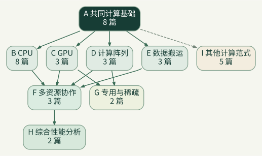

# 计算微架构

计算微架构研究怎样组织芯片内部的运算电路、寄存器、流水线和控制逻辑，使硬件能够正确、持续地完成计算。相同的一组运算，可以由一个单元逐次执行，也可以由多个单元同时执行；这些选择会改变计算所需的时间、数据搬运量和硬件成本。

想象芯片正在计算一个点积。乘法器刚算出第一项，结果放在哪里？第二项是否可以同时计算？如果下一组操作数还没到达，已经空闲的乘法器为什么不能继续工作？这些问题会从一个计算单元延伸到整颗芯片，涉及数据通路、执行控制、并行资源和数据供给。

## 从共同基础到不同计算架构

先从[半导体与电路基础](../semiconductor-foundations/README.md)中的逻辑门、触发器和时钟出发，理解如何构建一个可以执行运算的电路。再根据想理解的处理器或硬件机制选择路线：CPU 怎样执行指令，GPU 怎样组织并行线程，NPU 的计算阵列怎样传递和复用数据，DMA 又怎样独立搬运数据。

最后把计算、搬运和控制放到同一个系统中，观察不同资源何时工作、何时等待，以及怎样比较不同微架构方案。

## 九个专题的知识关系

<figure class="micro-v2-map micro-v2-map-wide" markdown="1">

<figcaption>箭头表示知识衔接，虚线指向可选拓展，并非必须逐条完成的先修顺序。理解多资源协作不要求先学完 CPU、GPU、阵列和 DMA 四条路线。性能分析贯穿所有专题。点击可查看大图。</figcaption>
</figure>

本系列规划 37 篇正文：32 篇常规微架构文章和 5 篇拓展阅读。九个专题的导读已开放，正文会逐篇完善并发布。专题内标为“未发布”的条目只是阅读规划，不是已经完成的文章。篇数会随写作过程中发现的问题调整。

| 专题 | 核心问题 | 建议先了解 | 规划篇数 |
| --- | --- | --- | ---: |
| A · [共同计算基础](01-foundations/README.md) | 怎样把逻辑门和寄存器组织成能够持续执行运算的硬件？ | 逻辑门、触发器、时钟 | 8 |
| B · [指令执行与 CPU](02-cpu/README.md) | 硬件怎样在保持程序语义的前提下并行执行指令？ | A 中的数据通路、流水线与依赖 | 8 |
| C · [并行执行与 GPU](03-parallel-execution/README.md) | 多个通道和执行上下文如何共同使用硬件资源？ | A 中的执行机制；指令接口基础 | 3 |
| D · [计算阵列与数据流](04-compute-arrays/README.md) | 多个乘加单元怎样传递、驻留和复用数据？ | A 中的乘加、数据通路与流水线 | 3 |
| E · [数据搬运与处理引擎](05-data-movement/README.md) | 独立引擎怎样生成数据请求、处理返回并改变数据格式？ | A 中的控制与握手；存储及互连接口 | 3 |
| F · [多执行实体与资源协作](06-resource-cooperation/README.md) | 数据和资源何时可用，多个计算及搬运引擎怎样协作？ | A 与相关计算或搬运路线 | 3 |
| G · [专用计算与稀疏计算](07-specialized-compute/README.md) | 怎样用专用资源处理复杂运算，又怎样避免无效运算？ | A；按需参考 C、D、E | 2 |
| H · [性能分析与设计权衡](08-performance/README.md) | 增加资源为何不一定更快，怎样权衡性能、面积与能耗？ | 已学习的执行机制；F 有助于系统分析 | 2 |
| I · [其他计算范式](09-compute-paradigms/README.md) | 改变计算资源、计算位置或数值载体，会怎样改变计算过程？ | A；按范式补充阵列、存储等知识 | 5 |

## 按学习目标选择

- **从零理解计算硬件**：从 A 读起，理解运算电路、数据通路、流水线与控制，再选择感兴趣的专题。
- **理解通用处理器**：A → B，遇到向量和多线程资源时补充 C；想研究多核协作，再读 F。
- **理解 AI 计算芯片**：A → C 或 D，结合 E 了解数据供给，再到 F、G、H 理解资源协作和设计取舍。
- **了解新型计算机制**：掌握 A 中相关基础后，直接按兴趣进入 I；存内计算还需要存储与阵列知识。

这些不是硬性课程安排。不理解某个前置机制时再返回对应专题即可。

## 与相邻系列的分工

这里主要解释硬件具备哪些能力，以及硬件接到指令或任务之后怎样工作。[存储系统](../storage/README.md)负责解释存储器和访问机制；[芯片与系统互连](../interconnect/README.md)负责解释请求怎样跨模块和设备传递；[算法与模型](../workload/README.md)负责解释要执行的计算。软件怎样划分任务、映射算子或组织推理执行是另一个抽象层次。

## 版本说明

新版正在重构，专题导读可用于了解后续阅读路线。正文完善期间，[旧版计算微架构资料](../microarchitecture/README.md)及原有文章仍可正常阅读。特别是已有 DMA、存内计算和建模资料，后续会结合新版结构整理，不在本阶段删除。
