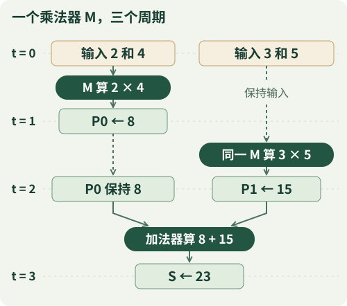
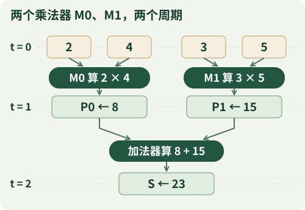

# 芯片怎样算出一个点积？

在数字电路仿真里，把乘法器所有输出位合在一起，按十进制显示。输入 2 和 4，等信号稳定，波形上显示 8。现在把输入换成 3 和 5，稍等片刻，同一行波形显示 15。如果下一步要把两个乘积加起来，加法器还能去哪里找到刚才那个 8？

这是两个向量 A =（2，3）和 B =（4，5）的**点积**。从 A、B 各取第一项相乘，再各取第二项相乘，最后把乘积相加，纸上留下的是 **2 × 4 + 3 × 5 = 23**。纸上可以同时看见两个乘积。芯片也要在加法器的两个输入端同时给出 8 和 15。我们先用一个乘法器把它做出来。

## 一个乘法器，先算出的 8 存在哪里？

先只保留乘法器里的**组合逻辑**，把输入固定住。各级逻辑门根据输入改变输出，变化逐级传递，最后一组输出线上的高低电平共同表示乘积。换成第二对输入后，同一批门会对新输入作出响应。等它们重新稳定，那些线便表示 15。即使给加法器多接一根线，让两根线都从这个输出取数，两端最终读到的也都是 15。要让 8 留到下一拍，得在它还出现在输出上时保存一份。

把两组**寄存器** P0、P1 都接在乘法器输出上，每组可以保存一个乘积。寄存器有数据输入 D、输出 Q，还有决定这一拍能否改写的**写使能**。可以用一个选择器理解写使能。在 P0 前面摆两条候选路径，一条来自乘法器，一条从 P0 自己的 Q 接回来。允许写入时选乘积，要求保持时选旧 Q。每逢时钟上升沿，寄存器采下选中的值。这样，即使乘法器的输出不断变化，P0 的 Q 仍能单独保持 8。寄存器里面，每一位都有能维持高、低两种状态的存储电路。例如两只反相器首尾相接，在通电时就能靠反馈维持写入的那一位。连在外面的选择器只负责决定下一沿取哪份数据。[寄存器怎样采样](../../semiconductor-foundations/latch-and-divider/README.md) · [MIT 6.004 的寄存器与时序讲义](https://ocw.mit.edu/courses/6-004-computation-structures-spring-2017/pages/c5/c5s1/)

现在看图。四个数已经分别放在四个输入寄存器里。从边沿 *t* = 0 开始，相邻两个上升沿之间叫一拍。假设一次乘法、一次加法各能在一拍内完成，结果寄存器 S 有空位。图中写在边沿上的数表示这一次采样保存的值。

<figure class="micro-diagram" style="width: 100%; max-width: 30rem" tabindex="0" aria-label="一个乘法器的三拍日程，窄屏可横向滚动" markdown="1">

<figcaption>从上往下读。M 只有一个，分别在第一拍和第二拍工作。虚线箭头表示原值保持。</figcaption>
</figure>

**第一拍，控制电路选 2 和 4，让 P0 可以写入，P1 保持。** 在 *t* = 1 这个沿之前，乘法器的输出已经稳定为 8。就在这个沿，P0 采下 8，控制电路也把记录「该算哪一对」的状态从第一对推进到第二对。把时间放慢看，控制状态的输出要在沿后经过一小段延迟才会改变，随后选择器才会切换到 3 和 5，乘法器的输出还要再经过一段延迟才会稳定为 15。只要满足采样的时间要求，P0 留下的就是沿前的 8。

**第二拍，同一个乘法器算 3 × 5，控制电路把写入机会给 P1。** 到 *t* = 2，P1 采下 15。乘法器的新结果也连到 P0 前面的选择器，但这次 P0 选回自己的 Q，保存的仍是 8。试着把这一拍 P0 的写使能也打开。沿后两个寄存器就都会给出 15，再让加法器相加，得到的是 30。计算的次序完全没变，改动一根控制信号就弄错了答案。

**第三拍，加法器终于同时看见 P0 的 8 和 P1 的 15。** 为什么不能在 *t* = 2 就让 S 收下 23？因为在这个沿到来之前，P1 的 Q 还没有给出本次的 15。沿后，新的 15 才从 P1 的 Q 传到加法器，再经过加法电路传到 S 的 D。到 *t* = 3，S 采下 23。从四个输入就绪到结果保存，一共三拍。

“一拍能算完”对真实电路有什么要求？

沿着第三拍的路径走，先是 P1 的 Q 改变，接着是连线和加法器传递新值，最后 S 的 D 必须在下一边沿前提前稳定一小段时间。这最后一段叫**建立时间**。另一方面，新一轮变化也不能过早到达，破坏接收端在刚刚那个边沿后仍需保持稳定的**保持时间**。两项都要在设计规定的工艺、供电电压和温度（PVT）下检查，单元和布线都影响传播快慢。若最长路径赶不上下一沿，可以放慢时钟，也可以把这段工作拆到更多流水级。拆开后，原图中 23 出现的拍号也要改变。单纯延长周期不能修复相对于同一边沿的保持时间违例。两张图假设所有寄存器在同一时钟域，跨域时还须规定接收方怎样确认数据已安全到达。[PVT 与路径延迟](../../semiconductor-foundations/pvt-and-path-delay/README.md)

## 两个乘法器，第一拍的四个数从哪来？

第一拍算 2 × 4 时，第二拍才用的 3 和 5 早已在旁边等着。算 3 × 5 需要用到 8 吗？把 2 临时改为 7，第二个乘积仍是 15。两次乘法彼此独立，原来的先后顺序来自它们要共用同一个乘法器。保留原来的时钟、寄存器和加法器，只给第二对操作数单独接一个乘法器。

<figure class="micro-diagram" style="width: 100%; max-width: 30rem" tabindex="0" aria-label="两个乘法器的两拍日程，窄屏可横向滚动" markdown="1">

<figcaption>横向对照两个乘法器。四条输入连线在 t = 0 同时送数，两次乘法在同一拍完成。</figcaption>
</figure>

从图的顶端顺着四条线向下读。A 的第一项 2 和 B 的第一项 4 一起进入 M0，各占一个输入端。A 的第二项 3 和 B 的第二项 5 同时进入 M1。这次第一拍可以同时打开 P0、P1 的写使能，因为两个寄存器各自接在不同乘法器的输出上。*t* = 1 采下 8 和 15，*t* = 2 采下 23。从操作数就绪到 S 装入 23，这次只走了两拍。被省掉的是第二对输入原先等乘法器空闲的那一拍。加法仍要等同一份点积的两个乘积都到齐。

### 如果四个数还在 SRAM 里，第二个乘法器还能省一拍吗？

这次只改供数条件，并把计时起点移到第一次读请求。假定片上 SRAM 只有一个读端口，每拍可以接收一个地址，恰好在下一边沿把一个数送入它对应的输入寄存器。按 **2、4、3、5** 的顺序读取，已读出的数各自保留。乘法器从相应输入寄存器的 Q 取数，一对数到齐就开始算。读端口和乘法器可以同时工作。

从 *t* = 0 发出第一次请求，*t* = 1 收到 2，此时只有半对输入。到 *t* = 2 才收到 4，第一对齐了。接下来一拍，乘法器算 2 × 4，同时读端口取回 3。于是 *t* = 3 时，P0 保存着 8，第二对输入还差一个 5。直到 *t* = 4 收到 5，3 × 5 才能开始。*t* = 5 保存 15，*t* = 6 保存 23。

再拿走第二个乘法器，重复刚才的六拍。第一对占用乘法器的区间是 [2, 3)，第二对要到 [4, 5) 才用它，中间甚至空了一拍。**从第一次读请求算起，两种实现都是六拍。** 图二的两拍依然算得对，它从四个操作数已经就绪时起算。现在时钟从第一次读请求起走，而且第一项乘法已经与后面的读取重叠，不能把「四拍读数」和图一的「三拍计算」直接相加。用运算数除以峰值算力同样只能估出下界。要得出实际耗时，还得把启动、争用和最后一份结果走出电路的过程接在这条时间线上。

## 这组小整数算对了，换成更大的数还装得下吗？

先回到四个输入都已就绪的图二。最初的 8、15、23 很小，看不出电路会不会丢掉一个高位。给这个点积规定一个输入范围，每项都是 **4 位无符号整数**，要返回精确的和。现在把四个输入都调到能表示的最大值 15。两条乘法路径各自送来 **15 × 15 = 225**，一个 8 位寄存器能存 0～255，所以 P0、P1 各用 8 位足够。接着加法器要算 **225 + 225 = 450**。把 450 写成 9 位二进制是 **1 1100 0010**。如果 S 只有 8 根数据线，只接低 8 位，就只留下 **1100 0010**，即 194。两个乘法器都算对了，答案丢在加法结果的最高位。若要对全部合法输入返回精确结果，加法路径和 S 都需要保留第 9 位。

还可以把这两个乘积**逐项累加**。先让一个寄存器存 0，每一步读出旧和，把本项的乘积加进去，再写回。这个动作叫**乘加（MAC）**，保存部分和的寄存器叫**累加器**。用原来的四个数试一次，累加器先从 0 变成 8，再从 8 变成 23。换成四个 15，它得先能存 225，再能存 450。若有 N 对同样范围的输入、初始和为零，最大和就是 N × 225。有符号输入或非零初始和则要重新算范围。

现在可以分清两种设计选择了。给同一份合法输入，软件是该拿到 450，还是只拿到低 8 位的 194？或者规定超出范围就钳在 255？接口为这些问题规定的答案叫**软件语义**。换成浮点，还要规定舍入。处理器把规则写进指令集架构（ISA），加速器也可以通过命令队列、描述符或运行时接口规定结果、异常以及同步时对外可见的顺序。用几个乘法器、在 P0 保留 8 还是在累加器保留 8，则是**微架构**能选择的实现。只要接口承诺精确给出 450，这些选择就都要兑现同一承诺。

再问「图二的两拍一共要多少纳秒」，只知道上述两件事还答不出来。**物理实现**决定在给定工作条件下，这段电路能用多短的时钟周期。即使两份设计都把乘法算在一拍里，所用单元和连线的实际延迟也可能不同。只有拿到各自能满足采样要求的周期，才能把拍数换成时间。

真实指令的累加器有多宽？乘法器内部又怎么得到 225？

RISC-V 向量扩展的加宽整数乘加给出了具体契约。两个等宽输入产生完整的双倍宽度乘积，它被加到一个双倍宽度的累加元素里，结果仍是这个规定宽度。实际硬件要实现指令指定的结果。本例中 9 位的结论来自「两个 4 位无符号乘积之和必须精确」这个要求。[RISC-V 向量规范 §30.1.11.14](https://docs.riscv.org/reference/isa/v20260120/unpriv/v-st-ext.html)

把 15 写成二进制 1111，乘以另一个 1111，就像笔算乘法那样得到四行错开位权的部分积。全加器能把同一位权的三个比特压成一个本位和、一个高一位的进位。压缩树用这样的电路把多行逐层归约成两行，末级再传播进位，得到 225。门级结构的选择会改变延迟和代价，仍须产出约定的位。[从部分积到 MAC](../01-datapath/multiply-accumulate-from-gates.md) · [压缩树与进位结构](../01-datapath/dadda-and-adder-trees.md)

## 乘积已经齐了，什么时候才能把 P0 交给下一组数？

回到图二，遮住图中 *t* = 2 的那一行。P0、P1 已经给出 8、15，加法器的输出也已经稳定为 23。现在只改一件事。假定 S 还装着上一份结果，下游要晚两拍才能取走它，而且没有备用位置。若仍在这一沿让 S 写入 23，上一份结果就会丢。控制电路必须让 S 保持。要是又让下一组乘法覆盖 P0、P1，加法器的输出会跟着那对新值变化，**这次丢掉的就会是还没地方存的 23**。回看开头的波形，乘法器从 8 变为 15，是因为输入变了。这里若把 P0、P1 改了，加法器也会同样失去刚才的结果。

在这套电路里，只要 23 还没有别处保存，就让 P0、P1 继续保持 8 和 15。等到下游能收走旧的 S，并且接口允许同一沿接旧值、换新值，就可以在那个边沿完成交接。沿前，下游看到的是 S 的旧 Q，S 的 D 上是 23。沿后，S 的新 Q 才变成 23。若下一组乘积已在 P0、P1 的输入端及时备好，它们也可在同一沿被采下。加法器此后改算下一组，刚刚保存的 23 会留在 S 中。

换成更大的电路，也可以沿一个值这样追。等另一个乘积，是加法的**数据依赖**。等同一个读端口，是两个请求在争用**资源**。刚才的加法器两样都不缺，仍交不出 23，限制它的是保存结果的**容量**。拿到一个队列或缓冲区，也可以先找谁取走旧值，再找谁获准覆盖它，最后放大到边沿两侧检查**时序**。若系统遇到错误，还得沿同一路径追踪哪些未完成的工作会撤销、哪些位置可以重新使用。

## 接下来怎么读

恢复图二最初的条件，再连续送来几组点积。现在假定每拍都能供到新一组四个数，下游也每拍都能接。第一份点积的乘积在 *t* = 1 存进 P0、P1，直到 *t* = 2 才存好最终的 23。就在这两个边沿之间，加法器忙着算第一份和，两个乘法器已经可以去算第二份的乘积。等哪一个边沿，才既能保存第一份和，又能交出第二份乘积？下一篇沿这个问题区分第一份结果的等待时间和相邻结果的间隔。[第一份结果还没出来，下一份能开始吗？](../02-pipeline/pipeline-register-insertion.md)

随数据路径继续读

从这个点积出发，位宽和路径选择见[数值格式与运算数据通路](../01-datapath/README.md)，相邻两级如何交接见[流水线与时序](../02-pipeline/README.md)。当许多指令都要占用乘法器，控制问题可以沿[指令执行](../03-instruction-execution/README.md)和[并行执行](../04-parallel-execution/README.md)继续追。真实处理器 BOOM 区分取指、发射、执行、写回和提交等职责，其中若干职责可以合在同一物理流水级。[BOOM 流水线文档](https://docs.boom-core.org/en/latest/sections/intro-overview/boom-pipeline.html)

从单端口例子往上游走，读请求可以由 [DMA](../05-dma/README.md) 展开和执行。[任务控制](../06-task-control/README.md)再把搬运、计算、写回和缓冲释放排进同一日程。存储和互联系列展开 cache、DRAM 控制器与协议，计算一侧跟踪请求由哪个端口发出、响应何时可见、顺序如何保持，以及下游来不及接收时怎样反压上游。

要比较把乘法器放在存储旁边、搬进存储阵列会怎样改变数据路径，可以继续读[片上组织](../07-chip-organization/README.md)、[存内与近存计算](../08-in-memory-computing/README.md)和[功耗与实现](../09-power-implementation/README.md)，比较经过的连线、所需面积和能量。

