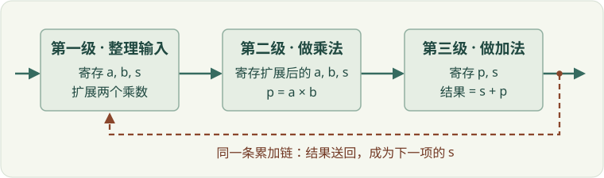

# 第一份结果还没出来，下一份能开始吗？

<span class="micro-legacy-anchor" id="pipeline-register-插入路径延迟与吞吐的权衡"></span>

[上一篇](../00-overview/microarchitecture-decisions.md)用两个乘法器和一个加法器算点积。第二拍，加法器把 8 和 15 加成 23，同时两个乘法器已经能接下一组四个数。如果每拍都能供齐四个数，下游也能接收，这个电路填满后每拍可以交出一个完整的点积，每个点积含两项乘积。

现在换一种硬件：同一个点积交给一条乘加流水线，分两次完成。这里每接收一项输入，做的是**一次乘加**。第一项是 `0 + 2 × 4`，第二项是 `8 + 3 × 5`。第二组乘数 3 和 5 早就有了。它能紧接着在下一拍进入流水线吗？

先把第二项暂时改成一道独立的题 `0 + 3 × 5`。这一次，第二项的三个输入都已就绪。下面给这两项工作分别取名 A、B，逐拍看看 B 在哪一拍开始。

## 三份工作可以同时处在哪三个位置？

规定每项工作有三个无符号整数输入 `(a, b, s)`，结果是 `s + a × b`。输入在接纳时一起采样，整数位宽足够。为了能逐拍跟踪，给这条教学流水线做如下切分：

<figure class="micro-diagram" tabindex="0" aria-label="三级乘加流水线与结果反馈路径，可横向滚动" markdown="1">



<figcaption>图中每级入口都有寄存器。每份工作有自己的 s，它要一路跟着自己的乘数和乘积走。</figcaption>
</figure>

1. **第一级整理输入。** 入口寄存器收下 `(a, b, s)`，把两个乘数零扩展到乘法器的输入宽度。拍末，第二级收下扩展后的值和同一份 s。
2. **第二级做乘法。** 乘法器算出 `p = a × b`。拍末，第三级收下 `(p, s)`。即使 s 已经就绪，也要保存到自己的乘积到达。
3. **第三级做加法。** 加法器算出 `s + p`，接收端可以在拍末取走结果。

每级只有一个位置，带一个有效位 `valid`。有效位为 1，它的寄存器里就有一项工作。有效位为 0 时，留下的比特没有运算意义。初始各级均为空，输入每拍最多来一项。先假定输出端每拍都接收。

| 周期 | 第一级 · 整理输入 | 第二级 · 乘法 | 第三级 · 加法 | 拍末交出的结果 |
| --- | --- | --- | --- | --- |
| [0,1) | A | 空 | 空 | — |
| [1,2) | B | A | 空 | — |
| [2,3) | C | B | A | t = 3，A 得到 8 |
| [3,4) | D | C | B | t = 4，B 得到 15 |
| [4,5) | 空 | D | C | t = 5，C 得到 9 |
| [5,6) | 空 | 空 | D | t = 6，D 得到 14 |

四份输入依次是 A = (2,4,0)、B = (3,5,0)、C = (4,2,1)、D = (2,6,2)。每行周期从左端的时钟边沿开始，到右端的边沿结束。譬如在 [2,3)，第三级保存 A 的 `(p,s) = (8,0)`，正在相加。第二级同时用 B 的 `(3,5,0)` 做乘法。B 能先开始，是因为 A 已经让出了它要用的硬件，而且 B 的三个输入都已就绪。

## 同一条流水线，为什么有时三拍才能开始下一项？

把 B 的旧累加值恢复成 A 的结果，这就回到了点积。A 在 t = 0 进入。第三级在 [2,3) 算出 8，假定反馈连线从加法器输出直达第一级输入，能在 t = 3 的采样窗口前稳定。此时 B 才能带着 `(3,5,8)` 进入。它在 t = 6 得到 23。如果芯片要等结果写回后再读，时间还会更晚。

| 发给同一条硬件的任务 | 两项的接纳边沿 | 两项的结果边沿 |
| --- | --- | --- |
| 分别算两份独立结果 8、15 | 0、1 | 3、4 |
| 顺序更新同一个累加值，得到 8、23 | 0、3 | 3、6 |

横着看第一行，**一项计算的延迟**是从接纳输入到结果就绪的三拍，**启动间隔（II）**是连续接纳独立输入时相邻两次启动相隔的一拍。流水线填满后，每拍交出一个乘加结果。从 t = 0 到 t = 6 的整段时间里，实际完成的是四次乘加，平均每拍 4/6 次。按相同条件连续送四项，最后一项在 `3 + (4 − 1) × 1 = 6` 拍后完成。第二行的硬件仍有每拍接收一项的能力，但这条累加链每三拍才有一份完整输入。等待期间，如果另一个输出也要算、它的输入又都已就绪，就有机会利用空出来的级。改变单个点积的求和顺序还要检查舍入、溢出等数值规则。[反馈环与多条独立累加链](./feedback-loop-clock-constraint.md) · [AMD 对流水线延迟与 II 的说明](https://docs.amd.com/r/en-US/ug1399-vitis-hls/Pipelining-Paradigm)

## 如果结果没人接，下一份数据放在哪里？

重新给流水线送四道独立的题，只把输出端改成在 t = 3 不能接收。规定输出端在时钟边沿同时看到 `valid = 1` 和 `ready = 1` 才取走结果。本例采用整线一起停的控制：末级有有效工作而接收端还没准备好，这个边沿所有级都保持，上游也要保住正在等待进入的 D。可以逐项检查边沿两侧的寄存器：

| 采样边沿（各级状态记在沿后） | 该沿采样的输出 ready | 第一级 · 输入值 (a,b,s) | 第二级 · 扩展后的 (a,b,s) | 第三级 · (p,s) | 这一边沿的交接 |
| --- | --- | --- | --- | --- | --- |
| t = 2 沿后 | 1 | C (4,2,1) | B (3,5,0) | A (8,0) | C 进入 |
| t = 3 沿后 | 0 | C (4,2,1) | B (3,5,0) | A (8,0) | 停一拍，D 等在入口 |
| t = 4 沿后 | 1 | D (2,6,2) | C (4,2,1) | B (15,0) | A 的 8 被取走，D 进入 |
| t = 5 沿后 | 1 | 空 | D (2,6,2) | C (8,1) | B 的 15 被取走 |
| t = 6 沿后 | 1 | 空 | 空 | D (12,2) | C 的 9 被取走 |
| t = 7 沿后 | 1 | 空 | 空 | 空 | D 的 14 被取走 |

看 t = 3 这一行，三个有效位都保持为 1。A 的结果 8 已经在输出端，接收端要到 t = 4 才真正取走它。这一拍若把第三级清空，就会丢掉 A。若让 B 的 15 覆盖 A 的 8，同样会丢。整条流水线可以用“已接纳数 − 已交出数 = 当前有效级数”自检。例如 t = 4 沿后是 4 − 1 = 3。采用逐级反压的设计还可以使用空位暂存工作，抽出其中一个位置就能推导它的接纳条件。[逐级停顿与反压](./stalls-and-backpressure.md) · [Arm AXI 规范 Issue L，第 A2 章的握手规则](https://documentation-service.arm.com/static/68b03beb01ae952d9559f9eb)

## 一次前馈切分

上面假定每级工作都能在一拍内做完。设计者为什么愿意多放一级寄存器？看一个单独的两级时序算例。原来输入在同一拍走完逻辑 A 和逻辑 B，再由输出寄存器采样。现在在 A 和 B 之间插入一个寄存器，第一拍保存 A 的结果，第二拍才让输出寄存器采样 B 的结果。

| 按各自最短可行周期比较 | 切分前 | 在 A、B 中间插一级 |
| --- | --- | --- |
| 每段完整 setup 要求 | 2 ns | A 段 1.2 ns，B 段 1.3 ns |
| 该域周期下界与频率上限 | 2 ns，500 MHz | 1.3 ns，约 769 MHz |
| 一笔输入到结果 | 1 拍，2 ns | 2 拍，2.6 ns |
| 每拍可接收一笔独立输入时的启动间隔 | 1 拍，2 ns | 1 拍，1.3 ns |

这里假定该域无其他更慢路径，数值已计入示例中的寄存器、布线与时钟修正，且资源、输入依赖和接口允许 II = 1。切分后，连续两笔工作可以启动得更密，单笔工作反而晚了 0.6 ns。这组数值来自手算。换一种切分，单笔延迟随周期和级数的乘积而变，不能只看提高了多少 MHz。[时钟同步与 setup、hold](./global-clock-synchronization.md) · [频率与吞吐](./frequency-is-not-throughput.md) · [Chris Terman 的流水线时序讲义](https://computationstructures.org/lectures/performance/performance.html)

## 前提与代价

切分后要为每一级的有效位、数据、目的标签和异常信息一起安排寄存与停顿。若存在分支或多条输入路径，还要保证取消和汇合发生在正确的工作项上。每个寄存器位都消耗面积、时钟功耗、布线和时序预算。级数增加还可能带来时钟树开销、hold 修复和拥塞。切分是否值得，取决于段与段是否平衡、其他路径有多慢，以及工作负载能否持续提供独立输入。

## 建模启示

在事务级模型中，可以用下面这些字段描述流水切分。在有停顿时，还要跟踪输入何时被接纳、结果何时被交出，以及反馈值何时可用。

```text
Pipeline { stages, latency_cycles, initiation_interval_cycles,
           stage_setup_requirements, area, power, clock_domain }
T_domain >= max(all_valid_setup_requirements_in_domain)
```

估算一个时钟域的周期，要取该域所有有效路径的完整 setup 要求的最大值，并独立检查 hold 和跨时钟域接口。II = 1 来自实际实现或明确的模型假设。模拟器可以用上面的两组轨迹分别检查连续发射能力、真实数据依赖，再让下游停一拍检查数据能否按序交出。

接下来把问题交给发射电路：队列里第二条指令还在等上游结果，第三条指令的输入已经齐了。哪一个信号能证明第三条可以先走？[下一篇：第二条指令在等，第三条能先执行吗？](../03-instruction-execution/dependencies-bypass-issue.md)
