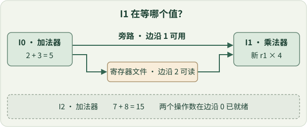

# 第二条指令在等，第三条能先执行吗？

<span class="micro-legacy-anchor" id="数据依赖旁路与发射"></span>

上级：[指令执行与处理器控制](./README.md)

寄存器里明明存着一个可以读的数 9，乘法器也空着，处理器为什么还要扣住一条「乘以 4」的指令？看下面三条指令。左边是结果要写入的寄存器，右边是计算要用的数。

```text
I0    r1 ← r2 + r3       2 + 3 = 5
I1    r4 ← r1 × r5       取 r1，再乘 4
I2    r6 ← r7 + r8       7 + 8 = 15
```

从上往下算一次。I0 把 `r1` 从 9 改成 5，I1 应该得到 20。它若早读了一拍，就会得到 36。I2 却随时可以拿 7 和 8 做加法。在上一篇里，流水线可以连续接收独立的输入。现在让三条指令一起排在入口，沿着 5 和 15 各走一遍，看谁必须等，谁有机会先走。[回看流水线如何接收下一组输入](../02-pipeline/pipeline-register-insertion.md)

## 硬件怎样知道，明明读得到的 9 已经过时？ {#先把依赖和冲突分开}

在程序里，`r1` 是个可以反复写的名字。在处理器里面，可以让它先后指向不同的物理寄存器。给这些实际存放数据的位置编上号。假设程序开始时，编号 P4 的位置存着 9，处理器的映射表里记着「`r1` 在 P4」。

现在按程序顺序接收这三条指令。收到 I0 时，处理器看到它将要写 `r1`，就分配一个空闲位置 P12。它把「结果写 P12」交给 I0，把供后续指令查找的映射改成「`r1` 在 P12」，并把 P12 标成**尚未就绪**。这时加法还没做，P4 里的 9 也还在。改变的只是下一条指令该去哪里找 `r1`。

接着收到 I1。它一查 `r1` 就得到 P12，于是在等待队列里记下第一个操作数等 P12，第二个操作数 4 已就绪。队列只需记住这个编号，甚至不必知道最终会等来 5。P4 即使一直报告「有值」，编号也对不上。I2 查的是 `r7` 和 `r8`，两个位置都有可用的数，因此可以立即参加选择。

这样为不同写入分配不同物理位置，就是**寄存器重命名**。I0 生产一个值、I1 必须读这次写入，叫**写后读依赖（RAW）**。下面用 P12 演示的是一种带重命名的实现，具体编号由我们选定。[BOOM 的重命名映射和物理寄存器就绪状态](https://docs.boom-core.org/en/latest/sections/rename-stage.html)

## 两条指令都已就绪，这一拍谁先走？ {#就绪不等于获准执行}

从边沿 0 开始计时，三个队列位置都已填好。每拍最多选一条指令，让它占用相应运算单元的入口，这个动作叫**发射**。把「第几拍发射」记在这一拍的起始边沿，输入只需赶上这一拍约定的取数时刻。机器有一个加法器、一个乘法器，均可每拍接收一组输入。加法一拍出结果，乘法两拍。两个候选都能执行时，我们约定选程序里靠前的那条。

边沿 0，I0 和 I2 都申请加法器。I1 还在等 P12，发不出请求。控制器从两份申请里选 I0，把 2 和 3 送入加法器。I2 的请求留到下一拍。此时它的等待和 I1 有什么区别？**再给机器一个发射名额和一个可用的加法器入口，I2 就有机会同时起步。I1 缺的那个数，仍得由 I0 算出来。** 如果下游暂时不能接收输入，获选的工作也要留在上游或按协议重试。[停顿时怎样保持状态](../02-pipeline/stalls-and-backpressure.md)

## 加法器已算出 5，乘法器为什么还要多等一拍？ {#旁路需要哪些硬件和判断}

<figure class="micro-diagram" tabindex="0" aria-label="三个指令的操作数依赖和两条取值路径，可横向滚动" markdown="1">



<figcaption>沿两条路径跟踪 I0 为 P12 生成的 5。图中「边沿 1 可用」「边沿 2 可读」标的是哪一拍发射的操作能取得 5，具体取数发生在拍内。</figcaption>
</figure>

先遮住上方的直连线，沿下方走。I0 在边沿 1 算出 5，带着目标编号 P12 送往寄存器文件，固定在边沿 2 写回。调度器事先就知道这个拍号，可以把需要 P12 的 I1 安排在第 2 拍。沿这拍内部的先后看，先把 5 写进 P12，再读 P12，把 5 和另一输入 4 送给乘法器。这里假设该拍给先写后读和运算留足时间。I1 的两拍乘法从获准占用入口的第 2 拍算起，到边沿 4 得到 20。

再放开上方的线。相同的一份「P12，数值 5」可以从加法器直接送到乘法器输入端，这条近路叫**旁路**。调度器知道第 1 拍就能经这条线取数，于是 I1 可以提前一拍参与选择。若它获选，输入选择器匹配 P12，检查结果仍有效，把 5 送到乘法器。乘法占用第 1、2 两拍，到边沿 3 得到 20。边沿 2 的正常写回仍然照常发生。

这里需要送两样东西。**「P12 即将可用」**的通知使 I1 来得及参加选择，这叫**唤醒**。**数值 5**必须在约好的时刻抵达选中的端口，才能真的做乘法。BOOM 的整数 ALU 可在发射时发出这类提前通知，浮点运算和 load 则等写回时唤醒。若设计者想靠预测一次 load 命中来提前启动消费者，预测落空时就要撤销并重新执行受影响的操作。BOOM 文档把这种投机发射列为未来方案。[BOOM 发射单元、唤醒与重放](https://docs.boom-core.org/en/latest/sections/issue-units.html)

实际设计还要让数据线、编号匹配和选择器都赶上接收端的采样边沿。执行端越多，可能的来源就越多，一份数据也可能要驱动更多输入。旁路能省下表里的一拍，前提是这段连线和逻辑走得完。[操作数选择网络的代价](../01-datapath/mux-and-data-movement-cost.md) · [时序与采样约束](../02-pipeline/global-clock-synchronization.md)

## 同一个空出来的第 1 拍，可以让谁用？ {#一个明示时序的例子}

把加法器、乘法器和刚才的三条指令放回同一张表。第 0 拍指边沿 0 到边沿 1，表中记录的是每拍开始时**谁获准发射**。假设读写端口充足，允许同一边沿写回两个不同的结果。

| 规则 | 第 0 拍发射 | 第 1 拍发射 | 第 2 拍发射 | 第 3 拍发射 | I1、I2 各何时算完 |
| --- | --- | --- | --- | --- | --- |
| 顺序发射，无旁路 | I0 | 空，等 I1 | I1 | I2 | 边沿 4、4 |
| 允许越过等待者，无旁路 | I0 | **I2** | I1 | — | 边沿 4、**2** |
| 顺序发射，有 I0 到 I1 的旁路 | I0 | **I1** | I2 | — | 边沿 **3**、3 |

比较前两行，只改变控制器能看哪些候选。顺序发射时，下一个位置属于 I1。它发不出去，后面的 I2 也走不了。允许越过等待者后，控制器在边沿 1 找到了已经备好 7 和 8 的 I2。它借这一拍算完加法，15 提前两拍出现。可最后一个结果仍要到边沿 4 才有，因为两行里的 I1 都要等到第 2 拍才能从 P12 读到 5。

再比较第一行和第三行，两行都要求按顺序发射。旁路让 I1 在第 1 拍拿到 5，用上这一拍的是原来被挡住的乘法。结果出现得更早，与前一行的“让另一条指令先算”是两种不同的变化。

## 先算出 15，程序状态也先更新吗？

沿表格第二行继续走。I2 在边沿 2 算出 15，边沿 3 把它**写回**为 `r6` 新分配的物理位置。假设原来的 `r6` 是 99，原来存 99 的位置还留着。此刻 I1 还在做乘法。若要观察「程序顺序执行完 I0」的状态，`r1` 应为 5，`r6` 应为 99。假如先把 15 当作程序正式的 `r6`，这个状态就多出了一条尚未轮到的指令的效果。

处理器可以把 I0、I1、I2 按原来的顺序记在**重排序缓冲区（ROB）**里，各自算好时给自己的位置做标记。确认程序正式状态的动作叫**提交**。每次从队首看，较老的指令已经顺利完成才允许它提交，然后才轮到下一条。要看为什么值得保留旧值 99，可以把 I1 临时换成从新 `r1` 指定的地址读一个字节。假定地址 5 所在的页不允许读，访存错误到 I2 写回 15 后才报告。I1 到 ROB 队首时，处理器处理这次异常。I1 本身不提交，处理器丢弃 I1、I2 的更新，恢复到 I0 提交后的映射。此时异常处理程序读 `r6`，会从旧位置读出 99。新位置里的 15 无须倒算回去，恢复后的 `r6` 已经不指向那里了。[BOOM 怎样按序提交及处理异常](https://docs.boom-core.org/en/latest/sections/reorder-buffer.html)

把 I1 换回最初的乘法，沿用无旁路、允许越过等待者的日程，三条指令都无异常。再约定每个边沿最多提交一条，最早在自己写回后的下一个边沿提交。

| 指令（程序顺序） | 发射 | 运算结果产生 | 写回物理寄存器 | 按序提交 |
| --- | --- | --- | --- | --- |
| I0 | 边沿 0 | 边沿 1 | 边沿 2 | 边沿 3 |
| I1 | 边沿 2 | 边沿 4 | 边沿 5 | 边沿 6 |
| I2 | 边沿 1 | 边沿 2 | 边沿 3 | **边沿 7** |

在边沿 3 停下来，同一个 15 有两个可检查的身份。它作为 I2 的结果已经写回，随后依赖新版 `r6` 的指令有机会使用它。但此时提交的是 I0，正式的 `r6` 仍为 99。边沿 6 轮到 I1，边沿 7 才轮到 I2，此时才确认这个位置是程序应见的 `r6`。表里各事件之间的拍数是本例的约定。[从取指到提交，继续看异常和写内存的处理](./instruction-lifecycle.md)

## 把 I2 也改成写 r1，会发生什么？ {#延迟启动间隔与依赖距离}

现在只改第三条指令的目的地，把 `r6 ← 7 + 8` 改成 `r1 ← 7 + 8`。让 I2 像刚才一样抢先算出 15。I1 此后用哪个数乘 4？

**重新走一遍分配的先后。** I0 领取 P12 时，后来查找 `r1` 的指令会看到 P12。I1 在这个时候进入队列，已经把 P12 填入自己的源操作数位置。再轮到 I2，处理器给这次写入另分配 P18，更新映射供更后面的指令查找。即使 I2 提前写了 P18，I1 等待的编号依然是 P12。它既不会拿到旧的 9，也不会误拿程序后面才产生的 15。三条都提交后，`r4` 是 20，`r1` 才是 15。

这个改动同时暴露了两个同名问题。I1 要读 `r1`，后面的 I2 又要写它（读后写，WAR）。I0 和 I2 还都要写 `r1`（写后写，WAW）。分配 P12 和 P18 就能把这两次写入分开，而 I1 对 P12 的真正依赖仍然保留。内存读写还要判断两个地址是否指向同一处，寄存器编号无法回答这个问题。

回到上一篇的流水线。如果乘法器三拍才出结果，每拍可收新输入，三个独立乘法可以在边沿 0、1、2 发射。把算式改成每次都要上一次的乘积，假设一算好即可旁路，那么三个发射边沿就成了 0、3、6。和 I1 等 P12 一样，空出的执行入口只能接收**输入已经能按时到达**的工作。[循环中的反馈依赖](../02-pipeline/feedback-loop-clock-constraint.md)

刚才，I2 能抢先执行，是因为它的数据已经齐了。如果十个独立加法的操作数全都齐了，给它们四条执行通道，最后两个加法会轮到谁？[下一篇：十个独立的加法，怎样分给几条执行通道？](../04-parallel-execution/simd-vector-simt.md)

如果想直接看相邻单元怎样传数，可以[跟踪 2×2 脉动阵列里的八次乘加](../04-parallel-execution/why-systolic-array.md)，看看左上角已经开工时，右下角还在等什么。
