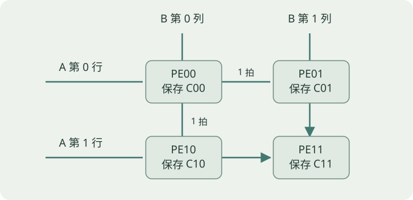

# Systolic array：用局部传递和复用组织计算

上级：[并行执行与计算阵列](./README.md)

Systolic array 把多个处理单元（PE）按邻近连接组织起来。数据按约定节奏传递，在正确的 PE、正确的拍相遇，完成运算。局部复用能减少某些边界的搬运；启动、排空、停顿和低填充率仍要计入时间。

## 一个 2×2 矩阵的逐拍例子

构造 C = A×B，其中 A = [[1, 2], [3, 4]]，B = [[5, 6], [7, 8]]。四个 PE 分别保存一个输出的部分和，初始为零。整数表示足够宽，不溢出。

这是 output-stationary 教学阵列：A 沿行向右传，B 沿列向下传；每个 PE 每拍完成一次乘加，相邻 PE 之间传递需一拍。每行和每列的入口按位置错开一拍，使相同 k 的 A[i,k]、B[k,j] 同时到达 PE(i,j)。

<figure class="micro-diagram" tabindex="0" aria-label="2×2 阵列结构，可横向滚动" markdown="1">

<figcaption>相邻传递各需一拍；窄屏可横向滚动查看。</figcaption>
</figure>

| 计算拍 | 左侧输入：第 0/1 行 | 顶部输入：第 0/1 列 | 本拍有效乘加与拍末部分和 |
| --- | --- | --- | --- |
| 0 | 1 / 无 | 5 / 无 | PE00：0 + 1×5 = 5 |
| 1 | 2 / 3 | 7 / 6 | PE00：5 + 2×7 = **19**；PE01：1×6 = 6；PE10：3×5 = 15 |
| 2 | 无 / 4 | 无 / 8 | PE01：6 + 2×8 = **22**；PE10：15 + 4×7 = **43**；PE11：3×6 = 18 |
| 3 | 无 / 无 | 无 / 无 | PE11：18 + 4×8 = **50** |

“无”表示没有有效元素，不能把无效输入当作一项有效乘加。拍 1 的 PE01 使用前一拍从 PE00 传来的 A 值 1；PE10 使用从 PE00 传来的 B 值 5。入口若不做错位，就会把不同 k 的操作数配在一起。

四拍共完成 8 次有效 MAC。四个 PE 的 16 个 PE-cycle 中只有 8 个用于有效运算。这个 50% 是本例计算窗口的利用率，不是长矩阵或连续 tile 的固定效率。

## 计算结束与结果排空

全部部分和在 t = 4 就绪。再假设只有一个结果输出端口，每拍取走一个 PE 结果，且本例直到计算结束才开始排空。四个结果在 [4,8) 依次输出，总完成时间为 8 拍。

这四拍排空是本例选择的结果路径，不是 systolic 阵列的固有延迟。实现可以使用更多输出端口，或在满足资源与所有权条件时提前输出。比较时必须说明采用哪一种。

## 插入一拍供数停顿

若计算拍 2 之前无法提供下一组输入，本例采用全阵列同步停顿：入口进度、A/B 传播寄存器、有效位和各 PE 累加器一起保持。停一拍后从同一个计算拍恢复，结果仍为 [[19,22],[43,50]]，全部结果就绪时间变为 t = 5；沿用上述排空规则，总时间为 9 拍。

只冻结累加器、却让操作数继续移动，会破坏配对。更灵活的局部停顿可以使用弹性缓冲和标签，但需要额外协议，不能无条件套用这张全局节拍表。状态保持的基本机制见[停顿与反压](../02-pipeline/stalls-and-backpressure.md)。

## 流量、时间和实现成本分别统计

本例每个 A、B 元素只在入口注入一次。若每个输入 1 B、每个输出 4 B，则阵列边界流量为 8 + 16 = 24 B，算术强度为 8/24 = 1/3 MAC/B。停顿若不重传或重装，不增加这些字节，却延长时间。

不同驻留方式会改变统计窗口和流量。权重预驻留的 3×2 矩阵向量例子集中在[指标定义](../reading-and-reference/02-analysis/compute-communication-ratio.md)中；[dataflow](./dataflow-taxonomy.md)负责比较驻留位置，[阵列尺寸](./array-sizing-tradeoff.md)负责分析容量与形状。门数代理与 MAC/B 是不同指标。

## 与 CIM 的边界

本例 PE 从寄存器取得操作数，由独立乘加电路计算。权重或部分和驻留在本地，并不自动构成存内计算。按[本系列的术语口径](../08-in-memory-computing/01-overview/cim-pim-nmc-taxonomy.md)，还要判断存储 cell 或阵列路径是否直接参与求值。

## 资料与模型范围

[第一代 TPU 论文](https://arxiv.org/abs/1704.04760)提供实际 systolic 矩阵单元的系统实例；[Eyeriss 原始论文](https://eems.mit.edu/wp-content/uploads/2016/04/eyeriss_isca_2016.pdf)讨论卷积映射中的多种复用。上面的 2×2 轨迹是独立构造的教学模型，不代表这两种芯片的具体数据流或周期数。
