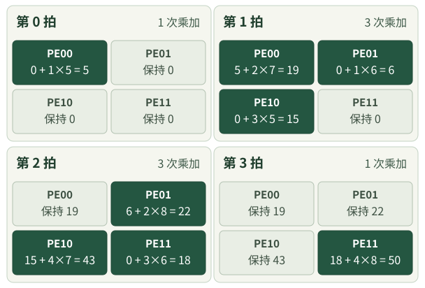

# 四个乘加单元，为什么两拍算不完八次乘加？

上级：[并行执行与计算阵列](./README.md)

把两个 2×2 矩阵相乘，结果有四个数。给每个结果配一个乘加单元，每个单元连续做两次乘加，纸上两拍就排完了。在下面这块芯片里，第一拍却只有左上角在算。其余三个单元的乘法器都空着，它们在等什么？

[上一篇的 SIMD、向量和 SIMT](./simd-vector-simt.md)讨论了一项工作如何交给多个执行通道。这次四个单元各自负责哪个输出，已经分好了。我们只改供数方式：A 从方阵左边进，B 从上边进，一个数每拍只能往相邻单元走一格。

## 右上角需要的 1 和 6 分别从哪里来？ {#一个-22-矩阵的逐拍例子}

取 A 的两行（1，2）、（3，4），B 的两行（5，6）、（7，8）。做矩阵乘法，要从 A 取一行，从 B 取一列，对应位置相乘再相加。把每个单元要做的两次乘加摆回它的位置。

| | B 第 0 列（5，7） | B 第 1 列（6，8） |
| --- | --- | --- |
| **A 第 0 行（1，2）** | 左上 PE00：1×5 + 2×7 | 右上 PE01：1×6 + 2×8 |
| **A 第 1 行（3，4）** | 左下 PE10：3×5 + 4×7 | 右下 PE11：3×6 + 4×8 |

PE 是处理单元。这里每个 PE 有自己的乘加电路和一个保存**部分和**的寄存器。以左上角为例，寄存器初始为 0，先存 0 + 1×5 = 5，下一次再把 2×7 加进这个 5。两次运算之间，5 就留在左上角。我们选用足够宽的整数，所有结果均可精确保存。

<figure class="micro-diagram" tabindex="0" aria-label="2×2 阵列结构与 A、B 的传递方向，可横向滚动" markdown="1">

<figcaption>按同一条行线或列线走一步，就从一个 PE 到了另一个 PE。四个部分和各留在自己的方框里。</figcaption>
</figure>

先跟着 A 里的 1。第 0 拍，它从左边进入 PE00，遇到上边送来的 5，左上角做 1×5。这个 1 在本拍也送往右边，经过两单元之间的寄存器，第 1 拍才能供 PE01 使用。再看 6，它从顶部直接进入 PE01。如果在第 0 拍就送 6，第 1 拍紧接着送 8，会发生什么？第 0 拍的 6 等不到 1。等 1 到时，眼前的数已经换成 8，乘法器会把 1×6 错配成 1×8。

在这个没有额外排队缓冲的阵列里，可以把右边那一列的输入**晚送一拍**。第 1 拍送 6，它恰好与向右走了一格的 1 相遇。左下角同理。5 从 PE00 向下走一拍，因此第二行的 3 也要晚送一拍。入口按行、列错开时间，这就叫输入**错位（skew）**。按这样的固定节拍，让操作数在邻居之间传递并就地计算，就是本例的**脉动阵列**（systolic array）。

## 右下角拿到第一对输入时，左上角已经算完了吗？

从时钟边沿 *t* = 0 开始计。第 0 拍是 [0,1)，每个 PE 一拍可以用当前已到的两个有效数做一次乘加，在拍末把新部分和写回。左侧每行、顶部每列各有一个输入位置。「—」表示这个位置没有有效输入。一个有效的 0 也可以参与乘加，它和「—」含义不同。

| 计算拍 | 左边送给第 0 行 / 第 1 行 | 顶部送给第 0 列 / 第 1 列 | 拍末新算完的输出 |
| --- | --- | --- | --- |
| 0 | 1 / — | 5 / — | — |
| 1 | 2 / 3 | 7 / 6 | 左上 19 |
| 2 | — / 4 | — / 8 | 右上 22、左下 43 |
| 3 | — / — | — / — | 右下 50 |

<figure class="micro-diagram" tabindex="0" aria-label="同一 2×2 阵列连续四拍的四幅快照，可横向滚动" markdown="1">

<figcaption>从左上到右下依次读四幅快照。深色格写出本拍所做的乘加，浅色格写出保留的部分和。四幅图中，同一位置始终对应同一个单元。</figcaption>
</figure>

盯住右下角。第 1 拍，3 在左下，6 在右上。3 用来算 3×5，同时往右送。6 用来算 1×6，同时往下送。到第 2 拍，这两个数才在右下相遇，PE11 把 3×6 = 18 存在自己的寄存器里。此时左上角的 19 已经算完。第 3 拍，入口一个新数也没送，阵列内部却还有 4 和 8 在走。右下角把它们的乘积 32 加到先前的 18，得到 50。图里沿对角线铺开的，是各单元**开始工作的位置**。真正走在线上的 A、B 分别向右、向下。

把任意一对数的到达拍号也算一下。行号 *i*、列号 *j* 和点积中的项号 *k* 都从 0 起。A 的第 *i* 行晚 *i* 拍启动，第 *k* 项从左边进入的拍号是 *i + k*，再往右走 *j* 格。B 的第 *j* 列晚 *j* 拍启动，对应项从顶部进入的拍号是 *j + k*，再往下走 *i* 格。两条路径恰好都在**第 i + j + k 拍**抵达 PE(*i*,*j*)。右下角的最后一项，三个下标都是 1，因此在第 3 拍计算。

逐拍数深色格，有效乘加次数是 **1、3、3、1**，合计 8 次。四个单元运行四拍共有 16 个可用的乘加位置，用上了 8 个，利用率是 **50%**。拿 8 除以峰值每拍 4 次得到的两拍，隐含每一拍、每一个 PE 都同时拥有匹配的输入。图中第 0 拍就不满足这个条件。这里算的是单独这一块从启动到最后一次乘加的窗口，连续送多块工作时，要按各块实际能否衔接重新数。

## 最后一拍乘加完成了，外面能读到几个结果？ {#计算结束与结果排空}

在边沿 *t* = 4 停下来，四个本地寄存器里已经是 **[[19, 22], [43, 50]]**。在阵列外面放一个接收结果的缓冲区，再给它一条每拍只送一个结果的输出通路。如果控制器规定整块算完才开始读，那么到这个边沿，四个数仍都在 PE 里。

从 *t* = 4 开始依次送出 19、22、43、50。第一个在 *t* = 5 交付，最后一个要到 **t = 8** 才交付。换个规定，如果输出通路可以和计算并行、读取已完成的部分和不会影响别的 PE，就可以在 [2,3) 先取走 19。后面依次用 [3,4)、[4,5)、[5,6) 送另三个结果，到 *t* = 6 也能全部交付。两种日程都做八次乘加，都只有一条输出通路，差在谁允许它从哪一拍开始读。

## 只少送一个 4，为什么连阵列里面的数也要等？ {#插入一拍供数停顿}

回到原来的全块算完再输出日程。假设第 2 拍开始前，第二行该送的 4 没准备好。此刻左下角已经存着 15，正要用 4×7 把它更新到 43。它要用的 7 已经从左上角传来。如果仅停住累加器，却继续推进列线上的数，等 4 到时，和它配对的 7 可能已经离开，左下角就少了一项。

本例选择让整块阵列停一拍。入口保留下一组输入进度，行、列之间的寄存器连同各自的有效位都保持，四个累加器也保持，已经送到入口的 8 等着与 4 一起被接收。下一拍恢复时，原来的「计算拍 2」才真正发生。结果仍为 19、22、43、50，全块算完从 *t* = 4 推迟到 *t* = 5，全部送出从 *t* = 8 推迟到 *t* = 9。要让右侧某个单元先走，得另外给还在路上的数留出位置，并能识别随后该和哪一项配对。[一个寄存器怎样在停顿时留住数据](../02-pipeline/stalls-and-backpressure.md)

## 左上角用过了 1，为什么右上角不用再读一遍？ {#流量时间和实现成本分别统计}

框住四个 PE，只数穿过这个框的数。A 里的 1 在第 0 拍只从外部送入一次，先参加 1×5，再由右边的 PE 用来算 1×6。B 里的 5 也只送入一次，沿列供 1×5 和 3×5 两次使用。A、B 合计八个输入，各占 1 字节，最终四个输出各占 4 字节。输入和输出穿过阵列边界共 **8 + 16 = 24 字节**。八次有效乘加对应的算术强度是 **8/24 = 1/3 MAC/B**。刚才整块停一拍，输入无需重传，因而字节数照旧，完成时间却延长了。阵列内的转发、寄存器读写和控制照样消耗硬件与能量，面积和功耗还需分别估算。[算术强度应在哪个边界统计](../reading-and-reference/02-analysis/compute-communication-ratio.md)

这四个 PE 中，最值得留意的是**哪一份数始终没出过自己的格子**。右下角的部分和经历了 0、18、50，直到完成才输出，这叫**输出驻留**（output-stationary）。如果 B 是多组输入共用的权重，也可以让 B 留在 PE，随后把不同的 A 送到它面前。此时要先回答，第一块权重从哪里装进来、何时装满，以及原有权重是否还会被使用。例如每拍能从顶部送入两个权重、整行逐拍向下移，装满这个 2×2 阵列需要两拍。如果当前四个权重还在用，想同时装入下一整块，就得另外留出存放位置，并确保装入不占用当前计算所需的端口。部分和此时在哪里合并，也要随新的接线重画。[比较几种驻留方式](./dataflow-taxonomy.md) · [权重怎样逐拍装入](./weight-loading-and-trickle-feed.md)

再往上游看一步。权重缓冲只要能存下这四个数，容量就够装这一块。但要连续两拍各送出两个数，还要核对它们放在哪个 bank、同拍有多少读端口可用。[存储系统：权重缓冲要多大，能否每拍供足权重？](../../storage/01-memory-hierarchy/04-npu-case/npu-memory-hierarchy.md#supply)

换一块 4×4 阵列试同一题。如果仍然让一个 PE 专管一个输出，又只有这一个 2×2 输出块，实际使用的仍是左上角的四个 PE。按同样的入数节拍做完，四拍内全阵列有 64 个乘加位置，只用上八个。要让多出来的行和列干活，还得找到其他独立输出，给它们送来输入并收走结果。增大阵列后，可用的算力、供数端口和工作量形状要一起考虑。[阵列尺寸与供数能力](./array-sizing-tradeoff.md)

## 让权重留在本地，就算存内计算了吗？ {#与-cim-的边界}

看乘积在哪里形成。本例的输入即使只从远处读一次，PE 仍从寄存器取数，再交给独立的乘加电路。若改为让存储单元或读出阵列的路径直接参与求值，就改变了执行乘法或求和的硬件。判断一份设计属于哪一种，可以先顺着操作数走到真正产生乘积的位置。[存内计算和近存计算的具体边界](../08-in-memory-computing/01-overview/cim-pim-nmc-taxonomy.md)

## 换到真实芯片，还应对照哪些条件？ {#资料与模型范围}

第一代 TPU 的论文图 4 画出数据从左侧进入，权重从顶部预载，再随运算推进生效。Eyeriss 针对卷积提出行驻留，在本地复用滤波权重、输入以及部分和。读实物图时，可以照本文一样标出谁负责哪个输出、哪一份数跨过哪条边界，再按该硬件的加载和输出通路排拍。这里的 1、3、3、1 来自上面自己搭的输出驻留阵列。[第一代 TPU 论文](https://arxiv.org/abs/1704.04760) · [Eyeriss 原始论文](https://eems.mit.edu/wp-content/uploads/2016/04/eyeriss_isca_2016.pdf)

现在阵列终于把一块结果交了出去。如果后面还有第二块工作，第一块还在算的时候，搬运引擎能提前把第二块的输入写到哪里？什么时候可以覆盖第一块占过的位置？[继续看搬入、计算和写回怎样处理两个分块](../06-task-control/dma-compute-writeback.md)
