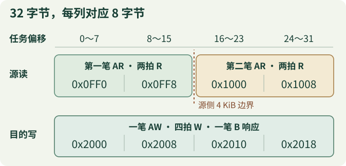

# 一条 DMA 描述符，为什么会变成多笔读写请求？

上级：[基础对象与传输语义](./README.md)

沿用[两个分块的例子](../../06-task-control/dma-compute-writeback.md)。第一块输入有 16 字节，阵列等着从片上缓冲 I0 读取它。控制器只提交了一条命令，DMA 却从源端发出两笔读请求。假如第二笔先返回，I0 中哪些位置可以写入？阵列现在可以开工吗？

那台教学机器规定**每笔读请求最多取 8 字节**，所以任务偏移 0～7 和 8～15 分属两笔请求。先回来的若是后一笔，它带回的就是后八个字节。即使已经把它们写进 I0，前八个字节也可能还是旧值。阵列约定整块开工，就得等到两半都成功写入且可读。这里的 8 字节是对**一整笔请求**的上限。下面换一台 AXI4 机器，它**一次数据握手**传 8 字节，同一笔请求可以连续传多次。仍然只提交一条命令，看什么会决定读写请求的数量。

## 软件说「搬 32 字节」，它要求哪些地址一一对应？

给 I0 的起点选一个具体地址 0x2000。把源地址设为 0x0FF0，长度增加到 32 字节，源和目的都按字节递增。现在软件要求每个偏移都能对上。对于从 0 到 31 的每个偏移 *k*，目的地址 **0x2000 + k** 最终保存源地址 **0x0FF0 + k** 原有的那个字节。这里假设两个区间不重叠，访问已获授权，搬运期间源数据保持不变。

软件把源、目的和长度等参数写下来的记录叫**描述符**（descriptor）。这一整段字节怎样对应，是它描述的**逻辑搬运**。DMA 真正去访问源或目的时，每发出一个读或写地址并完成相应的数据传送和响应，就是该接口上的一笔**事务**。可以先把源和目的都想成普通存储区，试着只发一个源读地址、一个目的写地址，看看问题出在哪里。

## 为什么读到 0x0FFF，必须重新发一个地址？

先从源端走。本例源、目的两侧都是 64 位 AXI4 数据接口，支持地址递增突发（INCR burst）。两侧起点均按 8 字节对齐，这次 32 字节搬运的每个数据拍（beat）传 8 字节。一笔突发只发送一次起始地址、拍数和每拍大小，接收端由它们推算后续地址。某一拍只有在该通道的 VALID 和 READY 同时为 1 的边沿才交接成功。中间若有等待，四个数据拍可以花超过四个时钟周期。[AXI 的五条通道怎样握手](../../../interconnect/BUS/03-on-chip-protocol-families/axi-five-channels-handshake.md)

试排四拍。第一拍覆盖 0x0FF0～0x0FF7，第二拍覆盖 0x0FF8～0x0FFF。第三拍的起点将是 0x1000。AXI 要求**同一笔突发覆盖的地址不能跨越 4 KiB 边界**。所以 DMA 在发读地址之前就要算一遍，距离下一个边界只剩 0x1000 − 0x0FF0 = 16 字节，正好够两拍。把起点不变的四拍请求发出去，再在数据通道暂停或提前结束，都不能让这笔请求合规。[Arm AXI 规范 A3.4](https://developer.arm.com/-/media/Arm%20Developer%20Community/PDF/IHI0022H_amba_axi_protocol_spec.pdf?hash=6325311012DDADF238C35A6C0FD734E520754F82&la=en&revision=71bd7c57-2ed7-487b-bc3e-68c4ab56fa5f) · [AXI 突发、对齐与边界](../../../interconnect/BUS/03-on-chip-protocol-families/axi-burst-alignment-boundary.md)

<figure class="micro-diagram" style="width: 100%; max-width: 37rem" tabindex="0" aria-label="32 字节分别在源端和目的端组成哪些事务，窄屏可横向滚动" markdown="1">

<figcaption>同一列始终代表同样的八个字节。横轴是任务内偏移，色框圈出同一笔事务。它们在硬件里握手的时刻可以不同。</figcaption>
</figure>

图上方读地址通道 **AR** 要完成两次握手。第一笔的起点是 0x0FF0，第二笔的起点是 0x1000，每笔各请求两拍。读数据沿 **R** 通道返回，每笔有自己的最后一拍标志 RLAST，并且每个数据拍都带读响应状态。若监视器数到 **2 次 AR、4 次 R、2 次带 RLAST 的 R**，这三项正好说的是同一次 32 字节搬运在源接口留下的记录。尚未收到的数据和收到出错响应的数据，都不能算作已经成功取得的输入。

## 两笔读回来的字节，目的端能合成一笔写吗？

从图下方的地址再算一次。0x2000、0x2008、0x2010、0x2018 四个拍的范围都在同一 4 KiB 窗口内。假设目的端支持四拍递增写，DMA 也能为它按顺序提供数据，就可以只发**一笔写地址（AW）、四个写数据拍（W），接收一个写响应（B）**。四拍覆盖 0x2000～0x201F。DMA 也可以采用更简单的做法，每收齐一笔 16 字节的读数据，就发一笔对应的两拍写。两种做法都能把同一批字节放到相同地址，后一种会有两个 AW 和两个 B。

为什么合并需要硬件配合？设两笔读使用不同的事务 ID，系统允许后一笔先返回。落在偏移 16～31 的字节属于本次写突发的第三、四拍。即使它们先回来，DMA 也不能把它们当作第一、二拍送出去，否则 0x2000 开始的 16 字节就全错了。它需要保留「这一笔读对应任务的哪个偏移」，给早到的数据找暂存位置，再让写通路按目的地址顺序取数。若选择两笔独立的写，且接口和任务的顺序契约允许，可以先写目的区的后半段。读写两侧分别怎样拆分，由各自的地址约束与引擎能力共同决定。[DMA 引擎的组成](../03-dma-microarchitecture/engine-components.md)

**最后一个 W 被接收，能否立刻通知阵列？** 把图中的四拍写完，只说明数据已在 W 通道完成交接。AXI4 的 AW 与 W 使用独立通道。目标端要等写地址和带 WLAST 的最后一个数据拍都已握手，才可以给出 B。DMA 还要接收并检查这个 B 的状态。若写被拆成两笔，就得把两笔的状态都算进去。能否让阵列读 I0，还要看这个响应和目标可见性之间的约定。对于允许中间缓冲提前应答的路径，B 可能来自中间节点。在本例，只有整块成功、并且全部字节对阵列可读时，才允许发布“输入可用”。若目标换成不一致的 CPU 缓存，还须完成相应的缓存同步和所有权交接。[DMA 与主机缓存的同步](./noncoherent-vs-coherent-dma.md)

## 若最后只剩 5 个字节，另外三根字节通道怎么办？

把刚才的长度从 32 改成 37。前 32 字节的去向照旧，最后要把源 0x1010～0x1014 搬到目的 0x2020～0x2024。假设这次只获准读这 5 个字节，源端支持窄读，那么可以在 0x1010 单独读 4 字节，在 0x1014 再读 1 字节。AXI 的读数据通道没有与写字节选通相对称的读掩码。为了填满总线就读 8 字节，会多访问三个地址。对于外设寄存器，多读甚至可能触发副作用。

如果目的支持对这个对齐地址进行带字节选通的写，可以在 0x2020 发起一个 8 字节写拍，把八位 **WSTRB** 设为 **0x1F**。最低五位置 1，分别允许 0x2020～0x2024 更新，0x2025～0x2027 保持原值。写地址通道上的 AWSIZE 声明本次写的数据拍大小为 8 字节，WSTRB 选中的有效字节只有 5 个。若设备不支持窄读、部分写或所需的非对齐访问，就得改用它支持且对完整地址范围合法的拆分，或由接口拒绝请求。写掩码也不会让一个跨越 4 KiB 的地址序列变合法。

拆分器除 4 KiB 外还要比较哪些边界？

对这里的对齐线性拷贝，一种保守做法是源和目的沿同一偏移切块。一块的字节数受四项限制，包括剩余长度、本次配置允许的最大块长、源端到下一处强制边界的距离，以及目的端到下一处强制边界的距离。取其中最小值作为本块长度。生成两侧分别支持的拍大小与字节范围，再把两个地址都前进这个长度。与图中目的独立合并的做法相比，这种算法简单，却可能多发几次写地址。地址加法还要检查可表示宽度、回绕和权限，端点也要确实支持发出的访问。

AXI4 的 INCR 突发在协议上最多 256 拍，具体引擎可以配置得更短。地址对齐、桥或从设备能接收的长度、局部 SRAM 的 bank 与端口限制，也可能促使实现进一步拆分。有的 bank 冲突只造成等待，应按实际硬件判断。短突发会重复消耗地址握手、仲裁或包头开销。在限制同时在途请求数的系统里，同一窗口能覆盖的字节也更少。长突发可以摊薄这些开销，但若一个繁忙端口按整笔突发仲裁，别的小请求或高优先级流量就可能等更久。哪一侧成为瓶颈，要把响应回程也算进去。[RAM 的通道、bank 与行地址映射](../../../storage/04-dram-controller/address-mapping-channel-rank-bank-row-col.md)

如果下一段走的是 PCIe，读请求要遵守最大读请求大小（MRRS），带数据的包还受最大载荷大小（MPS）等规则约束，内存请求也有 4 KiB 边界。一笔 Memory Read 可以收到一个或多个携带数据的 Completion。普通 posted Memory Write 没有逐笔返回的事务 Completion，因此不能把图中的 B 搬到 PCIe 图上。IOMMU 页边界又是另一层问题。设备看到的连续 DMA 地址可以映射到不相邻的物理页，在哪里做翻译、翻译后怎样访存，要看具体路径。物理页分散不能直接推出软件必须在相同偏移提交新描述符。[AMD PCIe 请求长度与 4 KiB 约束](https://docs.amd.com/r/en-US/pg344-pcie-dma-versal/Max-Payload-Size-for-PCIe-Max-Read-Request-Size-or-4K-Page-Violated) · [AMD PCIe Memory Read 与 Memory Write 的响应](https://docs.amd.com/r/en-US/pg054-7series-pcie/TLP-Data-Flow) · [Linux DMA 地址映射指南](https://docs.kernel.org/core-api/dma-api-howto.html)

## 软件为什么值得把这三个数写进内存？

如果整个程序只搬这一次，CPU 可以直接写 DMA 的源地址、目的地址、长度和控制寄存器，启动后等待完成。现在换成连续很多个分块，或网络接收队列里的一串缓冲区。若每完成一块都要 CPU 再来填一遍寄存器，搬运引擎中间会反复等软件。把若干任务预先写成内存中的描述符，引擎就可以自己取下一条，而每条在内部仍按刚才的方式展开。AMD AXI CDMA 的链式描述符就有下一条描述符指针、源地址、目的地址、控制和状态字段。[AMD AXI CDMA 描述符定义](https://docs.amd.com/r/en-US/pg034-axi-cdma/Scatter-Gather-Transfer-Descriptor-Definition)

链表用下一条指针找到后继。一种环形队列则约定固定槽位，由生产者和消费者的位置确定哪些条目已经发布、哪些槽可以复用，无须在每条记录里都写一个下一跳指针。软件先让字段完整可见，再交出所有权或通知设备。完成令牌可以标识哪一份任务成功或出错，优先级可以影响仲裁，故障策略可以规定是否中止或重试。描述符槽可复用的时刻和数据缓冲区可覆盖的时刻，仍要各按接口的约定判断。[提交队列、门铃与完成记录](../04-programming-model/queues-doorbells-completions.md)

如果 32 字节本来就散在几块不相邻的、设备可访问的地址区间，软件还可以列出各段的 DMA 地址和长度，让引擎按**散布/聚集（scatter-gather）**表或描述符链走完。这样一个逻辑任务可以含多个段，软件无需逐段启动传输。段多时，取表、解析、边界检查、潜在的地址翻译和返回数据配对都可能变多。段数要以 DMA 映射后的结果为准，例如 Linux 的映射接口可以把若干段合并。在网络、存储或分页的用户缓冲区上，这能直接改变引擎实际看到的地址序列。[Linux 对 scatterlist 映射及段合并的说明](https://docs.kernel.org/core-api/dma-api-howto.html#using-streaming-dma-mappings)

如果要模拟这 32 字节，最少应记下什么？

可以给任务一个 descriptor_id，给每个子请求保存方向、起始地址、字节数、任务内偏移及触发拆分的边界。用前面的一写方案，展开记录应含两个 16 字节读和一个 32 字节写。subreq_count 为 3，三个条目各有自己的完成状态。若还要算描述符的读取流量，应另记控制路径上的取描述符请求，避免把它算成第四笔载荷事务。

事件驱动模型可以记录描述符取回（descriptor_fetch_done）、事务拆分（transaction_split）、读发出（read_issue）、逐拍读返回、写发出（write_issue）、写响应以及对消费者可见的完成。若统计边界代价（boundary_penalty），应明确它指向哪一次额外仲裁或等待，避免已经逐笔计时以后再重复加罚。只估稳态吞吐时，可以把展开结果折叠成长度分布和平均边界代价。要分析顺序、跨页或故障归属，就还原每一笔以及字节偏移，才说得清报错的是哪 16 字节、还有什么正在路上。

再回到要交给阵列的这一块。刚才的 32 字节在源端首尾相连。如果换成一幅图像中的三小行，每行末尾还隔着填充字节，DMA 怎样知道下一行从哪里读、又从哪里写？可以先沿[多维 DMA 的行间距与地址生成](../03-dma-microarchitecture/multidimensional-stride-dma.md)算出每行地址，再去看[多笔请求在途时怎样调度和安放回包](../03-dma-microarchitecture/scheduling-outstanding.md)。
