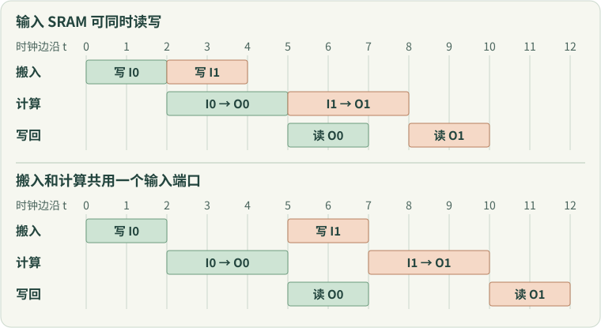

# 第一块还在算，第二块能开始搬吗？

上级：[任务控制、同步与资源管理](./README.md)

[上一篇的脉动阵列](../04-parallel-execution/why-systolic-array.md)里，左上角的乘加单元已经在算，后面的数据还在路上。现在把视线移到阵列入口。假设一层计算分成两个独立的小块（tile），片上输入区放得下两块数据。第一块的最后几个数还在被阵列读取，能让搬运引擎现在就去取第二块吗？

沿两块数据走一遍。输入放在 I0、I1，结果放在另外两个位置 O0、O1；每个位置容纳一整块。先用可以同时搬入、计算、写回的设计，再保持这四块空间不变，只把输入 SRAM 的读写改成共用一个端口。两种设计做同样的工作，第二块结果会相差两拍才到达目的地。

## DMA 取到了描述符，阵列就可以读了吗？

块 0 的输入有 16 字节。控制器向搬入引擎提交一条**描述符**，其中给出源地址、目的位置 I0 和长度 16 字节。DMA（直接内存访问）引擎读到它时，只是知道去哪里取哪些数。此时若阵列去读 I0，里面甚至可能还是上一轮留下的值。[DMA 的地址、描述符与事务拆分](../05-dma/02-fundamentals/address-descriptor-burst.md) · [AMD AXI CDMA 实际使用的描述符字段](https://docs.amd.com/r/en-US/pg034-axi-cdma/Scatter-Gather-Transfer-Descriptor-Definition)

为了看清中间步骤，给这台教学机器规定每笔读请求最多取 8 字节。DMA 算出两个源地址，分别从起始地址和起始地址加 8 处读 8 字节。它可以先后发出两笔请求，再按请求所对应的偏移，把回来的数据写入 I0 的前半或后半。哪怕后半先返回，也只更新后半，仍有前半没到。即使两笔读数据都收齐了，如果后半还在等写入片上 SRAM，阵列读它就可能把新块的前半和旧块的后半拼在一起。

这里约定阵列**整块开工**。DMA 等两个片段都写入、检查成功，而且阵列已经能读到这些写入，才发布“块 0 的输入可用”事件。它可以是一条队列记录，也可以是送到控制器的一次通知。收到它之后还要让计算引擎和结果槽 O0 都空出来，才能真正启动。允许按片段消费的硬件可以更早起步，但必须分别标明哪些片段已经可读。

## 第 2 拍刚开始，谁能够同时工作？ {#两个-tile-的具体日程}

把硬件的时间约定写清楚。搬入一块要 **2 拍**，从数据搬入开始计到阵列可读；计算一块要 **3 拍**，从开始取数计到最后一个结果落入相应的 O 槽；写回一块要 **2 拍**，从写回引擎开始服务计到目标消费者可以使用结果。这里把阵列视为整体，三拍是本例指定的服务时间。描述符已准备好，忽略额外提交和通知延迟。一次搬运可以展开成多笔请求，上述两拍只给出整块服务时间。先假定三个引擎各自一次处理一块，所需端口允许它们并行。时刻 t 处的交接发生在时钟边沿，区间 [2,5) 占第 2、3、4 拍。

- **t = 0 到 2。** 搬入引擎把块 0 放到 I0。t = 2，阵列可以开始读 I0。搬入引擎也空出来了，它下一笔要写的是 I1，所以可以立刻搬块 1。此后两拍，DMA 写 I1，阵列读 I0，两个不同的数据块各自推进。
- **t = 4 到 5。** I1 的数据全部到齐。可这台机器只有一个计算引擎，块 0 最后的一拍还没结束。即使 I1 可读，块 1 也得再等一拍。提前搬入给它省掉了搬运时间，没替它多造一个阵列。
- **t = 5。** 块 0 的结果全部存在 O0，阵列不再读 I0。块 1 可以立刻从 I1 开始算，结果将放到 O1。同时块 0 的写回请求排入写回引擎，恰好引擎空闲，当场开始取 O0。**此刻可以覆盖的是 I0；写回引擎还需要 O0 里的数。**
- **t = 7 到 10。** t = 7，块 0 的结果在目标端可用，本例现在允许复用 O0。块 1 在 t = 8 算完并释放 I1，它的结果从 O1 写回，到 t = 10 可用。计时到两块都交给目标消费者为止，合计 **10 拍**。若一块搬入、计算、写回全部结束后才启动下一块，要花 2 × (2 + 3 + 2) = **14 拍**。

<figure class="micro-diagram" tabindex="0" aria-label="同一时间轴上的两块数据搬入、计算和写回，两种端口安排分别耗时十拍和十二拍" markdown="1">

<figcaption>按同一个时钟刻度比较。上图在 t = 2 同时读 I0、写 I1。下图只能选一件做，第二块的搬入推迟到 t = 5。</figcaption>
</figure>

## 都叫「完成」，究竟是谁可以继续？ {#先定义事件与所有权}

在 t = 5 把 O0 当场交给另一项计算会怎样？假设写回引擎刚读走前半个结果，下一项恰好把 O0 的后半覆盖，目标端最终可能收到两代结果各一半。给两项计算分了不同的任务号，也追回不了那一半旧数据。控制器要记住每个位置还有谁在读、谁能写，以及什么时候可以换给下一项工作。这就是这里说的**缓冲区所有权**。

| 本例发生的事件 | 当时已有的事实 | 因而允许做什么 |
| --- | --- | --- |
| `input_ready(1)`，t = 4 | 块 1 的完整输入已对阵列可读 | 申请计算资源；I1 保持原值 |
| `compute_start(1)`，t = 5 | 阵列空闲，I1 就绪，O1 已为本块留出 | 从 I1 取数计算，将结果放入 O1 |
| `compute_done(0)`，t = 5 | 块 0 最后一次输入读取已结束，所有结果已存入 O0 | 释放 I0，并把 O0 交给写回引擎 |
| `output_done(0)`，t = 7 | 写回成功，目标消费者按约定可见块 0 的结果 | 目标消费者可使用块 0 |
| `buffer_release(id)` | 对这个槽的旧读写都已结束 | 下一块可复用该槽；块 0 的 I0 在 t = 5，O0 在 t = 7 |

还能把“写回排上队”和“写回引擎已经读走数据”分开看。假设写回引擎临时被别的请求占用，块 1 在 t = 8 算完时只能把写回请求排入队列。队列项即使占了一个位置，O1 的旧结果仍在原地，下一项计算不能覆盖它。有的硬件会把整个结果复制到专用发送缓冲，或能单独报告「最后一次源读取完成」，那就可能在远端可见之前归还 O1。本文的图采用较保守的规则，到写回完成才归还。

## 两个输入槽都在，为什么还会多花两拍？ {#同样两个-buffer为何仍可能无法重叠}

现在看图的下半。输入槽 I0、I1 的地址照旧，唯一改动是搬入写和阵列读共用一个单端口 SRAM。搬一块要独占端口两拍，算一块要独占它三拍；输出槽和写回路径仍能独立工作。在 t = 2 的第一个冲突处，先让阵列取块 0。另一种仲裁顺序得单独排一张表。

| 时间区间 | 谁占用输入 SRAM 端口？ | 独立的写回引擎 |
| --- | --- | --- |
| [0,2) | 搬入块 0，写 I0 | 空闲 |
| [2,5) | 计算块 0，读 I0；块 1 尚不能搬入 | 空闲 |
| [5,7) | 搬入块 1，写 I1 | 写回 O0 |
| [7,10) | 计算块 1，读 I1 | 空闲 |
| [10,12) | 空闲 | 写回 O1 |

这次到 t = 5，阵列已经算完块 0，I1 却还是空的。要先等两拍搬入，才能开始块 1 的三拍计算；再用两拍写回，在 t = 12 交出最后一块。可以用端口占用时间复算：两个块合计独占输入端口 **2 × (2 + 3) = 10 拍**。最后一项占用输入端口的操作必定是某一块的计算，因为每块数据搬入以后，阵列还得用这个端口把它读出来算。该块最后的两拍写回只能排在这次计算之后。因此两块全部写完至少要 10 + 2 = **12 拍**；这张日程让端口从 t = 0 一直工作到 t = 10，恰好达到这个下界。首块的写回藏在第二块的搬入期间，所以还能比完全串行的 14 拍早结束。

若真实阵列把一批操作数读入寄存器后连续算几拍，空出的端口可以用来搬下一批。若仲裁器允许每个传输节拍交错读写，也应按实际访问重新计时。本例每块在共享端口上实实在在用了 2 + 3 拍；只有能同时服务两项工作的资源，才可以直接取两个服务时间的较大值。要确认手上的 SRAM 一拍能否一读一写，可以对照不同端口允许的操作。[SRAM 的单端口、双端口与多端口](../../storage/02-sram/foundations/single-port-dual-port-multi-port.md)

## 如果最后回来的是上一次的通知呢？ {#完成记录可见性与错误}

想象再加入块 2，它复用 I0。现在有一条迟到的成功通知，只带了「I0 已填好」。控制器怎样知道这是旧的块 0，还是正等待开工的块 2？一种做法是给每次使用的槽配上任务号和代次。搬入引擎可以同时有多个未返回的子请求，逐笔核对所属任务、偏移和返回状态，等当前代的必要片段全部到齐并可见，再发成功事件。控制器检查任务、代次、成功或错误，以及这个完成事件对哪个消费者生效。用硬件信号、事件或完成队列都能表达同一组条件。

如果块 2 的一半搬入失败，另一笔仍在途中，就不能发出成功的 `input_ready(2)`。先阻止依赖这块输入的计算启动，按设备约定终止或重试；把旧请求排空，或确认它们已经撤销且不会再写这个槽，才可复用。仅丢弃旧通知只能避免错误唤醒。一个迟到的真实写请求，仍可能覆盖下一代的数据。

“谁能读”还取决于系统接口。比如 CPU 向设备发布描述符，即使采用一致性 DMA 映射，设备仍要先看到完整字段，再看到有效标志，软件要用适当的顺序保证。若设备写的是供 CPU 读取、仍保持映射的 streaming 缓冲区，驱动还要按平台接口完成设备到 CPU 的同步与所有权交接。中断只通知软件检查完成情况。本例把对应消费者确实可以读数的时刻记为完成。[Linux DMA 指南](https://docs.kernel.org/core-api/dma-api-howto.html) · [DMA 一致性与软件映射](../05-dma/02-fundamentals/noncoherent-vs-coherent-dma.md)

## 回到阵列入口，这一次该等谁？ {#从日程走向实现}

回到开头的 t = 2。I1 有位置、搬入引擎空闲、通往 I1 的写端口也可用，下一块就能在第一块仍在计算时开始搬。t = 4，堵住它的是计算引擎；t = 5，要保护的又换成了 O0 里的结果。为具体芯片选队列深度、槽位数量和通知机制时，可以沿这些时刻逐个数仍在途的任务和仍有人使用的槽。

本文的 10 拍和 12 拍都包含首块搬入和末块写回。[存储系列的激活缓冲算例](../../storage/01-memory-hierarchy/04-npu-case/activation-buffer-and-double-buffering.md)追踪三个块，每块搬入 6 拍、消费 4 拍，到最后一次计算结束是 22 拍；它只计搬入和消费。推导这两个阶段的首块延迟、有限批次时间和稳态间隔，可以接着读[分块与双缓冲](../05-dma/04-programming-model/tiling-double-buffering.md)。若要对照真实接口，CUDA 的异步拷贝示例展示了消费者怎样等待某一级的数据，使用后再释放该级；具体实现可以用指令和流水线完成这类协作。[CUDA 异步拷贝文档](https://docs.nvidia.com/cuda/cuda-programming-guide/04-special-topics/async-copies.html)

在这两个块的例子里，每次等待我们都能指出一块具体硬件：谁在占用阵列，谁在占用端口。把阵列换成 CPU 核心或 GPU 的一个 SM，某项工作在等数据时，共用这组执行单元的还有谁？[下一篇：同一块矩阵，CPU、GPU 和 NPU 怎样算？](../07-chip-organization/cpu-vs-gpu-core-area.md)
