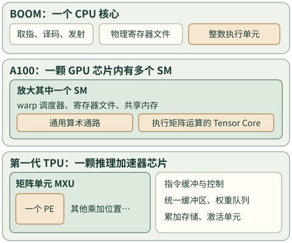

# 同一块矩阵，CPU、GPU 和 NPU 怎样算？

上级：[处理单元与片上组织](./README.md)

[上一篇](../06-task-control/dma-compute-writeback.md)把一块数据搬进了计算引擎。现在放大图中写着「计算」的方框。假设里面要做两张 2×2 矩阵的乘法，第一张的两行是 (1, 2)、(3, 4)，第二张的两行是 (5, 6)、(7, 8)。左上角的答案是 **1 × 5 + 2 × 7 = 19**。同样这四个数，在一颗 CPU 上谁来叫乘法器开工？换到 GPU，硬件会给其中的每个乘法器各取一条指令吗？

下面沿着 **19** 走三次。整数输入都可用 8 位表示，累加空间足够，四个输出依次是 19、22、43、50。用这四个位置辨认同一份工作。硬件指令规定的运算块可能大得多，整颗芯片的运行时间还要计入如何装下、送入和取出这些数据。[四个结果各在哪一拍形成](../04-parallel-execution/why-systolic-array.md)

## CPU 核心怎样等到 5 和 14？ {#控制机制与比较层级}

用一段标量程序，在一个 Berkeley BOOM 乱序 CPU 核心上算左上角。假设四个输入已经从内存装入寄存器。可以用三条 RISC-V 整数指令表达这一步，下面用名字标出寄存器里的数。

| 指令的意思 | 输入从哪来 | 结果给谁 |
| --- | --- | --- |
| 乘法：p ← 1 × 5 | 两个输入寄存器 | 后面的加法等 p = 5 |
| 乘法：q ← 2 × 7 | 另两个输入寄存器 | 同一条加法也等 q = 14 |
| 加法：c ← p + q | 上两条指令的结果 | c = 19，可供后续指令使用或由 store 写出 |

这三行摆在程序里，整数乘法器只会计算送到它输入端的数。**安排它工作的是核心内的取指、译码和发射电路。** 在 BOOM 中，指令译码后先重命名，为结果分配物理寄存器，然后才派发到发射队列。发射电路知道加法所等的两个来源。第一份乘积算出来时，另一份如果尚未就绪，加法就留在队列里。第二次乘法只要两个操作数齐了、乘法通路也可用，就有机会先发射。选中的操作经寄存器读口或旁路取值，送到相应执行单元。其他输出的独立指令也可以参与选择。[BOOM 的取指到提交路径](https://docs.boom-core.org/en/latest/sections/intro-overview/boom-pipeline.html) · [BOOM 执行单元及其支持的操作](https://docs.boom-core.org/en/latest/sections/execution-stages.html)

如果程序用循环遍历矩阵，分支预测帮助前端决定接下来从哪个地址继续取指。它预测对了，队列里较早就能有后面的工作；预测错了，错误路径上的工作要撤销。乘法器、预测器、寄存器文件和按序提交逻辑都属于这条程序的执行环境，预测器承担多少面积需要看具体实现。这里刻意使用标量指令来观察依赖。采用向量或矩阵指令的 CPU，可让一条指令描述更多运算。[一条指令怎样走到提交](../03-instruction-execution/instruction-lifecycle.md) · [一个未就绪的操作数会挡住谁](../03-instruction-execution/dependencies-bypass-issue.md)

## GPU 的一个 warp 会给多少人派活？ {#gpu-的-warp-调度实例}

仍算这四个输出。先给 NVIDIA A100 写一种朴素的程序，启动一个只有四个线程的线程块，让线程 0 算左上角，线程 1 算右上角，另两个线程算下一行。线程 0 的两个乘积是 5、14，线程 1 的则是 6、16。它们执行同一段程序，但各自持有不同的输入和中间结果。这些数在程序中是各线程自己的寄存器值。

A100 将线程以 **32 个一组的 warp** 调度。这个例子只创建了四个线程，因此这个 warp 只有四个有效位置。SM（流式多处理器）中的调度器选择一个就绪 warp 的一条指令，活动线程据此操作各自的数据。四个输出可以分工，仍须为这组线程提供操作数、寄存器位置及执行通路。如果这组线程等待读取，调度器可以选另一个就绪的驻留 warp。每个线程用多少寄存器、每个线程块占多少共享内存，都会限制一个 SM 同时容纳多少工作。观察哪些位置有效、还有多少就绪 warp，才能判断一次等待或分支分歧损失了多少吞吐。[SIMD、向量与 SIMT](../04-parallel-execution/simd-vector-simt.md) · [NVIDIA Ampere 调优指南，Occupancy](https://docs.nvidia.com/cuda/ampere-tuning-guide/index.html#occupancy)

同一颗 A100 还有另一条路。遇到较大矩阵，程序可以让**整个 warp 合作**执行支持的矩阵乘加指令。一个具体的整数指令形状是 m16n8k16，即用 16×16 的输入乘 16×8 的输入，再加到 16×8 的累加块上。每个线程的寄存器只保存矩阵的一部分，warp 提供整组操作数，SM 内的 **Tensor Core** 执行矩阵运算。为检查左上角的 19，可以把原来的 A、B 分别嵌入两个输入块的左上角，其余输入补零，累加块也全部初始化为零。此时，19 来自整组线程共同执行的矩阵指令；只发四个线程的上一种程序不能直接套在这里。实际内核常处理足够多的有效数据来填块，并可先将会复用的输入搬入线程块共享内存，再装入寄存器。[NVIDIA A100 白皮书，SM 与 Tensor Core](https://images.nvidia.com/aem-dam/en-zz/Solutions/data-center/nvidia-ampere-architecture-whitepaper.pdf) · [PTX 规范，第 9.7.16.5.9 节的整数操作数分布](https://docs.nvidia.com/cuda/parallel-thread-execution/index.html)

## 第一代 TPU 上，阵列怎样得到这一块的命令和数据？

再把 A 看成激活、B 看成权重。在 Google 第一代推理 TPU 上，主机发送给芯片的指令可以直接指定一整段矩阵计算。一次矩阵操作使用 256×256 的权重块，激活按 256 个元素一行送入。为了追踪 19，可以把两列激活、两行两列权重放在相应位置，多余的输入位置补零。生产任务通常会安排分块，尽量让这些位置也装入有用的数。[第一代 TPU 原论文，第 2 节及图 1、4](https://arxiv.org/pdf/1704.04760#page=3)

要看到使乘加发生的两个条件，可以按下面的次序分别追踪权重、激活和指令。

1. **权重从哪里来？** 芯片接收读权重指令，从权重存储器取数，经片上权重队列（Weight FIFO）送入矩阵单元 MXU，从顶部装入阵列。论文指出，读权重指令可以在发出地址后就结束，权重此刻可能还在路上。
2. **哪一条指令让阵列运算？** 矩阵指令指定输入所在的片上统一缓冲区（Unified Buffer）和累加结果的地址等信息。阵列从左边接收激活；若激活或权重还没到，矩阵单元仍会等待。这正是上一篇区分「请求已发出」和「消费者已有输入」的原因。
3. **谁收下 19？** 在选定的数据布局下，1 和 2 对应的乘积贡献被加到同一输出位置。阵列把运算结果送往 32 位累加存储。后续激活指令可以从那里取数，经过激活单元再写回统一缓冲区。这个接口让一条块级命令驱动许多乘加位置；每个位置按预定的数据流接数和运算。[Google 的第一代 TPU 数据流说明](https://cloud.google.com/blog/products/ai-machine-learning/an-in-depth-look-at-googles-first-tensor-processing-unit-tpu)

第一代 TPU 是一种神经网络加速器设计。若要看另一种 NPU，STM32N657 的 Neural-ART 由编译器为一段网络生成运算单元、流处理单元和互连的配置，控制边界也随之改变。[STM32N657 上一段量化网络怎样执行](../../chip-architectures/stm32n657-neural-art/README.md)

## 指着图说「一个核心」时，指的是哪一层？ {#比较什么}

<figure class="micro-diagram" tabindex="0" aria-label="三种具体实现的资源层级，窄屏可横向滚动" markdown="1">

<figcaption>方框嵌套表示包含关系，大小不代表实际面积。沿着 A100 一栏从 Tensor Core 往外读，会依次经过 SM、整颗芯片。</figcaption>
</figure>

把手指放在图里的 Tensor Core，再往外移一层才到 SM。取计算块和操作数、等待依赖、保存其他 warp 的寄存器，这些资源支撑着 SM 内的矩阵单元。沿下方的图做同样的事，先从一个 PE（处理单元，这里指阵列里的一个乘加位置）走到 MXU，再到带有指令接口和片上存储的 TPU 芯片。两颗芯片上都能找到执行乘加的位置；如果一边数的是整颗芯片，另一边只数一个执行单元，连共享内存和控制电路是否算在内都没有对齐。

现在把左上角的权重 5 故意推迟。标量程序里，等这份输入的乘法需要等待，队列里无关的就绪操作还有发射机会。A100 的这个 warp 可能等待，而同一 SM 里另一个就绪 warp 可以先行。第一代 TPU 要是尚未备好本次矩阵指令所需的权重，矩阵单元就得等待。**算式相同，等待影响多大，取决于控制器能从哪些工作中挑选，以及那些工作还共用了哪些资源。**

若要比较面积或性能，先选同一工作量、精度和统计层级，再分别清点运算、寄存器、局部存储、控制、互连与时钟开销。面积还要核对产品、工艺、频率和测量单位；延迟、有效吞吐与完成任务的能量需要自己的测量窗口。一个阵列的峰值 MAC 数推不出整颗芯片的资源比例。[cache 与 scratchpad 如何管理数据](../../storage/01-memory-hierarchy/02-access-paths/cache-vs-scratchpad.md)

下一步把八次乘加交给两个计算单元。究竟要把四个权重各送两次，还是要把四个部分和再合一次？可以从这四个熟悉的数自己算出来。[深读：把矩阵切给两个单元，哪些数据要跨过去？](gpu-as-tiled-tpu.md)
