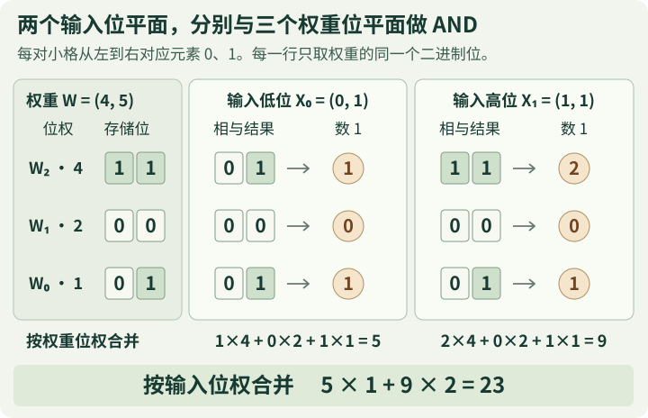

# 同一个点积，挪到存储旁边或阵列里面怎么算？

上级：[问题、术语与分类](./README.md)

在[第一篇的点积电路](../../00-overview/microarchitecture-decisions.md)里，乘法器拿到 2 和 4 算出 8，再拿到 3 和 5 算出 15，加法器把它们合成 23。如果四个输入原本都在内存里，能不能保留这个结果，却让 4 和 5 从头到尾都不用送出内存芯片？

可以先把乘加器搬到内存芯片上。还可以再往里走一步，改变存储阵列的操作，让它在读出时就算出一部分结果。下面三种做法都算 **2×4 + 3×5 = 23**。固定起点和终点：输入 X =（2，3）和权重 W =（4，5）都已放在内存，计算芯片上的消费者要拿到 23。先追踪逻辑数值，再单独计入布局准备、命令和实际传输。

## 乘积 8 第一次出现在哪里？ {#两个不能省略的物理问题}

**把一个处理单元 PE 放在计算芯片上。** 内存读出 2 和 4，将它们经过两颗芯片之间的接口送到 PE。2 和 4 第一次同时出现在乘法器输入端时，电路才有条件生成 8。PE 在本地累加器中保存 8，再取来 3 和 5，更新为 23。沿内存的对外数据接口数，跨过它的是四个输入值。输出已经在计算侧，交给消费者不必再穿回内存。这是冷启动的一次点积，如果 PE 里原本就有可复用的权重，跨这条边界的流量还要重算。

**把同样的数字乘加器放进内存 die，接在一个 bank 旁边。** bank 是可以分别选择和操作的一组存储阵列。假设这四个输入均已放在该单元可访问的位置。打开行后，存储单元的值先由感测电路读出，再经局部数据通路到达乘加器。它算出的仍是 8、15，累加器仍要保存中间结果。改变的是两个乘数走到算术电路所经过的边界。4 从阵列送到了 bank 旁的单元，却无需穿过内存对外接口去计算芯片。最后对外返回 23；主机仍要发命令、判断完成，阵列也仍要完成读操作。

真实器件上可以找这段局部连线。Samsung Aquabolt-XL 的框图画出了连接偶、奇 bank 的处理单元，单元里有寄存器、FP16 乘法和加法硬件。看图时，从 bank 接口往下找，才找到乘法器。这里比较位置，手算的小整数、数据如何排进 bank、执行了几条指令都不能从这张框图倒推。[Samsung 在 Hot Chips 33 展示的 Aquabolt-XL 处理单元](https://hc33.hotchips.org/assets/program/conference/day1/20210813_HC33_Aquabolt-XL_PIM_Jin_Kim_slide.pdf)

## 如果阵列只能做「按位与」，怎么可能算成点积？

先看一位无符号乘法。两个比特各取 0 或 1，只有两者都是 1，乘积才是 1。这正是 AND（按位与）的真值表。所以我们可以把完整乘法拆成单个位之间的乘法，最后再把各位的权重加回来。

把 X 的两个数写为 `10₂`、`11₂`，W 的两个数写为 `100₂`、`101₂`。普通布局通常让一个数的几位待在一起。现在改换摆法，让阵列的一列对应点积的第一项，另一列对应第二项。沿一行横读，看到的是**两个元素的同一位**，这称为一个**位平面**。下表中的数都是单个比特。

| 存成哪一行 | 第一项（2 配 4） | 第二项（3 配 5） |
| --- | --- | --- |
| X 的低位，位权 1 | 0 | 1 |
| X 的高位，位权 2 | 1 | 1 |
| W 的高位，位权 4 | 1 | 1 |
| W 的中位，位权 2 | 0 | 0 |
| W 的低位，位权 1 | 0 | 1 |

只跟踪 X 低位行（0，1）和 W 低位行（0，1）。怎样让阵列自己给出两个 AND 结果？取 Ambit 研究中的一种 DRAM 操作。先把两行复制到同一子阵列的两个指定工作行，再在第三个工作行写入全 0。现在让这三行同时连接到各列的位线。位线原先预充到约半个电源电压。按论文的理想电荷共享模型，每列的三个存储电容中，如果有两个或三个保存 1，位线就向高侧偏；如果只有零个或一个，位线就向低侧偏。感测放大器把这个偏差放大成一个确定的比特，得到三者的多数值。

第三行固定为 0 意味着什么？要让三个值中的多数为 1，前两行就**必须都是 1**。回到这两列：第一列是（0，0，0），判为 0；第二列是（1，1，0），判为 1。按位与的结果（0，1）已经出现在两列的感测路径上。这里我们可以指出算术最小的一步究竟发生在哪儿。三行同时激活会把判决结果恢复到工作行里，所以先复制，才能保留还要反复用的 X、W 原值。该操作依赖 Ambit 专设的行、译码和控制，不能假定普通 DRAM 允许任意三行同开。[Ambit 原论文，第 3 节的三行激活与工作行复制](https://www.pdl.cmu.edu/PDL-FTP/NVM/ambit-bulk-bitwise-dram_micro17.pdf)

## 感测端只给出 0 和 1，23 从哪里来？

给这个教学阵列配上两段**数字外围电路**。第一段数出结果的两列里共有几个 1，叫 **popcount**，答案可以是 0、1 或 2。第二段按输入和权重的位权移位，再把整数加起来。Ambit 提供了上面按位运算的依据；此处的计数器、移位累加器和完整点积是为了追踪数据而另配的。实际阵列一行可以很宽，教学例只对这两列计数，其余列须屏蔽或保证为零。

<figure class="micro-diagram" tabindex="0" aria-label="两个输入位平面分别与三个权重位平面做按位与、计数与加权累加" markdown="1">

<figcaption>每对方格给出阵列逐项 AND 的两个结果。圆圈里是数字外围数出的 1 的个数。沿高位平面的路径读到小计 9，还需乘输入位权 2。这些分组表示逻辑操作，拍数由具体硬件决定。</figcaption>
</figure>

**先走 X 的低位行（0，1）。** 它与 W 的高、中、低位行分别相与，依次得到（0，1）、（0，0）、（0，1）。数出 1 的个数是 1、0、1。W 的三个位权依次为 4、2、1，所以这一行贡献 **1×4 + 0×2 + 1×1 = 5**。这也可以直接验：第一项的低位是 0，第二项的低位是 1，这一轮只选中了第二个权重 5。

**再走 X 的高位行（1，1）。** 它与相同三个权重位平面相与，得到（1，1）、（0，0）、（0，1），相应计数为 2、0、1。先用 W 的位权相加，得到 **2×4 + 0×2 + 1×1 = 9**。为什么最高那一组能数出 2？因为 4 和 5 的最高位都是 1，而 2 和 3 的高位也都是 1，两列各贡献 1。把两个列结果再做一次简单的「或」只会得到 1，就会少算一份。

这次的 9 来自 X 的高位，位权是 2，所以累加前要左移一位，得到 18。最后 **5 + 18 = 23**。跟着这条路径走，根本没有哪个单元非要先保存完整的 8 或 15；保存 5 和 18 这两份按位分解的部分和，也能重建同一个精确整数。两个计数位足以表示 0 到 2，但最后的累加器要更宽。若要覆盖任意两项 2 位无符号输入和 3 位无符号权重，最大和为 2×3×7 = 42，至少需要 6 位。本例只算非负整数；换成补码，高位的负权也要进入加权规则。[继续看数字存内计算怎样展开多比特乘法](../03-compute-paradigms/digital-cim-deep-dive.md)

## 在数据路径上画哪两道边界？ {#本专题采用的工作定义}

第一道画在**内存 die 的对外接口**，看哪些操作数还要穿出内存。第二道画在**存储阵列和独立算术电路之间**，看穿过来的是完整操作数，还是已经求出的一部分结果。把上述三种做法摆在一起看。

| 本次点积的实现 | 阵列首先交出什么 | 最后在哪里形成 23 | 内存对外主要传什么有效数据 |
| --- | --- | --- | --- |
| 计算芯片上的普通 PE | 读出的 X、W 数值 | 计算芯片的 PE | 本例把四个输入值送到计算侧 |
| 内存 die 的 bank 旁数字单元 | 仍读出 X、W，沿 die 内局部通路送给处理单元 | bank 旁的数字累加器 | 在输入都已驻留且本地能完成归约时，送出 23 |
| 本例中参与求值的 DRAM 阵列 | 已形成的逐列 AND 结果 | 阵列外围的数字计数与累加电路 | 位平面已就位、外围在内存侧时，也可只送出 23 |

两种内存侧实现对外都可能只交付一个 23。要区分二者，就得去看第二道边界。本专题把**存储单元、位线或感测路径参与某一步求值**称为 CIM（存内计算）；把**内存 die 或 bank 内、与存储单元分开的处理单元**称为 PIM；把**内存 die 外、靠近存储的独立处理逻辑**称为 NMC（近存计算），例如堆叠内存的独立逻辑底座。若把上例的数字 MAC 从 bank 旁挪到底座，点积的算术可以原样保留，但局部读出的数据还要经过 die 间连接。普通 SRAM 供给相邻 PE 的距离也可以很短，仅凭这一点无法说明阵列参与了求值。

## 读真实产品和论文时，哪一步最容易看错？ {#边界案例}

- **在 DRAM 内复制一行，算术发生了吗？** RowClone 改变了复制路径，让一整行可以在内存内部复制或初始化。刚才的 Ambit 例还需要三行共同驱动位线，才得到 AND。找到一次本地复制，只能说明搬运在哪里做；找到一次 AND，也还要继续找数 1 和加权累加的位置。[RowClone 原论文](https://www.pdl.cmu.edu/PDL-FTP/NVM/rowclone_micro13.pdf)
- **封装里有 HBM，算术就发生在某个 bank 里吗？** 要找图上计算单元所属的 die。bank 旁的处理单元、独立 base die 上的逻辑、封装另一侧的 host 可以同时出现。只有逐段指认数据穿过的接口，才能给不同部分归类。[Samsung HBM-PIM 的芯片与 bank 组织](../09-research-frontier/case-study-samsung-hbm-pim-research-angle.md)
- **UPMEM 装在 DIMM 上，怎么知道数据去了哪里？** 它的 DPU 是同 DRAM 集成的可编程处理单元，按本文口径归为 PIM。还可往下追，DPU 的 DMA 可以把数据从主存区 MRAM 搬到工作区 WRAM，再由 DPU 执行指令。DIMM 说明交付形态，MRAM 到 WRAM 的移动才说明计算前的实际路径。[UPMEM 系统论文](https://www.usenix.org/system/files/atc21-nider.pdf) · [DPU SDK 的 DMA 指令](https://cmu-safari.github.io/UPMEM-SDK-Documentation/201_IS.html)

### 文献里都叫 PIM，怎么对齐？ {#引用资料时怎样命名}

本文的三种简称是阅读约定。Mutlu 等人在 2025 年修订的综述里把 PIM 用作更广的总称，再区分「利用存储结构计算」和「把处理逻辑放到存储附近」。读另一份资料时，先保留作者的原名，再补一句**哪一段电路算出了哪个中间结果**。若框图没有给出 die 归属或计算路径，就把该项留作待核实。公司名、产品名和历史文件名前缀都不足以补上这条信息。[A Modern Primer on Processing in Memory](https://arxiv.org/abs/2012.03112) · [整体分类的记录维度](./taxonomy.md)

## 同样得到 23，哪条路真正省了时间和能量？ {#分类不能代替性能比较}

回到开头，先问 4 和 5 原本在哪里。权重如果已经常驻普通 PE，后续点积也能省去重新取权重的外部流量。阵列方案如果收到的是普通排布的整数，第一次使用前要先把同一位排成行。刚才的表需要两组 X 位平面、三组 W 位平面，共六组 AND 结果；这六组并非六个固定硬件时钟周期，内部的复制、感测、读出计数、移位和输出都有各自的代价。把短向量铺在很宽的行上只用两列，或者为跨 bank 的点积另做全局归约，还会改变账目。模拟或混合信号阵列则要进一步核对转换精度、外围面积、校准和误差；数字算例里的精确 23 不能直接替它们保证精度。[存储介质与求值方式](./two-axes-memory-and-paradigm.md) · [真实混合信号芯片 IBM HERMES 的信号与部分和路径](../../../chip-architectures/ibm-hermes/README.md)

比较时先约定同一批输入、输出精度和复用次数，再从布局准备一直计到消费者可用。宏电路内每瓦能做多少运算和整机生成一个 token 要多久，统计边界不同。最初的问题现在可以落到一条具体线上：**下一次点积还用 4 和 5，哪一条线可以少传它们，留下的局部读取、感测和归约又要做多少次？** [CIM 从宏到系统的性能与能效建模](../05-architecture-and-system/performance-energy-modeling.md)
