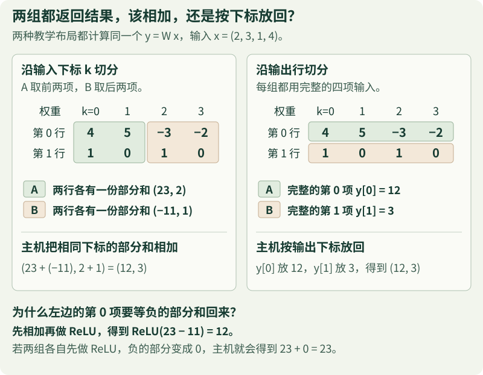

# 多组 bank 各算出部分和，谁把它们合成最后的答案？

主机收到一个数，23。它来自上一节追踪的那条运算通路，先算 2 × 4 = 8，再加上 3 × 5 = 15。现在把同一个点积加长一倍，后两项的权重放在另一组 DRAM bank。第一组依然算出 23。主机能把它交给下一层吗？这次要沿着**结果离开运算单元以后的路**找答案。[把乘加器放在 DRAM bank 旁，一条命令怎样算起来？](./dram-pim-foundation.md)

## 同一个 23，什么时候只算完了半行？ {#bank-level-与-channel-level}

算一个四项点积。输入是 (2, 3, 1, 4)，一行权重是 (4, 5, −3, −2)。先按点积长度 K 把它切在中间，前两项放在 A 组，后两项放在 B 组。这里的“组”指一组数据和负责处理它的本地计算单元（CU），组的大小及连接方式由设计决定。先用小整数精确计算，不设舍入或饱和。

| 算哪一段 | 本地累加器从 0 开始 | 送出的是哪个输出的贡献 |
| --- | --- | --- |
| A 组，前两项 | 2 × 4 = 8，再加 3 × 5 得 **23** | 第 0 行的前半段 |
| B 组，后两项 | 1 × (−3) = −3，再加 4 × (−2) 得 **−11** | 第 0 行的后半段 |

先假定两组之间没有加法通路，最后一个加法在主机执行。主机收到 A，只能记下“第 0 行还有一段没到”。收到 B，才能算出 **23 + (−11) = 12**。把同一个输出拆开的贡献重新合起来，就叫**归约**。若接下来要做 ReLU，即把负数截成 0，现在才可以做。抢先把 ReLU 放在各组，A 留 23，B 把 −11 变成 0，主机相加得到 23。两份数据都传对了，答案仍然错了：B 本该抵消 A 的一部分。

再加一行权重 (1, 0, 1, 0)，复用刚才的输入。仍按 K 切，A 给第 0、1 行的贡献是 (23, 2)，B 给的是 (−11, 1)。主机按**同一输出下标**相加，得 (12, 3)。现在只改变权重布局，把完整第 0 行放 A，完整第 1 行放 B，送给两组同一条完整输入向量。A 直接得到第 0 行的 12，B 直接得到第 1 行的 3。主机只需把两项放进对应位置；此时再把 12 和 3 加起来，反而丢掉了两个独立的输出。两种布局作了相同的八次乘法，需要汇合的对象却不同。

<figure class="micro-diagram" tabindex="0" aria-label="同一矩阵按输入维度或输出行分块，得到的返回值含义不同" markdown="1">

<figcaption>同色权重格归同一组。这里选主机合并，ReLU 在每行的输出完整后执行。换一种切法，回到同一主机的两组数据便要按不同规则处理。</figcaption>
</figure>

## 一条命令发给两组，结果为什么还要等？ {#when-partials-are-visible}

回到按 K 分割的第 0 行。让两组各有一个独立 CU，再给它们一个共用的返回端口，假设每次只能接收一份标量。控制器可以向两组分发一条计算命令，两组也可以同时算完。本例的接口仍要分两次传回 23 和 −11。**命令往外分发，操作数留在各组；结果朝反方向经过共享端口。** 这三段各占用什么资源，可以分别检查。

| 观察到的事件 | 主机此时能做什么 |
| --- | --- |
| 控制器接受计算命令 | 记录第 0 行预期有 A、B 两份结果 |
| 两组的最后一次本地乘加结束 | 本地累加器各有一个有效值，主机还没有操作数 |
| A 的结果经共享端口送达主机，并按接口约定可读 | 保存 23，或者让主机累加器先接收它；第 0 行还缺 B |
| B 的结果也可读，主机完成最后的加法 | 第 0 行的 12 可交给 ReLU 或其他消费者 |

这张表写的是依赖顺序，不是芯片的逐拍时序。若 B 先到，由输出下标和分块位置认领即可。本例的标识也可以由固定缓冲地址和预先约定的返回顺序隐含表达。若设备把结果先写回 DRAM，还要等写入完成并满足该接口的可见性要求，主机才能按约定读它。局部累加器能否立刻复用，则看接收方是否已把数取走。端口忙时若没有中间缓冲，先用下一行覆盖 23，这一行就永远缺一项。[DRAM 命令与控制器的访问路径](../../../storage/03-dram/protocols/commands-act-rd-wr-pre.md) · [从行缓冲到返回端口，哪些数据经过 HBM 接口？](../../../storage/06-system-integration/future-packaging-cxl-near-memory.md#hbm-pim-data-path)

换一种硬件，把加法器放在两组都能送数的通道近侧。现在 23 和 −11 仍须分别抵达这个加法器，只是主机端口只传最终的 12。共享处得多备一份累加状态，知道属于哪行、已经收齐几段，还要仲裁多个组的请求。再换一种硬件，让两个 bank 连乘加器也共用，那么两个本地操作就会争用同一执行资源。增加 bank 数能增加数据来源，却不能凭空增加 CU 的发射能力。靠近 bank 或子阵列，每组可利用宽的本地通路，但 DRAM 工艺、面积和功耗限制了可复制的数字逻辑。把控制和归约集中在通道或 DRAM die 的共享区域，逻辑更易复用，各 bank 的操作数或部分和则必须真正走到那里。这与片上网络中局部归约和集中归约面临的是同一个取舍。

## 两颗 PIM 芯片，各在什么地方做了加法？ {#与-analogdigitalmixed-signal-的关系}

在 Samsung **Aquabolt-XL** 的 PIM-DRAM die 上，一对偶、奇 bank 共享一个可编程计算单元（PCU）。进入 AB-PIM 模式后，外部列命令触发预装在命令寄存器文件中的指令。原型的 16 路 FP16 SIMD 可在各 lane 上分别乘加。上一节那条 lane 里的 23 已经包含两次乘积；同一条命令推进其他 PCU，也只说明它们执行了相应的本地操作。公开指令表列出逐 lane 的 MAC、目的寄存器 GRF_B；图中没有给出把分属多个 PCU 的这类结果直接相加的指令。要声称跨组归约完成，还得在映射中指出搬数和加法的执行者。[Samsung 原始微架构和指令表，第 8–10 页](https://www.hc33.hotchips.org/assets/program/conference/day1/20210813_HC33_Aquabolt-XL_PIM_Jin_Kim_slide.pdf#page=8) · [Samsung HBM-PIM 研究案例](../09-research-frontier/case-study-samsung-hbm-pim-research-angle.md)

在使用 Aquabolt-XL 的 MPC-Wrapper 实验里，可以直接指认最后的加法器。论文图 8(b) 的矩阵–向量乘先把每个伪通道的局部输出写回各自的 bank。一个伪通道不能直接访问另一个伪通道的数据，FPGA 逻辑便把这些局部输出读到自己的缓冲区，在 FPGA 上归约。换个任务，图 8(a) 把彼此独立的嵌入表分给不同伪通道，各自产生完整向量，FPGA 取走后便不需要再做跨通道求和。归约在哪里发生，要看具体映射和消费者。[MPC-Wrapper 原论文，图 8 与第 VI 节](https://hpcp.yonsei.ac.kr/~youngsok/files/mpc-wrapper_fccm2024.pdf) · [IEEE 会议论文记录](https://ieeexplore.ieee.org/document/10653651/)

SK hynix **GDDR6-AiM** 的数据通路给出了另一种“本地”的尺度。让一份 32 B 的权重从 bank 出来，其中有 16 个 BF16 数。全局缓冲给出对应的 16 个向量元素。本地 PU 中的乘法器、加法树和累加器把 16 个乘积合起来，结果保存在 MAC_REG。这里已经做过一次向量内部的归约。厂商把让 16 个 bank 并行计算的命令称为 `MACAB`，把读 MAC 结果的命令另列为 `RDMAC`，后者需要相应模式寄存器配置。一个 bank 的 16 个乘积合成一份结果，同一命令下 16 个 bank 的结果仍各有归属。芯片还可以对本地 MAC 结果做某些激活函数；它在数学上是否该做，取决于该结果是否已经覆盖这一输出的全部贡献。四项算例中的整数、32 位返回值与共享通道加法器都是教学设定。[SK hynix 原始架构图与命令表，第 6–7 页](https://hc34.hotchips.org/assets/program/posters/hc34.SKhynix.YongkeeKwon.v03.pdf#page=6) · [GDDR6-AiM 原始芯片论文](https://doi.org/10.1109/JSSC.2022.3200718)

两种原型都先从 DRAM 取得数字权重，再由独立数字运算单元求值。FP16、BF16、整数或定制低位宽是运算单元的数值格式。DRAM 感放和 I/O 收发电路也处理模拟电压，点积在什么位置求值则是另一个问题。若某项研究直接利用 cell 与位线的电荷共享求逻辑或近似值，才要沿阵列内部的模拟求值和数字读出去分析 mixed-signal CIM。比较这两颗 PIM 原型，适合量的是省了哪些传输、用了哪些数字运算；ReRAM 模拟矩阵乘或 SRAM-CIM 宏的峰值 TOPS/W 采用的是别的电路和测量边界。[存内和近存计算的位置与分类](../01-overview/cim-pim-nmc-taxonomy.md)

## 剩下多少数据还要过主机接口？ {#hbm-pim-的系统价值}

把点积放大。仍让最终消费者在主机。这里的主机指存储接口另一侧的处理器，例如连接 HBM 的 GPU。矩阵有 **64 行，每行 128 项**；权重和输入各占 2 B，部分和及最终和各占 4 B。权重已经按相应布局常驻 DRAM，输入最初只在主机，主机侧没有缓存权重。每次只处理这一条输入向量。下面只数主机与存储侧之间的有效载荷，不数命令、地址、协议开销、布局预处理、最小突发填充和片内分发。每份输入从主机接口只送一次，所需分发在存储侧完成。

| 谁做最后的加法 | 主机 → 存储侧 | 存储侧 → 主机 | 合计 |
| --- | ---: | ---: | ---: |
| 主机读权重，自己算全部点积 | 0 B，输入已在主机 | 64 × 128 × 2 = 16,384 B 权重 | **16,384 B** |
| 每行按 K 切两组，主机合并 | 128 × 2 = 256 B 输入 | 64 × 2 × 4 = 512 B 部分和 | **768 B** |
| 同样切两组，新设的通道侧加法器合并 | 256 B 输入 | 64 × 4 = 256 B 完整结果 | **512 B** |

第二、三行都在存储侧算了 8,192 个乘积。差掉的 256 B 来自**每个输出少回传一份 4 B 数据**。通道侧仍须接纳 128 份本地部分和。若改用图中的整行布局，也可以只返回 64 个完整值，但要让两个运算组都拿到完整输入。若通道外的主机必须为两组分别复制输入，整行布局的输入成本就从 256 B 增到 512 B。复制发生在接口的哪一侧，决定要给该接口记一份输入还是两份。

把返回路径单独拿出来算时间。假设它能持续净传 32 B/拍，结果已就绪，且允许把标量紧密打包。按 K 切后在主机归约，512 B 至少占 **16 拍**；在通道内归约，256 B 至少占 **8 拍**。这两个数只覆盖返回链路。此前发送的 256 B 输入、本地读行、乘加、共享加法器排队、模式切换和消费者等待各有依赖。小请求若要独占更大的突发，还要用总线实际传输的字节重新计时。HBM 同样有内部与外部两条带宽口径。[Samsung 列出的内部与外部 PIM 带宽，第 13 页](https://www.hc33.hotchips.org/assets/program/conference/day1/20210813_HC33_Aquabolt-XL_PIM_Jin_Kim_slide.pdf#page=13)

## 放大到整张卡，怎样验算这本账？ {#aimaimx-的边界}

SK hynix 的 **AiM** 是带上述计算功能的 GDDR6 器件。厂商在 2023 年展示的 **AiMX** 则是用多颗 AiM 组成的原型加速卡。把观察点挪到整张卡，命令还要经过运行时、卡上控制逻辑和存储控制器，数据可能先在卡内供下一个算子使用。该厂商的 FPGA 参考平台图把 host、DMA、组播互连和多个 AiM 控制器分别画出：具备组播命令或输入的硬件可以省去重复传送，归约仍需要一个明确的算术单元和目的位置。要评估产品，从芯片能力、控制 hub、板级集成、软件到演示工作负载逐层核对；2023 年展示给出的是原型卡上的系统演示。[SK hynix 原始系统架构](https://hc34.hotchips.org/assets/program/posters/hc34.SKhynix.YongkeeKwon.v03.pdf) · [2023 年 AiMX 原型卡公告](https://news.skhynix.com/en/sk-hynix-debuts-first-gddr6-aim-accelerator-card-aimx-for-generative-ai/) · [AiM 与 AiMX 产业卡片](../08-industry-and-products/company-cards/pim-companies-sk-hynix-aim.md)

算术单元的物理位置也决定了术语的范围。本系列把 DRAM memory die 或 bank 周边独立执行的运算归入 PIM。若把上述共享加法器安在 HBM base die、中介层或封装侧逻辑，跨组那次加法在本系列归入近存计算（NMC）。一台系统完全可以由 bank 侧 PIM 先乘加，再由封装侧 NMC 或主机归约。判断各段归属的依据，是 23 和 −11 之间那次加法究竟落在哪个电路。[存储介质与计算路径](./README.md)

## 一次 token 生成能少等多久？ {#指标口径}

计算每个输出时都只读一遍大权重，bank 旁的局部乘加更有机会省下外部带宽。小批量 LLM decode 中的矩阵–向量乘、长上下文中对大量 KV 数据的扫描，以及部分 HPC 流式算子，值得先画出这样的字节表。改成大批量 dense prefill GEMM，同一份权重可能服务多个输入，GPU/NPU 已能复用权重和密集乘加，主机逐次重读权重的基线就要重算。沿一次 token 的依赖再向下找，如果 softmax、归一化、采样或复杂控制由主机处理，每次交接都可能成为新的等待点。[LLM decode 的负载特征](../07-workloads/llm-decode-and-cim.md)

量一次真实运行，可以分别记下每个 kernel 中实际下沉的操作比例、各 bank 和 channel 服务的字节及有效带宽、结果返回的次数和主机等最后一份贡献的时间。耗能要合计内外每一段的字节数与单位字节搬运成本，再计本地 MAC、归约、控制器及等待期间的能耗。最后用相同精度、布局准备和测量起止点比较 kernel 能量与端到端 token 延迟。运行时把哪些操作交给 PIM、哪些退回 GPU/NPU，应由真实支持的操作集、命令与控制器改动、资源争用和这段完整时间共同决定。存储厂商能交付带计算逻辑的芯片，客户的软件和工作负载还要能稳定利用这条路径。[Samsung HBM-PIM 产业与系统集成](../08-industry-and-products/company-cards/pim-companies-samsung-hbm-pim.md)

再看开头的 23。上一节的点积只有两项，23 就是完整的答案。在四项点积里，这条通路仍然只处理前两项，23 要等另一组的 −11。检查一张 PIM 系统图时，试着指出**哪根线载着 −11，哪一级做 23 + (−11)，哪个消费者第一次能安全使用 12**。这三个位置串起来，才知道一次计算具体省去了哪段往返。

回到只有两项的点积。如果把权重 4 和 5 写成两个存储单元的电导，让两行电流在同一列汇合，乘法和最后的加法分别发生在哪里？[一格 ReRAM 怎样存下权重，两行电流又怎样算出点积？](./reram-as-compute-element.md)
