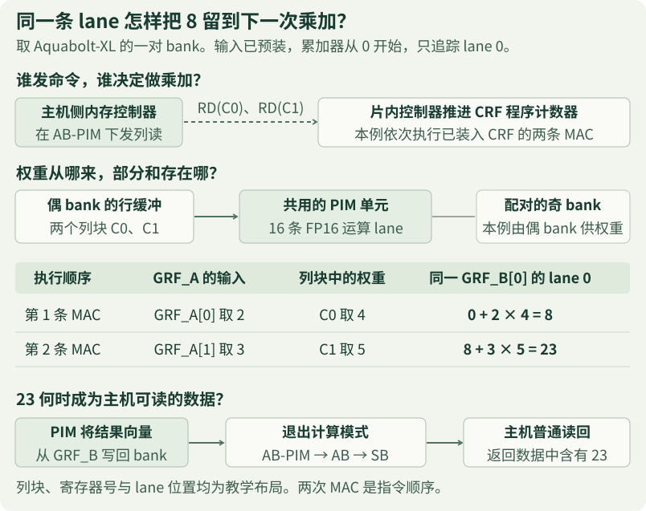

# 把乘加器放在 DRAM bank 旁，一条命令怎样算起来？

内存控制器发出一条读命令，地址指向权重 4。平常，这个数会沿数据线回到处理器。Samsung 的 Aquabolt-XL 在另一种模式下，可以把 4 送给内存里的乘法器，用它乘 2。可这条读命令里没有乘号，也没有 2。**谁告诉内存要做乘法？第二个操作数从哪里来？算出的 8 又在哪里等下一项？**

继续算[普通 PE、bank 旁单元与阵列内求值都做过的点积](../01-overview/cim-pim-nmc-taxonomy.md)：`2×4＋3×5＝23`。这次认准一个真实硬件中的一条计算通路，从控制器发出的列地址一直追到主机能读回的结果。[Samsung 在 Hot Chips 33 的 Aquabolt-XL 讲义，第 8–11 页](https://hc33.hotchips.org/assets/program/conference/day1/20210813_HC33_Aquabolt-XL_PIM_Jin_Kim_slide.pdf#page=8)

## 先沿着 4 走，找到第一个会做乘法的地方 {#find-the-multiplier}

一个 DRAM 存储单元通常用一个晶体管和一个电容（1T1C）保存一位。开行时，一排单元与各自的位线共享电荷，感放把微小电压差判成 0 或 1，并恢复单元原值。这排被感测的数据停在行缓冲里。给出列地址后，才能从打开的行里选出所需的一块。到这一步，4 仍然只是按原样读出的权重。行缓冲怎样工作、一次行切换为什么占时间，可看[普通 DRAM 的感测与恢复](../../../storage/03-dram/foundations/1t1c-cell-destructive-read.md)和[bank 的组织与并行](../../../storage/03-dram/foundations/bank-organization-parallelism.md)。

Samsung 讲义第 8 页把可编程计算单元放在 **HBM 存储核心 die 的 bank 输入输出边界**。第 9 页放大了一个单元：一侧连偶数编号的 bank，另一侧连配对的奇数编号 bank，中间是局部寄存器、控制器和 16 路 FP16 乘法、加法硬件。这里的 16 路称为 16 条 *lane*。同一条向量指令让各 lane 对各自位置的数据执行同类运算。我们只跟踪其中的 **lane 0**。偶 bank 送来的 4 到了这一条 lane 的乘法器，才第一次有机会变成 8。两个 bank 接到一个单元，画在两边的接口也就不能当作两套各算各的乘法器。[局部总线与 FP16 单元，讲义第 9 页](https://hc33.hotchips.org/assets/program/conference/day1/20210813_HC33_Aquabolt-XL_PIM_Jin_Kim_slide.pdf#page=9)

HBM 已经用堆叠和宽接口提高了带宽。它仍要为每次穿过对外数据接口的传输付费。如果模型权重已经常驻 DRAM、处理器又主要在等它们送到，在 bank 旁消费这些数，就有机会减少处理器与大容量存储之间的往返。源 bank 的开行、列选择和局部总线传输依然要做。[存储系统：HBM 的堆叠与宽接口](../../../storage/03-dram/protocols/hbm-stacked-wide-io.md)

## 同样是列读，怎么知道这一次要做 MAC？ {#command-and-instruction}

先把两种不同的问题分开。「**取哪一块数据**」由内存控制器发来的行、列地址回答。「**拿到它做什么**」由 PIM 单元里预先放好的短程序回答。`CRF` 是存这些指令的寄存器组，程序计数器（PC）指出当前条目。`GRF_A`、`GRF_B` 则是保存向量**数值**的寄存器组。硬件还设有标量寄存器组 `SRF`。权重 4、输入 2、以及告诉它们相乘的指令，各有自己的位置。[指令来源、操作数和 MAC 的目的寄存器，讲义第 9–10 页](https://hc33.hotchips.org/assets/program/conference/day1/20210813_HC33_Aquabolt-XL_PIM_Jin_Kim_slide.pdf#page=10)

要让列读遇上这段短程序，控制器先要准备好相应的**伪通道**，也就是这里切换工作模式的一组存储资源。下面按演示所需的先后关系展开。

1. **普通访存（SB）。** 先把两个权重块放到预定位置，让结果另有一块可写的空间。SB 是普通的单 bank 寻址方式，一次请求按地址选中相应 bank。在这种模式下读权重，拿到的是内存数据。
2. **配置（AB）。** 控制器按照该器件规定的命令/地址序列，从 SB 进入全 bank 模式 AB。讲义第 11 页画出了用于切换的 `ACT/PRE` 序列，以及和普通数据地址分开的配置区域。利用相应的配置访问，可以把短程序写进 CRF，为参与的 PIM 单元准备寄存器。本例需要两个输入向量就位，并让目标累加位置从 0 开始。
3. **执行（AB-PIM）。** 设置 `PIM_OP_MODE=1` 进入计算模式。对于下面用来触发计算的列读，控制器选中列块的同时，也让 PIM 控制器执行 CRF 中相应的指令，推进指令位置。讲义第 9 页把一次 `ACT` 后的几笔 `RD` 分别画在 `CRF0`、`CRF1` 等条目上。`ACT` 先打开数据行。每笔用于触发的 `RD` 提供这次的列地址，选定的 MAC 指令决定另外读哪个寄存器、把结果累加到哪里。

因此，把同样的列地址送来，普通读和 PIM 执行会有不同结果。在计算模式里也不能光看 `RD` 就猜出乘加：如果当前指令要求做加法，局部算术就随之改变。多组计算单元可以按共同命令同步推进，主机要安排好模式、程序和访问次序；发一笔读权重的请求并不会自动跑完整个点积。[Samsung 的三种模式及转换，第 11 页](https://hc33.hotchips.org/assets/program/conference/day1/20210813_HC33_Aquabolt-XL_PIM_Jin_Kim_slide.pdf#page=11) · [普通 ACT、RD、WR、PRE 的职责](../../../storage/03-dram/protocols/commands-act-rd-wr-pre.md)

## 两次列读，怎样让 8 和 15 相加？ {#two-column-reads}

把两个权重放在**同一个偶 bank、同一打开行的两个列块**，分别叫 `C0`、`C1`。它们在 lane 0 的值依次是 4、5。两个输入向量已经装入 `GRF_A[0]` 和 `GRF_A[1]`，在 lane 0 分别是 2、3。选 `GRF_B[0]` 作目标向量，它在 lane 0 的初值是 0。方括号里是**向量寄存器编号**，取该向量的哪一个元素是另一回事。为使例子容易复算，其余 15 个位置都可填 0。

在 CRF 的相邻两个条目里安排两条 MAC（乘加）指令。第一条取偶 bank 数据和 `GRF_A[0]`，第二条取偶 bank 数据和 `GRF_A[1]`。**两条都读、改、写同一目标 `GRF_B[0]`。** 这是按真实数据路径安排的教学程序，手算采用固定寄存器编号。厂商资料把 MAC 的目的列为 `GRF_B`；Samsung 的公开模型给出了指令中的寄存器选择，以及如何把乘积加上目标旧值再写回。[Aquabolt-XL 的指令表](https://hc33.hotchips.org/assets/program/conference/day1/20210813_HC33_Aquabolt-XL_PIM_Jin_Kim_slide.pdf#page=10) · [Samsung 模型的寄存器编号](https://github.com/SAITPublic/PIMSimulator/blob/3703d1f19c8f027360cc33a3243eb271e3bb6898/src/PIMCmd.cpp#L53-L66) · [MAC 如何取旧值并写回](https://github.com/SAITPublic/PIMSimulator/blob/3703d1f19c8f027360cc33a3243eb271e3bb6898/src/PIMRank.cpp#L449-L473)

| 外部发出的命令 | 当前局部指令选的输入 | 这一列块送到 lane 0 的权重 | lane 0 的计算与写回 |
| --- | --- | --- | --- |
| `RD C0` | 第一条 MAC，`GRF_A[0]` 的 2 | 4 | `0＋2×4＝8`，保存到 `GRF_B[0]` 的 lane 0 |
| `RD C1` | 第二条 MAC，`GRF_A[1]` 的 3 | 5 | 接着用上次的 8，`8＋3×5＝23`，写回同一位置 |

第一次更新后，8 已经是**内存侧的部分和**。第二条指令必须拿到这个更新后的值，才能得到 23。图里只标两次运算的依赖顺序；哪一拍能让下一条使用前一条结果，要看流水与转发，不能把两行表直接当作两个完整时钟周期。这些小整数和两次运算结果都可用 FP16 精确表示。

<figure class="micro-diagram" style="width: 100%" tabindex="0" aria-label="两个列读、两条局部 MAC 与同一 lane 上的部分和" markdown="1">

{style="min-width: 680px"}

<figcaption>上图只追踪一个 PIM 单元的 lane 0。其他 lane 同时执行各自的算术。图中先后关系表示数据依赖，结果向量还要写回 bank 才能从普通数据地址取回。</figcaption>
</figure>

试着只改布局：让 `2×4` 落在 lane 0，让 `3×5` 落在 lane 1，各自从 0 累加。这样能得到 8、15，却没有哪个寄存器元素保存 23。一次向量 MAC 对应各 lane 独立的更新；要把不同 lane 的部分和合起来，还要找额外的加法和数据通路。我们让两次乘积按时间先后进入同一 lane，正是为了让上一步的 8 留在下一次加法能取到的地方。

## 23 已经在寄存器里，主机什么时候能读到？ {#read-back-local-sum}

第二次 MAC 完成时，23 属于 `GRF_B[0]` 的 lane 0。设主机接下来要从预留的**普通内存地址**读取结果。此时直接访问那个地址，就算地址算对了，也还缺了一个步骤：把结果向量从局部寄存器放进 bank。这个动作也要安排目的地址和命令，必要时给目标 bank 开行。在 Samsung 的公开模拟器里，可以跟到一个具体组合：CRF 的当前位置是 NOP（不执行算术），外部控制器发出列写命令，输出列地址选中相应的寄存器编号。按这套模型的规则，把 `GRF_B[0]` 的向量写到配对奇 bank 的结果块。这个块与前面偶 bank 中两个只读的权重块分开。[Samsung 模型中由 GRF_B 写回奇 bank 的路径](https://github.com/SAITPublic/PIMSimulator/blob/3703d1f19c8f027360cc33a3243eb271e3bb6898/src/PIMRank.cpp#L474-L488)

在结果保存完成后，结束这段计算，先从 AB-PIM 退回 AB，再回到 SB。控制器现在可以发一笔普通读，访问预留的结果地址。返回的数据块里，约定位置上的 FP16 数就是 23。主机读回了一个含它的传输块；看到 23 这个标量，不代表外部总线上只传了两个字节。Aquabolt-XL 的 FPGA 系统论文也把初始化、执行、结束分为三段，图 2 和正文明确说明，最后切回普通模式，才从 bank 读回已保存的输出。[MPC-Wrapper 原论文，图 2 与第 II.B 节](https://hpcp.yonsei.ac.kr/~youngsok/files/mpc-wrapper_fccm2024.pdf#page=2)

再沿内存对外数据接口数一次。两个权重块若已常驻，算这两项时无需分别穿过 HBM 对外接口送到处理器；两次局部列读仍要发生。输入向量最初要装入，命令、模式转换和写后读的排序都占资源，输出块还要送回。把同一段程序和同一批权重复用许多次，每个结果分摊到的准备成本才会改变。若下一个操作也在本地，结果是否需要离开 HBM 堆栈，应按那个消费者的位置另算。[存储系统：沿 HBM 数据路径区分局部访问与离开 HBM 堆栈传输](../../../storage/06-system-integration/future-packaging-cxl-near-memory.md#hbm-pim-data-path)

## 这算存内计算，还是近存计算？ {#location-of-compute}

回想[两行 SRAM 怎样做 AND](./sram-cim-foundation.md)。在那里，共享位线和列末判决已经给出了两个原位的逻辑关系。也有 DRAM 研究利用同一位线上的多个存储电容共享电荷做逻辑。在这里却可以指出，权重 4 从普通行缓冲读出时仍是 4；它与 2 的乘积第一次出现在 **bank 旁独立的数字算术单元**。常规 DRAM 的读出涉及模拟电压和恢复，乘法的求值位置仍是数字 FPU。

本专题沿用三种位置约定：阵列或感测路径参与求值，归入 CIM；独立处理单元位于存储 die 上、靠近 bank，归入 PIM；把同样的乘加器另放在堆叠内存的独立逻辑底座、硅中介层或封装/模组旁边，归入 NMC（近存计算）。判断某个产品时，要同时看**哪颗 die** 和 **bank 的读出到乘法器之间隔了什么**。Aquabolt-XL 的硅片图明确把带 PIM 的 DRAM die 和下面的 buffer die 分开。另一个例子是 SK hynix GDDR6-AiM 的存储侧处理逻辑；搭载它的 AiMX 加速卡还涉及板上控制、接口和软件。只说「它在 HBM 封装里」或只报一张卡的型号，都无法确定某次乘加的位置。[Samsung 硅片与堆叠图，讲义第 13 页](https://hc33.hotchips.org/assets/program/conference/day1/20210813_HC33_Aquabolt-XL_PIM_Jin_Kim_slide.pdf#page=13) · [存储介质与计算路径导读](./README.md)

## 哪些任务值得为这几次局部乘加切一次模式？ {#when-is-offload-useful}

可以先问：处理器原本要搬来多少数据，算完又能把多少中间结果留在本地？不同 DRAM、HBM、GDDR 产品可在 bank 或存储 die 上配置小型数字 ALU、乘加器、SIMD 单元，能执行的指令范围各异。下面这些负载值得按同一个问题核对，工作负载名称本身不能证明收益。

| 候选任务 | 要核对哪一段数据能留在内存侧 |
| --- | --- |
| 小批量 LLM 解码及长上下文注意力 | 权重或 KV 数据可能反复从外存读取。要确认布局能否让本地单元连续取数，随后哪些阶段仍要回 GPU。 |
| 推荐系统的 embedding | 大表稀疏查找可能带回多条向量。如果能在相应存储分区先加成部分和，就有机会少传一些向量；跨分区还要归约。 |
| 扫描类 HPC 内核 | 一遍读很多数据、每项只做很少算术时，可比较局部处理后的输出量与原输入量，并计入启动成本。 |
| 图与数据库操作 | 过滤或局部聚合能缩小某些输出。随机访存造成的开行代价、下一地址依赖和多 bank 结果合并仍可能主导时间。 |

一个相反的情形是大批量、复用充分的稠密矩阵乘法，例如部分模型的 prefill。GPU 或 NPU 的矩阵单元已经能将一块数据多次用于计算。这时要比较端到端的时间和能量：除了 bank 旁乘法器，还要把布局、命令调度、与主机同步和结果交接算进去。兼容既有 HBM 命令接口方便了集成，要把这条路径交给真实应用，仍需要运行时能挑选算子、放置数据、控制完成顺序；器件支持一条 MAC 与软件能加速整个任务之间还有这些环节。[Samsung 的软件执行路径，讲义第 12 页](https://hc33.hotchips.org/assets/program/conference/day1/20210813_HC33_Aquabolt-XL_PIM_Jin_Kim_slide.pdf#page=12)

这一次，23 已经完整保存在一个 lane。如果 23 只是第一组的部分和，第二组还留着 −11，哪一处能真正得到最终的 12？下一篇跟着两个结果离开各自的局部单元，核对谁来相加、什么时候才可以执行激活。[继续读 DRAM-PIM 的跨组归约](./dram-pim-deep-dive.md) · [回到存内与近存计算导读](../README.md)
