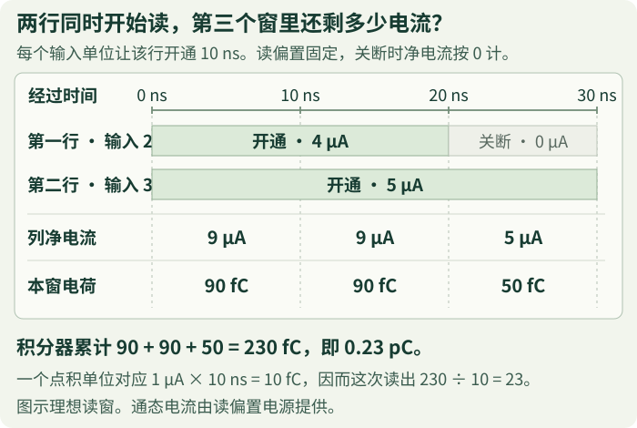

# Flash 怎样把权重写进阈值，再用三拍算出一个点积？

在 Flash 阵列里挑两个单元，给它们相同的读偏置，第一格读出 4 µA，第二格读出 5 µA。现在保持读电压不变，两格同时接入输出列；经过两个等长的时间窗后关掉第一格，再过一窗关掉第二格。列末只用一个积分器收电流，却能读出 `2×4＋3×5＝23`。这个 23 存在哪里？为什么下一次再算时，两格原来的权重还在？

## 一个浮栅存住什么，读的时候又从哪里取数？ {#stored-charge-and-threshold}

先看一格 n 沟道浮栅 Flash。源极和漏极之间可以形成导电沟道。控制栅上的电压会影响沟道导通的程度；在控制栅与沟道之间，还有一块被绝缘层包住的导体，叫**浮栅**。编程和擦除在器件规定的电场条件下改变浮栅保存的电子数量。回到普通读偏置时，浮栅保持隔离，之前写入的电荷仍会影响沟道。

设源极电位不变，固定漏源电压，逐渐升高控制栅电压，同时测漏极电流。在这类 n 沟道单元中，浮栅多存一些电子，要使沟道产生同样大小的读电流，控制栅通常要加更高的电压。我们说它的**阈值电压升高了**。反过来，把控制栅读压固定在同一个位置，阈值较高的单元电流较小，阈值较低的单元电流较大。这个关系可以直接从实测图上读：在一组「漏极电流随栅压变化」的曲线上画一条竖线，和不同存储状态的曲线相交，交点的高度就是该状态在此读压下的电流。[Merrikh-Bayat 等，浮栅单元剖面与不同状态的实测曲线，图 2a、2d](https://web.ece.ucsb.edu/~strukov/papers/2018/tnnls2018.pdf)

存储系列的 NAND 篇讲过相同的起点：存储电荷改变阈值，读电路在给定条件下判断单元落在哪个状态区间；有些器件用电荷俘获层保存电荷。这里选**经过改造的嵌入式 NOR 浮栅单元**作参照，只追踪一个工作点上的电流大小。普通 NAND 则把单元串成存储串，按页读取、按块擦除。下文的两条并联计算支路采用 NOR 型读法。[存储系统：NAND 单元怎样表示数据](../../../storage/05-hbf/02-nand-foundations.md#cell-怎样表示数据)

## 怎么把一个无单位的权重 4 写进去？ {#calibrate-the-read-current}

先定一个可测的目标：在选定的栅、源、漏读偏置下，**每一单位正权重对应 1 µA 净读电流**。于是权重 4 要写到约 4 µA，权重 5 要写到约 5 µA。没有理由要求两格的阈值之比是 4 比 5，也不必假定漏极电流与阈值处处成正比。写电路只需要沿各自的特性曲线找到合适的状态。

假设第一格还只读到 3.7 µA。每次调整浮栅电荷后，回到**同一组读偏置**再测一次，按误差方向决定下一次调整，直到读数落入 4 µA 的允许范围才算写入成功。第二格独立调到 5 µA。研究者在改造后的 NOR 阵列上实际演示过这样的过程：交替施加调节脉冲和读取脉冲，测得的电流指导后续编程或擦除。普通 Flash 阵列能擦哪些单元、被选单元旁边还有哪些会受影响，限制了这项精细调节能怎样实现。4 µA 和 5 µA 是下文的教学设定。[Merrikh-Bayat 等，单元调校的脉冲与实测读电流，图 5](https://web.ece.ucsb.edu/~strukov/papers/2015/ISCASflash2015.pdf)

现在给第一行加一次**幅度固定、持续 10 ns** 的读使能。读偏置下，电源经导通的源漏沟道提供 4 µA 电流，列端在这一窗收到的电荷量是 `4 µA × 10 ns＝40 fC`。若时间加倍，而电流维持不变，收集到的电荷也加倍。浮栅上保存的电子控制沟道；积分器收集的是**读偏置电源经沟道送来的电荷**。这就是一次计算后可以继续用同一个 4 的原因。

## 两行同时开始，为什么三拍刚好够算 23？ {#three-read-windows}

两个输入用**接通时长**表示。输入 2 让第一行从起点连通两窗，输入 3 让第二行从同一起点连通三窗。这里把 10 ns 的等长时间窗简称为一拍。行驱动和列端读出电路将读偏置维持在标定条件。下表按积分器测得的净电流幅值记数，接通时近似不变，关断行的净贡献视为零。先把列积分器复位到已知起点，三窗之间都不复位。分别看这三个 10 ns。

| 读窗 | 第一行（权重 4） | 第二行（权重 5） | 列的净电流 | 本窗增加的电荷 | 已收集的总电荷 |
| --- | --- | --- | --- | --- | --- |
| 0–10 ns | 开，4 µA | 开，5 µA | 9 µA | 90 fC | 90 fC |
| 10–20 ns | 开，4 µA | 开，5 µA | 9 µA | 90 fC | 180 fC |
| 20–30 ns | 关，0 | 开，5 µA | 5 µA | 50 fC | 230 fC |

逐行看这张表，**一格的读电流乘以它的接通时长**给出这一项的电荷；在同一拍，两条支路的电流在列上相加。按行验算，第一格贡献 `4 µA × 20 ns＝80 fC`，第二格贡献 `5 µA × 30 ns＝150 fC`。按行相加与表中按窗相加，都得到 `230 fC＝0.23 pC`。

<figure class="micro-diagram" tabindex="0" aria-label="两条固定幅度的读电流在三窗中汇合并积分" markdown="1">

<figcaption>两行从同一时刻接通，第三窗只有第二行导通。每个时间窗是教学时长单位。列电流由读偏置电源提供，三窗累计量保存在读出端，浮栅继续保存权重。</figcaption>
</figure>

一单位权重、接通一窗，贡献 `1 µA × 10 ns＝10 fC＝0.01 pC`。因此按本例标定，读出 `0.23 pC ÷ 0.01 pC＝23`。若用积分电容，末端也可以测相对于复位点的电压变化，再按电容、极性和转换增益换算电荷。**只在最后一拍看电流会读到 5 µA**，前两拍的 18 个乘积单位此时已留在积分器中。Bavandpour 等提出的 Flash 时域乘法器也把可调电流与输入脉宽相乘并积分；其设计采用自己的脉冲对齐和结果读出方案。这里特意让两行同起，只为便于复算，三窗不代表某个产品的指令时序。[时域向量矩阵乘法器的原始电路设计，图 1、7](https://web.ece.ucsb.edu/~strukov/papers/2019/timedomaintcas2019.pdf)

「净电流」这个条件可以检验。假设每个**已接通**的单元还带有 1 µA 的共同零点，实际读到的总电流就会是 11、11、6 µA，合计 280 fC。第一行开两窗，第二行开三窗，属于零点的部分一共是 `1 µA × (20＋30) ns＝50 fC`。要先用参考支路或数字校准扣除这 50 fC，才回到 230 fC。若模型需要负权重，也可另设正负支路，以两路积分电荷之差表示带符号结果。确定零点、增益和符号，是把列端的物理读数变成模型数值的工作。

## 同样是列电流，为什么不能把它直接当作 ReRAM 的例子？ {#flash-and-reram}

[ReRAM 的两行点积](./reram-as-compute-element.md#ideal-column-current)给两行加不同幅度的电压，让保存的电导决定每条支路的电流。那一例按单位电流换算列读数。本例中，浮栅电荷决定晶体管的阈值，在固定读偏置下标定出 4 µA 和 5 µA；输入的 2 和 3 由通道开启多久决定，要按单位电荷换算。这是两种具体实现的差别，其他 Flash 或 ReRAM 阵列也可以选用不同的输入编码。遇到新的框图，应先指出保存的数据是什么、改变的是哪一个输入量、读电路最终测什么。[ReRAM 单元的编程与读出](./reram-as-compute-element.md)

## Mythic 的计算阵列承担了哪一步？ {#mythic-array-and-periphery}

Mythic 在 Hot Chips 的单块计算单元图上，把**权重存储与模拟矩阵乘法**画在嵌入式 Flash 阵列内，输入端标着数模转换，输出端标着模数转换。阵列旁还有存放中间数据的 SRAM、负责局部控制的 RISC-V 处理器、执行数字操作的 SIMD 单元和连接其他计算块的路由器。沿这张图，能够确认权重在哪里、局部矩阵乘法在哪里做，以及数字数据如何进出。上一节的同起三窗与 10 ns 刻度是本文的教学方式；厂商图给出的是自己实现的转换器与阵列边界。[Mythic 的 Hot Chips 原始架构讲义，Single Tile 图](https://old.hotchips.org/hc30/2conf/2.05_Mythic_Mythic_Hot_Chips_2018_V5.pdf) · [Mythic 产品和软件的证据记录](../08-industry-and-products/company-cards/cim-companies-mythic.md)

若先把 Flash 里的二进制字完整读出，再交给独立数字乘加器，仍可利用非易失权重，但刚才那一步「单元在原地按权重贡献读电流」就不存在了。Mythic 的路径需要模拟阵列和数字外围共同完成推理，要得到一次完整推理的能量，还要把驱动、转换、激活存取和数字运算都计入，再结合推理频率估算功率。

## 什么时候值得把权重长期写在这里？ {#fixed-weight-inference}

一台常开相机反复运行同一检测模型时，编程一次的权重可以用很多帧，断电后仍能保留。它减少的是权重保持和重复搬入的负担；每次唤醒后驱动阵列、读出、转换和处理激活依旧要用电。长期监听的音频和传感器推理也可以按此核算。反过来，如果权重每隔很短时间就更新，又要付编程、擦除和校验的时间与能量，还要核对允许的写擦次数。这和频繁改写 SRAM 中的模型参数是不同的代价。[边缘推理的工作负载条件](../07-workloads/edge-ai-and-cim.md)

即使模型一直没改，读数也值得再查。若第一格在另一工作温度或一段保持时间后，从 4.0 µA 变成 4.2 µA，而第二格仍为 5.0 µA，第一行开 20 ns 就多交付 `0.2 µA × 20 ns＝4 fC`。在本例的连续理想刻度上会读成 23.4；实际输出还取决于转换器的判决边界。校准能否识别这次变化、多久复查、同一批芯片的分布有多宽，都会影响模型精度。成熟嵌入式 Flash 工艺提供了起点，多级权重的调校、量产测试、模型转换、编译与运行时仍是产品要兑现的工作。评估一个具体部署，需要用目标模型的精度、总耗能和更新频率来检验这些代价。

下一篇把权重改存进相变材料。即使输入、偏置和读出时刻都按原计划，先写入的状态如果随时间漂移，原来的权重还读得准吗？[继续读 PCM 权重写入后的漂移](./pcm-mram-for-cim.md#pcm-drift) · [存储介质与计算路径导读](./README.md)
