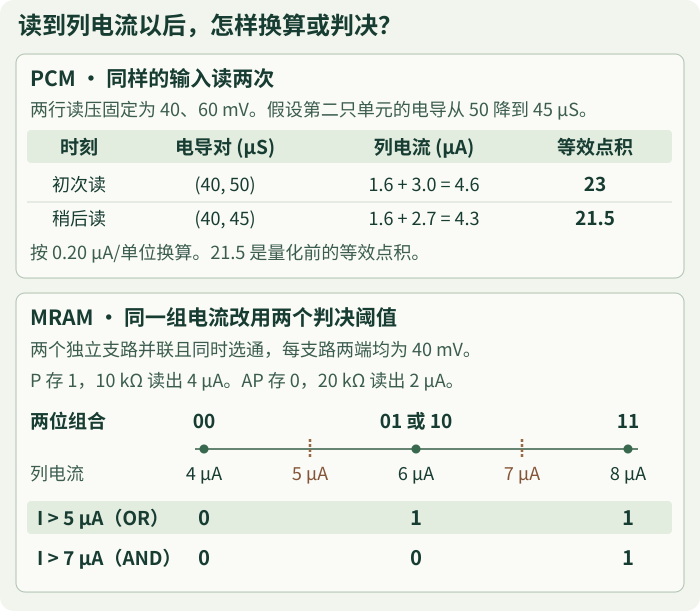

# PCM 的电导会漂移，MRAM 的两个磁态又怎样参与计算？

点积 2 × 4 + 3 × 5 = 23 已经算过几次。Flash 用阈值状态保存权重，在固定读偏置下标定出相应电流，ReRAM 的教学阵列把 40 µS 和 50 µS 两个电导直接放进乘法。换成另外两种断电后仍能保存状态的存储器，先做两个实验。第一个把 PCM 写好，隔一段时间再施加完全相同的输入。第二个同时读两只 MRAM，保持两个存储位不动，只调感测器的参考值。哪一个实验会改变模拟电流，哪一个会改变布尔函数？[Flash 的三个读出窗口](./flash-cim-niche.md#three-read-windows) · [ReRAM 如何用电导表示权重](./reram-as-compute-element.md)

## PCM 写完两项权重，为什么过一会儿要再读一次？ {#pcm-drift}

相变存储器（PCM）把一小块相变材料夹在电极之间。以常见的硫系相变材料为例，晶态区域原子排列较有序，电阻较低；电流通路中若有一段高阻的非晶区域，整个单元的电导就会下降。控制非晶区域的范围和导电通路，可以把单元写进两个端点之间的若干电导窗口。用它存权重，读出的量是电导的大小。

写一次，先要让材料经历合适的温度变化。做 **RESET** 时，电脉冲靠焦耳热熔化一小块材料，然后迅速降温，来不及重新排成晶格，就留下高阻非晶区。做 **SET** 时，让这部分材料在适合结晶的温区停留足够久，晶区长大，导电能力增强。读的时候则给短而弱的偏置，测流过的电流，把它限制在不会触发预期相变的范围。断电保持状态无需持续供电，读偏置和感测电路仍要耗能。反复改写时，还要为加热、冷却和确认写入状态支付时间、能耗和器件磨损。[PCM 原始实验中非晶区的形成与晶体生长，图 2](https://pmc.ncbi.nlm.nih.gov/articles/PMC5653661/) · [IBM 的 SET、RESET 和读出温度曲线，第 8 页](https://www.cmu.edu/nanotechnology-forum/Forum_14/US_Presentation/8_C%20Phase%20change%20memory%20for%20neuromorphic%20applications%20SangBum%20Kim.pdf#page=8)

把两只单元读两遍。这个教学模型忽略线阻和读噪声，列端钳在 0 V，两次读数都取在线性小信号区，读出温度相同。输入 2、3 分别映射为 40、60 mV，权重 4、5 初始映射为 40、50 µS，每个点积单位对应 0.2 µA。**假设**在稍后一次读出时，第一只的电导在本例精度内不变，第二只由 50 降到 45 µS。把这个变化单独拎出来，是为了看清它传到哪一项，并未指定某种器件的实测漂移量或等待时长。

| 读出的时刻 | 第一支路 | 第二支路 | 列电流 | 折回原点积单位 |
| --- | --- | --- | --- | --- |
| 刚写好并核对 | 40 mV × 40 µS = 1.6 µA | 60 mV × 50 µS = 3.0 µA | **4.6 µA** | **23** |
| 稍后，输入相同 | 40 mV × 40 µS = 1.6 µA | 60 mV × 45 µS = 2.7 µA | **4.3 µA** | **21.5** |

少的 0.3 µA 恰好来自第二支路。这里的 21.5 是量化前的等效点积，ADC 输出哪个整数码还要知道它的量程和判决门槛。ReRAM 深读篇在第二行串入电阻，第二只单元两端就拿不到全部 60 mV；这一次，两端实测仍是 60 mV，同样的读电压只能得到 2.7 µA，反算电导就是 45 µS。只在列末看到“电流变小了”，分不清这两个原因。[用单元两端的电压分辨线阻](./reram-cim-deep-dive.md#column-voltage-error)

PCM 中，刚熔融、又快速冷却的非晶结构处于非平衡状态。即使没有新的写脉冲，它的局部原子结构仍会缓慢松弛，影响载流子传输；含非晶区的状态常表现为电阻上升、电导下降。这种电阻漂移可以在保持非晶时发生。把它解释成“存储位又结晶了”，会混淆两种过程。漂移程度要结合具体材料、写入状态、温度和经过的时间。Kersting 等人的实验用阈值开关电压追踪熔融急冷后结构松弛的起点，该结果支持对机理的判断，本表的 45 µS 则是假设读数。[结构松弛起点的温度与时间实验](https://arxiv.org/abs/2106.06270) · [用实测器件分布建立 PCM 电导漂移模型](https://www.nature.com/articles/s41467-023-40770-4)

多级电导让一只单元可以承担模拟权重，却也把相邻权重窗口排得更紧。使用参考单元跟踪共同漂移、在数字端校正尺度，能补偿各单元共有的变化。若只有上表第二项变化，给所有输出乘同一个系数，就会把原本正确的第一项也改掉。更细的校正需要额外测量和参数，必要时还要重新编程并读回验证。固定权重做许多次推理，有机会摊薄写入开销；训练或频繁换权重时，应重新计入每次编程、验证与温度变化的代价。

## 在 HERMES 芯片里，谁来接走阵列的模拟结果？

IBM HERMES 是一颗制成并测试过的 64 核混合信号芯片。每核有 256 × 256 个权重单元，每单元有四只 PCM 器件，按正、负贡献分配。实际输入由读脉冲的宽度编码；核内的电流型 ADC 产生数字结果，片上数字处理单元再做缩放、归并等操作。这里的芯片实验证明了这条运算路径；表中按输入幅值施加 40、60 mV 是另一种便于手算的映射。要追踪一层卷积的 2,016 项输入如何分给八个核，以及一次板级数据转运发生在哪里，可沿 HERMES 的实际实现读下去。[IBM 原始论文](https://research.ibm.com/publications/a-64-core-mixed-signal-in-memory-compute-chip-based-on-phase-change-memory-for-deep-neural-network-inference) · [IBM HERMES 怎样在片上归并卷积部分和？](../../../chip-architectures/ibm-hermes/README.md)

## 两只 MRAM 只有两个磁态，感测端为什么看见三个电流？ {#mram-two-rows}

把相变单元换成磁隧道结（MTJ）。结中有两层磁性材料，中间隔着很薄的绝缘隧道势垒。参考层的磁化方向保持稳定，自由层的方向可以翻转。在常见的正隧穿磁电阻器件中，两层方向平行（P）时电阻较低，反平行（AP）时较高。以自旋转移力矩 MRAM（STT-MRAM）为例，写时让自旋极化电流作用于自由层，改变写电流的方向可以写入不同磁态，写成功的概率还取决于电流大小和脉宽。普通读则选通一行，用较小偏置产生电流，再把电流与一个参考值比较，区分这只单元的 P 和 AP。[STT-CiM 原论文的磁隧道结与单元读写，图 2](https://arxiv.org/pdf/1703.02118#page=3)

现在选通**同一列的两行**，让两条支路并联，由同一感测端接收两者电流之和。这是教学电路：每只被选单元两端都保持 40 mV，忽略选通晶体管压降、线阻和噪声。设 P 的电阻为 10 kΩ，AP 为 20 kΩ，并约定 P 代表 1，AP 代表 0。一条 P 支路贡献 40 mV ÷ 10 kΩ = 4 µA，一条 AP 支路贡献 2 µA。逐一列出输入，会发现 01 和 10 的电流一样大。

| 两个存储位 | 两个磁态 | 总电流 | 大于 5 µA 时输出 1 | 大于 7 µA 时输出 1 |
| --- | --- | --- | --- | --- |
| 00 | AP、AP | 2 + 2 = **4 µA** | 0 | 0 |
| 01 或 10 | AP、P 或 P、AP | 2 + 4 = **6 µA** | 1 | 0 |
| 11 | P、P | 4 + 4 = **8 µA** | 1 | 1 |

读到 6 µA 时，感测器只能知道这两个位恰好有一个是 1。要问“至少一个是 1 吗”，把参考放在 4 和 6 µA 之间，例如 5 µA，输出就是 **OR**。要问“两个都是 1 吗”，改放在 6 和 8 µA 之间，例如 7 µA，同一套感测电路就输出 **AND**。两个磁态都没被改写，变的是最后的判决条件。若两种结果需要同时取得，则要提供两次判决或两个相应参考的比较通路。

<figure class="micro-diagram" tabindex="0" aria-label="对照 PCM 电导漂移产生的电流变化与 MRAM 在同一电流上选择两个判决参考" markdown="1">

<figcaption>两个独立教学电路。PCM 保持输入，观察同一写入状态随时间的电导变化。MRAM 保持各磁态和读电压，切换感测参考，判断两个位置是否至少有一个 1、或是否都有 1。</figcaption>
</figure>

## 多读一行，怎样知道这次判决靠得住？

对上表的理想数，两边各留有 1 µA 到最近门槛的余量。若 01 的总电流加上感测偏差后超过 7 µA，AND 会错误地输出 1。两只单元仍可能保存着原来的磁态。这叫**读出判决错误**。另有一种故障发生得更早：STT 单元中的读电流也会对自由层施加力矩，若读脉冲在给定电流、方向和持续时间下诱发翻转，原来保存的位就被改变，这叫**读扰动**。两种故障的判断方法不同，要分别检查读出的逻辑值和读后保存的磁态。增大读电流可能使感测信号更容易分辨，也需要复核扰动概率；总电流和每只结中实际流过的支路电流要分开算。

Jain 等提出的 **STT-CiM** 同样从两条字线同时选通出发。他们用器件到体系结构的模型评估方案，用电路蒙特卡洛仿真比较单行与双行读。图 7 给出多组电流分布，双行判决的两个间距并不一样宽。该设计里两支路共享的外围还会改变每只结实际流过的读电流。因此 4、6、8 µA 这三个等间隔数只能说明布尔函数如何形成，不能充当制造良率或零扰动的证据。[STT-CiM 原始模型与判决、读扰动分析，图 7](https://arxiv.org/pdf/1703.02118#page=6)

MRAM 也有采用模拟累加的实物。Jung 等制成了一个 **64 × 64** 的 MRAM 阵列，集成 28 nm CMOS 读出电路。为应对低阻 MTJ 在常规并联求和时电流较大的问题，他们采用**电阻求和**完成模拟乘加，并报告了两层感知机的实验结果。文中另一个更深网络采用实测误差作仿真。这里的证据分别是芯片实测和带实测误差的网络评估，器件连接方式也与上面的双行并联门判决不同。[Jung 等的 MRAM 芯片原论文，图 1](https://ciqm.harvard.edu/uploads/2/3/3/4/23349210/jung2022.pdf)

## 同样是非易失存储，比较三条路线时看哪一段？ {#paradigm-映射}

非易失性说明移去电源后，权重仍可保存在单元中。判断它适合哪种计算，还需知道哪段电路实际对操作数求了值。模拟 CIM 用电流、电压等物理量表示中间值；数字 CIM 可以直接在阵列的读出或感测路径判断布尔函数；混合信号实现让模拟阵列结果与数字转换、校正、累加配合。上面的 OR/AND 从计算功能看是数字按位运算，电路里仍有电流比较器。

| 介质 | 模拟计算能用到什么 | 数字计算怎样利用阵列 | 混合信号实现要付的代价 |
| --- | --- | --- | --- |
| PCM | 多级电导表示权重，温度和写后时间影响读数 | 可区分离散状态并由读出路径执行按位操作，未用到连续电导的全部范围 | 阵列输出需转换、校正和数字归并，重新写权重还要承担热编程代价 |
| MRAM | 单个常见 MTJ 主要提供 P/AP 两态，做模拟累加需要具体电路，如电阻求和 | 多行读出时用感测门槛直接做逻辑、比较，也可据此形成计数 | 要为访问晶体管、读写电流、参考与感测外围留面积，验证多个电流窗口、误判和读扰动 |
| ReRAM | 多级阻变电导进入电流求和，适合表示点积 | 也可只保存二值，让阵列读出路径做按位运算 | 要处理编程与验证、电导离散、线阻和旁路，再转换并合并各块的部分和 |

如果 MRAM 只作普通存储，先读出两个位，再交给单独的 ALU 或 MAC 求值，阵列完成的是一次普通读。按本系列口径，独立运算单元位于存储 die 内时看作 PIM，位于存储 die 外的封装近侧逻辑时看作近存计算（NMC），普通 SoC 缓冲区向独立 MAC 供数则是常规处理。判断 CIM 的依据是阵列或读出路径参与了求值；要把两个普通位读出再相加的地方，应从电路位置和数据流去找。[存内计算与近存计算的分类](../01-overview/cim-pim-nmc-taxonomy.md) · [存储介质与计算路径](./README.md)

再看开头的两次操作。PCM 隔一段时间读，给定相同输入，电导的变化把等效点积从 23 拉到 21.5。MRAM 切换参考，6 µA 原封不动，却可以对 OR 输出 1、对 AND 输出 0。前者要问写入频率、多久校准一次、漂移累积到模型后还剩多少精度；后者要问两个判决窗口随工艺和温度怎样变化，以及读写电流能否同时满足保持、耐久和错误率目标。把这些条件带到同一个工作负载上，才能比较哪种非易失路线值得用。[按输出、误差与外围成本比较存储计算路线](./memory-tech-comparison-matrix.md)
