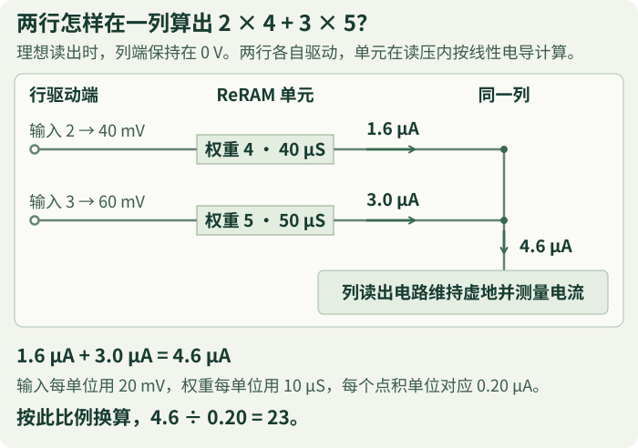

# 一格 ReRAM 怎样存下权重，两行电流又怎样算出点积？

把一个存储单元接在第一行和输出列之间。第一行加 40 mV，列端保持在 0 V，读出电路收到 1.6 µA。电流表上没有显示「4」，可这个单元保存的正是权重 4。再给第二行加 60 mV，列电流变成 4.6 µA。为什么从这一个读数里，能取回[前面反复算过的点积](../01-overview/cim-pim-nmc-taxonomy.md) `2×4＋3×5＝23`？

先只留下第一行。这里有两个可以分开改变的量：**上一次写入之后，单元有多导电**，以及**这一次读时，加在它两端的电压有多大**。权重存在第一个量里，输入由第二个量给出。

## 写一个 4，器件里究竟改变了什么？ {#write-a-conductance}

ReRAM 也写作 RRAM，是一类靠改变电阻状态存储数据的非易失存储器。以一种氧化物阻变器件为例，两个电极之间隔着一层材料。施加合适的写脉冲，可以改变材料内的局部导电通道。通道容易导通时，同样的读电压能推出较大电流；通道受阻时，电流较小。写脉冲撤去后，这种差别仍能保持，下一次读取才有东西可测。在钽氧化物双层器件的原位实验中，研究者同时观察到导电通道的形成、断开和相应的电阻变化，并用氧空位迁移解释开关过程。其他阻变材料的微观机制需要分别核对。[钽氧化物双层器件的原位观察，图 5、6](https://doi.org/10.1038/ncomms3382)

要让权重直接进入乘法，用**电导**比用电阻方便。电导 `G＝1/R`，单位是西门子（S）。本例约定每 1 单位正权重对应 10 µS，所以权重 4 的目标是 40 µS，等效电阻为 25 kΩ。这个换算关系是编程电路与读出电路的共同约定。它若改成每单位 5 µS，同样的 40 µS 就会被解作 8。器件实际保持的是导电状态。

怎样知道写到了 40 µS 附近？先用小读电压测一次，由 `G＝I/V` 估计当前电导。若偏低，就用能提高电导的 SET 脉冲调整，再读一次；若越过了允许范围，则可用降低电导的 RESET 脉冲调回。读回值进入目标容差带，这次写入才算成功。以 NeuRRAM 的实作为例，它会交替施加脉冲和校验。若达到重试上限仍未进入容差带，流程也会停止，留下的电导偏差需要另外记录。部分工艺还需要在日常编程前先建立初始导电通路，称为 *forming*。形成条件、写脉冲以及不致改变存储状态的读电压范围都依器件而定。[NeuRRAM 原论文，写入校验与扩展数据图 3](https://pmc.ncbi.nlm.nih.gov/articles/PMC9385482/)

## 写完后只改电压，为什么就有了乘法？ {#one-row-current}

现在先停止写入。假设这格在本例读压范围内保持 **40 µS**，而且电流与两端电压近似成正比。用 20 mV 读，得到 `20 mV × 40 µS＝0.8 µA`。换成 40 mV，得到 `40 mV × 40 µS＝1.6 µA`。两次读取之后，若再用原来的 20 mV 检查，仍应读到约 0.8 µA。若同一读压下的电流已经变了，就要回头检查存储状态和测量条件。把读电压当输入，前提是这次读取能保住权重。

我们也为输入约定一个刻度：每 1 单位输入对应 20 mV，所以输入 2 施加 40 mV。把两个刻度相乘，**每 1 单位数值乘积对应 `20 mV × 10 µS＝0.2 µA`**。于是刚才的 1.6 µA 除以 0.2 µA，正好读作 8。乘法发生在单元支路上：权重决定这条支路的电导，输入决定它的端电压，两者一起决定电流。本文所有电压、电导和电流数字都属于这个教学模型。

## 再接一行，8 和 15 在哪里相加？ {#ideal-column-current}

第二格编程为 50 µS，表示权重 5。它连接第二行，也接到同一输出列。两行分别由独立的电压源驱动；两格的另一端都接在**由读出电路维持约 0 V 的列节点**上。列端可以吸收电流并维持电位，这种电路条件常称为虚地。以下先假设导线不产生可见压降，已选支路近似线性，没有额外旁路电流。表中正方向从行端指向列端。

| 哪条支路 | 输入及行电压 | 权重及支路电导 | 流向列端的电流 | 对点积的贡献 |
| --- | --- | --- | --- | --- |
| 第一行 | 2，对应 40 mV | 4，对应 40 µS | `(40−0) mV × 40 µS＝1.6 µA` | 8 |
| 第二行 | 3，对应 60 mV | 5，对应 50 µS | `(60−0) mV × 50 µS＝3.0 µA` | 15 |

先把第二行输入设为 0 V。在这组假设下，第二格两端都是 0 V，即使它仍保持 50 µS，也不向列端贡献电流。现在只把第二行升到 60 mV。第一条支路的电压、电导都没变，仍送来 1.6 µA；第二条支路开始送来 3.0 µA。这两个电流汇入同一节点，按电流守恒，读出电路要接收 `1.6＋3.0＝4.6 µA`。**先前的 8 无须存进累加寄存器等 15 到来。两项各自产生电流，在同一列相加。** 多铺几列，每列写入另一组权重，同一组行电压就能同时求出多个点积，这就是阵列的矩阵向量乘法。

<figure class="micro-diagram" tabindex="0" aria-label="两行输入电压经过两个电导，支路电流在同一列汇合" markdown="1">

<figcaption>图中是电流读出的理想模型。两格各自承受的是行端与列端的电压差。20 mV 和 10 µS 是本例的输入、权重刻度，相乘得到 0.2 µA 的乘积刻度。</figcaption>
</figure>

谁把 4.6 µA 读成数字 23？列端可以用跨阻放大器将电流变成电压，再用模数转换器（ADC）量化，最后按增益和零点换算为数值。本例理想标定下，`4.6 µA ÷ 0.2 µA＝23`。**0.2 µA 是数学刻度**，实际 ADC 的一个码代表多少电流还取决于增益和量程。Can Li 等人的阵列实验给出了这种读法：图 1a 中跨阻放大器维持列端虚地，图 1e 则测量了所用电导状态在读取范围内的电流–电压关系。[Can Li 等，实测交叉阵列的结构和读出，图 1](https://doi.org/10.1038/s41928-017-0002-z)

## 把第二个权重改成 −5，哪条支路能有负电导？ {#signed-weights}

仍让电流从高电位流往列端。一个普通无源电导取正值，在相同的正读压下，单靠调大或调小这格的导电程度，无法让它贡献负号。连权重 0 都值得多问一步：真实器件的低电导态也可能大于零。只要两端有电压，它仍然会给列贡献电流。

一种办法是每个权重用两格，用差值 `G₊−G₋` 表示它。再做一次手算。保持两个输入电压不变，取 10 µS 作本例两支路共有的低电导。把权重 `+4` 存成 `(50,10) µS`，把 `−5` 存成 `(10,60) µS`。假设正、负两组分别汇入两个读出端，最后取差。

| 读哪组电导 | 两行的电流合计 |
| --- | --- |
| 正组 | `40 mV × 50 µS＋60 mV × 10 µS＝2.6 µA` |
| 负组 | `40 mV × 10 µS＋60 mV × 60 µS＝4.0 µA` |
| 两组相减 | `(2.6−4.0) µA＝−1.4 µA`，解码为 `−7` |

这正是 `2×4＋3×(−5)＝−7`。要把一个权重置零，两格可以同为 10 µS：两路实际都有电流，理想差值为零。若两格电导没有配准，或者两条读出链增益不同，零权重便可能留下残余输出。固定物理单元数、其他条件相同时，两格表示一个权重，可容纳的权重数约减半；还多了一次取差。相同的编码可以有不同的电路接法。NeuRRAM 把一对单元安排在相邻行，前向读时给这两行施加相反极性的输入，反向操作再采用输出取差。它的图 2h 说明差分权重的实现，本文上面的两列取差是另一种教学接法。[NeuRRAM 原论文，图 2h 的差分编码](https://pmc.ncbi.nlm.nih.gov/articles/PMC9385482/)

## 标上「2 bit」，真能稳定分出四个数吗？ {#four-levels}

另看一个**独立的四级编码**，这里不再沿用前面权重 4、5 的含义。假设想让一个单元区分四种码，名义目标分别是 `10、20、30、40 µS`，依次代表 `00、01、10、11`。一般地，标称 b 位需要区分 2ᵇ 个状态。2 bit 就需要四个。若暂用相邻目标的中点作边界，20 µS 和 30 µS 之间的门槛就是 25 µS。一格原先写为 20 µS，校验时读作 21 µS，日后若读成 26 µS，就会被解作相邻的码。这里的偏差只用来说明判错条件。

在相同的总电导范围里塞入更多目标，相邻目标之间的间隔就变小。写完刚好落入容差带，还要面对之后的电导松弛、长期保持、温度变化和读噪声。要问能可靠保存几位，就得测各目标的分布在使用条件下重叠了多少、允许多少错误，以及多久需要重校准。写后校验要花时间和能量；多次调到目标也会耗用器件有限的可写次数。这就是固定权重、一次写后反复推理，与频繁重写权重的训练，对同一种器件提出不同要求的原因。[NeuRRAM 的电导分布与松弛实测，扩展数据图 3](https://pmc.ncbi.nlm.nih.gov/articles/PMC9385482/)

## 哪一步是模拟计算，哪一步还需要数字电路？ {#analog-and-digital}

回想[两行 SRAM 做按位与](./sram-cim-foundation.md)。那里要保住单元中的两个逻辑状态，让共享位线形成一个能判为 0 或 1 的结果。本例中则要把电导写到可用范围，还要保住 **1.6 µA 和 3.0 µA 的量值**，这样它们相加才有数值意义。ReRAM 也可以用于二值读出后在阵列读出路径中完成数字逻辑。若只按普通存储读回各个比特，再送给独立的外部乘加器，乘法就移到了那个乘加器里。判断阵列承担了什么，仍要沿着数据找到第一次出现乘积和部分和的地方。

系统可以在阵列中用模拟电流求一个局部和，在外围做转换、校准，把分块或分拍读出的结果按位权积累起来。这就是一种混合信号实现。少搬权重的机会也要和写入、行驱动、列读出、数字修正以及未充分利用的单元一并比较。芯片样片可以证明在给定器件与工作负载上跑通了一次推理；要判断对目标应用是否划算，还要核对使用周期内的精度、能耗和权重更新频率。[模拟 CIM 的求值与读出](../03-compute-paradigms/analog-cim-fundamentals.md) · [电路非理想性与误差来源](../04-circuit-and-macro/non-idealities-and-error-sources.md)

回到开头，保持两行源电压和已写电导不变，列端仍维持 0 V，只在第二行驱动端与单元之间串入 1 kΩ 电阻。第二格两端还能分到完整的 60 mV、给这一列贡献 3.0 µA 吗？下一篇从这个压降算起，再看非选路径和读出量化会把答案改变多少。[继续算第二行的压降与列电流误差](./reram-cim-deep-dive.md#column-voltage-error) · [存储介质与计算路径导读](./README.md)
