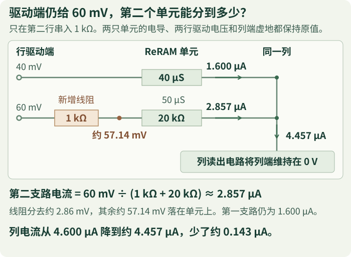

# 理想列电流应该是 4.6 µA，为什么实际读数会偏？

把上一页的两只 ReRAM 原样留下。第一只的电导是 40 µS，第二只是 50 µS。两行驱动器依然输出 40 mV 和 60 mV。现在只改一处：第二行驱动器与单元之间多了 1 kΩ 的串联线阻。测驱动器，仍是 60 mV；测整列电流，却从 4.600 µA 降到约 4.457 µA。少掉的 0.143 µA 从哪来？先把表笔从驱动器移到单元两端。[上一页的理想列电流](./reram-as-compute-element.md#ideal-column-current)

## 第二行的 60 mV，真正加在单元上的有多少？ {#column-voltage-error}

在这张电流读出型交叉阵列里，行给电压，列收电流。每条行线、列线都理想导通，列端钳在 0 V，且单元在读电压下近似线性时，第 j 列才可以直接写成 **Iⱼ = Σᵢ VᵢGᵢⱼ**。同一组行电压配上多列不同电导，就能同时算出矩阵–向量乘的多个输出。眼下只盯住其中一列。输入 (2, 3) 每单位对应 20 mV，权重 (4, 5) 每单位对应 10 µS。理想的两笔贡献为 1.6 和 3.0 µA，合计 4.6 µA，对应数字点积 23。这里每个点积单位对应 0.2 µA。

仍把列端理想钳在 0 V，只在第二行加入 1 kΩ。50 µS 等效为 20 kΩ，因此从第二行电压源到列端，电流依次通过 **1 kΩ 线阻和 20 kΩ 单元**。整条支路的电流为 60 mV ÷ 21 kΩ ≈ 2.857 µA。流过 1 kΩ 的也是这股电流，于是线上降了约 2.857 mV，单元两端只剩 **57.143 mV**。用这个电压乘 50 µS，会回到同一个 2.857 µA。第一行仍贡献 1.600 µA，故整列约为 **4.457 µA**，比理想和小约 3.1%。线上分掉的是电压，整条串联支路的电流随之减小。

<figure class="micro-diagram" tabindex="0" aria-label="在第二行电压源和存储单元之间插入线阻，整列电流从 4.600 降至约 4.457 微安" markdown="1">

<figcaption>教学模型只给第二行加线阻，其他导线理想、列端保持 0 V。两次读出的差别在 ADC 接手之前已经产生。</figcaption>
</figure>

真实阵列中，一个行线段可能同时给下游多列供电。流过这一小段线的电流等于下游支路电流之和，因而这段的压降还取决于**同一行其他单元的电导和偏置**。列线上也有分段电阻。即便感测端钳在 0 V，远端单元的列侧电位仍会随汇流而升高。这时要用每只单元自己两端的电压差来算电流。把同一个权重换到离驱动器或感测器更远的位置，计算贡献便可能改变。在相同线宽和可比的单元负载下，线越长、同时导通的支路越多，线段压降往往越明显。Li 等人在实物阵列上研究输出精度，还用仿真单独改变线阻；Sandia 的 CrossSim 则把分布线阻纳入逐次矩阵运算的电路求解。[Li 等的阵列实验与线阻分析](https://www.nature.com/articles/s41928-017-0002-z) · [CrossSim 手册，第 8.3 节](https://www.sandia.gov/app/uploads/sites/110/2022/07/CrossSim_Inference_manual_v2.0.pdf)

## 电流偏小，与从另一条路流进来，有什么区别？ {#sneak-path-与选择器问题}

把刚才的 1 kΩ 拿掉，换做一次**单点存储读**。看一个 2 × 2 的无选择器阵列，四个交点都是 20 kΩ 的双向线性电阻。把第 1 行驱到 60 mV，第 1 列钳在 0 V。第 2 行和第 2 列都浮置，四根线本身理想。目标是只读行 1、列 1 的单元，它本应给感测端 3 µA。可是在这套接法下，电流还有另一条闭合路径：

1. 从第 1 行经右上单元，进入浮置的第 2 列。
2. 顺着这条列线，经右下单元，进入浮置的第 2 行。
3. 沿第 2 行经左下单元，回到被钳在 0 V 的第 1 列。

这条支路有三个 20 kΩ 串联，贡献 60 mV ÷ 60 kΩ = 1 µA。感测器收到 **3 + 1 = 4 µA**。这多出来的 1 µA 是旁路电流（sneak-path current）。在前一个两行点积里，两行都承载有效输入，两个目标电流本就应该相加。判断有没有旁路，要先画出**这次操作**选哪些行列、未选线浮置还是受偏置、哪个感测端在收电流。不能把正常的并行乘加贡献也算成漏入信号的电流。

如果在每个交点给电阻串联一个受栅极控制的访问晶体管，即 **1T1R**，便可以关断不该接入的行，截断上面那条三单元支路。**1S1R** 用非线性选择器串接存储单元，常配合偏置方案，让半选单元承受的电压落在小电流区，同时给选中单元留足读写电压。V/2 方案中，未选行列置于半读电压，和上例“浮置”的解不同。残余旁路取决于选择器特性、存储状态、阵列尺寸和读法。若偏置了许多不用的单元，额外电流既会耗能，也可能压缩高、低电导态的可读间隔；待机漏耗则应另按待机偏置计算。访问晶体管占面积，选择器增加器件集成要求，也分担电压。这些代价要同降低旁路的收益一起计算。[Kim 等的三种 1S1R 读出偏置分析，图 1、2](https://silk.kookmin.ac.kr/img_up/shop_pds/kmusilk/contents/myboard/S.-J.Choi.pdf)

## 哪一个门槛让数字读数从 23 变成了 22？ {#adcdac-不只是外围细节}

回到有线阻的那一列。假设理想前端把列电流等比送给 ADC；从输入端电流看，这个教学 ADC 有 5 位无符号码，码 0 对应 0 µA，相邻码间隔 0.2 µA，舍入到最近的码，超出 0…31 则饱和。理想电流 4.600 µA 得码 23。相邻的码 22、23 分别代表 4.4、4.6 µA，二者的判决门槛在 **4.5 µA**。线阻把读数拉到约 4.457 µA，越过门槛，于是得码 22。换一组输入，同样大小的电流偏差若没有越过门槛，输出码可以不变。这里减少的是一个**码阶**，ADC 仍然是 5 位。

把误差按发生位置核算，便知道要修哪一级。线阻先使 4.600 变成 4.457 µA，约损失 0.143 µA。ADC 再把 4.457 表示为 4.400 µA，又产生约 −0.057 µA 的量化误差。把 ADC 做得更细，只能更精细地报告到达它的那个电流。反过来，若输入 DAC 送出的第二行电压本来就低于 60 mV，分压之前的起点也要改。这里给定的门槛、步长及钳位都只是教学设定。

这张交叉阵列的乘法取自电导、加法取自列上电流，属于模拟求值。把它接上 DAC、采样保持、参考源、ADC 和数字校正，便得到混合信号的计算路径。另一种做法是把 ReRAM 只写成二值状态，在阵列读出路径上做按位数字运算；这种数字 CIM 不再利用多级电导作模拟权重。若把位读到常规处理器后才进行全部运算，ReRAM 承担的是存储。实际设计还有不同的感测量：例如 NeuRRAM 原型感测输出线电压，论文图 3 正好比较了它与钳住列电位、测电流的方案。[NeuRRAM 论文图 3](https://pmc.ncbi.nlm.nih.gov/articles/PMC9385482/#Fig3) · [ADC、DAC 与感放各自负责什么](../04-circuit-and-macro/adc-dac-sa-in-cim.md)

对同一输入范围，从 4 位提升到 8 位，理想可用码数会从 16 增到 256。更细的门槛要求输入噪声、比较误差、参考稳定度和建立时间能够配合，才有可用的额外位数。所需面积、转换能量和次数取决于 ADC 架构、转速、多少列共用一个 ADC；不存在对所有实现通用的“每多一位就增加多少能耗”。比较宏的能效时，除了阵列，也要计入输入驱动或 DAC、采样保持、参考、转换、校准和数字累加。

## 切成小阵列，两个读数怎样合成一个？ {#误差如何传到模型}

想缩短长线，可以沿输入维度把一列点积拆成两个 tile。这样每个 tile 只负责同一输出的一段，两段都要读出，数字逻辑才能合成完整输出。先保持上述两条支路的电流不变，单独看**分别转换**的影响。让第一块按 0.2 µA/码读取 1.600 µA，得码 8。第二块改用 0.1 µA/码，在量程内按最近值读取 2.857 µA，得码 29。把 8 + 29 直接当成 37 会错，两个码的单位不同。统一成 0.1 µA 的单位，第一块的 8 换算成 16，第二块仍是 29。合计 **45 × 0.1 = 4.5 µA**，即本题的 22.5 个点积单位。此前先合成列电流再用一个 ADC 量化，得到的却是 4.4 µA。分别量化再相加和先相加再量化，结果可以不同。这个例子固定了两条支路，实际切短导线后还要重算各块电流。

若按输出列切分，每一列各自产生一个完整输出，数字端按下标排列，不把不同列的输出相加。如果两列专供同一个有符号权重的正、负电导，则应在统一尺度上相减。分块、差分、权重按位切片各有不同的输出含义。对按位切片的权重还要恢复位权再加。把阵列切小往往能减轻线阻问题，却要增加 tile 和互连，在更多外围电路与更多次复用转换之间作取舍；也要给数字部分和留足位宽和传输时间。[阵列非理想性怎样进入模拟计算](../03-compute-paradigms/analog-cim-deep-dive.md)

## 应该改电路、重新写权重，还是训练模型去适应？ {#研究启示}

先做一个能分辨原因的实验。在理想化的 1 kΩ 模型中，若知道第二行恰是 20 kΩ，给它的驱动改为 63 mV，支路就得到 63 mV ÷ 21 kΩ = 3 µA，整列重回 4.6 µA。但如果只给整个输出乘一个常数，让 4.457 “校准”成 4.600，关掉第二行再测，原本正确的 1.6 µA 也会被放大。真实阵列会随输入组合和位置改变压降，一份常数校准能覆盖哪些工况，应由多组激励来检验。按位置和电导分布安排权重（variation-aware mapping），也要付出测量、存放校准参数和重新映射的成本。

另一种可能是单元写入后根本没有到 50 µS。**写后验证（write-verify）**会在编程脉冲后读回电导，落在容许窗口内才停止，否则继续调节。窗口越窄，为提高写准率可能需要越多读写脉冲，要计编程时间、能量和器件耐久度。写后已经合格的单元，在随后的温度变化与长期保持中仍可能漂移。数字参考校准能追踪一部分变化；差分表示要占用成对器件并处理两边的不匹配。读噪声还会让同一个输入在两次采样中落到门槛两侧，不能把长期重复的固定偏差和逐次变化的噪声视作同一种误差。[电导如何表示权重](./reram-as-compute-element.md) · [1T1R 阵列实验中的写后验证与精度取舍](https://pmc.ncbi.nlm.nih.gov/articles/PMC5437298/)

数字部分和的误差会随每层的缩放、激活与后续运算传播。量化感知训练（QAT）可让训练看到部署时的离散码，加入测得的噪声或偏差分布还可检验模型对残余误差的容忍度。训练多花的时间、换模型后是否要重新校准，以及真实样本上的精度都要记录。评估一块芯片时，先量单元写入分布，再核阵列位置与偏置、转换器的量程和能量、数字合并后的输出，最后测完整模型。单个理想 SPICE 电路或小阵列上的一次精确点积，只覆盖其中一段。权重长期复用的边缘推理能把编程、验证和校准分摊到许多次推理；频繁更新权重或要求高精度的通用大模型还须重新核算这些成本。[NeuRRAM 的芯片测量与模型精度实验](https://pmc.ncbi.nlm.nih.gov/articles/PMC9385482/)

三维集成能把存储阵列和读出、计算逻辑沿垂直方向接近，并提高集成密度。若因此缩短了某段互连，该段电阻和能耗可以重新估算；器件电导的写入分布、没有换掉的行线和 ADC 门槛仍须各自测量。再回到本例，若数字端见到 22，最值得保留的两个观测点是**第二行单元两端的 57.143 mV**，以及**量化前约 4.457 µA 的列电流**。如果第二行确实写成 50 µS，且已排除旁路，用第一个观测值便能预言第二个。接着把 4.457 µA 与 4.5 µA 的门槛比较，就知道这个 22 是怎样产生的。[三维集成基础](../../../chip-development/FAB/wiki/04-back-end-packaging/3d-routes/3dic-fundamentals.md) · [硅通孔 TSV](../../../chip-development/FAB/wiki/04-back-end-packaging/3d-routes/tsv-through-silicon-via.md) · [返回存储介质与计算路径](./README.md)

ReRAM 的例子把权重 4、5 写成电导，把输入 2、3 施加为两行电压。换成 Flash，把权重写进单元的阈值，再用每一行参与读取的拍数表示输入，同一个点积怎样得到 23？[Flash 怎样把权重写进阈值，再用三拍算出一个点积？](./flash-cim-niche.md#three-read-windows)
