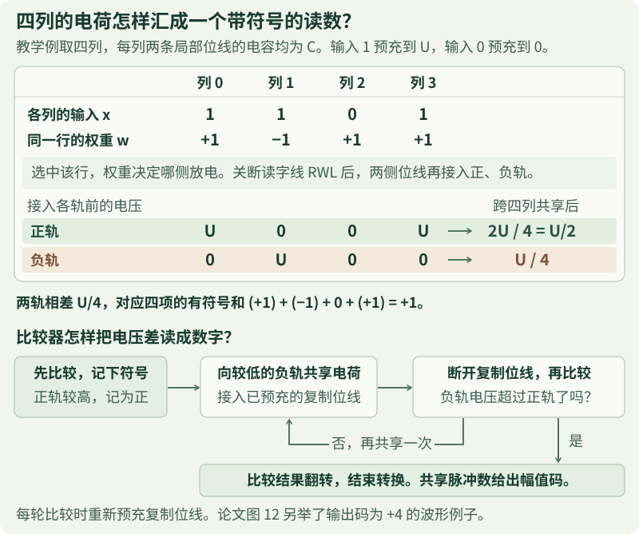

# 位线上的电压，怎样变成可累加的数字部分和？

上级：[存储介质与计算路径](./README.md)

[上一篇](./sram-cim-foundation.md)让 SRAM 在感测时就判出两个比特的 AND。现在让一组运算得到四项结果 `1、0、0、1`。如果感测端只给出“至少有一项为 1”，那么 `1、0、0、0` 和 `1、0、0、1` 会得到同一个输出。点积却需要区分它们：一个的和是 1，另一个是 2。怎样把这一份差别从位线一路保留到数字结果？

先数清硬件要分几种情况，再沿一块实测芯片的两张电路图走一遍。论文把结果表示成两条线之间的电压差。两条线都可以高于或等于地电势，相减后才有正负。

## 数四项里有几个 1，需要几个输出码？ {#精度路径如何形成}

给四项无符号运算各配一个输入位 x、一个权重位 b。把二者相乘，等于做一次 AND；把四个结果中 1 的个数相加，就是一次 **popcount**。

| 项 | 第 1 项 | 第 2 项 | 第 3 项 | 第 4 项 |
| --- | ---: | ---: | ---: | ---: |
| 输入 x | 1 | 1 | 0 | 1 |
| 权重 b | 1 | 0 | 1 | 1 |
| x × b | 1 | 0 | 0 | 1 |

两组数固定如表时，计数 k = 2。若希望电路覆盖输入 **和** 权重的任意组合，k 可以从 0 到 4。取两组全 1 即得到 4，所以这**五个结果**至少需要三位二进制编码。若固定表中的 x，只改变 b，三项被选中，k 最多为 3。同样，固定表中的 b 只改变 x，也只有三个权重位能贡献 1。

一种办法是让感测电路逐项判出比特，再把四个比特送到局部数字加法树；另一种办法是让四项先在模拟电路里合成一个量，再判出它对应哪个数字。后一条路即使接了三位 ADC（模数转换器），也得保证计数 2 和 3 对应的实际电压分布分得开。多给输出端接一根数字线，并不能把已经重叠的电压分开。

## 真实芯片把哪些数放在位线上？ {#典型-macro-结构}

来看 Biswas 和 Chandrakasan 的 **CONV-SRAM**。它用 10T 单元保存二值权重，权重的**算术值是 +1 或 −1**，激活可以是多位数。论文图 4 里，局部阵列的一条选中行放着同一组滤波器权重，各输入沿不同列送入；后面把这一行上多列的贡献合起来。上一篇“同列选两行判 AND”的电路在这里已经换了。[MIT 收藏的作者手稿，图 3、4](https://dspace.mit.edu/entities/publication/c2f4d699-5095-4d3f-8c3a-df79ad690fa3)

把上表的计数题翻译成这个电路能表示的数。约定无符号 b = 1 对应算术权重 +1，b = 0 对应 −1，那么四个权重是 **(+1, −1, +1, +1)**。被 x 选中的三项里，有两项贡献 +1，一项贡献 −1，带符号的点积 z = 2 − 1 = **+1**。若知道选中项数 m = 3，就可以从理想的精确 z 恢复 k = (z + m)/2 = **2**。一般地，z = k − (m − k) = 2k − m。这一步只为对照两种数学编码。论文电路中 SRAM 物理位 0 代表 +1、物理位 1 代表 −1；上表的 b 是算术记号。

打开论文图 9，先跟着第 1 个非负输入走，不必一次看懂全部开关：

1. **先把输入变成电压。** 列上的 DAC 将数字激活的幅值转成预充电压，两根局部读位线 LBLT、LBLF 先取得相同的电压。对本例四个 0/1 输入，把 1 的电压记成 U，0 记成 0；在真实电路中，不同输入幅值可以对应不同电压。
2. **用存储位决定哪一侧留下电荷。** 打开所选行的读字线。每列的 10T 单元有两个与写入路径分开的读端口。按存下的权重，其中一根局部线被放电，另一根保留输入电压。对非负输入，第 1 项 +1 对应的两侧贡献为 (U,0)，第 2 项 −1 给出 (0,U)，第 3 项输入为 0，两侧都是 0，第 4 项再给出 (U,0)。若激活带负号，外围开关还要交换正负贡献的去向。
3. **关掉读字线，再接通共享开关。** 四个对应正侧的电容接到一起，电荷重分布；负侧独立做同样的事。取理想化的四列等电容 C，忽略线网寄生，每侧总电容都是 4C。正侧原有 2CU 电荷，最后电压为 2CU/(4C) = U/2；负侧原有 CU，最后是 U/4。两侧相减得到 **U/4**，正好是四项带符号贡献的平均值。选中的行和四个 SRAM 锁存位都不必保存这个分数；保存它的是两组接通后的电容。[CONV-SRAM 原论文图 9 与式 (8)，局部位线及共享开关](https://picture.iczhiku.com/resource/eetop/syKrzDHpHkDuIvCB.pdf#page=6)

原型能同时处理最多 64 个输入、并行产生 16 组滤波器的局部输出。四列、U 和 U/4 是为了手算缩小的理想模型。把四项放进更大阵列时，必须按**实际接入平均网络的电容和项数**重新定标；把另外 60 项设成零，若它们的电容仍然接着，不能照搬四列的分母。

<figure class="micro-diagram" tabindex="0" aria-label="四列等电容汇成差分电压，积分式 ADC 将压差读成数字" markdown="1">

<figcaption>上半图按论文图 9 缩小为四列。每条轨都接入四个等电容，初始电压为零的电容也要计入分母。下半图按图 12 自绘；原论文波形中的 +4 是另一组输入的输出码，本例的 U/4 是量化前的电压差。</figcaption>
</figure>

## 比较器只会回答哪边高，怎样读出差了多少？ {#三种常见计算路径}

图 12 的感测放大器（SA）先比较正、负两侧。上例的 U/2 高于 U/4，因此第一次比较只给出正号。现在盯住较低的一侧。电路把一根复制位线的电容预充到参考电压，再把它接到较低的一侧，共享一次电荷，使这一侧升高一点。断开、重新预充、再接上，每步之后再比一次。第一次看到比较结果翻转，说明较低侧已经跨过较高侧。数字逻辑记下符号，计数器记下用了多少个这样的步进；这就是该原型的**积分式 ADC**。在校准的量程内，原先差得越远，通常需要越多步。[CONV-SRAM 原论文图 12，积分、比较和计数的时序](https://picture.iczhiku.com/resource/eetop/syKrzDHpHkDuIvCB.pdf#page=8)

这里有两个容易混在一起的累加。第一次是不同乘积在电容上合成一个差分电压，已经完成了局部求和并带有平均尺度。第二次是 ADC 重复加入参考电荷，为了**测量**这个已形成的电压差。ADC 计数器数的是持续到比较结果翻转为止的参考步进，不能直接当成“有几项无符号 AND 为 1”。数字输出还要解释它的符号、量化步长和平均尺度。若一个卷积滤波器放不进一次运算，原型将任务分组，对局部结果分别转换，再在阵列外数字累加。量化中已丢掉的低位，后面的加法器没法补回来。论文报告了使用 6 位输入/输出运行的网络实验，这项精度也不能当作任意整数点积都能逐位精确恢复的保证。[论文与实测条件](https://doi.org/10.1109/JSSC.2018.2880918)

换一种电路实现，同样的四项乘积会在哪里相加？**电荷域**用已充电的电容共享电荷，CONV-SRAM 属于此例。**电流域**可以让选中的读支路共同给一根读位线（RBL）充放电；若在时间 Δt 内，各有效支路电流近似恒定且相同，位线电压变化的大小约为“导通支路数 × I × Δt / C”。支路失配或位线电压变动都会破坏这种比例。**数字按位路径**则先感测 AND、XNOR 等逻辑结果，再做数字 popcount。三种方法都可能用到感测电路。把时序图中的那一次比较、积分或数字加法找出来，才能看出本地部分和出现在哪里。[普通 SRAM 的字线、位线与感放](../../../storage/02-sram/foundations/wordline-bitline-sense-amp.md) · [ADC、DAC 和感放各负什么责](../04-circuit-and-macro/adc-dac-sa-in-cim.md)

## 把输入再加一位，旧的部分和怎么用？ {#常见误解}

回到无符号四项例子。把输入换成 (1,3,2,1)，低位仍是 (1,1,0,1)，与原权重按位相乘得低位计数 **2**。高位是 (0,1,1,0)，与同一组权重相乘得高位计数 **1**。数字累加器将高位结果左移一位，再算 2 + 2 × 1 = **4**。直接检查原数也是 1 × 1 + 3 × 0 + 2 × 1 + 1 × 1 = 4。

这是一种 **bit-serial（按位串行）** 实现的可复算例子。它可以用多轮阵列操作、移位和更宽的累加器换多位输入。**bit-parallel（按位并行）** 实现可以用更多单元、通路和导线，同时产生多个位平面的结果。权重同为多位时还需计入权重位平面，带符号整数的符号位也要按自己的位权处理。CONV-SRAM 的多位激活则在列上先转成电压，以电荷域算局部点积。一句“支持 INT8”无法决定需要多少轮、内部是否量化，也无法保证最后保留的是精确整数和。三值网络还要另外表达零权重或屏蔽动作；每个权重只保存一位正负号的这颗芯片不会凭空多出第三种状态。

## 一次聚合 128 或 256 项，外围要付出什么？ {#与工艺节点的关系}

假定一条无符号点积一次真的要区分 0 至 128 的每个结果，就有 129 个码值需要分开；若要区分 0 至 256，则有 257 个。理想数字输出至少分别需要 8 位、9 位。只把阵列尺寸写成 128×128 或 256×256，仍然不能推出 ADC 位数；还得知道实际聚合了几项、要求分清哪些电平。若在相同电压摆幅内塞入更多间隔，每档允许的误差就更小。电容失配、漏电、感放失调和噪声都可能把一次比较推到相邻档。不同工艺、电源电压、温度（PVT）下还要验证原来的余量。缩小工艺节点可能有利于逻辑密度，同时要重新检验模拟电压余量与器件匹配。[工艺节点与面积、性能、功耗取舍](../../../chip-development/FAB/wiki/02-front-end-fabrication/process-nodes-and-ppa-tradeoffs.md)

从输入到可以运走的结果，宏内要算上输入编码、字线驱动、预充、位线、判决或转换、本地数字累加、输出缓冲和时序控制。看一眼这颗样片的版图会比猜比例更清楚：论文单列的积分式 ADC 占 CSRAM 面积的 **7.3%**；阵列及其配套电路归在另一项，列 DAC 和局部平均电路也各自计数。7.3% 的分母是该样片的 CSRAM 面积，不能当成所有外围占比或每次操作的能耗。更多独立 ADC 可以减少多个输出排队，但要付更多面积和驱动能量；若共用 ADC，又得在采样、复用和等候期间保住模拟量。[原论文第 VI 节与版图图 14](https://picture.iczhiku.com/resource/eetop/syKrzDHpHkDuIvCB.pdf#page=8) · [宏里的外围开销怎样计数](../04-circuit-and-macro/peripheral-overhead.md)

## 这项“少搬一次”的收益能留下多少？ {#研究启示}

这四项权重无需逐个读成数字送给独立乘法器，但激活仍须到达输入端，局部结果还要转换、暂存，并可能经过 NoC 去下一块阵列。选 6T、8T 或 10T 单元都要看实际读写隔离、容量和布线尺寸；仅凭晶体管数无法推得整块宏的面积效率。比较 SRAM 和 ReRAM 方案也应先固定运算、精度和输出边界，分别核对制造与验证条件。

读一项宏的 TOPS/W 或 TOPS/mm² 数字时，可以从刚才的数字部分和向两头追：**输入转换、校准、测试和可测性设计（DFT）算没算进去？阵列填不满时仍要驱动哪些外围？部分和到 tile 缓冲、数字归约及最终消费者，还要花多少时间和能量？** 把版图、硅片测量和模型精度的证据分别列出，才有条件将这个局部电路与整芯片上的另一种实现对齐。

换成 DRAM，还有一种办法能让权重留在存储芯片上：按普通方式读出它，把数送到 bank 旁独立的乘加器。沿这条路径，先前位线和 ADC 承担的工作变成了哪些命令和寄存器操作？[把乘加器放在 DRAM bank 旁，一条命令怎样算起来？](./dram-pim-foundation.md)
