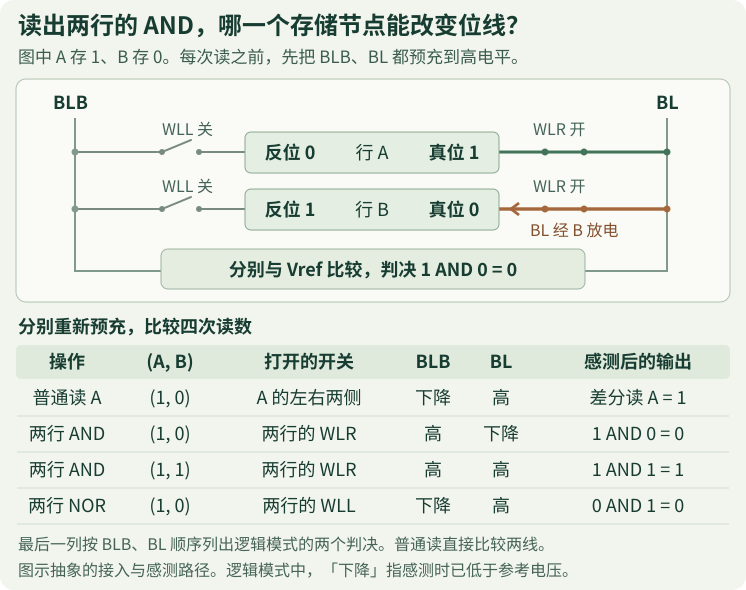

# SRAM 原本一次读出一个字，怎样让阵列参与计算？

把两个字存在 SRAM 的第 1 行和第 3 行。只看其中一列，第 1 行存 1，第 3 行存 0。要问「这两个比特是否都是 1」，用普通 SRAM 可以先读两行，把读出的两个比特送给与门。能不能让这两格**在同一根位线上**就给出答案？如果能，列末究竟看到了什么？

[点积的三种算法](../01-overview/cim-pim-nmc-taxonomy.md)里，两行逐位相与是算出 `2×4＋3×5＝23` 的一小步。那里用 DRAM 的三个工作行做与。这次取 Jeloka 等人在 28 nm FDSOI 工艺上验证的一款 SRAM，沿一列看它怎样完成同一个逻辑操作。图号都指这篇论文，下面的两格数值是便于复算的例子。[Jeloka 等，JSSC 2016，第 V 节及图 15](https://blaauw.engin.umich.edu/wp-content/uploads/sites/342/2017/11/JelokaA28nmconfigurable2016.pdf#page=8) · [期刊条目](https://doi.org/10.1109/JSSC.2016.2515510)

## 只读第 1 行，哪条位线会下降？ {#one-row-read}

先认清一格的四根线。这款 6T 单元用一对交叉耦合的反相器保持相反的两个值。本文把保存数据的节点叫 `Q`，另一端叫 `Q̅`。右侧访问管把 `Q` 接到真值位线 `BL`，由右字线 `WLR` 控制。左侧访问管把 `Q̅` 接到反相位线 `BLB`，由左字线 `WLL` 控制。**左右字线可以分别开关**，这是这款宏给普通六管单元增加的控制能力。列内各行共享同一对位线。[论文图 4 的接线、图 7 的感放](https://blaauw.engin.umich.edu/wp-content/uploads/sites/342/2017/11/JelokaA28nmconfigurable2016.pdf#page=3)

先把 `BL`、`BLB` 都预充到高电平，再释放位线，只打开第 1 行的左右两条字线。第 1 行的 `Q=1`，`Q̅=0`。右侧没有接向低节点的放电通路，`BL` 保持高；左侧的 `BLB` 经访问管和单元下拉管向地放电。等到两线的电压差足以判决，**差分感放比较 `BL` 与 `BLB`**，这一列读出 1。第 3 行的两条访问管都关着，它存的 0 此时没有参与。一次接口能读出一个字，是把其他列选出的结果一起交给输出端。[存储系统：字线、位线与读出放大器](../../../storage/02-sram/foundations/wordline-bitline-sense-amp.md) · [一格 6T SRAM 怎样保持和读取一个比特](../../../storage/02-sram/foundations/6t-cell-bistable-storage.md)

## 让两行都参加，为什么列输出变成了 AND？ {#two-row-and}

把第 1 行叫 A，第 3 行叫 B。保留 `A=1，B=0`，从新的一次预充开始。现在切到论文图 15 的逻辑模式。**只开 A 和 B 的右字线 `WLR`**，这两格的 `Q` 都接上本列 `BL`。所有左字线 `WLL` 保持关闭，其他行的左右字线也都关闭。这时沿着 `BL` 能找到两条支路。A 的 `Q=1`，B 的 `Q=0`，B 的下拉通路使 `BL` 电压下降。另一根 `BLB` 没接上任何选中单元，保持在预充高侧。

列末还有一件事要改。刚才的普通读只问「两根线谁高」；现在要问「哪一根跌过了判决门槛」。同一组可重配置感放切成两路单端比较，各自把一根位线与参考电压 `Vref` 比较。在有效采样时刻，`BL` 低于参考，真值侧报 0；`BLB` 高于参考，互补侧报 1。逻辑模式把**两路判决再相与**，列输出 `0 AND 1 = 0`。这里的「低」只表示在门槛的低侧，位线不必放到 0 V。名字带 B 的感放输出在这个模式下独立判决，两路结果可以同时为 1。[论文图 7、8 的单端判决及表 II 的输出选择](https://blaauw.engin.umich.edu/wp-content/uploads/sites/342/2017/11/JelokaA28nmconfigurable2016.pdf#page=4)

现在只改一个条件。用一次正常写把 B 从 0 改为 1，A 保持 1；重新预充，仍只开两根右字线。上次让 `BL` 下降的那条通路消失了。两根线都留在参考高侧，两路都报 1，列输出 `1 AND 1 = 1`。这也说明为什么要换感放模式。两根线都高时，一只只看两线差分的普通感放得不到这个「都保持高」的判据。

<figure class="micro-diagram" style="width: 100%" tabindex="0" aria-label="普通 SRAM 差分读与分侧字线的两行逻辑读" markdown="1">

{style="min-width: 680px"}

<figcaption>每次访问前重新预充。图中画出两行右字线打开后的连接和列末判决，省略晶体管尺寸与电压随时间变化的波形。下表中的 NOR 另起一次访问，只开两行的左字线。</figcaption>
</figure>

论文图 15 给出的是两字逐列相与的实现。把刚才的一列铺开，每一列都能用自己的位线给出这一位的答案。[论文图 15 及表 I](https://blaauw.engin.umich.edu/wp-content/uploads/sites/342/2017/11/JelokaA28nmconfigurable2016.pdf#page=8)

**原电路还支持 NOR（或非），要换哪些线？** 另起一次操作，把已选两行的右字线关掉，只开两行左字线。`BL` 保持高，`BLB` 接到两格的 `Q̅`。如果 A 或 B 有一个存 1，对应的 `Q̅` 就是 0，能使 `BLB` 下降，列输出 0。只有 A、B 都存 0 时，两条 `Q̅` 才都是 1，`BLB` 也维持高侧，输出 1。下面把四种输入填全。「↓」表示该侧下降到可判低的一侧，另一侧保持高。右字线模式与左字线模式各占一次独立操作。

| 同列 A、B | 只开两行右字线 | 列输出 AND | 只开两行左字线 | 列输出 NOR |
| --- | --- | --- | --- | --- |
| 0、0 | BL ↓ | 0 | 两线高 | 1 |
| 0、1 | BL ↓ | 0 | BLB ↓ | 0 |
| 1、0 | BL ↓ | 0 | BLB ↓ | 0 |
| 1、1 | 两线高 | 1 | BLB ↓ | 0 |

## 列输出算对了，原来存的 1 还在吗？ {#check-the-stored-bit}

回到 `A=1，B=0` 的 AND。B 的下拉管把共享的 `BL` 往低处拉；A 的访问管也开着，**这根正在下降的线同时接在 A 原本为高的 `Q` 上**。如果它把 A 的高节点拉得过低，交叉耦合的反馈就可能翻转，A 会从 1 变成 0。这是论文所说的伪写条件。即便列末这次恰好给出了正确的 0，阵列里也可能已经丢了一个操作数。

怎样区分这两件事？先检查列输出确为 0，再关掉逻辑字线，用普通 SRAM 模式分别读回 A 和 B。若读回仍是 `1、0`，这次操作保住了输入。如果变成 `0、0`，后一次普通读就查出了**读扰导致的数据翻转**。位线上出现电压变化是正常求值的一部分。真正要防的是**扰动跨过单元的保持裕量，撤掉字线后还恢复不了原值**。上述读回是这个例子的检验方法，一次通过不能代替跨数据图样、工艺偏差、供电和温度的验证。

论文让计算模式的字线采用较低的驱动电压，单元锁存电路仍用较高的供电，以减弱访问管相对单元的驱动强度。访问管弱些，更难把另一格改写；代价是位线建立可判电压需要时间。论文也区分了只开两个字与开更多字时可用的字线电压和频率。因此，「能同时开几行」要看这款宏给出的工作条件。写入或部分选通时，还要检查共享已选行或列的其他单元能否保值，这与两行 AND 的输出真值是两项不同的验证。[论文图 11 的伪写、图 12 的裕量分析及第 V.B 节的两字逻辑](https://blaauw.engin.umich.edu/wp-content/uploads/sites/342/2017/11/JelokaA28nmconfigurable2016.pdf#page=6)

这也解释了为什么会有 8T、10T 实现。6T 单元紧凑，普通读写与这里的求值共用访问路径。某些 8T 或 10T 单元增加独立读口，存储节点只驱动读支路的晶体管栅极，共享读线上的电压就少了一条直接改写存储节点的路径。额外晶体管、布线和外围会占面积。某个 8T 能否按位与，某个 10T 能否累加，仍须看读口怎样接、哪些线能一起激活、列末怎样判决。相同管数可以接成不同电路。

## 算出一列的 0，离最初的点积还有多远？ {#back-to-the-dot-product}

回到 `X=(2,3)`、`W=(4,5)`。取 X 的高位，横放为一行 `（1，1）`；取 W 的低位，放为另一行 `（0，1）`。每列代表点积的一项。只开这两行的右字线，第一列是刚才的 `1 AND 0`，第二列是 `1 AND 1`，逐列输出 `（0，1）`。如果外围能数 1，就能数出这两列中恰好有一个 1。乘回输入位权 2 和权重位权 1，这一对位平面对点积**贡献 1×2×1＝2**。这里额外假设了外围能计数和按位权累加。论文这款逻辑宏能够交出逐位与的结果，单凭它的两路感放，无法读出点积 23。[六对位平面怎样合成 23](../01-overview/cim-pim-nmc-taxonomy.md) · [数字 CIM 的按位乘法与累加](../03-compute-paradigms/digital-cim-fundamentals.md)

不少片上缓存、暂存器和寄存器文件都借助 SRAM 保存操作数。如果把同样两行用普通 SRAM 分两次读出，再交给紧挨阵列的乘加器或数 1 电路，越过阵列读出口的是两行**原数据**。本例跨过列输出的是已经逐列合成的一行**与结果**。这一步省去的是把那两行分别送往外部逻辑的局部搬运。预充、驱动两行、感测及后续归约仍要付出能量和时间。要估计一颗 SoC 能否受益，还要看数据原本放在哪个缓存或暂存器、每次有多少列真的用上。[SRAM 阵列组织](../../../storage/02-sram/foundations/sram-array-organization.md) · [缓存与软件管理的暂存器](../../../storage/01-memory-hierarchy/02-access-paths/cache-vs-scratchpad.md)

## 如果还想把「数出几个 1」也留在局部呢？ {#beyond-a-boolean-result}

这款阵列把两种位线状态判成一个数字位。数字路线可以继续组合按位与、同或（XNOR）、数 1 和局部数字累加器；多比特乘法则可以像点积例一样按位展开。设计者能逐项核对真值和位权，也要计算展开占用的周期、存储位和外围面积。现有 CMOS 的时序、可测性设计和 SRAM 宏集成经验可以沿用，新增的字线模式、感放和稳定性仍须单独表征。

若要在局部直接区分「0 个、1 个、2 个」甚至更多级，就需要一条能保留这些差别的信号路径。有的设计让各读支路贡献电流，在公共线上求和；也有设计先在局部电容上形成电荷，再连接电容共享电荷，使结果电压反映局部和。随后要靠感测或模数转换电路（ADC）区分电平，再按需要校正、累加。做这种混合信号的多比特运算，每格 SRAM 仍只稳定保存一个比特，多比特权重还要用多格、分拍或外围编码。增加判决级数后，相邻有效电平的间隔、噪声和工艺/供电/温度变化、转换器面积与功耗都要计入；也需以布局后仿真、实测和目标工作负载的精度核对整套方案。保留几位有效输出，不能从单元是 6T 或 8T 读出来。[Khaddam-Aljameh 等的多比特 SRAM 开关电容计算电路](https://doi.org/10.1109/TVLSI.2020.3037871) · [ReRAM 电导阵列的乘加方式](./reram-as-compute-element.md)

下一篇跟踪另一个实作 CONV-SRAM 的同一选中行，看看多列电容上的信号如何共同形成一个局部和，随后怎样读出。前面的普通读、逐列 AND 和这里的混合信号方案，各自只在实际接通的那段电路里完成了相应的一步。[SRAM-CIM 深入：从各列的贡献到一个可读的部分和](./sram-cim-deep-dive.md) · [本章导读：存储介质与计算路径](./README.md) · [存内与近存计算专题导读](../README.md)
