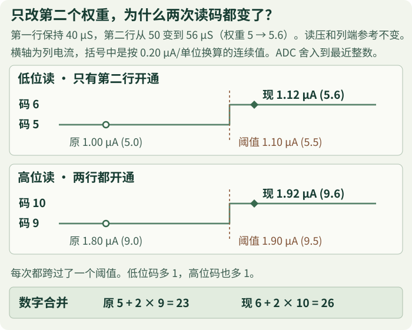

# 同一个输入反复读，怎样找出部分和里的误差？

上一页把输入 (2, 3) 分成两个位平面。读低位时只开第二行，理想读数是 5；读高位时两行都开，理想读数是 9。数字端算出 5 + 2 × 9 = 23。现在把同一输入、同一列权重连续读几遍，每次低位都出 6，高位都出 10，结果成了 26。电路每次都给同一个答案，能据此判定第二个权重写错了吗？[上一页的两次位平面读出](./analog-cim-fundamentals.md#two-input-planes)

## 一个权重多了 0.6，为什么答案多了 3？ {#repeat-read}

先做一个知道原因的实验。权重目标是 (4, 5)，只把第二个权重改为 5.6，保持到本次实验结束。按前篇的尺度，每个权重单位对应 10 µS。第二行的实际电导因此取 56 µS，目标是 50 µS；被选中的行仍用相同的 20 mV 读出。电压驱动、列线和感测参考都理想，不加随机读噪声。每个被选中的权重单位产生 0.2 µA；ADC 的一个码阶也对应 0.2 µA，采用无符号 4 位、最近值舍入，范围是 0 到 15。本例的输入均在量程内。下表的“量化前”是用电流除以 0.2 µA 所得的连续值。

| 这次开哪一行 | 理想电流及码 | 权重变成 (4, 5.6) 后的电流 | 量化前 | 实际码 |
| --- | --- | --- | ---: | ---: |
| 低位 (0, 1)，只开第二行 | 1.00 µA，码 5 | 1.12 µA | 5.6 | **6** |
| 高位 (1, 1)，两行都开 | 1.80 µA，码 9 | 1.92 µA | 9.6 | **10** |

低位这次的电流越过码 5 与 6 之间的 1.10 µA 门槛；高位也越过码 9 与 10 之间的 1.90 µA 门槛。两次转换各多一个码，数字端低位加一次、高位加两次，于是 **6 + 2 × 10 = 26**。若保留模拟值直到最后，5.6 + 2 × 9.6 = 24.8。相对 23 多出的 1.8 来自第二个权重所乘的输入恰好为 3。两次分别舍入又多出 0.4 + 2 × 0.4 = 1.2，合计偏高 3。**同一只单元在两次读取中都出现了**，所以它的一份写入偏差会进入两个部分和。

<figure class="micro-diagram" tabindex="0" aria-label="第二个权重固定偏大，两次位平面采样分别跨过一个门槛，按位权合并后从 23 变成 26" markdown="1">

<figcaption>只有一个权重被改动。模拟电流每次都增加 0.12 µA，两个 ADC 码则分别进入不同码区。图中的电流和阈值来自教学模型。</figcaption>
</figure>

## 如果手上只有码 6 和 10，怎样排查？ {#非理想性分层}

先把第二行关掉，只开第一行，再把两行都关掉。在空输入试验中仍开启读出与转换电路。下面设计三种彼此独立的偏差，表中每种误差各占一列，每次只启用其中一种。公共偏置表示在转换前给所有读数加上相当于 0.6 个码阶的电流，公共增益误差则把所有电流乘 1.11。

| 输入掩码 | 理想码 | 只有第二个权重多 0.6 | 只有公共偏置 +0.6 | 只有公共增益 ×1.11 |
| --- | ---: | ---: | ---: | ---: |
| (0, 1)，原低位 | 5 | **6** | **6** | **6** |
| (1, 1)，原高位 | 9 | **10** | **10** | **10** |
| (1, 0)，只开第一行 | 4 | 4 | 5 | 4 |
| (0, 0)，两行都关 | 0 | 0 | 1 | 0 |

第一行单独读出 5、空输入又读出 1，符合表中公共偏置的预言。如果分别得到 4 和 0，第二个权重偏高和公共增益偏高都解释得通。以 (1, 0) 为例，4 × 1.11 = 4.44，转换后仍是 4。多读一组输入有时还不够，量化可能把不同原因压进同一码区。

若测试通路允许，下一步**绕过阵列，在读出链的已知节点注入独立、已标定的参考电流**。例如在待测放大与转换电路之前送入 1.80 µA，理想读数应为 9。若偏差只在存储单元，此时读出 9；若增益仍是 1.11，则 9 × 1.11 = 9.99，读出 10。单个参考还可能混淆增益与偏置，可扫多个已知参考，记录各码门槛位置，检查响应整体平移还是斜率改变。参考须独立于可疑的片上基准，且只能检验**注入点之后**的电路。若芯片只开放数字输出，这一步就需要专用测试通路或外部仪器。

若参考扫过正常，再把疑点移回阵列和驱动。测行驱动电压，在相同读偏置下分别读单元；增加同时选通的行，观察偏差是否随负载、相邻线切换或位置变化。线阻造成的压降、旁路电流、耦合以及行驱动 DAC 的偏差都可能改变列电流。一个可重复的偏差仍不等于已经定位到器件。对同一单元重复写入目标值并验证，在同一温度、相同的写后等待时间再读；换一只物理单元映射同一权重，对照误差跟着位置走，还是随一次编程结果改变。改映射同时可能改走线，比较时也要控制行列负载。[列端电压和线阻怎样改变读数](../02-memory-technologies/reram-cim-deep-dive.md) · [在计算宏内沿写入、读出与转换逐段测量](../04-circuit-and-macro/non-idealities-and-error-sources.md#trace-weight-error)

## 同一列读十次，哪些误差会留下？ {#温度和时间为什么危险}

先固定温度、电源、输入和映射，不重写，短时间内连续读。回到“第二个权重固定偏高”的实验，再假设每次读数还可能上下扰动 0.2 个码阶。若一轮的模拟读数是 5.4、9.8，转换后得 5、10，合成 25；另一轮若是 5.8、9.4，转换后就得 6、9，合成 24。权重并未在两轮之间改变。相反，两次都报 26 也可能有噪声，只是电流没有越过门槛。反复读取可以估计在这些条件下的读数分布；要量到码区内部的散布，还得用更细的参考扫描或能观测模拟量的测试接口。

做仿真也要保留这种关系。给同一物理单元抽取一次固定失配，后续读取沿用；一次编程和验证结束时产生的写入偏差，保留到下次重写。随写后时间和温度变化的漂移要沿时间演化。对逐次变化的那部分快噪声，可按测得的相关时间重新采样；慢噪声、同列共用的参考波动则可能跨两次读取。若把每种误差都在每次读取时独立重抽，固定权重便会在仿真里凭空变化，也会低估连续偏高或偏低的影响。IBM 的一项 PCM 研究就将编程、长期漂移与一次次矩阵运算中的短时读噪声分开建模，并用器件测量拟合参数。[Rasch 等的编程、漂移和短时读噪声模型](https://pmc.ncbi.nlm.nih.gov/articles/PMC10469175/)

在量化前还可以做一次交叉核算。令低、高两次读取的随机误差为 e₀、e₁，单位都是码阶，合并误差为 e₀ + 2e₁。若两者零均值、方差都为 σ² 且相互独立，合并误差方差为 **5σ²**。若两次恰好叠加同一个随机偏差，即 e₀ = e₁，而这个共同偏差在所考察的一批样本中方差为 σ²，则合并误差为 3e₀，方差是 **9σ²**。开头那只已写好的单元在本次实验中确定地多了 0.6，重复读取不会让这一常数产生新的方差。推到实际输出码还须经过门槛和饱和规则，不能拿这两个模拟方差当成数字输出的误差率。

延长实验时间后要换一种测法。固定温度，在写后不同时间测一遍；另取匹配样本或重新设置初态，在多个受控温度、相同写后时间再测。否则“今天比昨天低”既可能是权重漂移，也可能是电源、感放零点或参考随温度变化。测量时把温度、供电、写后时间、映射、校准时间点一并记下。出厂或开机时做的一次校准，是否足够覆盖车载、工业或持续运行的设备，要看预期温区、寿命与最坏条件下还有多少余量。

## 换一种存储介质，先测哪个量？ {#analog-paradigm-的-memory-落点}

- **ReRAM 与 Flash。** ReRAM 的多级电导可直接参与电流求和，先查写入分布、保持和行列电压。Flash 也可在固定读偏置下把多个权重映射为不同电流，更应跟踪编程后的阈值、读偏置和长期电荷保持。同一块阵列上“隔一段时间再读”与“刚刚重写后再读”，检验的是不同过程。
- **SRAM。** 普通单元保存一个稳定逻辑位，电荷域或电流域电路可以将多个位的贡献形成一个模拟部分和。多位权重通常要用多个单元、编码访问或外围累加。工艺、供电和温度变化会影响漏电、位线匹配、感测偏置与裕量。可在计算后按普通方式再读一遍存储位，区分感测判错与位本身受到读扰动。
- **PCM 与 MRAM。** PCM 的多级电导可作模拟权重，写脉冲的热过程、写后验证、电阻漂移及其温度依赖都要纳入预算。常见 MRAM 则主要保存两个磁态。若两行同时选通、靠感测门槛判断逻辑，要测磁态组合的分布和判读窗口；有些专门电路也可做模拟累加。只把数据从 MRAM 读给独立处理器，是另一条路径。[两种介质的读出对照](../02-memory-technologies/pcm-mram-for-cim.md)
- **DRAM/HBM/GDDR-PIM。** 存储 die 内独立数字单元利用本地数据执行乘加时，数值精度由数字运算单元及其格式决定。有关 1T1C 单元电荷共享的阵列计算需要按具体电路另行分析。不能因为 HBM 内部有感放，就给数字 PIM 部分和套上本页的模拟电流误差模型。[DRAM bank 旁的数字执行单元](../02-memory-technologies/dram-pim-foundation.md)

## 如果目标是模型精度，哪一级值得修？ {#精度瓶颈不是单个-bit-数}

即使一篇论文写“4 位输入、4 位权重、8 位输出”，最后一项也只说明可以用多少位表示输出；要分辨得出多少正确的数值，要看输入 DAC 或行脉冲、单元状态、阵列累加、ADC 量程、数字位权合并，以及校准后的残余误差。上例的 ADC 工作正常、数字移位加法也完全正确，26 依然比目标多 3。模拟 CIM 的物理偏差能在电路按设计工作时直接进入数值结果；数字 CIM 也要考虑量化、时序、感测判错和硬故障，传播方式取决于中间值在何处被判为离散位。[输入、列信号和 ADC 的基本路径](./analog-cim-fundamentals.md)

若重写能缩小第二个权重的误差，可以收紧写后验证窗口，代价是更多编程脉冲和验证时间。若误差跟位置和负载走，切小阵列可缩短连线。沿输入维切分后，每个输出会多出需要转换和归并的部分和，还要计入多块阵列的外围与互连。若多个列输出共用一个 ADC，同样数量的转换还可能要排队完成。对共同的偏置可用参考校准，对两路共同变化的误差可考虑差分编码，后者需要额外单元或读出。挑选偏差较小的位置进行映射、用冗余单元避开坏点，也要支付测试、额外存储和映射维护的成本。设置重新校准的周期时，还要计算运行时停顿、参考与参数的占用，以及校准本身的能耗。[器件、阵列与外围的误差来源](../04-circuit-and-macro/non-idealities-and-error-sources.md)

量化感知训练（QAT）让训练过程看到部署时的量化和裁剪；加入根据硬件测得的写入与读出噪声，则让模型接触目标器件的误差分布。两者能否帮助特定层，须看校准前后真实层输出和整网任务精度，且训练、重训练的数据与时间也有成本。NeuRRAM 原型分别比较了仿真与芯片测量，并让已编程层的实测输出进入后续软件层，逐层检查微调效果。读它的图 5 时，辨明哪一层实测、哪部分在软件中执行，比把某个 ADC 位数当成整网精度更有依据。[NeuRRAM 原论文图 5，芯片测量与逐层微调](https://pmc.ncbi.nlm.nih.gov/articles/PMC9385482/#Fig5)

回到第一次读出的 26。低位和高位各多 1，指明了去哪里观察；单行读、参考扫描、重写和温度对照，才逐步缩小可能原因。对于低位宽、权重长期复用且允许校准的工作负载，可以用这套测量核算实际精度和摊销成本。若提高有效精度或频繁更新大模型，还要重做写入、校准、转换、时延与整网能耗的比较。接着换一条通路，看看把位先判成 0 或 1 后，部分和怎样形成。[数字 CIM 的按位计算](./digital-cim-fundamentals.md) · [返回阵列求值与信号转换](./README.md)
