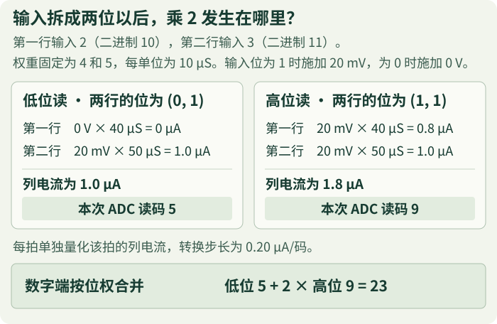

# 把输入拆成两个位平面，模拟阵列怎样算出 23？

算 `2×4＋3×5`，权重 4 和 5 都已经写进两行 ReRAM。现在给输入驱动器加一道限制：每个读窗时长相同，每行在整个窗内只有 **0 mV、20 mV** 两种选择。要在同一列上让第一行代表 2、第二行代表 3，一次读显然不够。如果第一次读到 1.0 µA，第二次读到 1.8 µA，能从这两个读数得到 23 吗？

## 两行上的两个整数，怎样变成两次可以施加的输入？ {#two-input-planes}

用两位无符号数表示输入，2 写作 `10₂`，3 写作 `11₂`。先只看这两个数的最低位：第一行是 0，第二行是 1。再只看高位：第一行是 1，第二行也是 1。一次取出**所有输入的同一位**，叫一个输入位平面。两次读窗就有了各自的用处。

| 输入位平面 | 第一行，输入 2 | 第二行，输入 3 | 这一位原来的位权 |
| --- | --- | --- | --- |
| 低位 | 0 | 1 | 1 |
| 高位 | 1 | 1 | 2 |

手算时，低位平面给出 `0×4＋1×5＝5`。高位平面给出 `1×4＋1×5＝9`；因为从 2 和 3 中取出的是值为二的那一位，**这一个 9 要计两次**。这一步只拆输入，两个权重始终是完整的 4 和 5。每次读到的数究竟从哪里来，还要回到电路。

## 列端怎样先收到 1.0 µA，再收到 1.8 µA？ {#read-the-column}

沿用[两行 ReRAM 的读出模型](../02-memory-technologies/reram-as-compute-element.md#ideal-column-current)。每单位权重对应 10 µS。第一行单元保持 40 µS，第二行单元保持 50 µS。列端由读出电路维持在 0 V 附近，假定已选支路在这段读压内近似线性，先忽略线阻、噪声和额外泄漏。输入位为 1 的行加 20 mV，位为 0 的行与列端同电位。本例的一个单位贡献是 `20 mV × 10 µS＝0.2 µA`。

**第一窗送低位 `(0,1)`。** 第一格保存的 40 µS 还在，只是它两端没有压差，净电流为零。第二行施加 20 mV，向列端贡献 `20 mV × 50 µS＝1.0 µA`。两条支路汇到同一列，列电流为 1.0 µA，相当于 5 个单位。待信号稳定，把**本窗**的读数转换为数字并保存。

**第二窗送高位 `(1,1)`。** 第二行维持 20 mV，继续贡献 1.0 µA。新接通的第一行贡献 `20 mV × 40 µS＝0.8 µA`，所以这一次的列电流是 `0.8＋1.0＝1.8 µA`，相当于 9 个单位。高位的意义没有写在 20 mV 上；电路在两个窗施加的是相同幅度。控制器知道读的是哪一位，稍后才把位权加回来。

<figure class="micro-diagram" tabindex="0" aria-label="两个输入位平面分别形成列电流，再经数字移位合并" markdown="1">

<figcaption>两次读窗的电压刻度和电导状态相同，每窗分别转换。窗间保存的是数字部分和；列电流没有从第一窗累积到第二窗。</figcaption>
</figure>

## 为什么 4 位读出能留下 23，3 位读出却只剩 19？ {#convert-and-shift}

要把部分和保存下来，先约定读出刻度。本例的理想无符号模数转换器（ADC）把列电流除以 `0.2 µA/码`，舍入到最近整数，超出范围时钳在端点。4 位 ADC 有 16 个码，范围为 0 至 15。第一窗的 `1.0 ÷ 0.2＝5` 和第二窗的 `1.8 ÷ 0.2＝9` 恰好落在整数码上，均能表示。此处电流用 µA 代入。

在数字侧，把高位平面的码 9 左移一位，得到 18，再加上先前保存的 5，得到 **`5＋2×9＝23`**。若只算 `5＋9＝14`，就丢掉了原输入的高低位之别。4 位 ADC 能参与算出 23，是因为每次只需读出 5 或 9；数字移位和相加须另有足够位宽，本例结果至少要有 5 个无符号位。

现在只把 ADC 改为 3 位，**每码 0.2 µA 的刻度及两个输入窗都不变**。3 位的最高码是 7，代表 1.4 µA。第二窗的真实列电流仍是 1.8 µA，转换器只能交出码 7。往后再做多少位的精确加法，收到的都是 `5＋2×7＝19`。丢失发生在第二窗读出时，差了 2 个部分和单位，到高位被放大成 4。这个对照固定了增益；若重新设计步长来扩大范围，较小的电流差还能否分出，就是另一个问题。[读出电路、参考与 ADC 怎样配合](../04-circuit-and-macro/adc-dac-sa-in-cim.md)

## 为什么其他阵列也算出 23，列端却读到别的数？ {#where-is-the-weighting}

同一对输入和权重，位权可以由不同的电路承担。比较时先指出**这次读出代表什么**。

| 已用过的算法 | 列端读到了什么 | 怎么得到 23 |
| --- | --- | --- |
| [ReRAM 一次按幅度输入](../02-memory-technologies/reram-as-compute-element.md) | 行电压 40、60 mV 已代表 2、3，一次得到 4.6 µA | 按原例的数学刻度 `4.6 µA ÷ 0.2 µA＝23`；若接 ADC，还要给这次更大的读数留够量程。 |
| [Flash 三窗积分](../02-memory-technologies/flash-cim-niche.md#three-read-windows) | 两行以各自标定的 4、5 µA 分别导通两窗、三窗，三窗共收集 230 fC | 输入由接通时长表示，按 `230 fC ÷ 10 fC＝23` 换算。 |
| 本文逐输入位读 ReRAM | 驱动器只有两档，低、高位窗各读到 1.0、1.8 µA | 分别转换为 5、9，数字侧按位权合并。 |

在这一例，物理量在列上相加，到 ADC 才被量化。行驱动器、列读出和数字累加器与阵列一起组成一个**混合信号宏**。读端可能先把电流变成电压或积分成电荷，不同设计也会用感放判决是否越过参考值。只要多个可能的幅度对应不同的部分和，就需要能区分这些幅度的读出电路。

可以在真实文献中分别找到这两项选择。Crafton 等的 RRAM 设计图 1 画出逐位输入、列 ADC 和数字移位相加；它还把较宽权重拆到多个单元，所需的部分和多于本例。实测芯片 NeuRRAM 也按位送入输入，但图 3e 在模拟积分阶段就给不同位安排不同的重复次数；图 3f 针对超过 4 位的输入才把高低两段分别转换，再由数字电路移位相加。这两处细节决定了每次 ADC 转换前已经合并了哪些贡献。本文的 20 mV、每码 0.2 µA 和饱和例只用于手算。[Crafton 等，图 1 的阵列与数字移加](https://bpb-us-e1.wpmucdn.com/sites.gatech.edu/dist/e/220/files/2022/12/Crafton2022DAC.pdf) · [NeuRRAM 原论文，图 3e、3f](https://pmc.ncbi.nlm.nih.gov/articles/PMC9385482/)

## 换了存储介质，仍能沿哪一步判断它是否在模拟域求值？ {#trace-the-partial-sum}

看多个操作数第一次形成局部和的位置。在这里，读出的 1.8 µA 已经结合了两行权重。SRAM 也能用多个读支路的电流或电容共享后的电压保存局部和，但单个 SRAM 单元通常只稳定保存一个二值状态，多比特权重要另用多格、分拍或外围编码。Flash 可以用阈值设定读电流，PCM 可以把权重写成电导，保持误差又各有不同。局部求值用的连续物理量，可以是电流、电压或电荷。[SRAM 的部分和怎样被读出](../02-memory-technologies/sram-cim-deep-dive.md) · [PCM 权重随时间的变化](../02-memory-technologies/pcm-mram-for-cim.md#pcm-drift)

常规 DRAM 的感放也在处理模拟电压。若感放只是先读回原始权重，乘积和部分和稍后才出现在 bank 旁独立的数字 FPU，这属于存储侧数字执行。它与多个 DRAM 单元利用电荷共享在阵列内求值，是两条不同的数据路径。[DRAM bank 旁的数字乘加器](../02-memory-technologies/dram-pim-foundation.md) · [三种点积的数据路径](../01-overview/cim-pim-nmc-taxonomy.md)

## 两窗读数还要付哪些代价？ {#count-the-readout}

拆成两窗后，每行只需选通 0 或 20 mV；现在要两次驱动、两次等信号建立和两次读出，还要保留第一窗的码，最后移加。局部电流求和可以省去一部分按行设置的数字乘法器和加法树；能否真的省电，要把驱动或 DAC、采样保持、ADC 及其参考、数字缓存和控制器一起算到宏边界。提高目标有效精度会收紧误差裕量，转换面积、速度和能耗如何变化，取决于具体电路。若整个矩阵分布在多个阵列里，各阵列的部分和还要跨块归约。再往外看，一层模型的激活、归一化、softmax、路由、回退算子和与主机同步也有各自的执行位置。

刚才得到 19 时，第二窗的物理列和其实正确，量程不足丢掉了信息。若使用 4 位读出仍得到别的数，则可以依次查已写权重的偏差与保持漂移、线上的压降、读噪声、工作温度以及参考电平。带噪训练、量化感知训练或校准能改善某些条件下的任务精度，不能替代对阵列实际读数的测量。比较两种设计，应在相同任务与精度下分别核对阵列能耗、包括外围的宏能耗，以及最终模型表现和芯片实测条件。

下一篇重复读这两个输入位平面。假如低位每次都读出 6，高位每次都读出 10，稳定的 26 能告诉我们是哪一级出了偏差吗？[继续追踪同一部分和的重复读数](./analog-cim-deep-dive.md#repeat-read)。若想比较一次列读直接给出 0 或 1 的情形，可从[数字 CIM 基础](./digital-cim-fundamentals.md)继续；[本章导读](./README.md)列出了其他读出方式。
