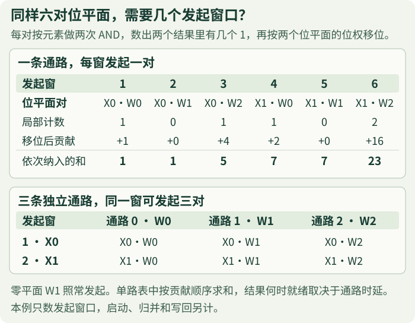

# 六组位平面要算几拍，换成负数又怎样累加？

沿用两项点积 2 × 4 + 3 × 5。输入占两位，权重占三位。上一页把同一位上的两个元素排在一起，由阵列读出路径执行按位 AND，再数结果中有几个 1。一共得到六个计数，其中有两个是 0。若控制器每拍发起一组，这个点积何时算完？若把权重的最高位解释为符号位，同样六个计数还够用吗？[上一页的 AND 与计数过程](./digital-cim-fundamentals.md#and-and-count)

## 先用一条通路，逐拍发起六组 {#schedule-six-pairs}

先把两个输入和两个权重都看成**无符号数**。输入 2、3 写成 `10`、`11`。抽出每个元素的最低位，得到输入位平面 X₀ = (0, 1)，再抽出高位，得到 X₁ = (1, 1)。权重 4、5 写成 `100`、`101`，得到 W₀ = (0, 1)、W₁ = (0, 0)、W₂ = (1, 1)。括号中第一位始终对应 2 × 4，第二位始终对应 3 × 5。

一次发起只配一对 Xᵢ、Wⱼ，两项会同时做 AND。计数 Cᵢⱼ 说明有多少项在这两个位上都为 1；每项的贡献是 2ⁱ × 2ʲ。因此这一次应向累加器加 **Cᵢⱼ × 2ⁱ⁺ʲ**。先假设没有零平面跳过，即使预期结果是 0，仍按固定顺序发起。下表最后一列按结果依次到达的顺序记账。

| 发起次序 | 平面对 | AND 结果 | 计数 | 带位权贡献 | 累计 |
| ---: | --- | --- | ---: | ---: | ---: |
| 1 | X₀、W₀ | (0, 1) | 1 | 1 × 1 = 1 | 1 |
| 2 | X₀、W₁ | (0, 0) | 0 | 0 × 2 = 0 | 1 |
| 3 | X₀、W₂ | (0, 1) | 1 | 1 × 4 = 4 | 5 |
| 4 | X₁、W₀ | (0, 1) | 1 | 1 × 2 = 2 | 7 |
| 5 | X₁、W₁ | (0, 0) | 0 | 0 × 4 = 0 | 7 |
| 6 | X₁、W₂ | (1, 1) | 2 | 2 × 8 = 16 | **23** |

最后一组最容易少算一次。计数器给 2，是**有两个位置命中**；每次命中的两位又都有自己的位权，所以这一组贡献 16。计数 2 要占两位，整个无符号累加器还得更宽。即使仍然只有两项，若输入、权重都取其位宽允许的最大值，和可达 2 × 3 × 7 = 42，需要至少 6 位无符号累加空间。

## 给三个权重平面各加一条通路，会少等多少？ {#bit-parallel}

先让 X₀ 进来，一次广播给三处。三处各放一个不同的权重平面，各自做 AND、计数，当次得到 (1, 0, 1)，按权重位 1、2、4 合成 5。再广播 X₁，得到 (1, 0, 2)，合成 9。数字端记得这是输入高位，最后取得 **5 + 2 × 9 = 23**。六个平面对一个也没少，发起时刻却从六个缩成两个。这里的硬件前提是三组权重可以同时取用或驻留，输入能广播到三处，每处有独立的按位运算和计数资源，后端也能接收并合并同时到达的三个结果。

<figure class="micro-diagram" tabindex="0" aria-label="相同六组输入和权重位平面对，一条通路用六个发起时刻，三条通路用两个发起时刻" markdown="1">

<figcaption>两种教学排程。编号只记录何时接收一组新工作。最后一组发起后，局部归约、最终累加和输出缓冲还可能需要时间。</figcaption>
</figure>

给延迟补上一个具体口径。令上升沿 t = 0 接收第一组，两种假设实现都能每拍接收下一批。再假定从一批被接收到它的带权贡献计入累加寄存器，**恰好相隔两拍**。三路版的这两拍已经包含三路合并；寄存器能每拍接收一批贡献，输出端畅通。单路在 t = 0、1、2、3、4、5 发起，第一笔在 t = 2 计入，最后一笔到 t = 7 才计入。三路在 t = 0、1 发起，对应贡献在 t = 2、3 计入。第一个点积的延迟分别是 **7 拍和 3 拍**。如果操作数始终就绪，后一个点积可以紧接着发起，各输出具有正确且相互独立的累加状态，流水线填满后，就分别可以每 **6 拍或 2 拍**产出一个点积。三路合并若让时钟变慢，这些拍数还须乘上各自的时钟周期才能比较用时。

如果三个计数最终都要抢一个每拍只收一项的端口，第一轮就有两项得等。缓冲可以短暂接住它们，持续工作时总归要把每个点积的六项送过这个端口，不能长期每两拍产出一份。另一个选择是让 W 驻留，多次复用 X 的位平面，或预先标记全零的 W₁，允许控制器在两次输入读中都略过它。这样单路的有效发起才会减至四次；检测、保存和传递零标志的代价也要计入。低比特量化同样可以减少平面数，能否接受则取决于模型精度。

## 还是那六个计数，怎样从 23 变成 −17？ {#signed-bit-weights}

保持输入为**无符号** (2, 3)，保持两组权重的存储位仍为 `100`、`101`，只告诉控制器“权重按三位二补码解释”。最高位 W₂ 的位权就从 +4 变为 **−4**，两个权重分别是 −4、−3。回到表中，按输入低、高位拆开算：

| 输入位 | W₀、W₁、W₂ 的计数 | 按 +1、+2、−4 合成 | 再计入输入位权 |
| --- | --- | ---: | ---: |
| X₀ | (1, 0, 1) | 1 + 0 − 4 = −3 | −3 × 1 = −3 |
| X₁ | (1, 0, 2) | 1 + 0 − 8 = −7 | −7 × 2 = −14 |

所以 −3 + (−14) = **−17**，与 2 × (−4) + 3 × (−3) 相同。两个 AND 位都为 1 时，计数器照常给正整数 2；接下来的位权逻辑决定这两份贡献应当加还是减。进入较宽的数字累加器时，必须正确扩展有符号部分和，不能把 −7 的位型当成无符号数补零。

把两边都扩到 **INT8 × INT8**，每个操作数的位权是 (1, 2, 4, 8, 16, 32, 64, −128)。若一次只处理一对平面、不并行、不跳过，每个点积要发起 8 × 8 = **64 对**，供数和最后归约另算。只有一边取第 7 位时，两边位权的乘积为负；两边都取第 7 位时，(−128) × (−128) = +16,384，该项要加回。若向量有两项且两边的每个数都为 −128，完整点积已达 +32,768，会超出 16 位有符号数的上限。支持 INT8 输入不等于用 16 位就能累加任意长度。BISMO 原论文的算法 1 分别给两个位平面定符号，图 4 把计数、移位、按需取负和累加画在一起；它实现于 FPGA，这里借它核对位权算法。[BISMO 算法 1 与图 4](https://www.sjalander.com/research/pdf/sjalander-fpl2018.pdf)

## 换成 XNOR，数到的 1 还表示相同的事吗？ {#popcount-路径}

上例对 0、1 做 AND，计的是**两边同时为 1**的项。若每个数只能是 +1、−1，可以约定用位 1、0 表示这两个符号。此时相同符号的乘积为 +1，异号为 −1。让对应位置做 XNOR，它等价于问“两个符号一样吗”。长度 K 中有 m 个匹配，就有 K − m 个不匹配，点积为 **m − (K − m) = 2m − K**。[XNOR-Net 原论文的二值点积与缩放](https://pjreddie.com/static/papers/xnor.pdf)

取 A = (+1, +1, −1, −1)，B = (+1, −1, −1, −1)。四个位置的 XNOR 是 (1, 0, 1, 1)，m = 3、K = 4，得 2。现在只把 B 的第二项改为真正的数值 **0**，让模型支持三值。该项的乘积原为 −1，现在应为 0。如果仍将该位置的占位位型拿去比符号，零可能被算成相同或不同，都会让结果依赖无意义的占位位型。先用两侧的非零掩码相与，本例有效掩码为 (1, 0, 1, 1)。有效项有 3 个，其中 3 个符号匹配，新的点积是 **2 × 3 − 3 = 3**。全零掩码给有效长度 0、匹配数 0，结果也应为 0。

双极性 XNOR 可以合并逻辑和符号比较，特别适合低比特模型。INT8 需要重建多组位权，FP8、FP16 还要处理符号、指数和有效数，不能拿一次二值 XNOR 的吞吐替这些格式报数。判断这种实现是否属于 CIM，要追到 XNOR 在哪儿发生：若在单元、位线或感测路径形成匹配位，计数器放外围仍然说得通。若 SRAM 只把两个普通字读给独立运算单元，所有 XNOR、计数和加法都由它执行，阵列承担的是普通存储功能。

## 在一块真实宏里，究竟是哪一级限制发起？ {#典型-macro-数据路径}

从输入寄存器跟一组 Xᵢ。字线驱动器选择阵列读路径，驱动负载、感测裕量和读扰动限制了能同时接入的行。位线、感放或局部逻辑先形成离散按位结果，局部计数器沿向量的各个位置数出其中有几个 1，后面的加法器按位权汇总并保存在累加器中。这个寄存器的位宽、每拍能接收的结果数、是否支持同一输出的连续更新，都会改变上面的排程。最后还要经输出缓冲交给 tile 或下一算子；若输出端持续反压，输入侧迟早也要停。按这几个位置逐段标出输入、输出、时序与端口数，比只在框图上数几列 SRAM 更可靠。[从计数到累加器](../04-circuit-and-macro/cim-macro-primitives.md#count-to-accumulator) · [SRAM 的求值与读出路径](../02-memory-technologies/sram-cim-deep-dive.md)

一个能查到实测的例子是 **Colonnade**。Kim 等将一列数字位单元组织成列 MAC，让多个列 MAC 共同完成点积。在 65 nm 测试芯片上，他们对 128 × 128 个 SRAM 型位单元的宏测试了 1 到 16 位输入与权重精度。这说明位串行可以在同一块数字宏上支持多种精度。要据此预测一项工作何时完成，还得用该宏实际的列内数据流、发起间隔和输出组织重画时序，上文两拍后的写回是教学假设。[Colonnade 原始芯片论文](https://doi.org/10.1109/JSSC.2021.3061508) · [作者机构的实测摘要](https://pure.kaist.ac.kr/en/publications/colonnade-a-reconfigurable-sram-based-digital-bit-serial-compute-/)

换介质要重新追这条路径。SRAM 容易把读出、感放和 CMOS 数字逻辑合在一块宏内。MRAM 也可以在多行读或感测时做比较和局部归约；权重仅存在 MRAM、另用普通 MAC 的系统没有这项阵列操作。ReRAM、Flash 可以分数字位读，但这会放弃一部分多级状态与列上模拟求和的好处，并增加读出、判决、编码，还需面对写后验证、耐久和保持变化。PCM 数字使用也要为热编程和电阻漂移保留读写裕量。DRAM/HBM/GDDR 中靠近 bank 的独立数字处理单元则属于 PIM，其主要问题是高带宽数据和命令调度。各路线的命名要回到**谁实际完成了这一组 AND 或 XNOR**。[数字 CIM 的阵列读出边界](./digital-cim-fundamentals.md) · [计算宏的电路原语](../04-circuit-and-macro/cim-macro-primitives.md)

## 两拍的方案放进系统，还值得多铺两条通路吗？ {#与-analog-的真正差异}

若目标是每个 tile 每拍都拿到一个完整 INT8 点积，先指定向量长度、工作频率、允许的数值误差和输出位宽。再把权重装载、输入位平面整理、广播、计数、累加、路由和输出缓冲计入，用同一批实际模型的利用率同 **SRAM 缓冲加 MAC、小型脉动阵列或 NPU 本地存储与已有乘加单元**比较。位并行增加列、读路径、布线和加法器，可能压低存储密度、拉长关键路径。位串行用较少通路换更多工作周期，额外的驱动、感测与中间寄存也会耗能。报告低位宽峰值 TOPS/W 时，还要说明它把一次二值操作还是一个完整多位乘加计作一个操作。

对于按位判决及移位累加，只要位判对、时序满足且累加器没有溢出，就可以逐位核对整数结果。模拟阵列要另外核对噪声、器件变化和 ADC 门槛。数字通路仍要在最差工艺、电源和温度条件下验证感测、时序与测试覆盖，这对工业、车载和可量产 SoC 尤其重要。能否省能、能否在同样误差要求下维持吞吐，要用整条路径的数据回答。

回到六个计数。发起六次还是两次，取决于硬件能同时接收几对；最终是 23 还是 −17，取决于最高位有多大权重。接下来若有一段把多路贡献先合成电流或电荷，再送往数字累加器，哪些时序和精度还可以逐位核对？[模拟部分和怎样交给数字端](./mixed-signal-cim.md) · [返回阵列求值与信号转换](./README.md)
